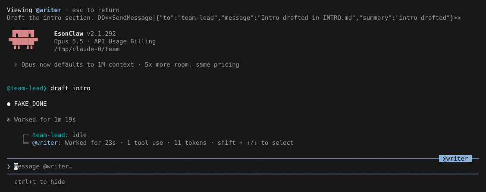

# Agent Teams

> 英文名：`agent-teams` · 领域：Agent 与编排 · [返回功能索引](README.md)

## 这是什么

普通的子 Agent 是「派出去干一件事、做完交回结果」。Agent Teams 更像一个小组：你所在的会话是**负责人（team-lead）**，它可以拉起几个有名字的**队友（teammate）**。队友各自是一个完整的 Claude 会话，会一直在线；大家可以：

- 互相发消息（`SendMessage`），队友做完一件事会主动告诉负责人；
- 共用一份任务清单，谁负责哪项、做到哪一步都记在上面；
- 你可以随时切过去看某个队友在干什么，直接给它发话。

和官方 2.1.303 一样，这个功能默认关闭。

## 什么时候用

- 任务能拆成几块相对独立、但又需要互相通气的部分（例如一个写实现、一个写测试、一个写文档）。
- 希望几个 Agent 长时间并行，而不是一次性跑完就结束。

只是想并行跑几个一次性的子任务，用普通的 [Agent 与后台任务](agents.md) 就够了。

## 开启

| 方式 | 写法 |
| --- | --- |
| 环境变量 | `CLAUDE_CODE_EXPERIMENTAL_AGENT_TEAMS=1 claude` |
| 命令行 | `claude --agent-teams` |

没开启时，模型调用团队工具会直接得到 `Error: No such tool available: TeamCreate`。

队友的运行方式由 `teammateMode` 决定（`/config` 里改，保存在 `~/.claude.json`）：

| 值 | 效果 |
| --- | --- |
| `auto`（默认） | 在 tmux 或 iTerm2 里运行时，每个队友开一个分屏；否则在当前进程里运行 |
| `in-process` | 总是在当前进程里运行，用下文的方式在界面里切换查看 |
| `tmux` | 总是用分屏（需要 tmux / iTerm2） |

`-p` 非交互模式下总是 `in-process`。

## 用起来是什么样

你不需要自己调用工具，直接告诉 Claude 要组团队、分工是什么。下面用测试用的假 API 演示负责人做了两件事：建团队 `docs`，再拉起一个叫 `writer` 的队友去写引言。

**1. 拉起队友后，提示框下方出现 agent 面板。** `main` 是你自己（负责人），下面每行是一个队友（和后台 Agent 一起按启动时间排序）：工作中的显示耗时和 token，空闲的显示 `idle`，等待审批的显示 `awaiting approval`，有排队消息时追加 `N queued`。面板最多显示 5 行，超出的部分用 `↑ N more` / `↓ N more` 表示：

```text
  ⏵⏵ bypass permissions on (shift+tab to cycle) · ↓ to manage
    ● main   ↑ 3 more
    ◯ mate4  mate 4                                                     idle
    ◯ mate5  mate 5                                        41s · ↓ 11 tokens
    ◯ mate6  mate 6                                                     idle
    ◯ mate7  mate 7                                        41s · ↓ 11 tokens
  ❯ ◯ 1 idle agent

  Enter to expand · Esc to cancel
```

空闲的队友超过 3 个时，多出来的会折叠成 `N idle agents` 一行；选中它按 Enter 展开，展开后按 `Esc` 再折叠。和官方 2.1.311 一致。

**2. 队友做完后会发消息回来。** 消息以 `@writer❯` 开头显示在负责人的对话里，负责人会接着处理。

**3. 切过去看队友。** 按 `↓` 进入面板，用 `↑/↓` 选中队友，按 Enter。顶部显示 `Viewing @writer`，下面是它收到的任务和它的对话；这时输入框变成 `Message @writer…`，打字发送就是直接对它说话：



**4. 回到负责人。** 在面板里选中 `main` 再按 Enter。查看一个正在工作的队友时按 `Esc` 只打断它这一轮；查看空闲或已结束的队友时按 `Esc` 返回负责人。

## 操作速查

| 按键 | 作用 |
| --- | --- |
| `↓`（输入框为空时） | 进入 agent 面板 |
| `↑/↓`（面板中） | 选择上一个 / 下一个 |
| `Enter`（面板中） | 切到该队友的视图；选 `main` 回到自己；选 `N idle agents` 展开 |
| `x`（面板中） | 停止选中的队友；已结束的则清除 |
| `Esc`（面板中） | 折叠已展开的空闲队友，否则退出面板 |
| `Ctrl+T` | 显示 / 隐藏任务清单 |
| `Ctrl+C`（查看队友时） | 停止所有正在运行的 Agent 并回到负责人 |

## 共享任务清单

负责人可以把工作拆成任务（`TaskCreate`），再把某项分给某个队友（`TaskUpdate` 设置 `owner`）。队友会被通知，也能自己认领和更新状态。任务存成文件，所有成员看到的是同一份：

```text
~/.claude/tasks/docs/1.json
{
  "id": "1",
  "subject": "Write intro",
  "description": "Intro section",
  "status": "in_progress",
  "blocks": [],
  "blockedBy": [],
  "owner": "writer"
}
```

## 团队的数据放在哪里

| 位置 | 内容 |
| --- | --- |
| `~/.claude/teams/<团队名>/config.json` | 成员名单：名字、类型、模型、颜色、运行方式（`backendType`）、权限模式 |
| `~/.claude/teams/<团队名>/inboxes/<成员>.json` | 每个成员的收件箱，消息带 `from`、`summary`、`read` |
| `~/.claude/tasks/<团队名>/` | 共享任务清单 |

收件箱里的一条消息长这样（`idle_notification` 是队友告诉负责人「我空下来了」）：

```text
[
  {
    "from": "writer",
    "text": "Intro drafted in INTRO.md",
    "summary": "intro drafted",
    "timestamp": "2026-10-24T16:22:21.857Z",
    "color": "blue",
    "read": true
  },
  {
    "from": "writer",
    "text": "{\"type\":\"idle_notification\",\"from\":\"writer\",\"idleReason\":\"available\"}",
    "read": true
  }
]
```

## 其他行为

- **权限模式跟随负责人**：负责人处于 bypass、acceptEdits 或 auto 模式时，进程内队友也用同样的模式；否则队友的权限请求会转给负责人确认。
- **解散**：队友被要求 shutdown 并确认后，会从 `config.json` 的成员名单里移除。

## 任务清单

负责人按 `Ctrl+T` 在「任务清单」和「成员列表」之间切换。任务存在 `~/.claude/tasks/<团队名>/`，负责人空闲、只有队友在跑时也会显示在 `Idle` 下面。

## 说明

画面来自实际运行，模型回复由测试用假 API 生成（`FAKE_DONE`，提示词里的 `DO<<…>>` 是让假 API 调用工具的指令）。tmux 分屏模式没有实拍。
