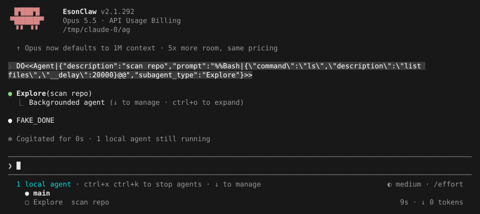
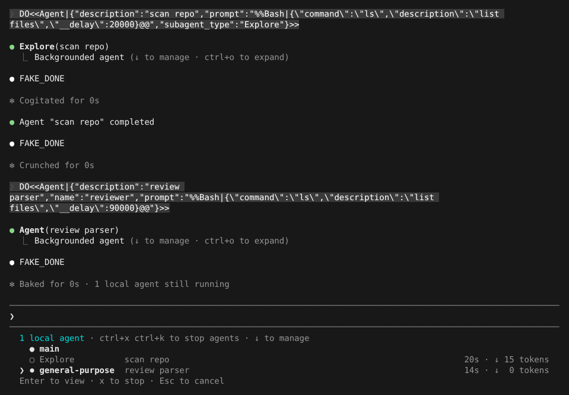
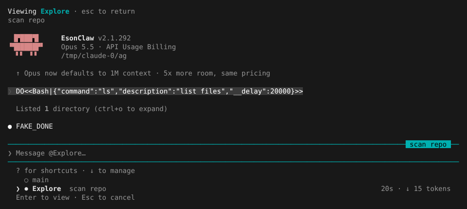
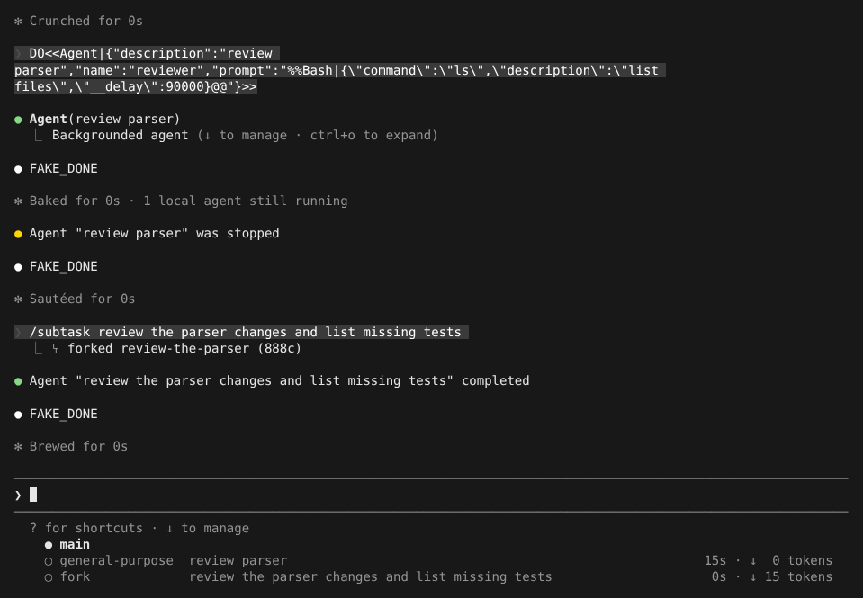
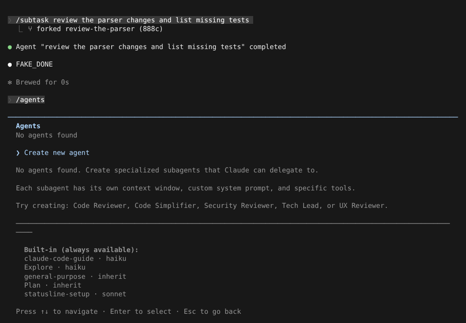
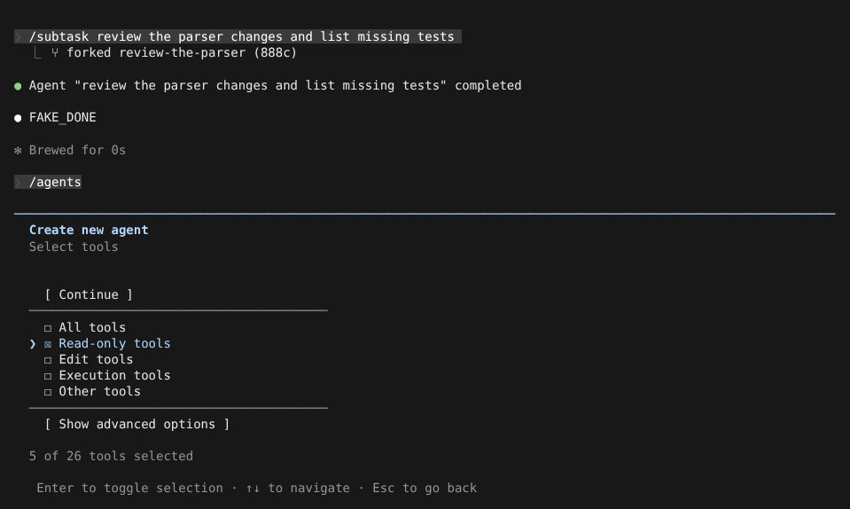
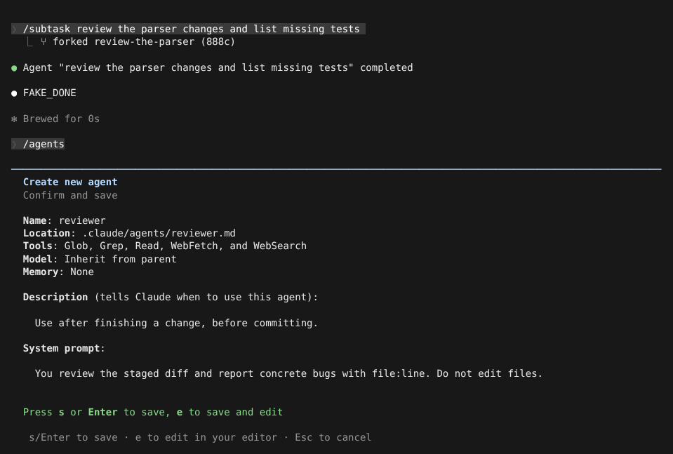

# Agent 与后台任务

> 英文名：`agents` · 领域：Agent 与编排 · [返回功能索引](README.md)

## 这是什么

子代理（subagent）是 Claude 临时叫来的帮手：它有自己独立的上下文，专门做一件事（搜代码、做方案、审 diff），做完把结果交回给主对话。好处是：

- **不占主对话的上下文**：翻了几十个文件的过程留在子代理里，主对话只收到结论；
- **可以并行**：几个子代理同时在后台跑，你在主对话继续说话；
- **可以专用**：给子代理限定只读工具、指定模型、写专门的系统提示。

交互会话里子代理默认在**后台**运行。内置的有 `Explore`（快速搜代码，只读）、`Plan`（只分析不改代码，出实施方案）、`general-purpose`（通用）等。

## 快速上手：看一个后台子代理怎么跑

**1. Claude 启动子代理。** 你让 Claude 去「扫一下仓库」之类的活，它会调用 Agent 工具。主对话立刻显示 `Backgrounded agent`，底部多出一个任务列表，显示每个子代理的类型、描述、已运行时间和 token：



**2. 按 `↓` 进入任务列表。** 用 `↑` `↓` 选中某个子代理：运行中的可以按 `x` 停止，已结束的按 `x` 从列表清掉；按 `Enter` 查看：



**3. 查看子代理在做什么。** 进入后看到的是这个子代理自己的对话记录；底部输入框变成 `Message @Explore…`，可以直接给它发消息。按 `Esc` 返回主对话：



**4. 子代理结束后**，主对话出现 `Agent "scan repo" completed`，Claude 会读它的报告继续工作。被你停止的显示 `was stopped`。

## 自己把当前对话分一份出去：`/subtask`

想让一个副本带着**当前全部对话**去做支线任务，而你继续在主线聊，用：

```text
/subtask review the parser changes and list missing tests
```

它继承主对话的模型、工具和历史，在后台运行，回执显示名字和 ID 后四位：



## 定义自己的子代理：`/agents`

**1.** 输入 `/agents`。下方列出内置子代理和它们用的模型；选 `Create new agent`：



**2.** 依次选择：保存位置（项目 `.claude/agents/` 或个人 `~/.claude/agents/`）→ 创建方式（让 Claude 生成，或 `Manual configuration` 手写）→ 名字 → 系统提示 → 什么时候用（description，Claude 靠这句话决定何时调用它）。

**3.** 选工具。下图只保留只读工具，这个子代理就不能改文件：



**4.** 再选模型、颜色、记忆范围，最后确认保存：



保存的文件就是一个普通 Markdown，可以直接手写或提交进仓库：

```markdown
---
name: reviewer
description: "Use after finishing a change, before committing."
tools: Glob, Grep, Read, WebFetch, WebSearch
model: inherit
---

You review the staged diff and report concrete bugs with file:line. Do not edit files.
```

本 fork 额外支持两个 frontmatter 字段：

| 字段 | 作用 |
| --- | --- |
| `omitClaudeMd: true` | 作为子代理运行时不加载 CLAUDE.md，省 token |
| `autoCompactWindow: 150000` | 子代理的自动压缩窗口上限（100000–1000000），只能调小；`CLAUDE_CODE_AUTO_COMPACT_WINDOW` 优先 |

## 操作按键

| 按键 | 位置 | 作用 |
| --- | --- | --- |
| `↓` | 主输入框为空时 | 进入底部任务列表 |
| `↑` `↓` / `Enter` | 任务列表 | 选择 / 查看子代理 |
| `x` | 任务列表 | 停止运行中的子代理；清除已结束的 |
| `Esc` | 子代理视图 | 返回主对话 |
| `ctrl+x ctrl+k`（按两次确认） | 任意 | 停止所有后台子代理 |
| `ctrl+o` | 主对话 | 展开子代理的详细过程 |

## 权限怎么算

- 子代理跟随主会话**当前**的权限模式，你切模式它也跟着切；Agent 调用里显式写的 `mode` 是上限。
- 自定义子代理里写的 `permissionMode` 不能比主会话更宽，也永远不会给出 `bypassPermissions`。
- 后台子代理需要你确认时，弹窗出现在主会话里，并注明来源，例如 `from the general-purpose agent`。
- 自动模式下，子代理用 `SubagentHandback` 工具交回报告，报告也要过分类器；被拦时报告仍会送达，但带 `SECURITY WARNING`。设 `CLAUDE_CODE_SENDMESSAGE_HANDBACK=0` 关闭。

## 续跑、停止与并发

- **续跑**：子代理结束后，Claude 可以用 `SendMessage` 给它发新消息，它带着原来的记录继续干，ID 不变。名字被新的子代理占用后，用旧名字发消息会被拒绝，需要用回执里的 `name [ref]` 或原 ID。
- **你停止的不会被自动续跑**：用 `x`、`ctrl+x ctrl+k` 或 SDK `stop_task` 停的子代理，会记下「用户停止」，Claude 再发 `SendMessage` 会被拒绝（重启后也一样），只能开新的。Claude 自己用 `TaskStop` 停的不受此限。
- **等子任务**：后台子代理自己又开了后台子任务时，它会先让出名额进入 `waiting`，子任务完成后自动以原 ID 续跑。
- **并发上限**：同时运行的子代理默认最多 20 个，`CLAUDE_CODE_MAX_CONCURRENT_SUBAGENTS` 可调；超出时启动会被拒绝。

## fork 模式是什么

交互会话默认开启 fork 模式，影响两件事：

1. 子代理一律后台运行（模型看不到 `run_in_background` 参数）；
2. 模型可以用 `subagent_type: "fork"` 启动一个**继承整个当前对话**的子代理（和 `/subtask` 一样），不写类型时仍是独立上下文的 `general-purpose`。fork 子代理固定用主对话的模型，以复用缓存。

想让 Claude 能前台等子代理结果，用 `CLAUDE_CODE_FORK_SUBAGENT=0 claude` 关闭；非交互模式可用 `=1` 打开。`/subtask` 不受这个开关影响。

## 设置

| 配置项 | 写法 | 说明 |
| --- | --- | --- |
| `CLAUDE_CODE_DISABLE_EXPLORE_PLAN_AGENTS` | `1` | 去掉内置 `Explore` 和 `Plan` |
| `CLAUDE_CODE_FORK_SUBAGENT` | `0` / `1` | 关闭 / 开启 fork 模式 |
| `CLAUDE_CODE_DISABLE_BACKGROUND_TASKS` | `1` | 禁用所有后台任务，子代理一律前台；此时 `SendMessage` 续跑会等结果再返回 |
| `CLAUDE_CODE_MAX_CONCURRENT_SUBAGENTS` | 正整数，默认 `20` | 同时运行上限 |
| `CLAUDE_CODE_SENDMESSAGE_HANDBACK` | `0` | 关闭自动模式下的 `SubagentHandback` |
| `CLAUDE_CODE_HANDBACK_PROVENANCE` | `0` | 续跑报告改用原始 JSON 格式 |
| `worktree.baseRef`（settings） | `fresh`（默认）/ `head` | `isolation: "worktree"`、`--worktree`、`EnterWorktree` 新分支的起点：`fresh` 基于 `origin/<默认分支>`，`head` 基于本地 HEAD（保留未推送提交） |

模型调用 Agent 工具时可用的参数：

```json
{
  "description": "检查配置映射",
  "prompt": "核对 provider effort 的当前行为并报告证据。",
  "subagent_type": "general-purpose",
  "model": "sonnet",
  "effort": "high",
  "name": "effort-review",
  "isolation": "worktree"
}
```

`EnterWorktree` 也可以传 `path` 进入已有的 worktree；不在 `.claude/worktrees/` 下的路径会先问你，退出时只能保留不能删除。

## 插件里的 fork 技能

技能（skill）写 `context: fork` 就会在子代理里运行，交互模式默认后台；`background: false` 改为同步，`agent:` 指定用哪个子代理：

```yaml
---
description: Review the supplied changes
context: fork
agent: my-plugin:reviewer
allowed-tools: Read, Grep, Glob
disallowed-tools: Bash, Write, Edit
background: false
---
Review $ARGUMENTS and report concrete findings.
```

启动时会把技能身份和权限记录存到子代理的 transcript 目录，续跑时按当前技能重新计算权限；记录缺失或技能已不支持 fork 时拒绝续跑。

## 开发者参考

- 调试日志标签：`[AgentConcurrency]`、`[AgentLifecycle]`、`[ForkMode]`、`[ConversationFork]`、`[AgentResume]`、`[AgentCancellation]`、`[SendMessage]`（用 `--debug --debug-file <path>` 打开）。
- Mods 脚本：`$.agent.spawn()` 在全局额度不足时返回 `{ deny }`；`$.agent.list()` 显示 `running` / `waiting` / `idle`；`$.tool.call({tool: 'SendMessage', …})` 走同一续跑路径。
- 相关测试：`src/tools/AgentTool/` 下的 `backgroundRouting`、`forkMode`、`backgroundOwner`、`AgentTool.receipt292` 测试，以及 `src/utils/forkedSkill.test.ts`。
- 专项验收记录：[并发](../research/mods-agent-concurrency-20261007.md)、[fork 技能名额](../research/mods-fork-capacity-20261007.md)、[插件 fork](../research/mods-plugin-fork-20261007.md)、[父子任务](../research/mods-background-owner-20261007.md)、[fork 技能后台](../research/mods-fork-background-20261007.md)、[默认后台](../research/mods-agent-background-default-20261007.md)、[fork 模式](../research/mods-fork-mode-20261007.md)、[/subtask](../research/mods-subtask-20261007.md)、[同步续跑](../research/mods-inline-resume-20261007.md)、[用户停止](../research/mods-user-cancellation-20261007.md)、[SendMessage 绑定](../research/mods-sendmessage-pin-20261007.md)。
- 尚未实现：内置 `/fork`（复制整个后台会话）和 fork 指令折叠 UI。

## 说明

画面来自实际运行，模型回复由测试用假 API 生成（`FAKE_DONE`；提示词里的 `DO<<…>>` 是让假 API 调用工具的指令，`__delay` 用来让子代理跑久一点）。
