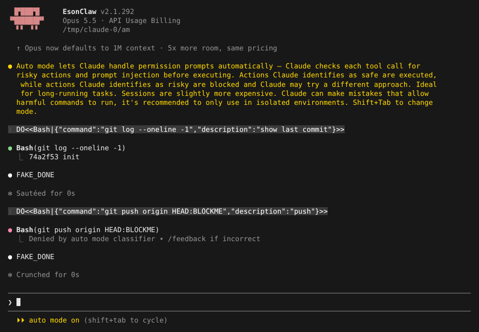
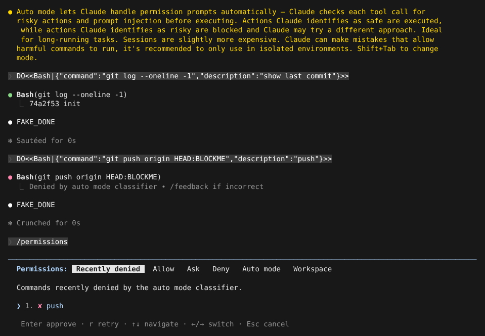
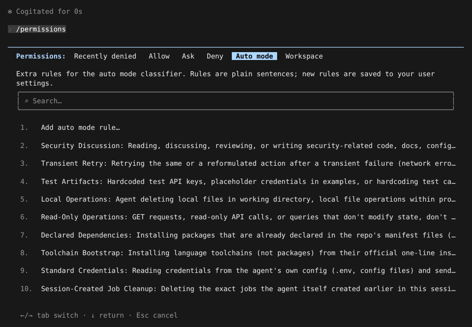
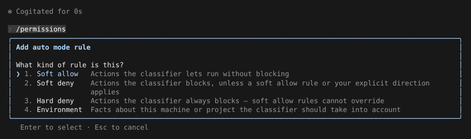
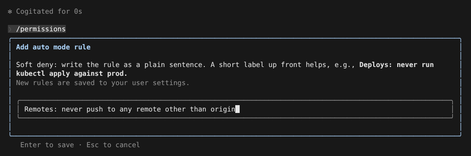

# 自动模式（Auto mode）

> 英文名：`auto-mode` · 领域：权限与安全 · [返回功能索引](README.md)

## 这是什么

平时 Claude 每次要跑命令、改文件，都会停下来问你。自动模式把「问你」这一步交给一个**分类器**（另一次模型调用）：

- 它认为安全的操作（读文件、跑测试、`git log`）直接执行；
- 它认为有风险的操作（推送代码、删远程资源、外传数据）被拒绝，Claude 会收到「被拒」的结果并尝试换个做法；
- 你随时可以在 `/permissions` 里查看被拒的记录，手动放行。

适合长时间跑、你不想一直盯着的任务。代价是每次工具调用多一次分类器请求（略贵、略慢），而且分类器也会判断失误，官方建议只在隔离环境里使用。

行为对齐官方 2.1.303。

## 快速上手

**1. 切换到自动模式。** 在输入框按 `Shift+Tab` 循环切换模式，直到底部显示 `⏵⏵ auto mode on`。也可以启动时直接指定：`claude --permission-mode auto`。

**2. 正常下指令。** 下图中，`git log` 被分类器判为只读，直接执行；`git push` 被判为有风险，被拒绝，底部提示 `bash denied by auto mode · /permissions`：



**3. 觉得拦错了，手动放行。** 输入 `/permissions`，第一个分页「Recently denied」列出最近被拒的操作。选中后按 `Enter` 放行，或按 `r` 放行并让 Claude 重试；按 `Esc` 关闭时生效：



按 `r` 后关闭，Claude 会收到一句「Permission granted for: push. You may now retry this command if you would like.」，由它决定是否重跑。

## 加自己的规则

分类器的判断依据是一组用自然语言写的规则。内置规则已经覆盖常见情况，你可以用一句话补充自己的。

**1.** `/permissions` 里按 `→` 切到「Auto mode」分页，能看到当前规则；第 1 项是「Add auto mode rule…」：



**2.** 选「Add auto mode rule…」，先选规则类型：



| 类型 | 含义 |
| --- | --- |
| Soft allow | 符合描述的操作放行 |
| Soft deny | 符合描述的操作拦下，除非有 soft allow 规则或你明确要求 |
| Hard deny | 一律拦下，soft allow 也不能覆盖 |
| Environment | 告诉分类器这台机器 / 这个项目的背景，例如「origin 是公司内网仓库」 |

**3.** 用一句话写规则，开头加个简短标签更容易管理，按 `Enter` 保存：



规则写进**用户设置** `~/.claude/settings.json`，`"$defaults"` 会自动加在最前面，表示保留内置规则：

```json
{
  "autoMode": {
    "soft_deny": [
      "$defaults",
      "Remotes: never push to any remote other than origin"
    ]
  }
}
```

如果去掉 `"$defaults"`，这一类内置规则就全部不用了，只剩你写的。

## 命令速查

| 命令 | 作用 |
| --- | --- |
| `Shift+Tab` | 循环切换权限模式（default → accept edits → auto → …） |
| `claude --permission-mode auto` | 以自动模式启动 |
| `/permissions` → Recently denied | 查看被拒操作；`Enter` 放行，`r` 放行并通知重试 |
| `/permissions` → Auto mode | 查看、新增、删除你的规则 |
| `/auto-mode-setup` | 内置 skill：和 Claude 对话生成规则，确认后写入用户设置 |
| `claude auto-mode config` | 打印实际生效的规则（JSON；你设置了的类别显示你的写法，其他显示内置值） |
| `claude auto-mode defaults` | 打印全部内置规则 |
| `claude auto-mode critique` | 让模型点评你写的规则 |
| `claude auto-mode reset` | 删除用户设置里的 `autoMode`，恢复内置规则 |

## 设置

| 配置项 | 写法 | 说明 |
| --- | --- | --- |
| `autoMode.allow` / `soft_deny` / `hard_deny` / `environment` | 字符串数组，首项 `"$defaults"` 保留内置规则 | 只从用户设置、`--settings`、托管设置读取；写在项目 `.claude/settings.json` 或本地设置里会被忽略并警告，防止仓库自己给自己放行 |
| `autoMode.classifyAllShell` | `true` / `false` | 所有 shell 命令都交给分类器，不再被本地 allow 规则直接放行 |
| `disableAutoMode` | `"disable"` | 禁用自动模式；会话中途加上会立刻退出，删掉后不用重启就能再进入 |
| `CLAUDE_CODE_AUTO_MODE_MODEL` | 模型名 | 指定分类器用的模型；分类器不支持的值会被忽略 |

## 进入自动模式时会发生什么

- **危险的 allow 规则暂时失效。** 像 `Bash(python3:*)`、`Bash(sudo:*)` 这种等于「任何代码都能跑」的放行规则，以及 `Terminal`、`Monitor` 的放行规则，会绕过分类器，所以进入自动模式时先搁置，离开时还原。
- **本地规则优先。** deny / ask 规则和受保护路径照常生效，剩下的才交给分类器。
- **分类器出错会重试。** 每个模型最多重试 4 次；分类器在 Sonnet 5 或 Opus 4.8 上用官方的两阶段 `<severity>` 格式，其他模型用 `<block>` 格式。
- **子代理** 在自动模式下用 `SubagentHandback` 交回结果，见 [agents.md](agents.md)。

## 已知差异

- `/permissions` 的 Auto mode 分页不能停用某条内置规则，也不能编辑 environment；要改只能直接编辑 settings.json。
- `/auto-mode-setup` 没有官方的非交互参数和自动侦察（recon）流程。

## 说明

画面来自实际运行，模型回复和分类器结果由测试用假 API 生成（`FAKE_DONE`；假分类器拦下含 `BLOCKME` 的请求）。提示词里的 `DO<<…>>` 是让假 API 调用工具的指令。
