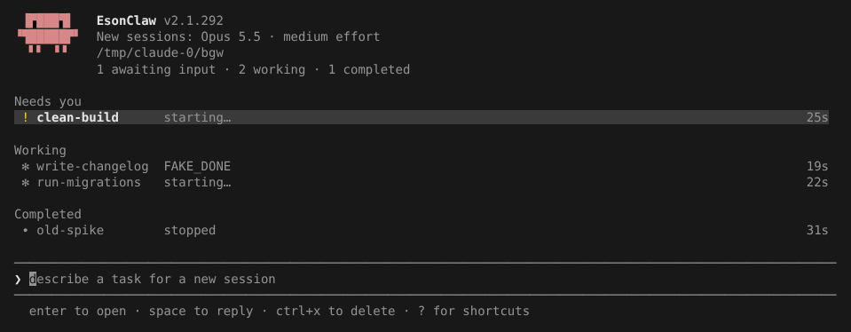
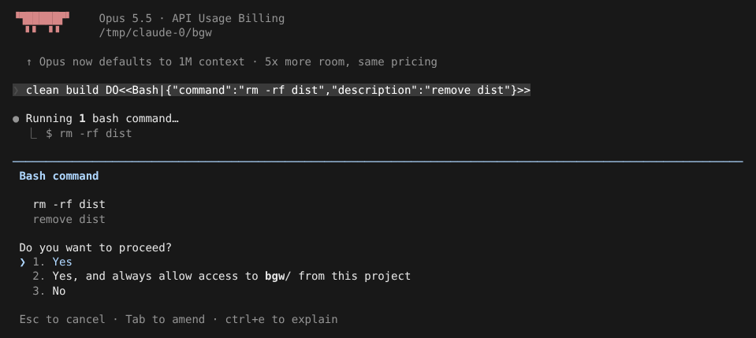
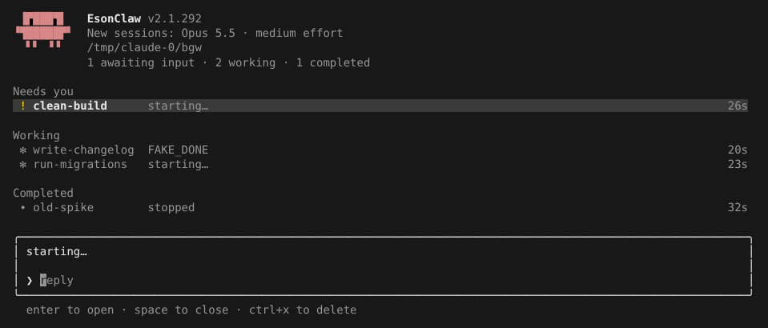
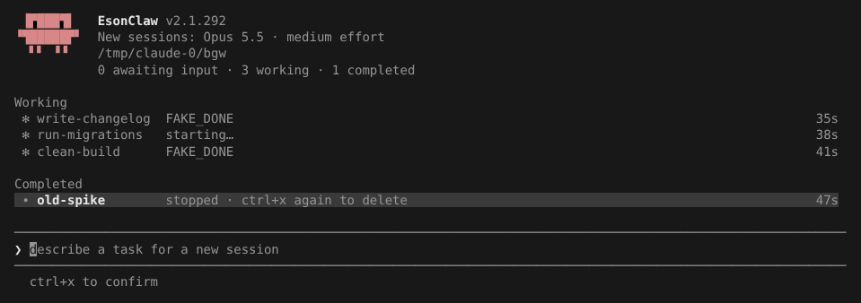

# 背景会话、daemon 与 agents 视图

> 英文名：`background-sessions` · 领域：Agent 与编排 · [返回功能索引](README.md)

## 这是什么

平时和 Claude 对话，终端会被这个会话占住，要等它做完才能干别的。背景会话让你把一个任务「交出去」：Claude 在后台继续工作，你的终端马上就能用。之后随时可以：

- 用 `claude agents` 一屏看所有后台任务：哪些在等你确认、哪些还在跑、哪些已经结束；
- 打开（attach）其中一个，像正常会话一样接着聊，按 `Ctrl+Z` 再把它放回后台；
- 不打开也能看它最近的输出（`claude logs`），或者直接回一句话给它。

后台任务由一个按需启动的小服务（daemon）托管：第一次用 `--bg` 时自动启动，没有后台任务、也没人在看列表时 5 秒后自动退出，不需要手动安装或维护。

## 什么时候用

- 一个要跑很久的任务（迁移、大范围重构、跑完整测试），不想盯着它。
- 同时开几个互不相关的任务，各自独立进行。
- 正在聊的会话突然需要让位给别的事：输入 `/background`，当前对话原样转到后台继续。
- 想让 Claude 在独立的 git worktree 里改代码，不碰你当前的工作目录（配合 `-w`）。

## 快速上手

**第 1 步：交出一个任务。** `-n` 给它起个好认的名字（不给就用提示词开头）：

```text
$ claude --bg -n fix-readme "update README"
Starting background service…
backgrounded · 387c1190
  claude agents             list sessions
  claude attach 387c1190    open in this terminal
  claude logs 387c1190      show recent output
  claude stop 387c1190      stop this session
```

`387c1190` 是这个后台会话的 id。之后所有命令都可以用 id、id 的前几位，或者名字里的一段（例如 `claude attach fix`）；有多个匹配时会列出来让你说清楚。

**第 2 步：看看大家在干什么。** 运行 `claude agents`：



列表按「需要你做什么」分三组：

| 分组 | 图标 | 含义 |
| --- | --- | --- |
| Needs you | `!`（黄色） | 卡在等你：通常是在等权限确认 |
| Working | `✻` | 进程还在运行：正在干活，或者已经回复完、在等下一句话 |
| Completed | `∙` | 已经停止或退出；对话还在，打开会自动恢复 |

每行依次是名字、它最新一条回复的第一行（还没回复时显示 `starting…`；已结束的显示 `stopped` / `exited`）和启动了多久。顶部那行是计数，`New sessions:` 是在这个界面里新建会话时会用的模型和 effort。

**第 3 步：处理需要你的那个。** 选中 `clean-build` 按 Enter，直接进入那个会话，看到它在等什么：



确认后按 `Ctrl+Z` 回到列表，它已经从「Needs you」移到「Working」：

```text
           0 awaiting input · 3 working · 1 completed

Working
 ✻ write-changelog  FAKE_DONE                                                                             33s
 ✻ run-migrations   starting…                                                                             36s
 ✻ clean-build      FAKE_DONE                                                                             39s

Completed
 ∙ old-spike        stopped                                                                               45s
```

## agents 列表里的操作

| 按键 | 作用 |
| --- | --- |
| `↑` / `↓` | 选择会话 |
| `Enter` | 打开选中的会话（已结束的会先自动恢复）；`Ctrl+Z` 回到列表 |
| 直接打字 + `Enter` | 在当前目录新建一个后台会话，打的字就是任务 |
| `空格` | 不打开会话，直接给它回一句话；再按一次空格关闭 |
| `Ctrl+X` | 第一次：如果还在运行就先停止它，并进入「待确认」；第二次：删除 |
| `?` | 显示 / 隐藏快捷键说明 |
| `Esc` / `Ctrl+C` | 退出列表（输入框里有字时先清空） |

**快速回复**：按空格弹出回复框，第一行是它最新的回复，打完字按 Enter 就发给它，不用切进去：



**删除要按两次**：第一次 `Ctrl+X` 会立刻停止正在运行的会话，行尾提示 `ctrl+x again to delete`，底部提示 `ctrl+x to confirm`；再按一次才真正删除。按别的键就取消。



如果这个会话建了 worktree 而且里面有没提交的改动，第二次 `Ctrl+X` 不会删，而是提示 `uncommitted changes — ctrl+x again discards them`，第三次才连改动一起丢弃。

## 正在聊的会话转到后台：`/background`

在普通会话里输入 `/background`（别名 `/bg`），当前对话连同权限模式、模型一起转到后台，前台终端退出。后面可以带一句话，作为它在后台要做的下一件事：

```text
❯ /background then add tests
  ⎿  backgrounded · 439fe3c7
       claude agents             list sessions
       claude attach 439fe3c7    open in this terminal
       claude logs 439fe3c7      show recent output
       claude stop 439fe3c7      stop this session
```

后台会话的名字取这段对话的第一句话。在后台会话里面（attach 进去以后）可以用 `/stop` 停止它自己，对话和 worktree 都会保留。

## 命令行速查

| 命令 | 作用 | 实际输出 |
| --- | --- | --- |
| `claude --bg [-n 名字] [-w worktree] "任务"` | 交出一个任务；其余参数（`--model`、`--permission-mode` 等）原样带给后台会话 | 见上方「快速上手」 |
| `claude --bg --resume <session-id>` | 把一个已有对话放到后台继续 | 同上 |
| `claude agents` | 打开列表（需要终端） | 见上图 |
| `claude agents --json [--all] [--cwd 目录]` | 输出 JSON：前台会话 + 运行中的后台会话；`--all` 连已结束的也列出 | 见下方 |
| `claude attach <id\|名字>` | 在当前终端打开，`Ctrl+Z` 离开；已停止的会先恢复 | ``detached from 98ba88ca · `claude attach 98ba88ca` to return`` |
| `claude logs <id\|名字>` | 不打开，只打印它屏幕上最近的内容 | 一屏终端画面 |
| `claude stop <id>`（别名 `kill`） | 停止，保留对话；之后 `attach` 能接着聊 | `stopped 946d9ea3` |
| `claude rm <id>` | 删除会话记录和它建的 worktree；已经停止的也能删 | `removed 5f7966ef` |
| `claude respawn <id>` | 用当前安装的版本重启这个会话（升级后用） | `respawned <id>` |

`--bg` 不能和 `-p` 一起用：后台会话是完整的交互会话，不是一次性输出。

`claude agents --json --all` 节选：`kind` 区分前台（`interactive`）和后台（`background`）；`status` 是 `busy`（正在处理）或 `idle`（等下一句话）；`state` 是 `running` / `stopped` / `exited`。

```text
[
  {
    "pid": 28976,
    "cwd": "~/project",
    "kind": "interactive",
    "startedAt": 1792858503332,
    "sessionId": "640a2823-c333-4451-8052-5028f9567f2b",
    "name": "bgw",
    "status": "idle"
  },
  {
    "id": "c96addf9",
    "cwd": "~/project",
    "kind": "background",
    "startedAt": 1792858246051,
    "sessionId": "c96addf9-50c7-4091-bad1-345b74443293",
    "name": "slow-echo",
    "state": "stopped"
  },
  {
    "pid": 27653,
    "id": "98ba88ca",
    "cwd": "~/project",
    "kind": "background",
    "startedAt": 1792858280427,
    "sessionId": "98ba88ca-68c8-4bd8-9f61-e287dac751bd",
    "name": "long-task",
    "status": "busy",
    "state": "running"
  }
]
```

## 搭配 worktree：改动不碰你的工作目录

`claude --bg -w feat-notes "..."` 让后台会话先建一个 git worktree（`.claude/worktrees/feat-notes`，分支 `worktree-feat-notes`），所有改动都在里面。收尾时 Claude 会保护你的工作，不会悄悄删掉没保存的东西：

停止时提醒 worktree 还在：

```text
$ claude stop notes
stopped 5f7966ef
  worktree retained at ~/project/.claude/worktrees/feat-notes
  run 'claude rm 5f7966ef' to remove worktree and job state
```

有没提交的改动时，`rm` 拒绝删除：

```text
$ claude rm notes
kept 5f7966ef — its worktree is still at “~/project/.claude/worktrees/feat-notes”
  The worktree has uncommitted changes. Deleting it would lose them.
  commit or stash them and run 'claude rm 5f7966ef' again, or delete the session from 'claude agents' (ctrl+x twice) to discard them
```

提交了但没推到任何远端时，同样拒绝，并给出确认丢弃用的参数：

```text
$ claude rm notes
kept 5f7966ef — its worktree is still at “~/project/.claude/worktrees/feat-notes”
  1 unpushed commit on worktree-feat-notes: e2cc7b2 add notes. It exists on no remote, so deleting the worktree would lose it.
  push it and run 'claude rm 5f7966ef' again, or discard the worktree and its commits: claude rm 5f7966ef --discard-unpushed e2cc7b2ecd73e1c8bb207467e64be4232c53274b@d10f5040dda6
```

推送后再 `rm`，或者确认不要了带上那个参数，worktree 和分支一起删掉：

```text
$ claude rm 5f7966ef --discard-unpushed e2cc7b2ecd73e1c8bb207467e64be4232c53274b@d10f5040dda6
removed 5f7966ef
  worktree: “~/project/.claude/worktrees/feat-notes”
```

这个参数绑定了当时的提交和 worktree 路径，之后又有新提交就会失效，需要重新 `rm` 拿新的值。

## 背景服务（daemon）

一般不用管它。它只负责启动和看护后台会话；每个后台会话跑在自己的终端宿主进程里，所以就算 daemon 退出，会话也不受影响，下次 daemon 启动时会重新接管。

在会话里输入 `/daemon` 打开管理面板：上半部分是服务状态，下面可以逐个停止 / 删除会话，或者整个停掉服务：

```text
  Background service

  pid:     29489
  version: 2.1.292
  uptime:  60s
  origin:  transient — started on-demand by `claude --bg` (pid 29474) in ~/project
  log:     ~/.claude/daemon.log

  bg sessions:
    sock dir:     /tmp/cc-daemon-0/7bccf0c4
    control.sock: reachable
    bg workers:   3 running (control.sock)
    daemon.log:   448B at ~/.claude/daemon.log

  holding this daemon open:
    3 bg workers running (daemon waits for them to settle)

  to let it idle-exit: wait for (or cancel) bg workers and close any `claude agents`

  ❯ 1. Remove a80a19bc · old-spike      stopped
    2. Stop fb06a3d5 · clean-build      running
    3. Stop 93a3daf2 · run-migrations   running
    4. Stop 1da3ada2 · write-changelog  running
    5. Stop the background service      ends every running session

  Enter to confirm · Esc to cancel
```

命令行对应的是 `claude daemon`：

| 命令 | 作用 |
| --- | --- |
| `claude daemon status` | 同上面面板的上半部分（不带参数时默认就是 status） |
| `claude daemon logs` | 持续输出 daemon 日志，`Ctrl+C` 结束 |
| `claude daemon stop --any` | 停止服务并结束所有后台会话 |
| `claude daemon stop --any --keep-workers` | 只停服务，后台会话继续跑 |
| `claude daemon run` | 在前台运行服务（调试用） |

按需启动的服务必须加 `--any` 才能停（和官方一致），不加会提示：

```text
$ claude daemon stop
No background service is installed, but a daemon is running (pid=27525, origin=transient). Run `claude daemon stop --any` to stop it.
$ claude daemon stop --any
stopped (terminated 3 background sessions)
note: the next `claude agents` or `claude --bg` will start a new one
```

所有后台会话都结束、也没有 `claude agents` 开着时，服务会在 5 秒后自己退出，`daemon status` 显示 `not running`。

## 数据放在哪里

| 位置 | 内容 |
| --- | --- |
| `~/.claude/jobs/<id>/state.json` | 会话记录：名字、目录、启动参数、状态 |
| `~/.claude/jobs/<id>/worktree.json` | 用 `-w` 启动时记录的 worktree 路径与分支 |
| `~/.claude/jobs/<id>/screen.txt` | 会话结束时的最后一屏，`claude logs` 在会话停止后读它 |
| `~/.claude/daemon.log` | 服务日志 |
| `/tmp/cc-daemon-<uid>/<hash>/` | 通信用的 socket（Termux 在 `$PREFIX/tmp`，Windows 用命名管道） |

后台会话以 120×40 的虚拟终端运行；`claude logs` 在更窄的终端里打印时会自动换行。

## 说明

- 以上画面均为实际运行截取，模型回复来自测试用的假 API（所以回复是 `FAKE_DONE`，提示词里的 `DO<<…>>` 是让假 API 调用工具的指令）；路径已缩写为 `~/project` 和 `~`。
- 列表里「Working」同时包含正在处理和已经回复完、等你下一句话的会话；用 `claude agents --json` 的 `status`（`busy` / `idle`）可以区分。
- 只在 Linux 上实测；macOS、Windows、Termux 的路径与管道逻辑有单元测试，未在真机验证。
