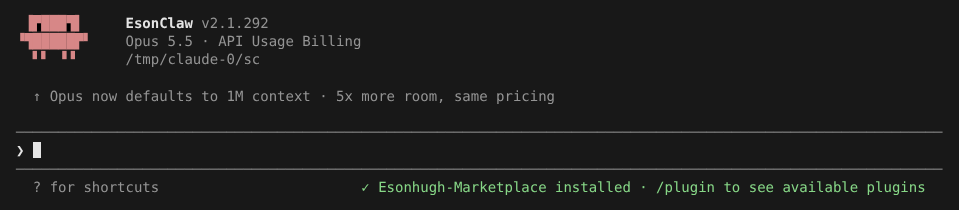
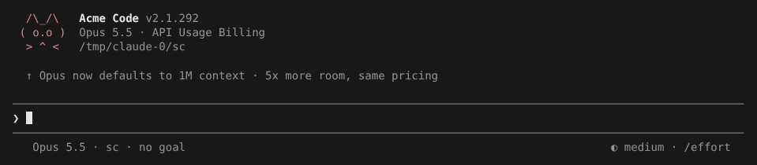
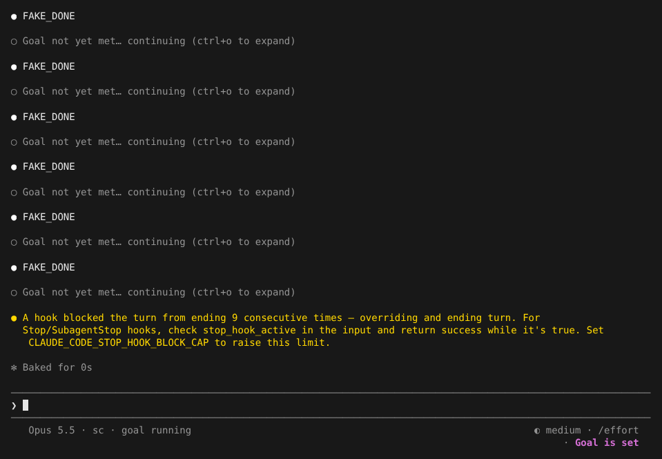

# 自定义 UI / Branding 与 Status line

> 英文名：`branding` · 领域：界面与交互 · [返回功能索引](README.md)

## 这是什么

三处可以按自己的喜好或团队品牌定制：

| 定制什么 | 怎么改 |
| --- | --- |
| 产品名（欢迎画面、标题、紧凑模式边框） | settings 里的 `uiName` |
| 左上角 Logo 图案 | `~/.claude/clawd.txt` 放一段 ASCII 图 |
| 输入框下方的状态栏 | settings 里的 `statusLine`，指向你的脚本 |

## 快速上手

默认显示 `EsonClaw` 和内置 Logo：



**1. 改名字和 Logo。** `~/.claude/settings.json`：

```json
{ "uiName": "Acme Code" }
```

Logo 图案：

```bash
printf '  /\\_/\\\n ( o.o )\n  > ^ <\n' > ~/.claude/clawd.txt
```

**2. 加一个状态栏脚本。** Claude Code 每次刷新时把当前状态以 JSON 从 stdin 传给脚本，脚本打印的第一行就显示在输入框下方：

```sh
#!/bin/sh
# Print "model · dir · goal" from the JSON Claude Code sends on stdin.
input=$(cat)
model=$(printf '%s' "$input" | sed -n 's/.*"display_name":"\([^"]*\)".*/\1/p')
dir=$(printf '%s' "$input" | sed -n 's/.*"current_dir":"\([^"]*\)".*/\1/p')
goal=$(printf '%s' "$input" | grep -q '"active":true' && echo "goal running" || echo "no goal")
printf '%s · %s · %s' "$model" "${dir##*/}" "$goal"
```

```json
{
  "statusLine": { "type": "command", "command": "/path/to/statusline.sh", "padding": 1 }
}
```

结果：名字、Logo、状态栏都换了：



设了 [`/goal`](goal.md) 之后，状态栏跟着变成 `goal running`：



## 状态栏脚本能拿到什么

传给脚本的 JSON 包含模型、工作目录、版本、费用、上下文窗口、速率限制、当前子代理、worktree 等（和官方一致），本 fork 额外加了：

| 字段 | 含义 |
| --- | --- |
| `goal.active` | 当前是否有进行中的 `/goal` |

用 `jq` 解析会比上面的 `sed` 更稳妥。

## 细节

- `uiName` 为空或没设置时回到 `EsonClaw`；后台会话视图（`claude agents`）的标题也用它。
- `clawd.txt` 为空或读不到时用内置图案；全屏紧凑布局会按图案宽度自动横排或竖排，过宽的行会被截断。
- 用了 `CLAUDE_CONFIG_DIR` 时，图案文件放在 `$CLAUDE_CONFIG_DIR/clawd.txt`。
- `/status` 还会显示 OpenAI 账号；`/usage`、`/stats` 分开统计 Claude 和 ChatGPT / OpenAI 的用量。

## 设置

| 配置项 | 写法 | 默认 |
| --- | --- | --- |
| `uiName` | 字符串 | `EsonClaw` |
| `${CLAUDE_CONFIG_DIR:-~/.claude}/clawd.txt` | 任意 ASCII 图 | 内置图案 |
| `statusLine` | `{"type":"command","command":"...","padding":1}` | 无 |
| `subagentStatusLine` | `{"type":"command","command":"..."}` | 无 |
| `timeFormat` | `"auto"`、`"12-hour"`、`"24-hour"`、`"24-hour-utc"`（`18:05Z`），或含 `%` 的 strftime 格式如 `"%H:%M"` | `auto` |
| `timeZone` | IANA 时区名，如 `"Asia/Shanghai"`；无效时用系统时区 | 系统时区 |
| `spellcheck` | `{"enabled":true,"checker":"auto","language":"en_US","color":"red"}` | 关闭 |

## 其他界面设置（与官方 2.1.303 一致）

**时间格式。** `timeFormat` 决定界面里时钟时间的写法（目前是 transcript 里的消息时间戳）；`/config` 的 Time format 只提供四个预设，strftime 格式写在 settings 里。格式最长 100 字符。

**子代理状态行。** `subagentStatusLine` 的命令在 agent 面板有子代理时每 5 秒运行一次，stdin 收到 JSON：会话信息加 `columns` 和 `tasks`（每项有 `id`、`name`、`agentType`、`status`、`description`、`label`、`startTime`、`model`、`contextWindowSize`、`tokenCount`、`tokenSamples`、`cwd`）。每输出一行 `{"id":"<task id>","content":"<文字，可带 ANSI 颜色>"}`，对应那一行就换成这段文字。和 `statusLine` 一样需要已信任工作区。与官方的差别：`content` 为空字符串时官方会隐藏这一行，本 fork 保持原样显示。

**拼写检查。** `spellcheck.enabled` 为 `true` 时，用 PATH 里找到的 aspell、hunspell 或 ispell 检查输入框里的英文单词，拼错的加下划线并着色（默认主题的 error 色）。代码片段、路径、`--flag`、驼峰词、中日韩文字不检查，光标正在输入的词也不检查。只读用户、`--settings` 和托管设置（取其中优先级最高的整块），项目里的 `.claude/settings.json` 不生效。没装检查器时什么也不做。

## 说明

画面来自实际运行，使用测试用假 API。
