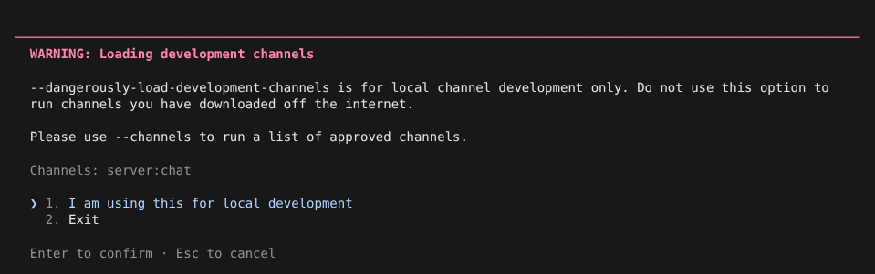
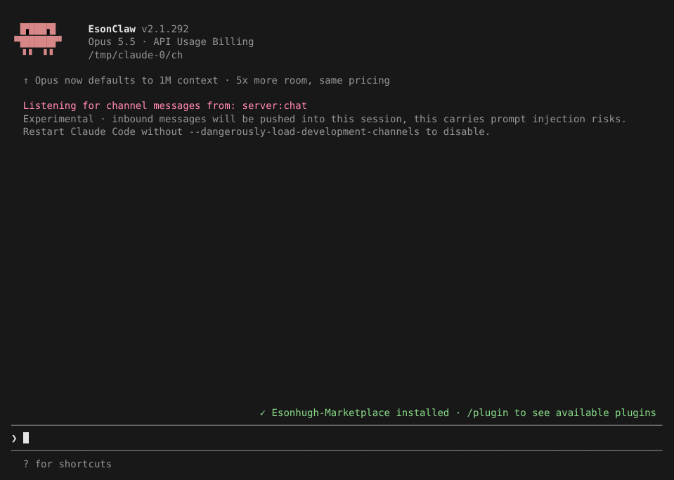
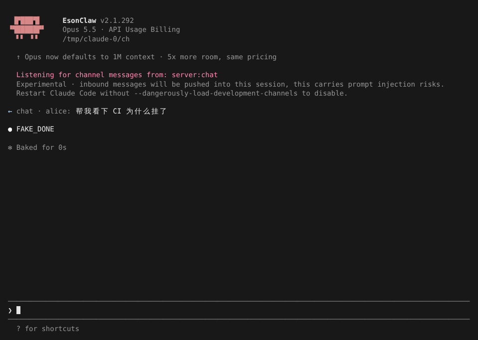
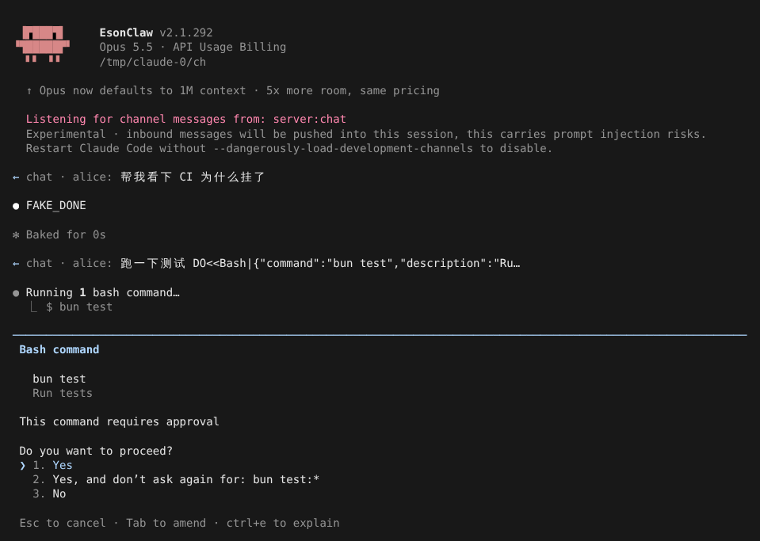
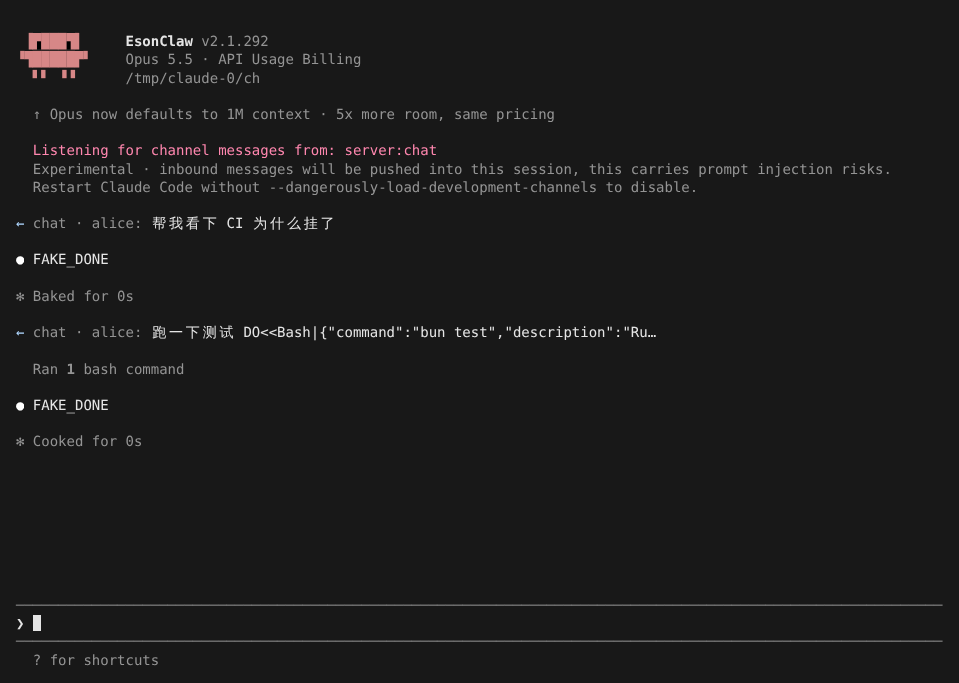
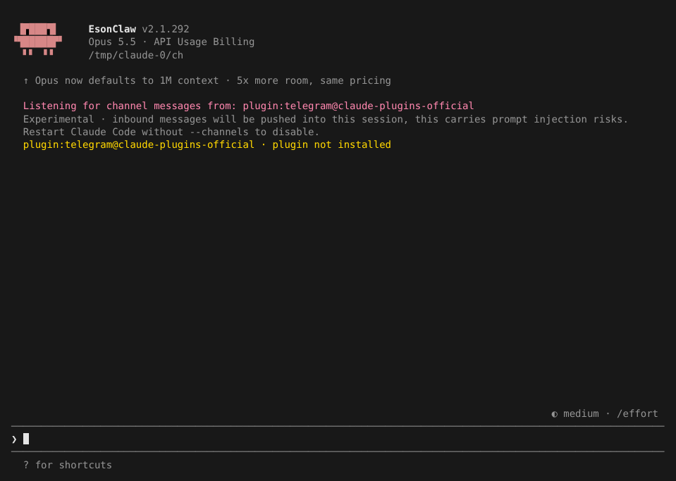

# Channels

> 英文名：`channels` · 领域：插件与扩展 · [返回功能索引](README.md)

## 这是什么

平时只有你在终端里打字，Claude 才会动。Channels（频道）让**外部消息源**也能往会话里「塞」消息：

- 你在手机 Telegram 里发一句「帮我看下 CI 为什么挂了」，桌面上开着的 Claude 收到后直接开工；
- Claude 需要你批准某个命令时，审批请求也可以发到手机上，你回一句 `yes abcde` 就放行。

频道本质上是一个特殊的 MCP server：它声明自己是「频道」，并主动推送消息。官方提供 telegram、discord、imessage 等插件，你也可以自己写一个。

**注意**：推进来的消息会被 Claude 当作输入处理，相当于给了外部一个「对 Claude 说话」的入口。只接你信任的频道。

## 快速上手：用一个本地小频道体验全过程

下面用一个几十行的本地 MCP server 演示。它监听 `inbox.txt`，往里追加一行就等于「从外部发来一条消息」。

**1. 准备频道 server。** 关键是在 `initialize` 时声明两项实验能力，并在有新消息时发 `notifications/claude/channel`：

```js
// chat-channel.mjs（节选）
capabilities: { tools: {}, experimental: { 'claude/channel': {}, 'claude/channel/permission': {} } }

// 收到外部消息时：
send({ method: 'notifications/claude/channel', params: { content: '帮我看下 CI 为什么挂了', meta: { user: 'alice' } } })
```

在项目 `.mcp.json` 里登记它：

```json
{ "mcpServers": { "chat": { "command": "bun", "args": ["./chat-channel.mjs"] } } }
```

**2. 以开发频道方式启动。** 自己写的、没上架的频道要用开发参数，启动时会先警告并要你确认：

```bash
claude --dangerously-load-development-channels server:chat
```



**3. 确认后进入会话**，欢迎区下方显示正在监听哪些频道：



**4. 外部发来消息。** 往 `inbox.txt` 追加一行，会话里立刻出现 `← chat · alice: …`，Claude 不需要你打字就开始处理：



**5. 远程审批。** 频道消息让 Claude 去跑 `bun test`，终端里弹出常规的审批框；与此同时，声明了审批能力的频道收到一条 `permission_request`，里面带一个 5 个字母的审批 ID（例子里频道把它写进 `outbox.txt`：`[审批请求 hoztn] Bash: Run tests`）：



**6. 在「手机」上回复 `yes hoztn`**（这里是往 `inbox.txt` 追加这一行），频道把它转成 `notifications/claude/channel/permission`，终端里的审批框自动关闭，命令执行：



本地按键和远程回复谁先到算谁的。普通聊天文字永远不会被当成审批，只有频道明确发出 `permission` 通知才算。

## 使用官方频道插件

先在 `/plugin` 里安装插件（例如 `telegram@claude-plugins-official`），按插件说明配好机器人，然后：

```bash
claude --channels plugin:telegram@claude-plugins-official
```

多个频道用空格分隔。插件没装或不在批准名单里时，欢迎区会直接告诉你原因，不会悄悄失效：



## 命令速查

| 写法 | 什么时候用 |
| --- | --- |
| `claude --channels plugin:<名字>@<市场>` | 用已安装的、批准名单内的频道插件；`-p` 和 SDK（`channel_enable`）也支持 |
| `claude --dangerously-load-development-channels server:<名字>` | 用 `.mcp.json` 里自己写的频道；只能交互模式，启动时确认 |
| `claude --dangerously-load-development-channels plugin:<名字>@<市场>` | 调试不在批准名单里的插件 |

## 谁能放行哪些频道

- **批准名单**：`--channels` 只接受名单里的插件，并核对插件确实来自声明的 marketplace。拿不到远程名单时，默认批准 `claude-plugins-official` 的 `telegram`、`discord`、`imessage`、`fakechat`。
- **只在 `.mcp.json` 里配一个 server 不会开启推送**，必须用上面的参数点名。
- **公司管理的安装**（有 managed settings，或 Team / Enterprise 订阅）：管理员必须设置 `channelsEnabled: true`；`allowedChannelPlugins` 会替换默认名单，空数组表示禁止所有普通插件。项目和个人设置不能覆盖。

## 设置

| 配置项 | 写法 | 说明 |
| --- | --- | --- |
| `channelsEnabled` | `true`（托管设置） | 托管环境里开启频道 |
| `allowedChannelPlugins` | 插件数组（托管设置） | 替换默认批准名单 |
| `CLAUDE_CODE_DISABLE_CHANNELS` | `1` | 关闭全部频道 |
| `CLAUDE_CODE_DISABLE_CHANNEL_PERMISSION_RELAY` | `1` | 保留消息推送，只关闭远程审批 |

## 写频道 server 时要知道的

- 消息格式：`notifications/claude/channel`，`params.content` 是字符串，`params.meta` 是可选的字符串字典（如 `user`、`chat_id`），会作为属性出现在 Claude 看到的 `<channel source="…">` 标签上；`source` 由连接名决定，伪造无效，非法 key 会被丢弃。
- 想回消息：在 server 里提供一个普通的 MCP 工具（如 `reply`），Claude 会调用它。发送方是谁、谁能配对，由 server 自己校验。
- 远程审批：声明 `experimental['claude/channel/permission']: {}` 才会收到 `notifications/claude/channel/permission_request`（含 `request_id`、`tool_name`、`description`、`input_preview`）；用户回复格式建议按 `/^\s*(y|yes|n|no)\s+([a-km-z]{5})\s*$/i` 解析，然后发 `notifications/claude/channel/permission`，参数 `{ request_id, behavior: "allow" | "deny" }`。发给频道的预览已清理 Unicode、遮罩可识别的凭据，每个参数最多保留 3,500 字符（长的保留首尾）。
- 协议细节见官方 [Channels reference](https://code.claude.com/docs/en/channels-reference)。

## 说明

- 本 fork 不要求 Anthropic 账号登录或灰度资格，API Key 和第三方 provider 下也能用；这属于本项目扩展。
- 画面来自实际运行（全屏渲染，110×36），模型回复由测试用假 API 生成（`FAKE_DONE`；消息里的 `DO<<…>>` 是让假 API 调用工具的指令）。

## 详细说明

以下内容自原 README 迁入，保持原文。

### Channels

默认构建包含 Channels，两个参数均可通过 `--help` 查看，不需要额外设置 `CLAUDE_CODE_RECOVER_FEATURES`，也不依赖 Anthropic OAuth 或远程灰度资格。模型调用仍使用当前 provider 的正常认证配置。

```bash
# 已安装的批准插件；可以空格分隔多个 plugin:<name>@<marketplace>
claude --channels plugin:telegram@claude-plugins-official

# 本地 .mcp.json 中的自定义频道；启动时须在终端确认
claude --dangerously-load-development-channels server:webhook
```

`--channels` 只允许有效白名单中的插件，并核对已安装插件的 marketplace 来源；仅配置 MCP server 不会开启消息注入。远程白名单不可用时默认批准 `claude-plugins-official` 的 `telegram`、`discord`、`imessage`、`fakechat`。远程返回的有效空名单仍然生效，非法名单不会扩大权限。

自定义 MCP server 使用 `server:<name>`，自定义插件使用 `plugin:<name>@<marketplace>`，均通过开发参数逐项确认；开发豁免只跳过对应条目的插件白名单，不跳过来源检查或组织策略。开发参数只支持交互模式，在 `-p` / Agent SDK 中不会授权；普通 `--channels` 和 SDK `channel_enable` 支持非交互模式。

存在 managed settings 或使用 Anthropic Team/Enterprise 时，管理员须设置 `channelsEnabled: true`。managed settings 中的 `allowedChannelPlugins` 替换默认名单，包括 API Key / 兼容 provider；空数组阻止普通插件，关闭 `channelsEnabled` 同时阻止开发频道。项目和用户 settings 不能覆盖管理员设置。

协议沿用 [Channels reference](https://code.claude.com/docs/en/channels-reference)：服务器声明 `experimental['claude/channel']: {}`，发送 `notifications/claude/channel`，参数为字符串 `content` 和可选字符串字典 `meta`。消息通过队列进入下一轮，SDK 空闲时也会开始处理；启动参数选择的已连接频道无需首条用户输入即可监听。`source` 由实际连接名决定，非法元数据键和伪造 `source` 被忽略。双向频道通过标准 MCP reply tool 回发；发送方身份认证与配对名单由频道服务器实现。

远程工具审批只发给通过完整频道准入检查且声明 `experimental['claude/channel/permission']: {}` 的服务器；缺失或 `false` 均不启用。审批使用独立的 `permission_request` / `permission` 通知和待审批 ID，普通聊天文本不能授权；本地与远程首先完成的答复生效。发送前清理 Unicode、遮罩可识别凭据，并按顶层参数分别保留最多 3,500 个码点的预览，长值保留首尾，无法序列化的字段单独标记。SDK/print 的权限审批仍由消费者的 `canUseTool` 处理。

现有 MCP SDK 要求实验能力为对象；本项目在握手前将审批能力的显式 `false` 转为缺失，保留普通频道和其他能力，使选择退出审批的服务器仍可连接。实现核对、回归和二进制验收见 [Channels 检查记录](../../docs/research/channels-20261007.md)。

可通过 `CLAUDE_CODE_DISABLE_CHANNELS=1` 关闭全部频道，或通过 `CLAUDE_CODE_DISABLE_CHANNEL_PERMISSION_RELAY=1` 单独关闭远程审批。第三方 provider 支持和可见 CLI help 属于本项目扩展，不表示官方产品提供相同行为。
