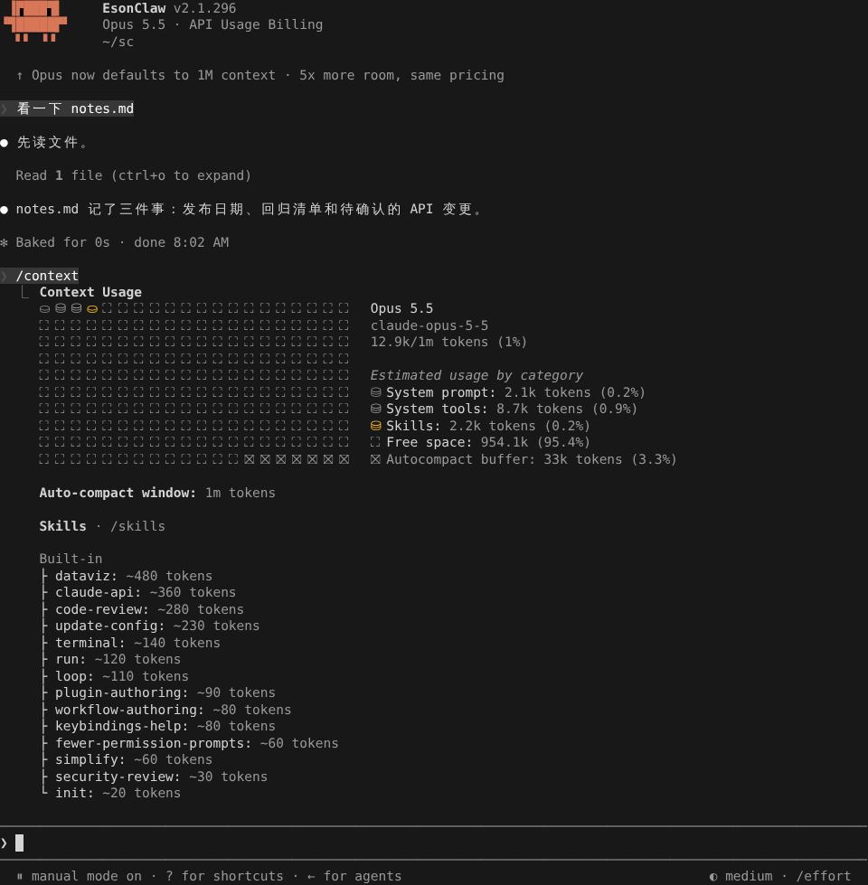
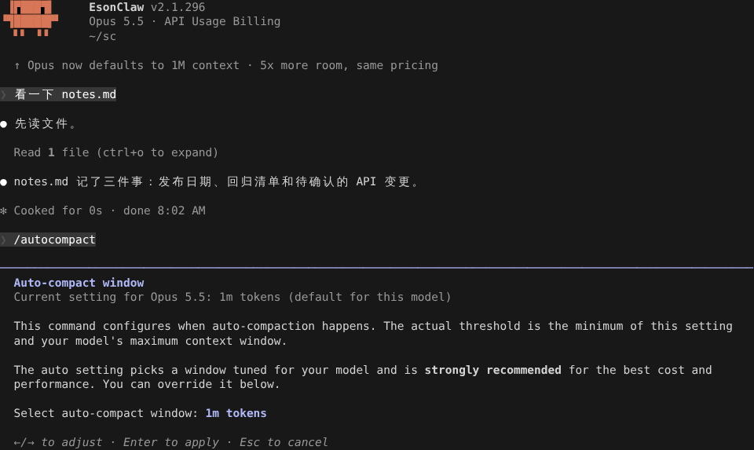
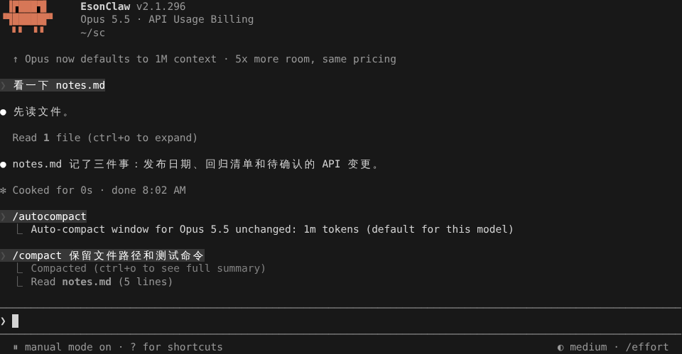

# 自动压缩窗口

<!-- lang: zh-Hans -->

> 英文名：`compaction` · 领域：上下文与记忆 · [返回功能索引](README.md)

## 这是什么

模型一次能看的内容（上下文窗口）有上限，而且对话越长，每次请求越贵、越慢。**压缩**就是把较早的对话交给模型写成一段摘要，用摘要替换原文，腾出空间继续聊。

- **自动压缩**：对话长度到达「压缩窗口」时自动进行；
- **手动压缩**：随时输入 `/compact`。

本 fork 让你按模型设置这个窗口：例如 1M 上下文的模型，你可能想在 200k 时就压缩，省钱也让模型更专注。还可以换成[Codex 式压缩](#换一种压缩方式codex-式压缩)：保留最近一段原文，用 OpenAI 时交给服务端压缩。

<details lang="en"><summary>English</summary>

> Name: `compaction` · Area: Context and memory · [Back to index](README.md)

## What it is

A model can only see so much at once (its context window), and the longer a conversation gets, the slower and more expensive each request becomes. **Compaction** has the model summarise the older part of the conversation and replaces the original text with that summary, freeing room to continue.

- **Auto-compact** runs when the conversation reaches the compaction window.
- **Manual compaction**: type `/compact` at any time.

This fork lets you set that window per model: with a 1M-context model, for example, you may want to compact at 200k to save money and keep the model focused. You can also switch to [Codex-style compaction](#换一种压缩方式codex-式压缩), which keeps the most recent stretch of the conversation verbatim and, on OpenAI, lets the server do the compaction.

</details>
<details lang="zh-Hant"><summary>繁體中文</summary>

> 英文名：`compaction` · 領域：上下文與記憶 · [返回功能索引](README.md)

## 這是什麼

模型一次能看的內容（上下文視窗）有上限，而且對話越長，每次請求越貴、越慢。**壓縮**就是把較早的對話交給模型寫成一段摘要，用摘要替換原文，騰出空間繼續聊。

- **自動壓縮**：對話長度到達「壓縮視窗」時自動進行；
- **手動壓縮**：隨時輸入 `/compact`。

本 fork 讓你按模型設定這個視窗：例如 1M 上下文的模型，你可能想在 200k 時就壓縮，省錢也讓模型更專注。還可以換成[Codex 式壓縮](#换一种压缩方式codex-式压缩)：保留最近一段原文，用 OpenAI 時交給服務端壓縮。

</details>

## 快速上手

**1. 看现在用了多少：** 输入 `/context`。右侧列出系统提示、工具、skill、对话各占多少，`Autocompact buffer` 是为写摘要预留的空间；标题行的分母就是当前的压缩窗口：



**2. 调整压缩窗口：** `/autocompact`（别名 `/context-window`）打开档位滑块，`←` `→` 在 `auto` 和各档位之间切换，`Enter` 应用；也可以直接 `/autocompact 200k`：



```text
❯ /autocompact 200k
  ⎿  Auto-compact window for Opus 5.5 set to 200k tokens
```

滑块的档位是 128k、200k、272k、500k、1M 中小于模型上限的那些，最后一档是模型上限本身（例如 262k 或 OpenAI `[1m]` 的 872k）；之前保存过的非档位值（如 150k）会保留自己的一档。命令参数可写 `500k`、`200000` 或简写 `200`（范围 100k 到 1M，并且不超过模型本身的上限）；`/autocompact auto`（或 `reset`）恢复推荐值。设置保存在用户设置的 `modelSettings.<模型>.autoCompactWindow`，换模型后各用各的。

`claude web` 会话页、起始页和项目协调者对话的模型菜单里有一行「上下文窗口」，列出同样的档位，只对当前会话生效（和思考强度菜单一样以会话级设置下发，`get_settings` 的 `applied.autoCompactWindow` 会报告它）。

触发点 = 窗口 − 20k（摘要输出）− 13k（固定缓冲）。模型上限来自内置表；Claude 官方 API 用户还会读取 `models.list` 的 `max_input_tokens`，但只用于内置表里没有的模型，`[1m]`/`[1M]` 后缀开启 1M 的规则不变。Haiku 5.5 的上限是 1M。

**3. 手动压缩：** `/compact` 后面可以加一句要求，告诉摘要要保留什么：



按 `ctrl+o` 能看到完整摘要和压缩前的历史。

## 换到小窗口模型时

如果当前对话已经超过新模型的上限，会先用**上一个（窗口更大的）模型**写摘要，再切过去；那个模型不在 `availableModels` 里或摘要失败时，用新模型。

## 设置与优先级

窗口由以下来源决定，排在前面的优先：

| 来源 | 写法 | 说明 |
| --- | --- | --- |
| 环境变量 `CLAUDE_CODE_AUTO_COMPACT_WINDOW` | 完整整数，如 `200000`（也接受 `2e5`、`200_000`） | 最优先；注意 `200k` 会被读成 200，再被提升到最小值 100,000 |
| `modelSettings.<模型>.autoCompactWindow` | 整数 | `/autocompact` 写在用户设置里；同一个设置文件里优先于顶层值 |
| 顶层 `autoCompactWindow` | 整数或 `"auto"` | 对所有模型生效；高优先级设置文件的顶层值会盖过低优先级文件的按模型值 |
| 子代理定义里的 `autoCompactWindow` | `100000`–`1000000` | 只能把子代理的窗口调小 |

以上来源都只能把窗口调小，不会超过模型本身的上下文窗口。要强制指定模型的上下文窗口（可调大也可调小），设定环境变量 `CLAUDE_CODE_MAX_CONTEXT_TOKENS`（完整整数，如 `500000`）：对 Claude 与 OpenAI 路径的所有模型都生效，优先于 1M 判断、模型目录与按模型调校的默认压缩窗口；上面的来源仍可在它之下再调小。

其他相关变量：

| 变量 | 作用 |
| --- | --- |
| `CLAUDE_AUTOCOMPACT_PCT_OVERRIDE` | 按百分比设定触发点，基于上面算出的窗口 |
| `CLAUDE_CODE_DISABLE_UNKNOWN_MODEL_WINDOW_ENFORCEMENT=1` | 未知模型默认用保守窗口；设 `1` 关闭这层保护 |

实际触发点会比窗口略低，因为要给摘要输出和缓冲留空间。

## 上下文超长与连续压缩

与官方 2.1.319 一致：

- 请求被 API 以 `prompt is too long` 拒绝时（自动压缩开启的情况下），先压缩一次再重试这一回合，不再直接以 `Prompt is too long` 结束。OpenAI 与兼容网关的 `context_length_exceeded`、`exceeds the context window`、`maximum context length` 等错误也按同样方式处理。
- 写摘要的请求本身太长时，多保留几轮最近的原文、只摘要更早的部分，不再直接丢掉最早的对话。
- 连续三次压缩、每次都在上一次之后 3 轮内又满了，回合停止并显示 `Autocompact is thrashing`（SDK 的 `terminal_reason` 为 `rapid_refill_breaker`），避免无限压缩烧 token。
- 压缩后重新列出可用的 skill，并提醒模型还开着的 Tmux 终端；`ToolSearch` 已加载的工具在 Codex 式压缩和 Mod 改写的压缩后同样保留。

## 空闲压缩（idle compaction）

和官方 2.1.299 一样：主对话用的是 1 小时 prompt cache 时，一轮结束后闲置 54 分钟（cache 过期前），且对话不少于 200k tokens，就先压缩，回来后下一条消息不必按全价重新处理整段对话。压缩后显示 `Compacted while idle, before the prompt cache expired`。

| 设置 | 作用 |
| --- | --- |
| `"idleCompaction": false` 或 `/config` 里的 Idle compaction | 关闭 |
| `CLAUDE_CODE_IDLE_COMPACT_MIN_TOKENS` | 最低 tokens，默认 200000，最低 100000 |
| `ENABLE_PROMPT_CACHING_1H=1` | 主对话使用 1 小时 cache；本 fork 关闭了 GrowthBook，不设这个变量（或 Bedrock 的 `ENABLE_PROMPT_CACHING_1H_BEDROCK`）就是 5 分钟 cache，空闲压缩不会触发 |

自动压缩关闭（`DISABLE_AUTO_COMPACT` 等）、后台会话、电脑休眠导致计时器晚了超过 60 秒时都不压缩。

## 换一种压缩方式：Codex 式压缩

默认的压缩方式是让模型把整段对话写成一段摘要，压缩后只剩摘要。本 fork 另外提供一种仿 Codex CLI 的压缩方式，在设置里打开：

```json
{
  "compact": {
    "mode": "codex",
    "codex": { "retainedUserMessageTokens": 20000 }
  }
}
```

打开后，手动 `/compact` 和自动压缩都按这种方式进行：

- **用 OpenAI provider 时**：交给 OpenAI 服务端压缩（请求里带 `compaction_trigger`），服务端返回一段加密的压缩内容，之后的请求带着它继续，多次压缩会接上之前的压缩历史。服务端不支持时（返回 404 / 405 / 426 或 `not supported`），改走下面的方式。
- **其他情况**：照常写摘要，但摘要后面**原样保留最近一段对话**，大约 `retainedUserMessageTokens` 个 token（默认 20000），工具调用和它的结果成对保留。超过 32000 字符的工具结果换成 `[tool output truncated during codex-style compaction]`。这种情况下压缩后默认不再重新附上文件、计划等附件（`keepPostCompactAttachments` 设为 `true` 可保留）。
- 两种情况都不走 session memory 压缩。

| 配置项 | 写法 | 默认 | 说明 |
| --- | --- | --- | --- |
| `compact.mode` | `claude` / `codex` | `claude` | 压缩方式 |
| `compact.codex.retainedUserMessageTokens` | 正整数 | `20000` | Codex 式压缩保留的最近对话大约多少 token |
| `compact.codex.keepPostCompactAttachments` | `true` / `false` | `false` | 写摘要的那种情况下，压缩后照常重新附上最近读过的文件、计划等附件（和默认压缩一样）；OpenAI 服务端压缩不受影响 |

实际效果（OpenAI provider，tmux 里对着测试用假服务运行，`compact.mode` 设为 `codex`）：

```text
❯ /compact
  ⎿  Compacted (ctrl+o to see full summary)
❯ after compact
● 好的。
```

假服务记录到压缩请求带了 `compaction_trigger`，压缩后下一条请求只剩压缩内容加新消息。不设 `compact.mode` 时，同样的 `/compact` 发的是普通的写摘要请求。

## 开发者参考：远程会话的 `autocompact_state`

远程 stream-json 会话会发送 `autocompact_state`，字段有 `enabled`、`effective_window`、`threshold`、`enforced`、`source`。`source` 表示窗口来自哪里：`model-default`（原生 1M 模型默认）、`unknown-model`（未知模型的保守窗口）、`auto`、`env`、`settings`、`clientdata`、`experiment`。

已知差异：这个状态帧只读顶层 `autoCompactWindow` 和环境变量，不读 `/autocompact` 写的按模型设置，所以用按模型设置时，状态帧里的窗口可能和实际触发的不一样。普通本地会话不发送该帧。

## 说明

画面来自实际运行，使用测试用假 API（token 数是假 API 返回的固定值，摘要内容也是假的）。
