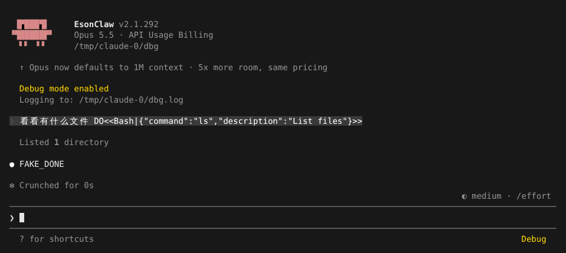

# 调试日志

> 英文名：`debugging` · 领域：界面与交互 · [返回功能索引](README.md)

## 这是什么

Claude Code 出问题（MCP 连不上、hook 没触发、请求报错、某个功能不生效）时，界面上通常只有一句简短提示。调试日志会把后台每一步都记下来：读了哪些配置、加载了几个 skill、发了哪些 API 请求、hook 有没有找到……排查时把日志看一遍，或者附在 issue 里，比描述现象有用得多。

## 快速上手

**1. 带上调试参数启动，并把日志写到文件：**

```bash
claude --debug --debug-file /tmp/claude-debug.log
```

启动时会提示 `Debug mode enabled` 和日志位置；用了 `--debug` 时，输入框右下角一直显示黄色 `Debug`，提醒你当前在调试模式：



**2. 正常操作，复现问题。**

**3. 打开日志看。** 每行一条，带时间和类别，例如上面这一轮对应的部分：

```text
2026-10-24T18:02:48.475Z [DEBUG] Loaded 0 unique skills (0 unconditional, 0 conditional, managed: 0, user: 0, project: 0, ...)
2026-10-24T18:02:54.356Z [DEBUG] Hooks: Found 0 total hooks in registry
2026-10-24T18:02:54.380Z [DEBUG] [API:request] Creating client, ANTHROPIC_CUSTOM_HEADERS present: false, has Authorization header: false
2026-10-24T18:02:54.428Z [DEBUG] [API REQUEST] /v1/messages source=repl_main_thread
```

## 只看某一类

日志很多时，在 `--debug` 后面跟类别过滤：

| 写法 | 效果 |
| --- | --- |
| `claude --debug` | 全部 |
| `claude --debug api,hooks` | 只记 api 和 hooks 两类 |
| `claude --debug '!1p,!file'` | 除了这两类都记 |

包含和排除不能混写（如 `api,!file`），混写时等于不过滤。

## 只写文件、不打扰界面

单独用 `--debug-file <路径>` 也会开启调试日志并写入文件，但输入框右下角不显示 `Debug` 标记（和官方一致），适合想悄悄记录的场合。

## 隐私

- 日志里会有本机路径、配置文件位置、命令名等信息，分享前先看一遍。
- [OpenAI provider](openai-provider.md) 的请求诊断只记录摘要：大小、压缩检查点、公共前缀，不记录请求正文。公共前缀稳定不代表服务端缓存一定命中。

## 设置

| 参数 | 写法 | 说明 |
| --- | --- | --- |
| `--debug` | 可带类别过滤 | 开启调试，显示 `Debug` 标记 |
| `--debug-file` | 文件路径 | 写入文件，并隐式开启调试 |

## 说明

画面来自实际运行（全屏渲染，110×22），模型回复由测试用假 API 生成（`FAKE_DONE`；`DO<<…>>` 是让假 API 调用工具的指令）。日志节选来自同一次运行。
