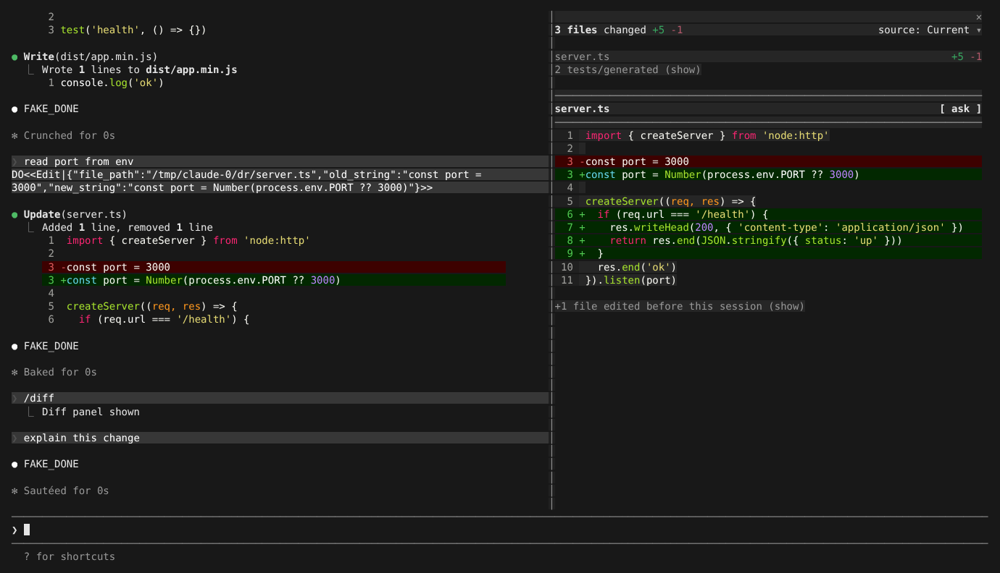
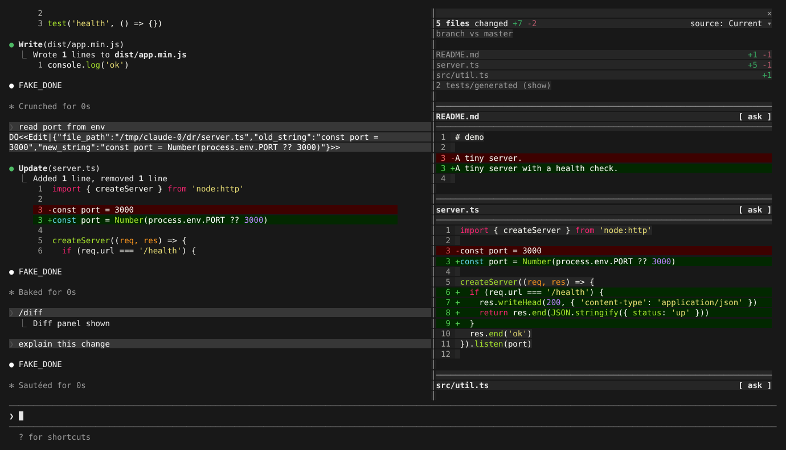
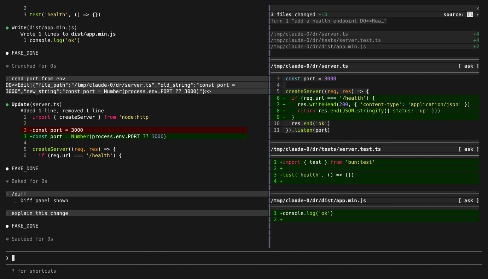
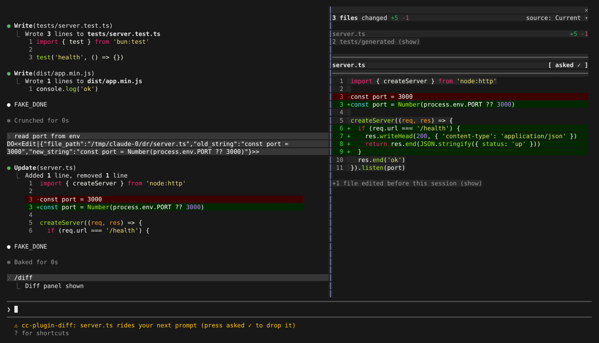

# /diff 视图

> 英文名：`diff-view` · 领域：界面与交互 · [返回功能索引](README.md)

## 这是什么

Claude 改了一堆文件之后，你想知道它到底动了哪些地方。`/diff` 把改动摊开给你看：在全屏模式下，聊天右侧会出现一个**常驻的 diff 面板**，Claude 每改一次文件就自动刷新，不用自己跑 `git diff`。

面板能做的事：

- 默认只看**本会话**改过的文件，测试和生成文件自动折叠；
- `ctrl+x b` 切换比较基准：本会话 / 未提交改动 / 整个分支相对默认分支；
- `source:` 下拉框按轮次回看「第几轮改了什么」；
- 对某个文件点 `[ ask ]`，把这个文件的 diff 附到下一条消息里问 Claude。

这个面板来自内置的官方 diff Mod（`cc-plugin-diff` 2.1.295），启动时校验后加载。

## 快速上手

1. 用全屏模式启动：`CLAUDE_CODE_NO_FLICKER=1 claude`，终端至少 110 列宽；
2. 让 Claude 改点东西，然后输入 `/diff`，右侧出现面板（提示 `Diff panel shown`）；
3. 再输入一次 `/diff` 隐藏（`Diff panel hidden`）。

下面「效果」一节有每种视图的实拍截图。

根据终端情况，有三种呈现方式：

| 条件 | 呈现 |
| --- | --- |
| 全屏（`CLAUDE_CODE_NO_FLICKER=1`）且终端 ≥ 110 列 | 右侧 dock 面板，下文所有进阶功能都在这里 |
| 全屏但终端 < 110 列 | 面板位置显示 `Resize your terminal to at least 110 columns to show the diff panel` |
| 非全屏，或停用了 diff Mod | 原生对话框 `Uncommitted changes (git diff HEAD)`，↑/↓ 选文件、Enter 看详情、Esc 关闭 |

新增代码保留语法颜色与词级差异背景。

## 配置

| 配置项 | 位置 | 可选值 | 说明 |
| --- | --- | --- | --- |
| `CLAUDE_CODE_NO_FLICKER` | 环境变量 | `1` | 全屏渲染；diff 面板只在全屏下出现 |
| `enabledPlugins["cc-plugin-diff@builtin"]` | settings | `false` | 停用官方 diff Mod，回到原生对话框（旧键 `diff@builtin` 仍可用） |
| `syntaxHighlightingDisabled` / `CLAUDE_CODE_SYNTAX_HIGHLIGHT` | settings / 环境变量 | `true` / `0` | 关闭语法高亮 |
| `app:cycleDiffBase` | `~/.claude/keybindings.json`（Global） | 默认 `ctrl+x b` | 切换比较基准 |
| `app:diffFileListUp` / `app:diffFileListDown` | 同上 | 默认 `ctrl+up` / `ctrl+down`，`meta+up` / `meta+down` | 在面板文件列表中移动 |
| `pane:close` | 同上（Pane 上下文） | 默认 `ctrl+x x` | 焦点在面板内时关闭面板 |

## 操作方式

| 操作 | 效果 |
| --- | --- |
| `/diff` | 显示 / 隐藏面板 |
| `ctrl+x b` | 在「本会话」→「未提交（vs HEAD）」→「分支 vs 默认分支」之间循环 |
| `ctrl+x Tab` | 焦点从输入框依次进入 Mods 面板；面板内 Tab / Shift+Tab 在按钮间移动，Enter 触发 |
| 鼠标点击 | `(show)` / `(hide)`、`[ ask ]`、`source:` 下拉框、右上角 `✕` 都可直接点击 |
| `/clear`、`/resume` | 面板随会话切换重新计算 |

## 效果

以下画面均为 160×42 tmux 中实拍：仓库默认分支 `master`，当前在 `feature/health`（比 master 多一个提交改了 `src/util.ts`）；会话开始前已手动改了 `README.md`；第 1 轮 Claude 编辑 `server.ts` 并新建 `tests/server.test.ts`、`dist/app.min.js`，第 2 轮再改 `server.ts`。左侧对话里的 `DO<<…>>` 是测试用假 API 的脚本指令；文本画面中的临时目录已替换为 `/home/user/demo1`。

### 默认：本会话的变更

只统计本会话里改过的文件。测试与生成文件（`/tests/`、`.test.`、`.min.`、`.bundle.`、`.generated.`、`/__snapshots__/`、lock 文件等）默认折叠为 `2 tests/generated (show)`；会话开始前就存在的改动折叠为 `+1 file edited before this session (show)`。



```text
                                                                     ✕
3 files changed +5 -1                                source: Current ▾

server.ts                                                        +5 -1
2 tests/generated (show)

──────────────────────────────────────────────────────────────────────
server.ts                                                      [ ask ]
──────────────────────────────────────────────────────────────────────
  1  import { createServer } from 'node:http'
  2
  3 -const port = 3000
  3 +const port = Number(process.env.PORT ?? 3000)
  4
  5  createServer((req, res) => {
  6 +  if (req.url === '/health') {
  7 +    res.writeHead(200, { 'content-type': 'application/json' })
  8 +    return res.end(JSON.stringify({ status: 'up' }))
  9 +  }
 10    res.end('ok')
 11  }).listen(port)

+1 file edited before this session (show)
```

点 `2 tests/generated (show)` 展开被折叠的文件；未暂存的新文件只给提示，不计行数：

```text
                                                                     ✕
3 files changed +5 -1                                source: Current ▾

dist/app.min.js
server.ts                                                        +5 -1
tests/server.test.ts
2 tests/generated (hide)

──────────────────────────────────────────────────────────────────────
dist/app.min.js (untracked)
──────────────────────────────────────────────────────────────────────
New file not yet staged.
Run `git add :/dist/app.min.js` to see line counts.
```

点 `+1 file edited before this session (show)`，会话前的改动接在下方：

```text
+1 file edited before this session (hide)

README.md                                                        +1 -1
──────────────────────────────────────────────────────────────────────
README.md                                                      [ ask ]
──────────────────────────────────────────────────────────────────────
 1  # demo
 2
 3 -A tiny server.
 3 +A tiny server with a health check.
 4
```

### 切换比较基准（`ctrl+x b`）

第一行下方显示当前基准。`uncommitted (vs HEAD)` 把会话前的 `README.md` 一并算入（4 files changed +6 -2）；`branch vs master` 再加上分支提交里的 `src/util.ts`（与 `master` 的 merge-base 比较）：



```text
                                                                     ✕
5 files changed +7 -2                                source: Current ▾
branch vs master

README.md                                                        +1 -1
server.ts                                                        +5 -1
src/util.ts                                                         +1
2 tests/generated (show)
```

默认分支按 `origin/HEAD` 识别，没有时依次尝试常见名称（需存在对应的 `origin/<name>`）。当前就在默认分支或没有远端时显示 `vs HEAD (no base branch)`；仓库还没有提交时标题变为 `Staged and new files (no commits yet)`。

### 按轮次回看（`source:`）

`source: Current ▾` 下拉框列出每一轮的快照 `T1`、`T2`…，选中后只看那一轮 Claude 改了什么，标题下显示该轮提示的开头：



```text
                                                                     ✕
3 files changed +10                                       source: T1 ▾
Turn 1 "add a health endpoint DO<<Rea…"

/home/user/demo1/server.ts                                          +4
/home/user/demo1/tests/server.test.ts                               +4
/home/user/demo1/dist/app.min.js                                    +2

──────────────────────────────────────────────────────────────────────
/home/user/demo1/server.ts                                     [ ask ]
──────────────────────────────────────────────────────────────────────
  3  const port = 3000
  4
  5  createServer((req, res) => {
  6 +  if (req.url === '/health') {
  7 +    res.writeHead(200, { 'content-type': 'application/json' })
  8 +    return res.end(JSON.stringify({ status: 'up' }))
  9 +  }
 10    res.end('ok')
 11  }).listen(port)
```

### 把单个文件的 diff 附到下一条提示（`[ ask ]`）

每个文件标题右侧的 `[ ask ]` 变成 `[ asked ✓ ]` 后，该文件的 diff 会随下一条提示一起发给模型，底部提示 `server.ts rides your next prompt (press asked ✓ to drop it)`；再点一次取消。发送后按钮恢复为 `[ ask ]`。diff 过长时截断并注明 `(The rest of this diff was cut: it did not fit in the prompt.)`。



### 窄终端

```text
╭────────────────────────────────────────────────────────────────────────────────────────────────✕─╮
│ Resize your terminal to at least 110 columns to show the diff panel                              │
╰──────────────────────────────────────────────────────────────────────────────────────────────────╯
```

### 大变更与特殊仓库状态

以下行为来自 Mod 源码，没有单独实拍：

- 变更超过 20 个文件时只列文件，不展开 diff（`diffs hidden above 20 files`）。
- 超过 500 个文件时不再逐文件计算（`Per-file diff is skipped above 500 files`）。
- rebase / merge / cherry-pick / revert 进行中时按对应的 HEAD 计算基准。

## 已知问题

实拍时观察到、尚未修复：

- 展开 `source:` 下拉框时，各选项被画在同一行上互相覆盖（例如显示为 `T1rrent2 ▴`），仍可用 ↑/↓ + Enter 选择。
- 按轮次查看时文件显示为绝对路径，且以换行结尾的新文件多出一行空的 `+` 行（3 行文件显示 `+4`）。
- 按轮次查看时不折叠测试与生成文件。

## 详细说明

以下内容自原 README 迁入，保持原文。

### Diff 的语法颜色

构建后在 Git 仓库中运行 `/diff` 查看变更。默认语法高亮保留新增代码的关键词、字符串和数字颜色，同时显示新增/删除行和词级差异背景；删除代码保持普通前景色。设置 `syntaxHighlightingDisabled: true` 或 `CLAUDE_CODE_SYNTAX_HIGHLIGHT=0` 可关闭语法高亮。

可用 `bun test ./src/native-ts/color-diff/index.test.ts` 检查实际安装的高亮依赖、代码文本、行号和颜色。2026-10-06 对照[官方 2.1.291](https://github.com/anthropics/claude-code/blob/main/CHANGELOG.md)，已验证样例在真实 `/diff`、resize、ask/取消和重开后的代码前景色；上下文与容器背景、退出日志及完整 diff/API/UI 对齐仍有独立待办，不能将此修复理解为完整兼容已完成。

### Diff 面板的背景

运行 `/diff` 即可使用继承面板背景的代码预览，无需额外设置。未修改代码、行号、空白区域和边框继承容器背景；新增/删除行及词级差异仍保留各自的背景颜色。切换背景或恢复默认背景时，旧颜色不应残留。

运行 `bun test ./src/ink/rawBackground.test.ts` 检查背景、样式重置、行号、差异颜色和缓存更新。2026-10-06 已在真实终端对照官方2.1.291样例；面板底部高度及退出诊断仍有差异，完整兼容进度见 mods-test。

### 验证带颜色的 diff 文本

运行 `bun test ./src/components/diff/DiffView.test.tsx` 验证文件选择、来源切换、滚动、Ask 和面板布局。文本断言读取已去除 ANSI 样式码的 Raw ANSI 文本；颜色与真实屏幕单元格仍分别验证，高亮无需关闭。

### 官方 diff 2.1.295 的离线归档与构建

`scripts/package-official-diff.mjs` 从已核验的官方完整模块生成 `assets/builtin-diff-2.1.295.zip`。它在写入前校验完整模块、身份模块、原始注册闭包和 compiled scan；输出使用固定 ZIP 时间，只创建新文件，拒绝覆盖或接受损坏输入。提取出的官方 JavaScript 不会由打包脚本执行。

```bash
bun scripts/package-official-diff.mjs /path/to/verified-2.1.295-modules /tmp/new-official-diff-295.zip
bun test ./scripts/shipped-diff-production.test.mjs ./scripts/build.test.mjs ./scripts/build-isolated.test.mjs
make build CLAUDE_CODE_BUILD_DIR=/tmp/new-claude-build
```

构建会把该归档同时复制到 `dist/assets` 并嵌入 standalone 二进制，保留已有 `builtin-mods-2.1.277.zip`。归档、构建和运行时接管分别验收；完整 diff UI 对齐仍按 `mods-test.md` 的范围记录。官方版本参考 [Anthropic changelog](https://github.com/anthropics/claude-code/blob/main/CHANGELOG.md)。

### 官方 Mods 接管 diff

生产启动从内嵌的 `builtin-diff-2.1.295.zip` 校验并加载原始 `cc-plugin-diff` Worker。在全屏 Git 工作区输入 `/diff` 打开或关闭面板。原生 diff 的已保存打开偏好只迁移一次；用户明确关闭后清除请求状态。活跃官方插件接管时，原生 diff 面板与后台刷新暂停；禁用、拒绝或卸载后恢复原生命令。

可以在 settings 中禁用官方插件：

```json
{ "enabledPlugins": { "cc-plugin-diff@builtin": false } }
```

旧键 `diff@builtin` 仍作为兼容别名；同时配置时以 `cc-plugin-diff@builtin` 为准。`--debug --debug-file /tmp/claude-diff-debug.log` 会记录 `[ModsBuiltin]` 的版本、来源哈希及加载失败原因，以及 `[Mods:diff]` 接管状态。缺失或损坏归档不会退回旧官方模块，而由原生 diff 保持可用。

```bash
bun test ./src/plugins/bundled/shippedDiffStartup.test.ts ./src/services/mods/diffTakeover.test.ts ./src/services/mods/diffBackground.test.ts ./src/services/diff/controller.test.ts
```

接管测试直接使用仓库内的真实官方归档，无须外部 diff fixture。原始 scan 的 hooks、calls、环境名称和静态命令名称逐项核对；保留 `runCommands` 元数据不代表 `$.command.run` 已完成实现。这里完成的是加载和接管链路，完整官方API及UI兼容范围仍见 `mods-test.md`。官方背景资料见 [Anthropic plugins文档](https://code.claude.com/docs/en/plugins) 和 [官方变更日志](https://github.com/anthropics/claude-code/blob/main/CHANGELOG.md)。

### 官方 diff 2.1.295 的当前固定来源

当前生产归档为 `assets/builtin-diff-2.1.295.zip`，包含官方完整模块、身份模块、编译扫描元数据及原始注册闭包。加载和离线打包均核对固定字节范围与 SHA-256；过期或损坏归档会记录 `[ModsBuiltin]` 错误并保留原生 diff。旧归档仅用于历史来源核对。

```bash
bun scripts/package-official-diff.mjs /path/to/verified-2.1.295-modules /tmp/new-official-diff-295.zip
bun test ./scripts/shipped-diff-production.test.mjs ./src/plugins/bundled/shippedDiffStartup.test.ts ./src/services/mods/diffTakeover.test.ts
make build CLAUDE_CODE_BUILD_DIR=/tmp/new-claude-build
```

在全屏 Git 工作区输入 `/diff` 打开或关闭官方模块的面板；settings 的 `cc-plugin-diff@builtin` 开关及 `diff@builtin` 别名沿用原契约。使用 `--debug --debug-file /tmp/claude-diff-debug.log` 可核对加载版本、来源哈希与接管状态。

`Ctrl+X B` 切换比较 base，`Ctrl+↑/↓` 滚动文件列表。Pane 的 action 在绘制提交阶段登记，重绘后使用当前 drawing；`[ModsPaneAction]` 调试日志记录动作、绘制代次及准入状态，不记录输入正文。提交时序回归可运行 `bun test ./src/components/ModsPane.actionCommit.test.tsx`。

官方最新来源核对见 [Anthropic package metadata](https://registry.npmjs.org/@anthropic-ai/claude-code/latest)，使用背景见 [Anthropic plugins 文档](https://code.claude.com/docs/en/plugins)。此升级原样加载官方 2.1.295 diff 注册闭包，使用最新 dock 行数与滚动计算，移除旧版顶部留白。公开声明基线及完整 API/UI 对齐仍须独立验收，详见 `mods-test.md` 和 [diff 2.1.295 来源与边界](../../docs/research/mods-shipped-diff-295-20261010.md)。
