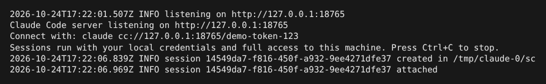
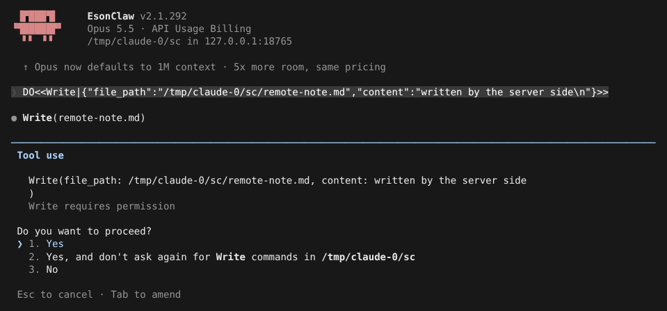
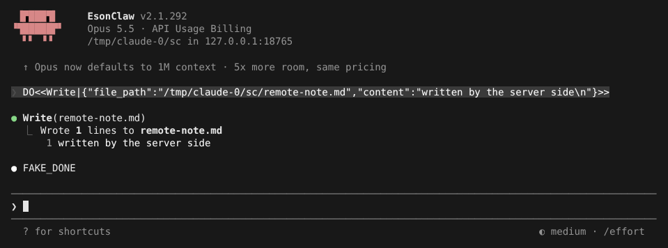

# Direct Connect

> 英文名：`direct-connect` · 领域：远程执行 · [返回功能索引](README.md)

## 这是什么

和 [SSH Remote](ssh-remote.md) 目的相同——**在别处执行、在本地操作**，但不走 SSH，而是 HTTP + WebSocket：

1. 在要执行代码的机器上运行 `claude server`，它监听一个端口，用 token 保护；
2. 在你的终端运行 `claude cc://地址/token`，得到正常的交互界面；
3. 每个会话在 server 上启动一个 Claude 执行进程，读写的是 **server 上的文件**，用的是 **server 上的凭据**；
4. 需要权限确认时，问题会传回你这边。

适合：容器 / 开发机里已经配好环境和凭据，你只想从外面连进去用。

## 快速上手

**1. 在执行端启动 server：**

```bash
claude server --port 18765 --auth-token demo-token-123
```

它打印连接命令，并提醒会话使用这台机器的凭据和完整权限：



**2. 在本地连接：**

```bash
claude cc://127.0.0.1:18765/demo-token-123
```

欢迎画面的目录后面写着 `in 127.0.0.1:18765`。Claude 要改文件时，权限确认出现在你这边：



确认后，文件写在 **server 那台机器**上：



**3. 不要界面，只跑一轮：**

```bash
claude cc://127.0.0.1:18765/demo-token-123 -p "summarize README.md"
```

`-p` 模式下没有人能确认权限，所以除非加 `--dangerously-skip-permissions`，需要权限的工具一律拒绝。token 不对时：

```text
Failed to create session: 401 Unauthorized — {"error":"Unauthorized"}
```

## server 选项

| 选项 | 默认 | 说明 |
| --- | --- | --- |
| `--port` | `0`（随机） | 监听端口 |
| `--auth-token` | 自动生成 | 每个请求都校验 |
| `--host` | `127.0.0.1` | 只监听本机；改成非本机地址时会警告「明文 HTTP」 |
| `--workspace` | — | 客户端给的目录在 server 上不存在时，退回这个目录 |
| `--idle-timeout` | `600000`（10 分钟） | 客户端断开后会话保留多久 |
| `--max-sessions` | `32` | 会话上限，满了返回 503 |

## 安全须知

- server 以**启动它的用户**身份运行，用这台机器的凭据，连上的人等于拥有这个用户的权限。token 要保密。
- 默认只监听 `127.0.0.1`。要跨机器访问，建议放在 TLS 反向代理后面，用 `cc://host:port/<token>?serverUrl=https://...` 指定 HTTPS 地址。
- 同一个配置目录只能起一个 server（`~/.claude/server.lock`）。
- 远程会话里会关闭本机 IDE 集成和本机工具，避免两边的工作区混在一起。
- 不支持 `cc+unix://`。

## 说明

画面来自实际运行：server 和客户端在同一台机器的两个 tmux 窗口，模型回复由测试用假 API 生成。下方「详细说明」保留协议细节。

## 详细说明

以下内容自原 README 迁入，保持原文。

### 远程执行：Direct Connect 与 SSH

Direct Connect 已包含在默认构建中。在执行端启动 server，在本地用 `cc://` URL 连接：

```bash
# 执行端：默认只监听 127.0.0.1；--port 0（默认）随机端口，未给 --auth-token 时自动生成
claude server --port 8765 --auth-token "$TOKEN" [--workspace <dir>] [--idle-timeout 600000] [--max-sessions 32]

# 本地：交互式 TUI；server 启动 banner 会打印完整的 cc:// URL
claude cc://127.0.0.1:8765/$TOKEN

# 本地：headless 单轮，可选 --output-format text|json|stream-json
claude cc://127.0.0.1:8765/$TOKEN -p "summarize README.md"
```

`cc://host:port/<token>` 映射为 `http://host:port` 并以路径作为 Bearer token；`?serverUrl=https://...` 可改写 HTTP 基址（如经 TLS 反向代理），`cc+unix://` 明确报错不支持。client 以 `POST /sessions`（`cwd`、`permission_mode`、可选 `session_key`）创建 session，再连 `GET /sessions/:id/ws` 双向传输 stream-json；server 为每个 session 启动同一 binary 的 `claude -p --input-format stream-json --output-format stream-json --verbose --permission-prompt-tool stdio`，`can_use_tool` 转给 client 的 permission UI，答复以 `control_response` 回送 child。client 的 `cwd` 在 server 上不存在时退回 `--workspace`，否则返回 400。detached session 超过 `--idle-timeout` 后结束，`--max-sessions` 满时返回 503；headless `-p` 收到 `result` 后删除 session，未加 `--dangerously-skip-permissions` 时工具权限请求一律拒绝。每个请求都校验 token；server 以启动它的用户身份和本机凭据运行 child，绑到非 loopback 地址时 banner 会警告明文 HTTP 风险。server 需在 Bun runtime（打包后的 `claude` binary）中运行，运行期间写 `~/.claude/server.lock` 阻止同一配置目录重复启动。malformed control frame、permission cancellation 和 late response 由 transport 生命周期处理。

SSH Remote 使用相同的本地 UI / 远端执行边界，但通过 SSH 部署 managed child，并在 child stdio 上传输 stream-json。两者是并列 transport，不会相互转发。

所有 remote execution session 当前都禁用本机 IDE integration、local tools 和 local skill watcher，以免本机 IDE/workspace 与远端执行上下文混用。因此 `--ide` 不会在 Direct Connect 或 SSH session 中暴露本机 IDE MCP tools；即使 Direct Connect server 与本机共享 workspace，也适用这一保守边界。
