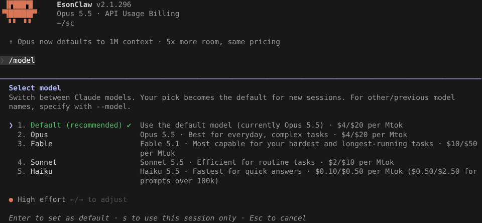
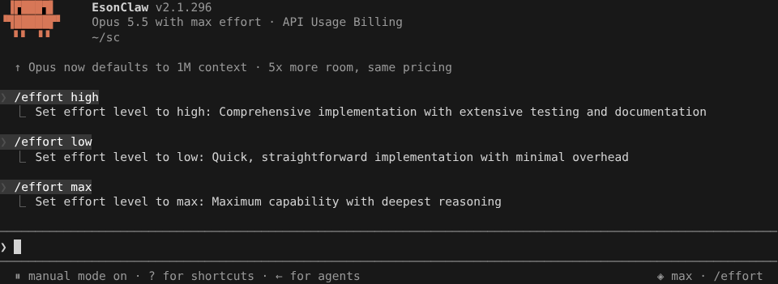
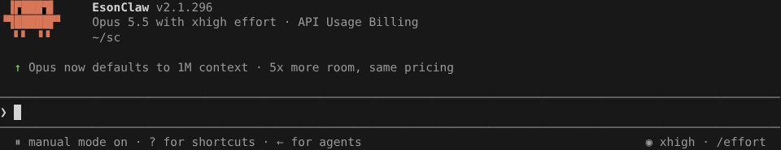

# Effort 档位

<!-- lang: zh-Hans -->

> 英文名：`effort` · 领域：模型与 Provider · [返回功能索引](README.md)

## 这是什么

Effort 是推理强度：同一个模型，effort 越高，回答前思考得越多，结果通常更仔细，但更慢、用的 token 更多。日常小改动用 `medium` 就够；复杂排查、大重构可以调高；简单问答可以调低省钱。

| 档位 | 适合 |
| --- | --- |
| `minimal` / `low` | 简单问题、机械改动，追求快 |
| `medium` | 大多数日常任务（多数模型的默认值） |
| `high` / `xhigh` | 复杂逻辑、跨文件改动、难查的 bug |
| `max` / `ultra` | 最难的问题，不在乎时间 |
| `ultracode` | 本 fork 的本地编排档：以 `xhigh` 发送；启用 Workflow 且模型支持 xhigh 时，子代理不受全局并发上限限制 |
| `none` | 不发送 effort 参数 |

不同模型支持的档位不同，以 `/model` 里能选到的为准。

非交互运行（`claude -p`、Agent SDK）在支持 effort 的模型上默认用 `high`：公开基准里，完成率高的 CLI 多出来的思考主要花在跑测试和收尾检查上。交互式会话的默认值不变；显式设置（`--effort`、`CLAUDE_CODE_EFFORT_LEVEL`、`modelSettings`）仍然优先。

<details lang="en"><summary>English</summary>

> Name: `effort` · Area: Models and providers · [Back to index](README.md)

## What it is

Effort is reasoning strength. With the same model, higher effort means more thinking before answering: usually more careful results, but slower and with more tokens. `medium` is enough for everyday small changes; raise it for hard debugging or large refactors, lower it for simple questions to save money.

| Level | Good for |
| --- | --- |
| `minimal` / `low` | simple questions and mechanical edits, when speed matters |
| `medium` | most everyday tasks (the default for most models) |
| `high` / `xhigh` | complex logic, cross-file changes, hard bugs |
| `max` / `ultra` | the hardest problems, when time does not matter |
| `ultracode` | this fork's local orchestration level: sent as `xhigh`; with Workflow enabled and a model that supports xhigh, sub-agents are not bound by the global concurrency limit |
| `none` | do not send an effort parameter |

Models support different levels; what `/model` lets you pick is authoritative.

Non-interactive runs (`claude -p`, the Agent SDK) default to `high` on models that support effort: in public benchmarks, the extra thinking of the CLIs with higher completion rates went mostly into running tests and final checks. The default for interactive sessions is unchanged, and explicit settings (`--effort`, `CLAUDE_CODE_EFFORT_LEVEL`, `modelSettings`) still win.

</details>
<details lang="zh-Hant"><summary>繁體中文</summary>

> 英文名：`effort` · 領域：模型與 Provider · [返回功能索引](README.md)

## 這是什麼

Effort 是推理強度：同一個模型，effort 越高，回答前思考得越多，結果通常更仔細，但更慢、用的 token 更多。日常小改動用 `medium` 就夠；複雜排查、大重構可以調高；簡單問答可以調低省錢。

| 檔位 | 適合 |
| --- | --- |
| `minimal` / `low` | 簡單問題、機械改動，追求快 |
| `medium` | 大多數日常任務（多數模型的預設值） |
| `high` / `xhigh` | 複雜邏輯、跨檔案改動、難查的 bug |
| `max` / `ultra` | 最難的問題，不在乎時間 |
| `ultracode` | 本 fork 的本地編排檔：以 `xhigh` 傳送；啟用 Workflow 且模型支援 xhigh 時，子代理不受全域併發上限限制 |
| `none` | 不傳送 effort 參數 |

不同模型支援的檔位不同，以 `/model` 裡能選到的為準。

非互動執行（`claude -p`、Agent SDK）在支援 effort 的模型上預設用 `high`：公開基準裡，完成率高的 CLI 多出來的思考主要花在跑測試和收尾檢查上。互動式會話的預設值不變；顯式設定（`--effort`、`CLAUDE_CODE_EFFORT_LEVEL`、`modelSettings`）仍然優先。

</details>

## 快速上手

**1. 在 `/model` 里调。** 选模型的同时，用 `←` `→` 调整下方的 effort，`Enter` 确认，保存为以后的默认值：



**2. 用命令切。** `/effort <档位>` 立即生效并保存；底部会短暂显示当前档位：



- `/effort` 不带参数：打开调节条，`←` `→` 选档位，`Tab` 开关 Ultracode，`Enter` 保存，`s` 只用于本会话；
- `/effort auto`（或 `unset`）：清除保存的值，回到模型默认。

**3. 启动时指定。** `claude --effort ultracode`。欢迎画面会写出实际发给 API 的档位（`ultracode` 显示为 `xhigh`）：



## 给子代理单独指定

Claude 调用 Agent 工具时可以按次指定 `effort`，例如让搜索类子代理用 `low` 省钱：

```json
{
  "description": "检查相关实现",
  "prompt": "检查此次改动的调用链和边界条件",
  "subagent_type": "general-purpose",
  "model": "inherit",
  "effort": "low"
}
```

子代理用哪个档位，按以下顺序取第一个有值的：

1. 这次调用写的 `effort`；
2. 子代理定义（`.claude/agents/*.md`）里的 `effort`（也接受旧的整数写法）；
3. 调用方当前的 effort（嵌套时继承直接上级）；
4. 调用方模型的默认值。

给子代理设置不会改变主对话。前台、后台、teammate 都会传递；后台子代理续跑时保留启动时的档位。

## 设置

| 方式 | 写法 | 作用范围 |
| --- | --- | --- |
| settings `modelSettings.<模型>.effortLevel` | `minimal` … `ultracode` | 按模型保存的持久默认值，与官方相同；`/model`、`/effort`、SDK `update_settings` 写当前模型这一项，换模型时载入新模型的值 |
| 顶层 `effortLevel` | 同上 | 只在项目、本地、managed 与 flag 设置里有效；用户设置里的顶层值不再读取（与官方相同），`/effort auto` 会顺便清掉它 |
| `--effort <档位>` | 也可用 `none` | 当前会话 |
| `/effort <档位>` | 另有 `none`、`auto` / `unset` | 当前会话并保存 |
| 环境变量 `CLAUDE_CODE_EFFORT_LEVEL` | 档位；`auto` / `unset` 表示请求里不带 effort | 最高优先级，覆盖以上所有 |

```json
{ "modelSettings": { "claude-opus-5-5": { "effortLevel": "high" } } }
```

从旧版本升级时，如果原来只在用户设置里写了顶层 `effortLevel`，运行一次 `/effort <档位>` 就会按当前模型重新保存。用 ChatGPT 账号登录 OpenAI provider 时，可选档位和默认值来自账号的模型目录。

## 和官方的区别

- 你通过命令行、settings、环境变量指定的档位**原样发给 API**，不会按模型能力自动改写；`/model` 里可选的档位仍按模型能力显示。
- 新增 `ultracode` 本地档（发送 `xhigh`）；Agent 工具支持按次 `effort`。

## 说明

画面来自实际运行，使用测试用假 API。
