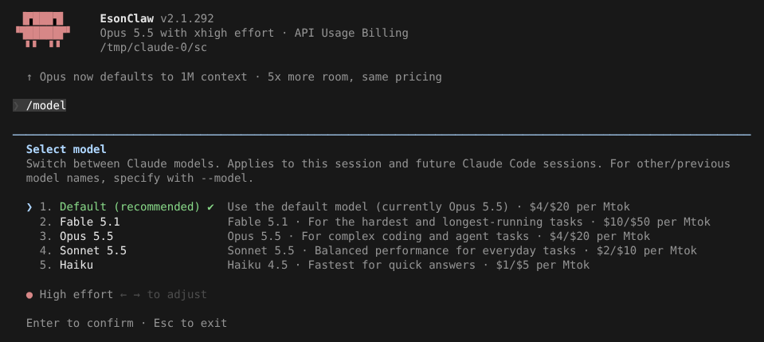
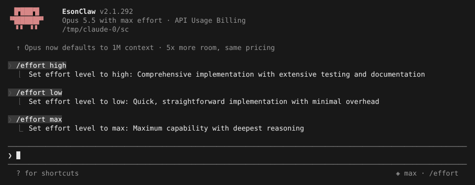
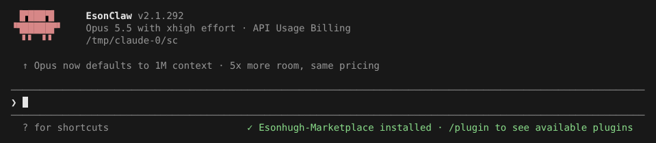

# Effort 档位

> 英文名：`effort` · 领域：模型与 Provider · [返回功能索引](README.md)

## 这是什么

Effort 是推理强度：同一个模型，effort 越高，回答前思考得越多，结果通常更仔细，但更慢、用的 token 更多。日常小改动用 `medium` 就够；复杂排查、大重构可以调高；简单问答可以调低省钱。

| 档位 | 适合 |
| --- | --- |
| `minimal` / `low` | 简单问题、机械改动，追求快 |
| `medium` | 大多数日常任务（多数模型的默认值） |
| `high` / `xhigh` | 复杂逻辑、跨文件改动、难查的 bug |
| `max` / `ultra` | 最难的问题，不在乎时间 |
| `ultracode` | 本 fork 的本地编排档：以 `xhigh` 发送；启用 Workflow 且模型支持 xhigh 时，子代理不受全局并发上限限制 |
| `none` | 不发送 effort 参数 |

不同模型支持的档位不同，以 `/model` 里能选到的为准。

## 快速上手

**1. 在 `/model` 里调。** 选模型的同时，用 `←` `→` 调整下方的 effort，`Enter` 确认，保存为以后的默认值：



**2. 用命令切。** `/effort <档位>` 立即生效并保存；底部会短暂显示当前档位：



- `/effort` 不带参数：显示当前档位；
- `/effort auto`（或 `unset`）：清除保存的值，回到模型默认。

**3. 启动时指定。** `claude --effort ultracode`。欢迎画面会写出实际发给 API 的档位（`ultracode` 显示为 `xhigh`）：



## 给子代理单独指定

Claude 调用 Agent 工具时可以按次指定 `effort`，例如让搜索类子代理用 `low` 省钱：

```json
{
  "description": "检查相关实现",
  "prompt": "检查此次改动的调用链和边界条件",
  "subagent_type": "general-purpose",
  "model": "inherit",
  "effort": "low"
}
```

子代理用哪个档位，按以下顺序取第一个有值的：

1. 这次调用写的 `effort`；
2. 子代理定义（`.claude/agents/*.md`）里的 `effort`（也接受旧的整数写法）；
3. 调用方当前的 effort（嵌套时继承直接上级）；
4. 调用方模型的默认值。

给子代理设置不会改变主对话。前台、后台、teammate 都会传递；后台子代理续跑时保留启动时的档位。

## 设置

| 方式 | 写法 | 作用范围 |
| --- | --- | --- |
| settings `effortLevel` | `minimal` … `ultracode` | 持久默认值；`/model`、`/effort` 会写这里 |
| `--effort <档位>` | 也可用 `none` | 当前会话 |
| `/effort <档位>` | 另有 `none`、`auto` / `unset` | 当前会话并保存 |
| 环境变量 `CLAUDE_CODE_EFFORT_LEVEL` | 档位；`auto` / `unset` 表示请求里不带 effort | 最高优先级，覆盖以上所有 |

```json
{ "effortLevel": "high" }
```

## 和官方的区别

- 你通过命令行、settings、环境变量指定的档位**原样发给 API**，不会按模型能力自动改写；`/model` 里可选的档位仍按模型能力显示。
- 新增 `ultracode` 本地档（发送 `xhigh`）；Agent 工具支持按次 `effort`。

## 说明

画面来自实际运行，使用测试用假 API。
