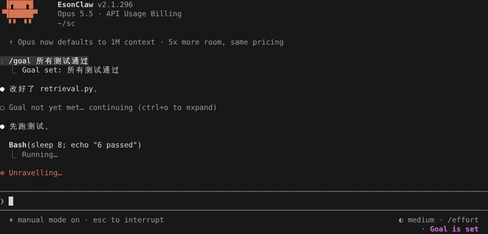
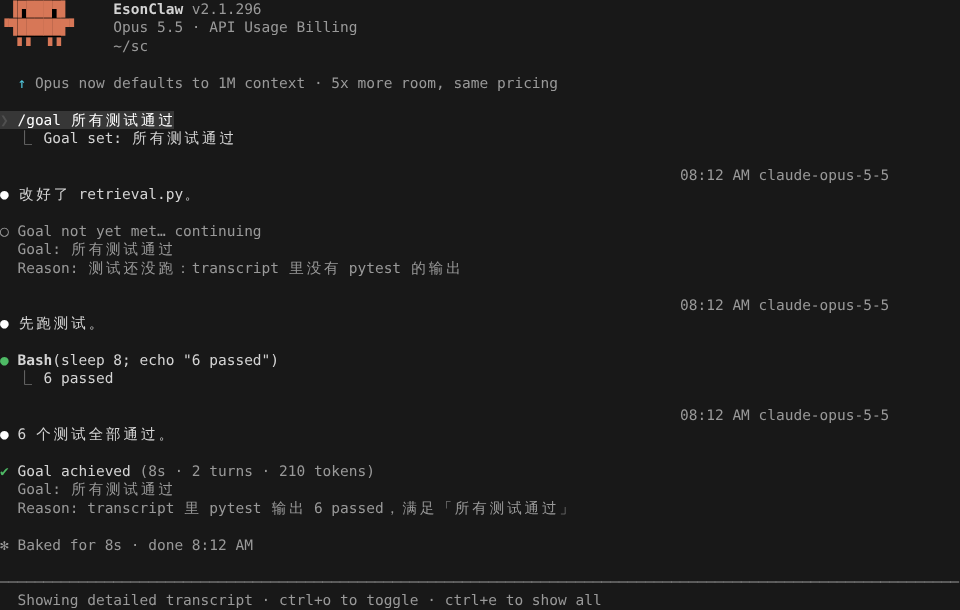
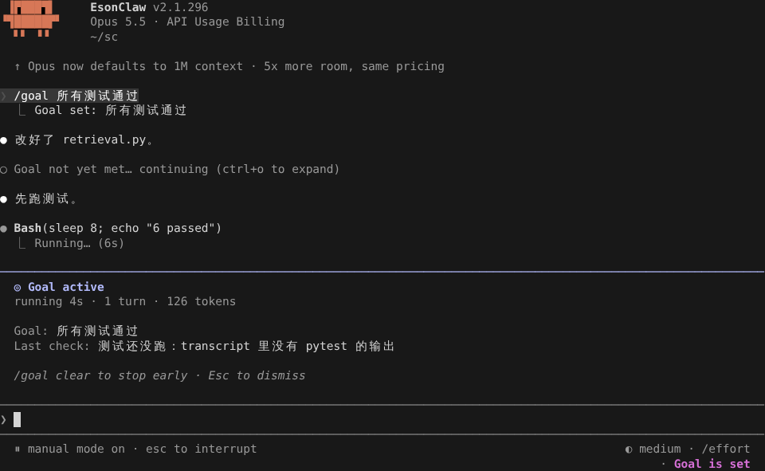

# 自主 Goal

<!-- lang: zh-Hans -->

> 英文名：`goal` · 领域：界面与交互 · [返回功能索引](README.md)

## 这是什么

平时 Claude 回答完一轮就停下来等你。有时你希望它**一直做到某个结果为止**，比如「所有测试通过」「lint 没有错误」。`/goal` 就是干这个的：

1. 你用一句话写下完成条件；
2. Claude 每次准备停下时，另一次模型调用读一遍对话记录，判断条件是否满足；
3. 没满足：把「还差什么」告诉 Claude，让它继续；满足了：停下，并显示用了多久、几轮、多少 token。

<details lang="en"><summary>English</summary>

> Name: `goal` · Area: UI and interaction · [Back to index](README.md)

## What it is

Normally Claude stops after each turn and waits for you. Sometimes you want it to **keep going until a result holds**, such as "all tests pass" or "lint is clean". That is what `/goal` does:

1. you write the finish condition in one sentence;
2. whenever Claude is about to stop, a separate model call reads the transcript and judges whether the condition holds;
3. if not, it tells Claude what is still missing and Claude continues; if so, it stops and shows how long it took, how many turns and how many tokens.

</details>
<details lang="zh-Hant"><summary>繁體中文</summary>

> 英文名：`goal` · 領域：介面與互動 · [返回功能索引](README.md)

## 這是什麼

平時 Claude 回答完一輪就停下來等你。有時你希望它**一直做到某個結果為止**，比如「所有測試通過」「lint 沒有錯誤」。`/goal` 就是幹這個的：

1. 你用一句話寫下完成條件；
2. Claude 每次準備停下時，另一次模型呼叫讀一遍對話記錄，判斷條件是否滿足；
3. 沒滿足：把「還差什麼」告訴 Claude，讓它繼續；滿足了：停下，並顯示用了多久、幾輪、多少 token。

</details>

## 快速上手

**1. 设定目标：**

```text
/goal all tests pass
```

Claude 开始工作。每轮结束时如果判断还没达成，会显示 `Goal not yet met… continuing`，然后自动继续：



为了防止死循环，**连续 9 次**没达成就强制结束本轮，并提示可用 `CLAUDE_CODE_STOP_HOOK_BLOCK_CAP` 调大上限。目标仍然保留，你补充信息后它会接着检查。

**2. 达成时**显示 `✔ Goal achieved`，括号里是耗时、轮数和 token；按 `ctrl+o` 能看到判断依据（`Reason: …`，会引用对话里的证据）：



**3. 随时查看：** 单独输入 `/goal` 打开状态视图，显示目标、状态、耗时、轮数、token 和最近一次检查的原因：



**4. 提前取消：** `/goal clear`。

```text
❯ /goal clear
  ⎿  Goal cleared: make tests pass
```

## 写好完成条件

判断只看**对话记录**，所以条件要能在记录里找到证据：

| 好的写法 | 不好的写法 |
| --- | --- |
| `all tests pass`（测试输出会出现在记录里） | `the code is good`（无法判断） |
| `bun test src/parser exits with 0` | `fix everything` |
| `lint reports no errors` | `deploy succeeds`（如果 Claude 看不到部署结果） |

条件永远不可能满足时（例如要求的文件不存在），判断会返回「impossible」并停止。

## 其他

- **恢复会话后目标还在**：目标和检查状态写在会话记录里，`--resume` / `--continue` 后恢复。
- **Claude 也能自己设目标**：通过 `Goal` 工具（`action: "set"` / `"clear"`），效果相同。
- **底部状态**：目标进行中，状态栏右侧显示 `Goal is set`；自定义状态栏脚本可以读 `goal.active`（见 [branding.md](branding.md)）。

## 命令速查

| 命令 | 作用 |
| --- | --- |
| `/goal <条件>` | 设定目标并开始 |
| `/goal` | 查看状态 |
| `/goal clear` | 取消目标 |

## 说明

画面来自实际运行，模型回复和目标判断由测试用假 API 按脚本生成（测试输出 `6 passed` 后判为达成）。
