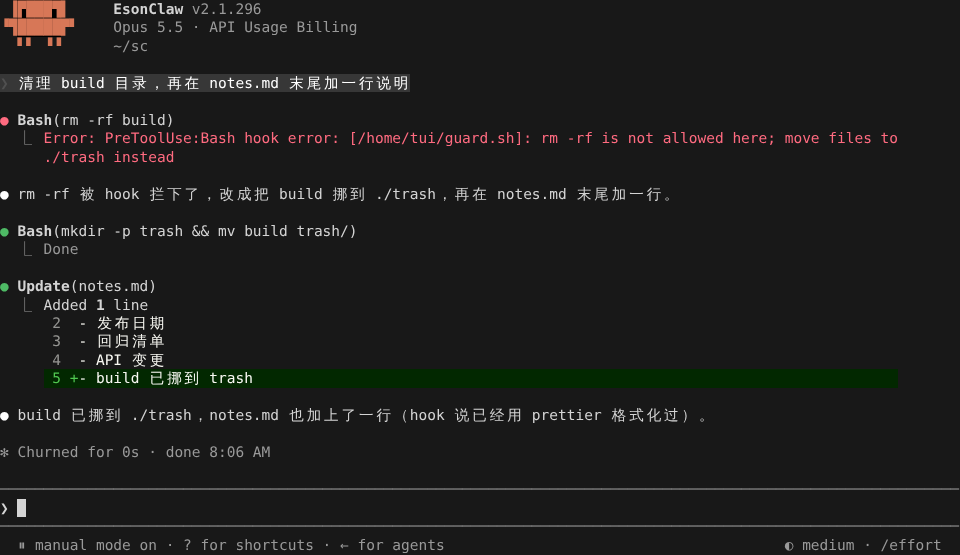
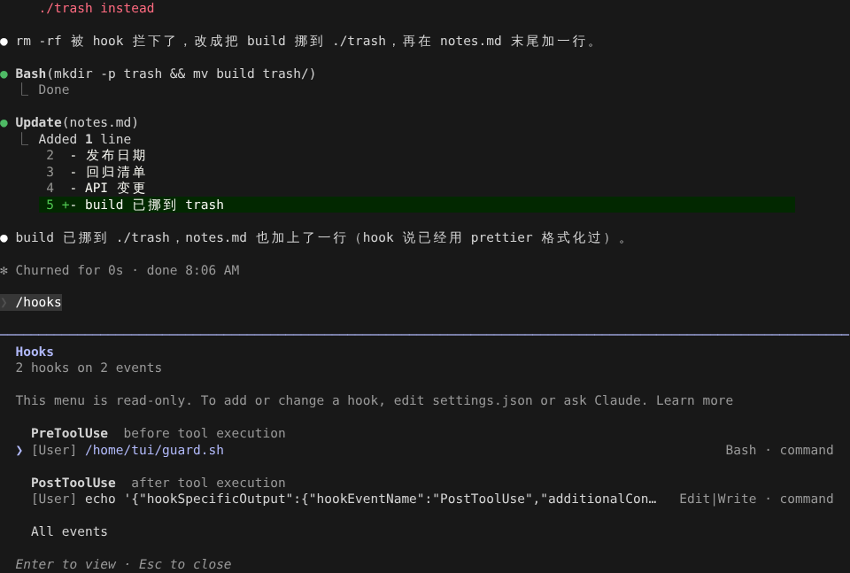
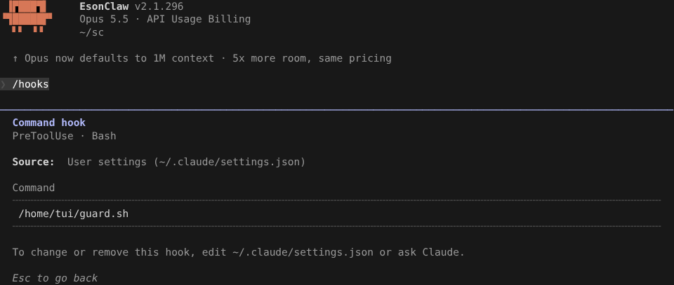

# Hooks 事件、匹配与输出校验

<!-- lang: zh-Hans -->

> 英文名：`hooks` · 领域：权限与安全 · [返回功能索引](README.md)

## 这是什么

Hook 是「到了某个时刻就自动执行的命令」。你在 settings.json 里登记：在什么事件、对什么工具、跑哪个脚本。典型用途：

- **拦截**：Claude 要跑 `rm -rf` 之前，你的脚本检查并拒绝，同时告诉它该怎么做；
- **善后**：每次改完文件自动跑格式化、lint；
- **补充信息**：会话开始时把当前分支、待办事项塞给 Claude；
- **通知**：Claude 需要你确认时发桌面通知。

行为对齐官方 2.1.303；2.1.329 新增和改动的 hook 行为已逐项对照，还没移植的列在文末「已知差异」。

<details lang="en"><summary>English</summary>

> Name: `hooks` · Area: Permissions and security · [Back to index](README.md)

## What it is

A hook is a command that runs automatically at a certain moment. In settings.json you register which event, which tool and which script. Typical uses:

- **Block**: before Claude runs `rm -rf`, your script checks it, refuses, and tells Claude what to do instead.
- **Clean up**: run the formatter and lint after every file edit.
- **Add context**: give Claude the current branch and open to-dos when a session starts.
- **Notify**: send a desktop notification when Claude needs your approval.

Behaviour matches the official 2.1.303. Hook changes up to 2.1.329 were compared item by item; what is not ported yet is listed under "Known differences" at the end.

</details>
<details lang="zh-Hant"><summary>繁體中文</summary>

> 英文名：`hooks` · 領域：權限與安全 · [返回功能索引](README.md)

## 這是什麼

Hook 是「到了某個時刻就自動執行的命令」。你在 settings.json 裡登記：在什麼事件、對什麼工具、跑哪個腳本。典型用途：

- **攔截**：Claude 要跑 `rm -rf` 之前，你的腳本檢查並拒絕，同時告訴它該怎麼做；
- **善後**：每次改完檔案自動跑格式化、lint；
- **補充資訊**：會話開始時把當前分支、待辦事項塞給 Claude；
- **通知**：Claude 需要你確認時發桌面通知。

行為對齊官方 2.1.303；2.1.329 新增和改動的 hook 行為已逐項對照，還沒移植的列在文末「已知差異」。

</details>

## 一个完整的例子

目标：不许 Claude 用 `rm -rf`，并告诉它改成把文件挪到 `./trash`；每次改完文件告诉它「已经格式化过了」。

**1. 写拦截脚本** `guard.sh`。Hook 从 stdin 收到一段 JSON（工具名和参数），用退出码表达结果：

```sh
#!/bin/sh
# Block any Bash command that contains "rm -rf".
cmd=$(cat | sed -n 's/.*"command":"\([^"]*\)".*/\1/p')
case "$cmd" in *"rm -rf"*) echo "rm -rf is not allowed here; move files to ./trash instead" >&2; exit 2;; esac
exit 0
```

**2. 在 settings.json 里登记：**

```json
{
  "hooks": {
    "PreToolUse": [
      { "matcher": "Bash", "hooks": [{ "type": "command", "command": "/path/to/guard.sh" }] }
    ],
    "PostToolUse": [
      { "matcher": "Edit|Write", "hooks": [{ "type": "command",
        "command": "echo '{\"hookSpecificOutput\":{\"hookEventName\":\"PostToolUse\",\"additionalContext\":\"formatted with prettier\"}}'" }] }
    ]
  }
}
```

**3. 效果：** `rm -rf` 被拦下，脚本写到 stderr 的那句话原样交给 Claude；编辑照常进行：



按 `Ctrl+O` 打开详细记录，能看到编辑后跑过的 PostToolUse hook：

```text
● Update(/tmp/claude-0/hk/a.txt)
  ⎿  Added 1 line, removed 1 line
      1 -x
      1 +y
  ⎿  2 PostToolUse hooks ran
```

## 用 `/hooks` 查看已登记的 hook

`/hooks` 按事件列出每个 hook，标出来源（如 `[User]`）、matcher 和类型（只读；要修改请编辑 settings.json 或直接让 Claude 改）：



选中一个 hook 按 Enter，能看到它的事件、matcher、来自哪个配置文件和完整命令：



设置里写了 `"disableAllHooks": true` 时，`/hooks` 只显示停用页：标题 `Hooks`，副标题 `off · N hooks not running`（N 是已登记但不会运行的 hook 数）；如果是组织托管设置停用的，`off` 换成 `turned off by your organization`。

## 退出码和输出

| 结果 | 效果 |
| --- | --- |
| 退出码 `0` | 放行；stdout / stderr 不显示（少数事件如 SessionStart、UserPromptSubmit 的 stdout 会作为上下文交给 Claude） |
| 退出码 `2` | 阻止这次操作，stderr 交给 Claude |
| 其他退出码 | 只给你看 stderr，操作继续 |
| stdout 输出 JSON | 更精细的控制，例如 `hookSpecificOutput.additionalContext` 补充上下文、`permissionDecision`（`allow` / `deny` / `ask` / `defer`）直接决定这次工具调用、`updatedInput` 改写工具参数 |

几条规则：

- stdout 的 JSON 不符合格式时，报错第一行指出哪个字段错了，后面附上 `Expected schema` 提示块，例如：

  ```text
  Hook JSON output validation failed — hookSpecificOutput.permissionDecision: Invalid option: expected one of "allow"|"deny"|"ask"|"defer"
  ```

  缺 `hookEventName`、PermissionRequest 的 `decision` 写错、用了旧版顶层 `decision` 时各有单独提示。SDK 收到的 `hook_response.exit_code` 是 hook 的真实退出码；退出码非零时，报错后面附上 stderr。
- `updatedInput` 会按工具参数格式校验：未知字段丢掉；其他格式错误、或工具自己的校验不通过，这次调用就被拒绝。
- hook 输出里的 `<system-reminder>` 标签会被转义，不能伪造系统提示。
- 插件 hook 的命令里不能直接引用 `${user_config.*}`，请改读环境变量 `$CLAUDE_PLUGIN_OPTION_<KEY>`。

## hook 自己出错时：`onFailure`

脚本不存在、超时或异常退出时，默认只报错、操作照常执行：

```text
● Bash(echo hi)
  ⎿  PreToolUse:Bash hook error
  ⎿  hi
```

对安全检查类 hook，建议加 `"onFailure": "block"`，这样 hook 坏了也不会放行：

```json
{ "type": "command", "command": "./check.sh", "onFailure": "block" }
```

```text
● Bash(echo hi)
  ⎿  Error: PreToolUse:Bash hook error: [/nonexistent/check.sh]: failed; blocking because onFailure is "block"
     /bin/sh: 1: /nonexistent/check.sh: not found
```

`onFailure` 对 Stop、SubagentStop、TaskCompleted、TeammateIdle 和异步 hook 不生效。

Agent SDK 在 `initialize` 里登记的 callback hook 也接受 matcher 上的 `onFailure`，回应里带 `hook_on_failure_supported: true`；callback 失败时和 command / http hook 一样阻断。SDK 的 PreToolUse callback 超时（不是用户中断）时，工具不会执行，模型收到：

```text
PreToolUse hook did not respond before its timeout (host client may be unreachable). The tool call was not executed; other configured hooks may not have completed.
```

## 先停下，回头再执行：`defer`

PreToolUse hook 返回 `"permissionDecision": "defer"` 时，这次工具调用先不执行，会话停下来等外部决定（同官方 2.1.329）：

```json
{ "hookSpecificOutput": { "hookEventName": "PreToolUse", "permissionDecision": "defer" } }
```

- 只在 `claude -p` 和 SDK 里生效，而且这一轮只能有一个工具调用；交互会话或一轮里有多个工具调用时，`defer` 被忽略（`--debug` 里有一行警告）。有 hook 返回 `deny` 时以 `deny` 为准。
- 结果的 `stop_reason` 和 `terminal_reason` 是 `tool_deferred`，并带上 `deferred_tool_use`（被推迟的那次调用）。
- 之后用 `claude -p --resume <会话>` 或 `--continue` 回来，可以不带提示词：这次调用先重新经过 PreToolUse hook，再执行。工具已经不存在时，结果是 `tool_deferred_unavailable`。

## 同一个 hook 只跑一次

同一条 hook 同时写在 user、project、local 设置和 `--settings` 里时，只执行一次，用优先级最高的来源那份（例如 `timeout` 不同时，project 优先于 user，`--settings` 优先于 local）。

- 组织托管设置里的 hook 单独算：只有整个 matcher（`matcher`、命令、`timeout` 等全部字段）和其他来源完全相同时才合并成一份，JSON 键的顺序不影响判断；有任何字段不同，两份都执行。
- 插件按名字去重：两个 marketplace 装了同名插件时，只注册先加载的那份的 hook，`--debug` 里记 `Skipping duplicate hook registration for plugin "<名字>" from <来源> - already registered from another source`。托管设置的 `enabledPlugins` 里设为 `true` 的插件排在最前，会话中途改了也会重新加载。

## matcher 怎么写

| 写法 | 匹配 |
| --- | --- |
| `"Bash"` | 只匹配 Bash |
| `"Edit\|Write"` 或 `"Edit,Write"` | 列表里的任意一个 |
| `"mcp__brave-search__.*"` | 正则：某个 MCP server 的全部工具 |
| 省略或 `""` | 全部 |

只包含字母、数字、`_`、`-`、空格、`|`、`,` 的 matcher 按**精确名字列表**匹配，所以 `brave-search` 这类带连字号的名字不会被当成正则。想用通配必须写成正则（例如 `.*`）。

OpenAI provider 的 `apply_patch` 工具在 `PreToolUse` / `PostToolUse` / `PostToolUseFailure` 里按文件拆成 Edit / Write 事件，已有的 `Edit|Write` hook 照常生效，见 [apply_patch 工具](openai-provider.md#apply_patch-工具)。

## 有哪些事件

| 事件 | 什么时候 | 常见用途 |
| --- | --- | --- |
| `PreToolUse` / `PostToolUse` / `PostToolUseFailure` | 工具执行前 / 成功后 / 失败后 | 拦截、审计、格式化 |
| `PermissionRequest` / `PermissionDenied` | 弹权限确认时 / 自动模式拒绝后 | 自动审批、记录；`-p` 下也会触发 |
| `UserPromptSubmit` | 你发出消息后、处理前（在 skill 和自定义命令展开之前） | 过滤、补充上下文 |
| `SessionStart` / `SessionEnd` / `Setup` | 会话开始 / 结束 / 初始化 | 注入上下文；SessionStart 可返回 `sessionTitle`、`reloadSkills`；`--fork-session` 与 `/branch` 触发时 `source` 为 `fork`（matcher 可写 `fork`） |
| `Stop` / `StopFailure` / `SubagentStart` / `SubagentStop` | Claude 准备结束回答 / 子 Agent 开始与结束 | 检查是否真的做完；可返回 `additionalContext` 让它继续 |
| `PreCompact` / `PostCompact` | 压缩上下文前 / 后 | PreCompact 可阻止压缩 |
| `PreModelSwitch` / `PostModelSwitch` | 切换模型前 / 后 | 限制可用模型 |
| `Notification` | 需要你注意时 | 桌面通知 |
| `TaskCreated` / `TaskCompleted` / `TeammateIdle` | 任务清单与团队事件 | 团队协作 |
| `Elicitation` / `ElicitationResult` | MCP 向你索取输入 | |
| `ConfigChange` / `InstructionsLoaded` / `CwdChanged` / `FileChanged` / `DirectoryAdded` | 配置、指令文件、目录变化 | |
| `WorktreeCreate` / `WorktreeRemove` | 建 / 删 worktree | 自定义 worktree 流程 |
| `MessageDisplay` | 每段回复文本显示完成时（只触发一次，`final: true`） | 朗读、转发 |

几个事件的细节（同官方 2.1.329）：

- **UserPromptSubmit** 阻止提交后，你输入的提示词放回输入框，不会丢。
- **PreCompact**：会话里还没有模型回复（只跑过本地命令）时，`/compact <指令>` 也会先运行 PreCompact，`custom_instructions` 是你写的指令，然后报 `Not enough messages to compact.`；SDK 收到 `compacting` 和失败两条 status。
- **PreModelSwitch / PostModelSwitch** 的输入带 `prompt_cache_warm`、`cache_ttl`（`5m` / `1h`）、`estimated_cache_write_usd`（在新模型上重建缓存的估算费用）和 `pricing`（本 fork 没有托管 `modelPricing`，只会是 `catalog` 或 `default`）。PreModelSwitch 阻止时，`/model` 和 `-p` 显示 `Model switch to X was blocked by a PreModelSwitch hook: <原因>`；hook 返回 `ask` 时 `-p` 下会附上 `(run /model interactively to confirm)`。原因压成一行显示：去掉末尾空白，超过 2000 字符截断并加 `…`，tab 换成空格，换行和控制字符、不可见格式字符换成 `�`。PreModelSwitch hook 的 `systemMessage` 和执行失败的提示（`PreModelSwitch hook <名称> failed: <stderr>`）逐行附在 `/model` 的结果或阻止原因后面，按同样规则压成一行。hook 返回 `allow` 时，`/model` 不再因 prompt cache 仍热而弹 `Switch model?` 确认。`-p '/model x'` 切换后也会运行 PostModelSwitch（`source` 为 `command`），它的 `additionalContext` 进入下一次请求。官方会对 plan mode 下要用的模型再运行一次 PreModelSwitch，同一条消息可能出现两次；本 fork 只运行一次。
- **Notification**：交互会话弹权限确认时，消息固定是 `Claude needs your permission`，不带工具名。
- **Elicitation** hook 最后决定取消时，MCP server 收到 `{"action":"cancel","content":{}}`，不带 hook 返回的 content。
- **WorktreeCreate** 失败时说明原因：hook 成功但没给路径时报 `WorktreeCreate hook failed: hook succeeded but returned no worktree path (command: echo the path to stdout; http/callback: return hookSpecificOutput.worktreePath)`；配置了但一个都没运行时报 `WorktreeCreate hook failed: hook is configured but did not run (workspace not trusted or matcher mismatch)`。

## 异步 hook

`"async": true` 的 hook 在后台运行，不等它结束；`"asyncRewake": true` 的 hook 在后台运行，结束时如果退出码是 `2`，会显示 `Stop hook feedback`，并把它的输出交给 Claude 继续处理。

- `claude -p` 结束时，还没跑完的 `async` hook 会被终止，后面的命令不再执行。
- 单次 `claude -p`（不是 `--input-format stream-json`）没有下一轮可以唤醒，所以 `asyncRewake` hook 改为同步运行，等它跑完再结束。

## hook 能读到的环境变量

除了你自己的环境，command hook 还能读到：

| 变量 | 值 |
| --- | --- |
| `CLAUDECODE` | `1` |
| `CLAUDE_CODE_SESSION_ID` | 当前会话 ID |
| `CLAUDE_CODE_CHILD_SESSION` | `1` |
| `CLAUDE_CODE_SESSION_ATTENDED` | 有人在场的会话为 `1`（交互会话，或 IDE、桌面应用等入口启动的 `-p`），后台、daemon 和普通 `-p` 为 `0` |
| `CLAUDE_PID` | Claude Code 进程的 PID |
| `CLAUDE_CODE_CHILD_NOTES_DIR` | `<项目临时目录>/<会话 ID>/started`，各级目录权限为 `0700`；路径上有符号链接时不设置 |
| `CLAUDE_EFFORT` | 当前 effort 档位（JSON 输入里也有 `effort.level`） |

打包 binary 自己用的 `CLAUDE_CODE_BUILTIN_*`、`CLAUDE_CODE_EMBEDDED_*` 不会传给 hook。`CLAUDE_CODE_CHILD_NOTES_DIR` 只创建目录并传下去，让 hook 的环境和官方一致。官方里，由 hook 启动的 Claude 子会话会在这个目录写一个以自己会话 ID 命名的记录，父会话读取这些记录，只用来写自己的数据流记录，界面上看不到。本 fork 没有这套数据流记录，所以不写也不读这个目录，这是有意的取舍。

## 未信任的文件夹

项目或本地 agent（`.claude/agents/`）frontmatter 里的 hook，只有在这个文件夹被信任后才注册；`-p` 和 SDK 不显示信任框，同样按是否信任过判断。没信任时不运行，`--debug` 里记 `Skipping frontmatter hooks for agent '<名字>': the folder its definition file came from is not trusted (source: projectSettings)`。用户级 agent 不受影响。信任框的变化见 [permissions.md](permissions.md#未信任的文件夹)。

## 其他细节

- **并行**：同一事件里的 prompt / agent 类型 hook 最多 12 个同时运行。
- **Stop 防死循环**：Stop hook 连续阻止结束时，默认第 9 次后强制结束；用环境变量 `CLAUDE_CODE_STOP_HOOK_BLOCK_CAP` 调整（整数，`0` 表示不限制）。
- **调试**：`claude --debug` 会记录每个 command hook 的结果和耗时。
- **UserPromptSubmit 拦截时**，自定义命令里嵌入的 shell 命令不会执行。

## 已知差异

和官方 2.1.329 相比，下面几项还没有移植：

- hook 输出的 `terminalSequence` 字段没有实现，`Expected schema` 提示块里也没有这一行。
- 未信任文件夹里 agent frontmatter hook 被跳过时，debug 日志只有前半句，没有官方后面那句「如何信任这个文件夹」。
- `CLAUDE_EFFORT` 在 `-p` 下默认是 `high`，官方是 `medium`，这是本 fork 有意的差异，见 [effort.md](effort.md)。

## 说明

画面来自实际运行，模型回复由测试用假 API 按脚本生成。
