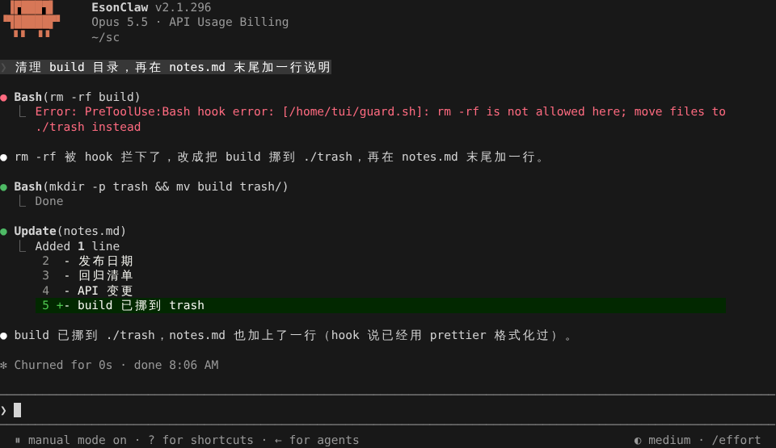
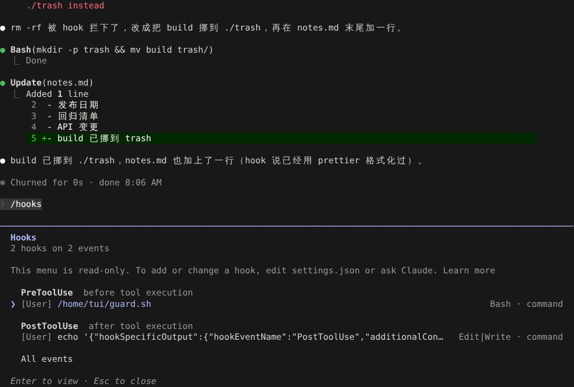
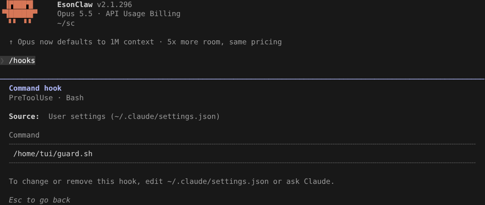

# Hooks 事件、匹配与输出校验

<!-- lang: zh-Hans -->

> 英文名：`hooks` · 领域：权限与安全 · [返回功能索引](README.md)

## 这是什么

Hook 是「到了某个时刻就自动执行的命令」。你在 settings.json 里登记：在什么事件、对什么工具、跑哪个脚本。典型用途：

- **拦截**：Claude 要跑 `rm -rf` 之前，你的脚本检查并拒绝，同时告诉它该怎么做；
- **善后**：每次改完文件自动跑格式化、lint；
- **补充信息**：会话开始时把当前分支、待办事项塞给 Claude；
- **通知**：Claude 需要你确认时发桌面通知。

行为对齐官方 2.1.303。

<details lang="en"><summary>English</summary>

> Name: `hooks` · Area: Permissions and security · [Back to index](README.md)

## What it is

A hook is a command that runs automatically at a certain moment. In settings.json you register which event, which tool and which script. Typical uses:

- **Block**: before Claude runs `rm -rf`, your script checks it, refuses, and tells Claude what to do instead.
- **Clean up**: run the formatter and lint after every file edit.
- **Add context**: give Claude the current branch and open to-dos when a session starts.
- **Notify**: send a desktop notification when Claude needs your approval.

Behaviour matches the official 2.1.303.

</details>
<details lang="zh-Hant"><summary>繁體中文</summary>

> 英文名：`hooks` · 領域：權限與安全 · [返回功能索引](README.md)

## 這是什麼

Hook 是「到了某個時刻就自動執行的命令」。你在 settings.json 裡登記：在什麼事件、對什麼工具、跑哪個腳本。典型用途：

- **攔截**：Claude 要跑 `rm -rf` 之前，你的腳本檢查並拒絕，同時告訴它該怎麼做；
- **善後**：每次改完檔案自動跑格式化、lint；
- **補充資訊**：會話開始時把當前分支、待辦事項塞給 Claude；
- **通知**：Claude 需要你確認時發桌面通知。

行為對齊官方 2.1.303。

</details>

## 一个完整的例子

目标：不许 Claude 用 `rm -rf`，并告诉它改成把文件挪到 `./trash`；每次改完文件告诉它「已经格式化过了」。

**1. 写拦截脚本** `guard.sh`。Hook 从 stdin 收到一段 JSON（工具名和参数），用退出码表达结果：

```sh
#!/bin/sh
# Block any Bash command that contains "rm -rf".
cmd=$(cat | sed -n 's/.*"command":"\([^"]*\)".*/\1/p')
case "$cmd" in *"rm -rf"*) echo "rm -rf is not allowed here; move files to ./trash instead" >&2; exit 2;; esac
exit 0
```

**2. 在 settings.json 里登记：**

```json
{
  "hooks": {
    "PreToolUse": [
      { "matcher": "Bash", "hooks": [{ "type": "command", "command": "/path/to/guard.sh" }] }
    ],
    "PostToolUse": [
      { "matcher": "Edit|Write", "hooks": [{ "type": "command",
        "command": "echo '{\"hookSpecificOutput\":{\"hookEventName\":\"PostToolUse\",\"additionalContext\":\"formatted with prettier\"}}'" }] }
    ]
  }
}
```

**3. 效果：** `rm -rf` 被拦下，脚本写到 stderr 的那句话原样交给 Claude；编辑照常进行：



按 `Ctrl+O` 打开详细记录，能看到编辑后跑过的 PostToolUse hook：

```text
● Update(/tmp/claude-0/hk/a.txt)
  ⎿  Added 1 line, removed 1 line
      1 -x
      1 +y
  ⎿  2 PostToolUse hooks ran
```

## 用 `/hooks` 查看已登记的 hook

`/hooks` 按事件列出每个 hook，标出来源（如 `[User]`）、matcher 和类型（只读；要修改请编辑 settings.json 或直接让 Claude 改）：



选中一个 hook 按 Enter，能看到它的事件、matcher、来自哪个配置文件和完整命令：



## 退出码和输出

| 结果 | 效果 |
| --- | --- |
| 退出码 `0` | 放行；stdout / stderr 不显示（少数事件如 SessionStart、UserPromptSubmit 的 stdout 会作为上下文交给 Claude） |
| 退出码 `2` | 阻止这次操作，stderr 交给 Claude |
| 其他退出码 | 只给你看 stderr，操作继续 |
| stdout 输出 JSON | 更精细的控制，例如 `hookSpecificOutput.additionalContext` 补充上下文、`permissionDecision` 直接允许 / 拒绝、`updatedInput` 改写工具参数 |

几条规则：

- `updatedInput` 会按工具参数格式校验：未知字段丢掉；其他格式错误、或工具自己的校验不通过，这次调用就被拒绝。
- hook 输出里的 `<system-reminder>` 标签会被转义，不能伪造系统提示。
- 插件 hook 的命令里不能直接引用 `${user_config.*}`，请改读环境变量 `$CLAUDE_PLUGIN_OPTION_<KEY>`。

## hook 自己出错时：`onFailure`

脚本不存在、超时或异常退出时，默认只报错、操作照常执行：

```text
● Bash(echo hi)
  ⎿  PreToolUse:Bash hook error
  ⎿  hi
```

对安全检查类 hook，建议加 `"onFailure": "block"`，这样 hook 坏了也不会放行：

```json
{ "type": "command", "command": "./check.sh", "onFailure": "block" }
```

```text
● Bash(echo hi)
  ⎿  Error: PreToolUse:Bash hook error: [/nonexistent/check.sh]: failed; blocking because onFailure is "block"
     /bin/sh: 1: /nonexistent/check.sh: not found
```

`onFailure` 对 Stop、SubagentStop、TaskCompleted、TeammateIdle 和异步 hook 不生效。

## matcher 怎么写

| 写法 | 匹配 |
| --- | --- |
| `"Bash"` | 只匹配 Bash |
| `"Edit\|Write"` 或 `"Edit,Write"` | 列表里的任意一个 |
| `"mcp__brave-search__.*"` | 正则：某个 MCP server 的全部工具 |
| 省略或 `""` | 全部 |

只包含字母、数字、`_`、`-`、空格、`|`、`,` 的 matcher 按**精确名字列表**匹配，所以 `brave-search` 这类带连字号的名字不会被当成正则。想用通配必须写成正则（例如 `.*`）。

OpenAI provider 的 `apply_patch` 工具在 `PreToolUse` / `PostToolUse` / `PostToolUseFailure` 里按文件拆成 Edit / Write 事件，已有的 `Edit|Write` hook 照常生效，见 [apply_patch 工具](openai-provider.md#apply_patch-工具)。

## 有哪些事件

| 事件 | 什么时候 | 常见用途 |
| --- | --- | --- |
| `PreToolUse` / `PostToolUse` / `PostToolUseFailure` | 工具执行前 / 成功后 / 失败后 | 拦截、审计、格式化 |
| `PermissionRequest` / `PermissionDenied` | 弹权限确认时 / 自动模式拒绝后 | 自动审批、记录；`-p` 下也会触发 |
| `UserPromptSubmit` | 你发出消息后、处理前（在 skill 和自定义命令展开之前） | 过滤、补充上下文 |
| `SessionStart` / `SessionEnd` / `Setup` | 会话开始 / 结束 / 初始化 | 注入上下文；SessionStart 可返回 `sessionTitle`、`reloadSkills`；`--fork-session` 与 `/branch` 触发时 `source` 为 `fork`（matcher 可写 `fork`） |
| `Stop` / `StopFailure` / `SubagentStart` / `SubagentStop` | Claude 准备结束回答 / 子 Agent 开始与结束 | 检查是否真的做完；可返回 `additionalContext` 让它继续 |
| `PreCompact` / `PostCompact` | 压缩上下文前 / 后 | PreCompact 可阻止压缩 |
| `PreModelSwitch` / `PostModelSwitch` | 切换模型前 / 后 | 限制可用模型 |
| `Notification` | 需要你注意时 | 桌面通知 |
| `TaskCreated` / `TaskCompleted` / `TeammateIdle` | 任务清单与团队事件 | 团队协作 |
| `Elicitation` / `ElicitationResult` | MCP 向你索取输入 | |
| `ConfigChange` / `InstructionsLoaded` / `CwdChanged` / `FileChanged` / `DirectoryAdded` | 配置、指令文件、目录变化 | |
| `WorktreeCreate` / `WorktreeRemove` | 建 / 删 worktree | 自定义 worktree 流程 |
| `MessageDisplay` | 每段回复文本显示完成时（只触发一次，`final: true`） | 朗读、转发 |

## 其他细节

- **并行**：同一事件里的 prompt / agent 类型 hook 最多 12 个同时运行。
- **Stop 防死循环**：Stop hook 连续阻止结束时，默认第 9 次后强制结束；用环境变量 `CLAUDE_CODE_STOP_HOOK_BLOCK_CAP` 调整（整数，`0` 表示不限制）。
- **环境变量**：hook 能读到 `$CLAUDE_EFFORT`，JSON 输入里也有 `effort.level`。
- **调试**：`claude --debug` 会记录每个 command hook 的结果和耗时。
- **UserPromptSubmit 拦截时**，自定义命令里嵌入的 shell 命令不会执行。

## 说明

画面来自实际运行，模型回复由测试用假 API 按脚本生成。
