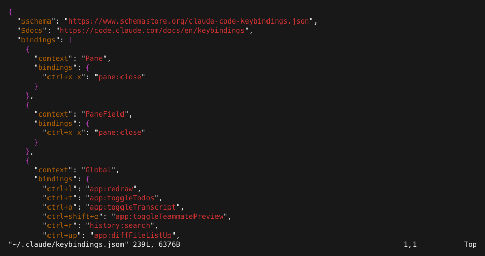
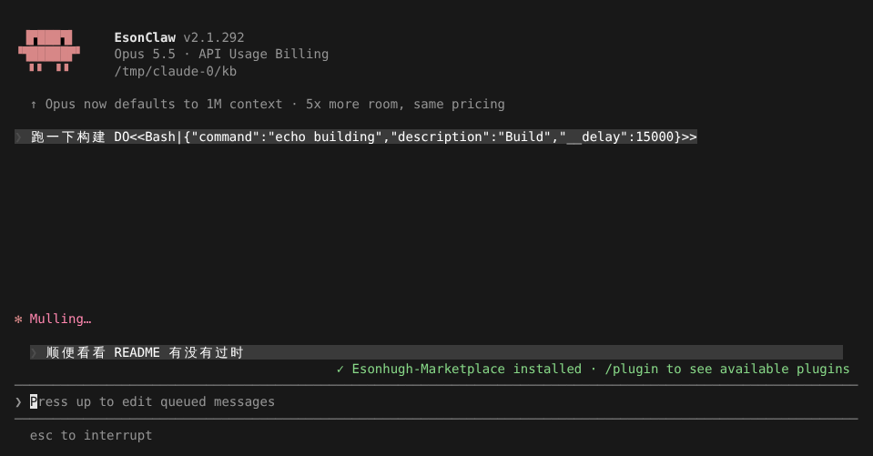
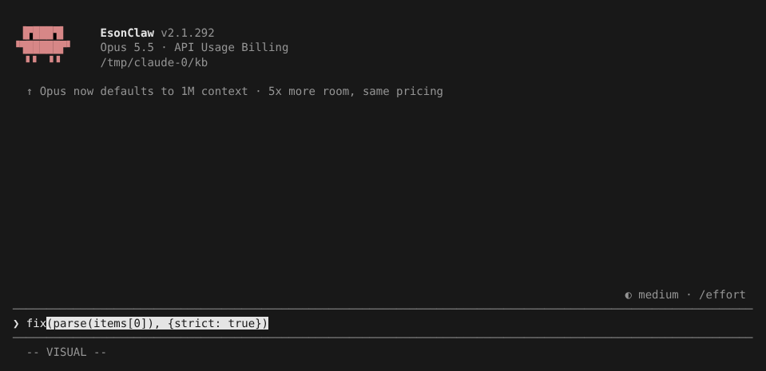
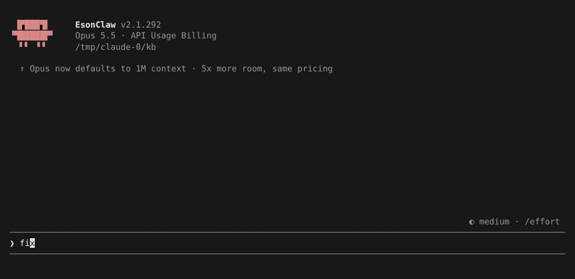

# 快捷键与 Vim 模式

> 英文名：`keybindings-vim` · 领域：界面与交互 · [返回功能索引](README.md)

## 这是什么

这一页讲三件事：

1. **自定义快捷键**：所有按键都可以在一个 JSON 文件里改，保存后立即生效；
2. **Claude 忙的时候怎么插话**：排队等它做完，或者立即打断；
3. **Vim 模式**：输入框支持 Vim 按键，本 fork 补上了 VISUAL 选择和 `%` 括号跳转。

## 自定义快捷键

**1. 输入 `/keybindings`。** 第一次会生成 `~/.claude/keybindings.json`（里面是全部默认键位，按场景分组），并用你的 `$EDITOR` 打开：

**2. 改你想改的那一行**，例如把 `ctrl+t` 从「切换待办列表」改成别的动作，或写 `null` 取消某个键。每组的 `context` 表示这组键在哪生效（`Chat` 是输入框，`Global` 是任何地方，`Scroll` 是全屏模式下滚动对话）。

**3. 保存即生效**，不用重启。写错了（未知的动作、冲突的键）底部会提示 `Found N keybinding error`，运行 `/doctor` 能看到具体是哪一行、该怎么改。完整的动作列表和格式见 [官方文档](https://code.claude.com/docs/en/keybindings)。

## Claude 忙的时候插话

Claude 正在回答时你也可以继续打字：

| 操作 | 效果 |
| --- | --- |
| `Enter` | **排队**：消息先放着，在下一个工具调用间隙送进去，Claude 不会停下 |
| `Ctrl+X` 然后 `Enter` | **等这轮结束再发**（`chat:queueSubmit`） |
| `Ctrl+X` 然后 `Ctrl+S`，或 `Ctrl+Enter` | **立即发送**（`chat:sendNow`）：正在跑可中断的工具（如长命令）时打断它并马上送出，模型还在输出文字时同样排到下一个间隙；输入框为空时，中断当前回合并立即送出已排队的消息 |
| `↑` | 把排队中的消息拿回输入框修改 |

下图是 Claude 还在思考时按 `Enter` 的效果：消息显示在输入框上方等待，下面提示 `ctrl+x ctrl+s to send now`，输入框提示可以按 `↑` 改：

`Ctrl+Enter` 需要终端支持 Kitty 键盘协议。iTerm2、kitty、WezTerm、Ghostty、tmux、Windows Terminal、Warp 直接开启；其他终端启动时会发 `CSI ? u` 询问，终端回应了就同样开启（比官方多这一步），排队提示随之显示 `ctrl+enter`。终端不回应时用 `Ctrl+X Ctrl+S`，提示也显示这一个。另外 `Ctrl+J` 和 `Shift+Enter`、`Option+Enter` 一样是换行。

## Vim 模式

**1. 打开。** `/config` 里把 Editor mode 设为 `vim`，或者直接输入 `/vim`（再输入一次切回普通模式，会显示 `Editor mode set to vim.` / `Editor mode set to normal.`）。输入框默认在 INSERT 模式，按 `Esc` 进入 NORMAL。

**2. 选择一段文字。** NORMAL 下光标放在 `(` 上，按 `v` 进入 VISUAL，再按 `%` 跳到配对的 `)`，整段括号内容被选中（反色），底部显示 `-- VISUAL --`：

**3. 对选区操作。** 按 `d` 删除，只剩 `fix`：

VISUAL 下还支持：移动光标扩展选区、`iw` / `i"` 等文本对象、`y` 复制、`c` / `s` 修改、`r` 替换、`~` / `u` / `U` 大小写、`p` / `P` 粘贴、`J` 合并行、`>` / `<` 缩进、`o` 跳到选区另一端。`V` 进入按行选择（`-- VISUAL LINE --`），`Esc` 或再按同一个键退出。

`%` 在 NORMAL 下也能单独用，在 `()` `[]` `{}` 之间跳，也能和 `d` / `c` / `y` 组合（如 `d%`）。[自定义状态栏](branding.md) 的 `vim.mode` 字段同样会显示 `VISUAL` / `VISUAL LINE`。

## 设置

| 配置项 | 写法 | 说明 |
| --- | --- | --- |
| `~/.claude/keybindings.json` | 见上 | 自定义快捷键，保存后热重载 |
| `/config` → Editor mode | `normal` / `vim` | 输入框的按键模式 |

## 说明

画面来自实际运行（全屏渲染，110 列），模型回复由测试用假 API 生成（`DO<<…>>` 是让假 API 调用工具的指令，`__delay` 让回合跑久一点以便演示排队）。
