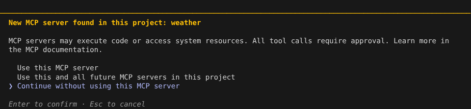
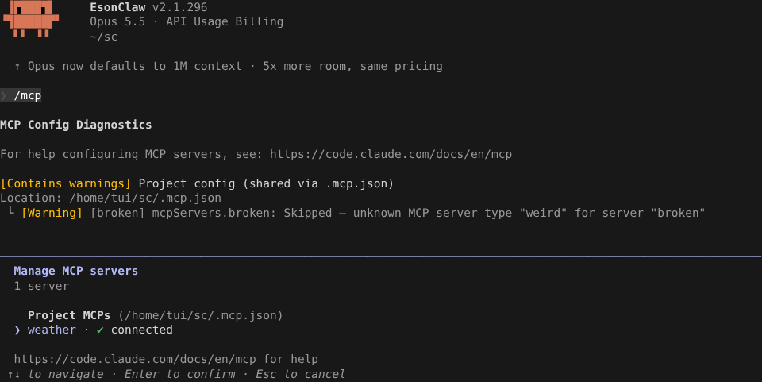
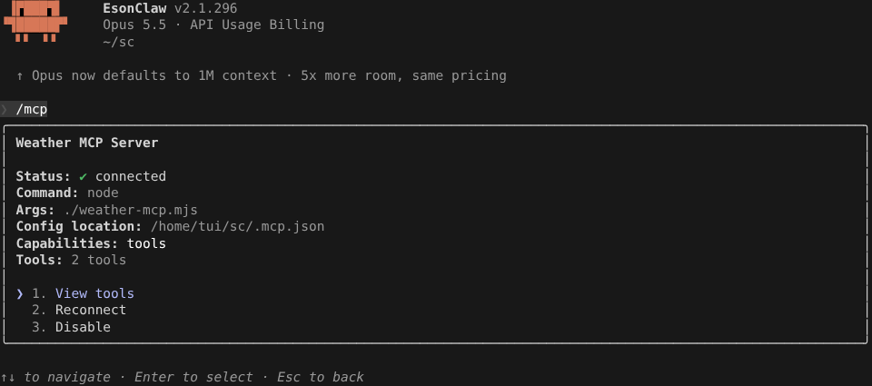
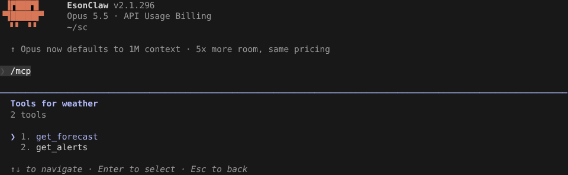
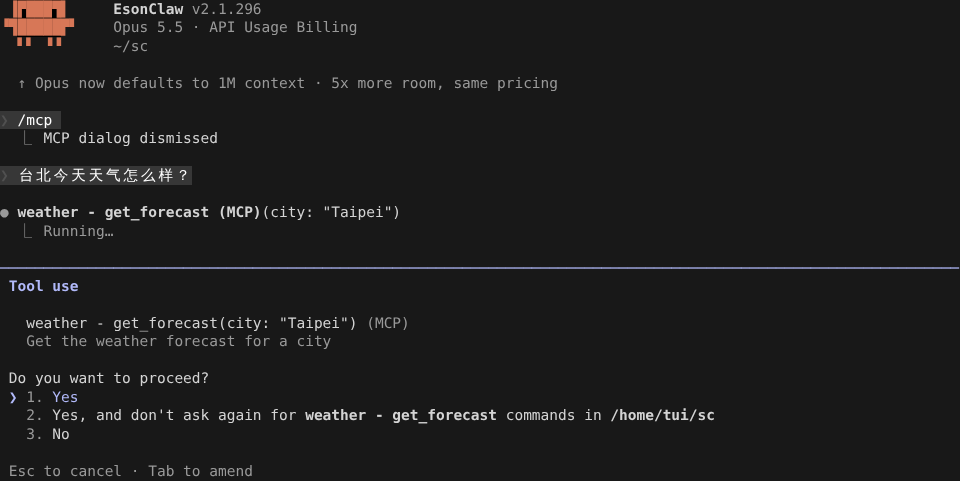
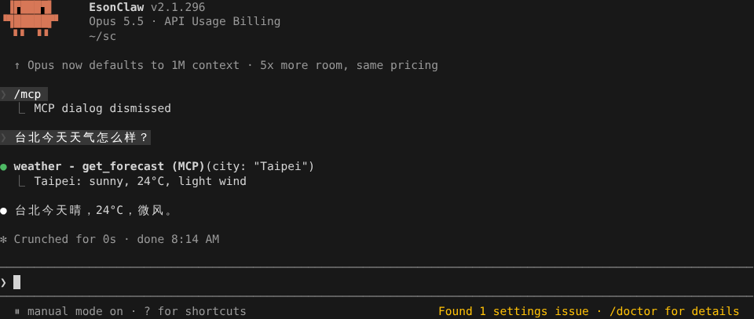
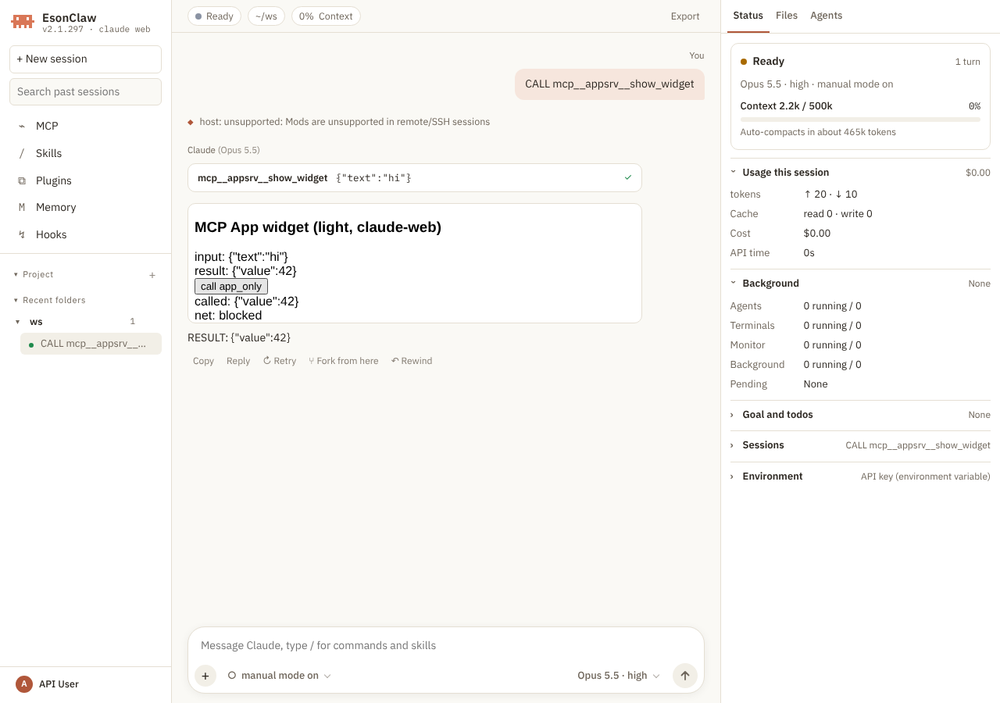

# MCP 配置与认证

<!-- lang: zh-Hans -->

> 英文名：`mcp` · 领域：插件与扩展 · [返回功能索引](README.md)

## 这是什么

MCP（Model Context Protocol）是一种「给 Claude 装外部工具」的标准。一个 MCP server 是一个小程序或网址，它告诉 Claude「我提供这些工具」，例如查天气、查数据库、操作浏览器。接上后，这些工具和内置的 Read、Bash 一样可以被 Claude 调用，名字形如 `mcp__<server>__<工具>`。

server 有两种接法：

- **本地命令（stdio）**：Claude 启动一个进程，通过标准输入输出通信；
- **远程网址（http / sse）**：连到一个 URL，通常需要 OAuth 登录。

<details lang="en"><summary>English</summary>

> Name: `mcp` · Area: Plugins and extensions · [Back to index](README.md)

## What it is

MCP (Model Context Protocol) is a standard way to give Claude external tools. An MCP server is a small program or URL that tells Claude "I provide these tools", for example weather lookup, database queries or browser control. Once connected, its tools can be called like the built-in Read and Bash, with names of the form `mcp__<server>__<tool>`.

There are two ways to connect a server:

- **Local command (stdio)**: Claude starts a process and talks to it over standard input and output.
- **Remote URL (http / sse)**: connect to a URL, usually with an OAuth sign-in.

</details>
<details lang="zh-Hant"><summary>繁體中文</summary>

> 英文名：`mcp` · 領域：插件與擴充 · [返回功能索引](README.md)

## 這是什麼

MCP（Model Context Protocol）是一種「給 Claude 裝外部工具」的標準。一個 MCP server 是一個小程式或網址，它告訴 Claude「我提供這些工具」，例如查天氣、查資料庫、操作瀏覽器。接上後，這些工具和內建的 Read、Bash 一樣可以被 Claude 呼叫，名字形如 `mcp__<server>__<工具>`。

server 有兩種接法：

- **本地命令（stdio）**：Claude 啟動一個程序，通過標準輸入輸出通訊；
- **遠端網址（http / sse）**：連到一個 URL，通常需要 OAuth 登入。

</details>

## 快速上手：给项目接一个 MCP server

**1. 写配置。** 在项目根目录建 `.mcp.json`（会提交进仓库，团队共用）：

```json
{
  "mcpServers": {
    "weather": { "command": "bun", "args": ["./weather-mcp.mjs"] }
  }
}
```

也可以用命令添加：`claude mcp add weather -- bun ./weather-mcp.mjs`（加 `-s project` 写进 `.mcp.json`，默认只对你自己生效）。

**2. 批准。** 项目里的 server 可能执行任意代码，所以第一次打开时会问你是否启用：



| 选项 | 效果 |
| --- | --- |
| Use this MCP server | 只启用这一个 |
| Use this and all future MCP servers in this project | 这个和以后新加的项目 server 都自动启用 |
| Continue without using this MCP server（默认选中） | 不启用，之后可以在 `/mcp` 里改 |

文案、选项顺序和默认选项与官方 2.1.303 一致；一次发现多个新 server 时改成多选列表。

**3. 用 `/mcp` 看状态。** 列出所有 server 和连接状态；配置里有问题的条目会在上方列出原因（这里故意放了一条类型写错的 `broken`，它被跳过，不影响 `weather`）：



**4. 选中一个 server 按 `Enter`** 看详情，可以查看工具、重连、停用：





**5. Claude 调用 MCP 工具时**，和其他工具一样先问你。选第 2 项以后这个工具不再询问：





## 远程 server 与登录

```json
{
  "mcpServers": {
    "search": {
      "type": "http",
      "url": "https://mcp.example.com",
      "timeout": 30000,
      "oauth": { "scopes": ["read"] }
    }
  }
}
```

需要登录的 server 在 `/mcp` 里显示待认证，选中后按提示在浏览器完成授权。也可以在命令行：

```sh
claude mcp login search              # 打开浏览器做 OAuth
claude mcp login search --no-browser # SSH / 无界面时：打印授权链接，把跳转后的网址贴回来
claude mcp logout search
```

claude.ai 上的 connector 请在 `/mcp` 里登录，不走 `claude mcp login`。

## 配置写错了会怎样

每个 server **单独检查**：某一条写错（类型未知、缺 URL、字段不合法）只跳过那一条，并给出原因；其他 server 照常加载、照常弹出批准。`claude mcp list` 不实际连接未批准的 server，只显示状态和问题：

```text
Checking MCP server health...

weather: /root/.bun/bin/bun /tmp/claude-0/weather-mcp.mjs - ✓ Connected

MCP Config Diagnostics

For help configuring MCP servers, see: https://code.claude.com/docs/en/mcp

[Contains warnings] Project config (shared via .mcp.json)
Location: /tmp/claude-0/mcpw/.mcp.json
 └ [Warning] [broken] mcpServers.broken: Skipped — unknown MCP server type
 "weird" for server "broken"
```

跳过原因：`invalid_config`（字段不合法）、`unknown_type`（type 不认识）、`url_missing_type`（写了 url 却没写 type）。整份文件格式坏掉（例如 `mcpServers` 不是对象）时才整体不加载。

## 命令速查

| 命令 | 作用 |
| --- | --- |
| `/mcp` | 查看、启用 / 停用、重连、登录 server，查看工具 |
| `/mcp reconnect all` | 重连所有失败或待认证的 server；`-p` 模式下 `/mcp` 只打印状态 |
| `claude mcp add <name> -- <命令>` | 添加 stdio server；`--transport http <url>` 添加远程 server；`-s user/project/local` 选范围 |
| `claude mcp list` | 列出 server 和健康状态（待批准、已停用的项目 server 不连接） |
| `claude mcp get <name>` / `remove <name>` | 查看 / 删除 |
| `claude mcp login <name> [--no-browser]` / `logout <name>` | HTTP / SSE server 的 OAuth 登录与登出 |

## 设置（写在每个 server 的配置里）

| 字段 | 写法 | 说明 |
| --- | --- | --- |
| `timeout` | ≥ `1000`（毫秒） | 这个 server 的工具超时，优先于环境变量 `MCP_TOOL_TIMEOUT` |
| `alwaysLoad` | `true` | 工具定义一开始就全部加载，不走按需搜索 |
| `oauth.scopes` | 字符串数组 | OAuth 登录时请求的权限范围 |
| `bareElicitationCapability` | `true` | 只声明最基础的 elicitation 能力，兼容不支持新字段的 server |

配置来源：项目 `.mcp.json`、用户 `~/.claude.json`（`-s user`）、本地（`-s local`，只对当前项目的你生效）、插件、`--mcp-config` 参数。

## MCP Apps（工具自带界面）

有些 MCP server 的工具会在 `_meta.ui.resourceUri` 里指向一个 `ui://` 页面（MCP Apps，SEP-1865）。`claude web` 会把这个页面显示在工具卡片下方：



- 页面跑在沙箱 frame 里，origin 是不透明的，读不到网页的登录状态，也调不了网页的 API。默认不能联网，只有 server 在资源的 `_meta.ui.csp` 里声明过的域名可以连。
- 页面能收到工具的输入和结果，能读同一个 server 的 `ui://` 资源，也能调用同一个 server 的工具。只给页面用的工具（`visibility: ["app"]`）和只读工具直接执行，其他工具要你先确认。
- `visibility` 里没有 `"model"` 的工具不会发给模型。`ListMcpResourcesTool` 的列表里也不列出 `ui://` 页面，模型知道 URI 的话仍然可以直接读。
- 终端界面不显示这些页面，只显示文字结果，和官方一致。SDK 客户端要显示页面时，启动 CLI 前设置 `CLAUDE_CODE_MCP_APPS_HOST=1`：CLI 会向 server 声明 `io.modelcontextprotocol/ui` 扩展，`mcp_status` 的工具会带上 `_meta`，客户端再用 `mcp_read_resource` 和 `mcp_call` 读页面、调工具。

## 说明

画面来自实际运行：`weather` 是一个用 MCP SDK 写的 20 行示例 server；模型回复由测试用假 API 按脚本生成。
