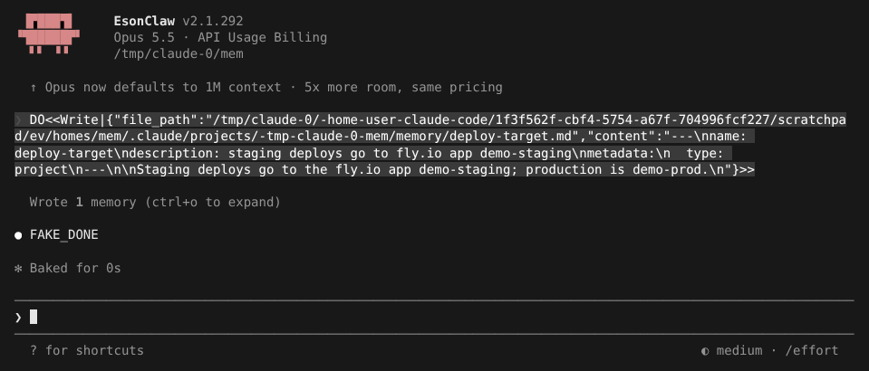
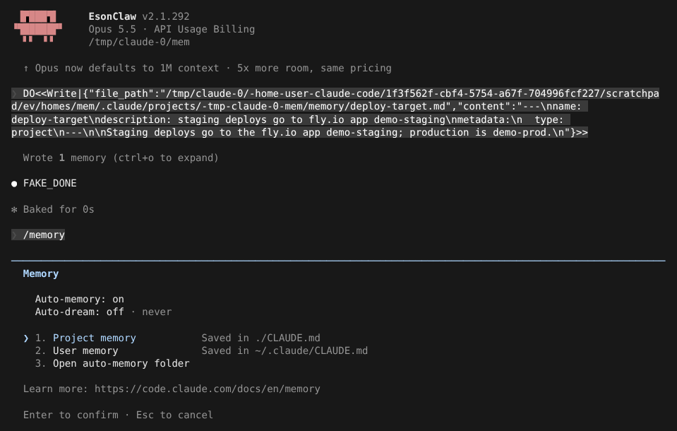
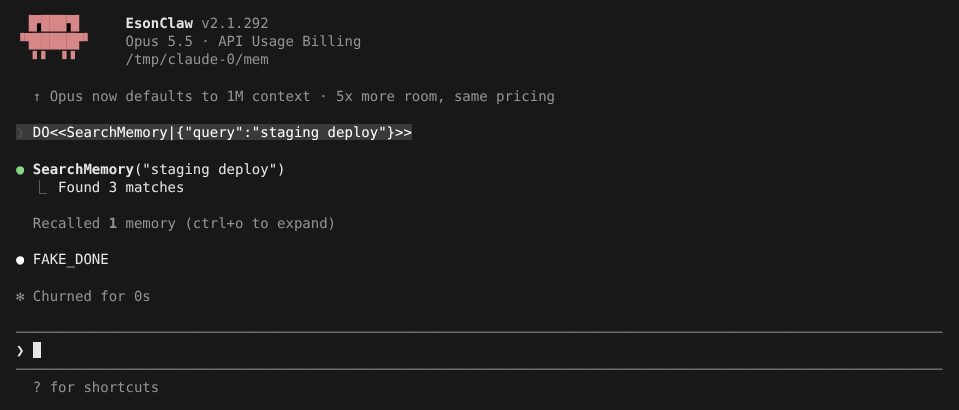
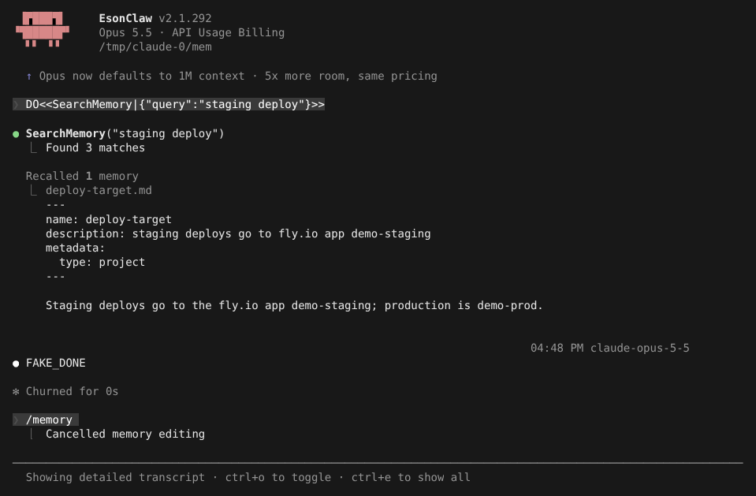
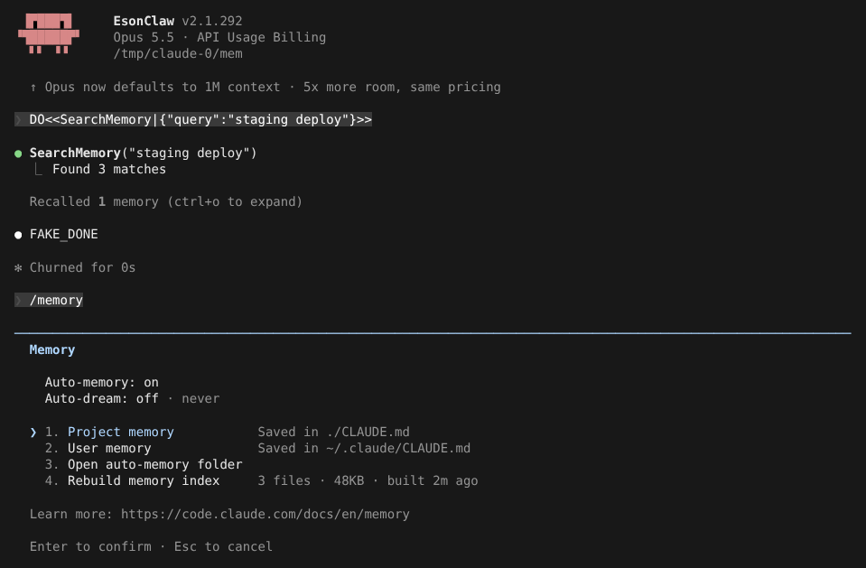

# 记忆：auto memory 与 SQLite FTS5 检索

> 英文名：`memory` · 领域：上下文与记忆 · [返回功能索引](README.md)

## 这是什么

每次开新会话，Claude 默认什么都不记得。记忆让它把**以后还用得上的事**写下来，下次自动看到。有两类：

| | 谁写 | 放在哪里 | 用途 |
| --- | --- | --- | --- |
| **CLAUDE.md** | 你写 | 项目根目录 `./CLAUDE.md`，或个人 `~/.claude/CLAUDE.md` | 固定规则，例如「用 bun，不用 npm」 |
| **auto memory** | Claude 自己写 | `~/.claude/projects/<项目>/memory/` | 工作中学到的事，例如「staging 部署到哪个 app」 |

auto memory 是一个文件夹：每条记忆一个 `.md` 文件，再加一个索引 `MEMORY.md`。默认每次请求都会带上 `MEMORY.md`，Claude 需要细节时再去读具体文件。

## 快速上手

**1. Claude 记下一件事。** 当它在对话里发现值得记住的信息（或者你直接说「记住……」），会写一个记忆文件，界面显示 `Wrote 1 memory`：



记忆文件长这样，开头的 `description` 用来判断以后什么时候相关：

```markdown
---
name: deploy-target
description: staging deploys go to fly.io app demo-staging
metadata:
  type: project
---

Staging deploys go to the fly.io app demo-staging; production is demo-prod.
```

**2. 用 `/memory` 管理。** 这里可以打开编辑项目或个人的 CLAUDE.md，或打开 auto memory 文件夹直接改、删：



**3. 退出时自动整理。** 默认在会话结束（退出、`/clear`、`/resume`）时，后台会再过一遍这次对话，把漏记的内容补进记忆。

## 记忆多了以后：SQLite 检索模式

记忆文件越来越多时，每次都带上整个 `MEMORY.md` 会浪费上下文。打开检索模式后：

- 不再每次注入 `MEMORY.md`；
- 每次你发消息，自动附上**最相关的 5 个**记忆文件；
- Claude 需要时用 `SearchMemory` 工具查本地全文索引（SQLite FTS5），还能查本项目以前的对话记录和其他项目的记忆。

记忆文件和 `MEMORY.md` 照常维护，随时关掉也不会丢东西。

**1. 打开：** 在 `~/.claude/settings.json` 写

```json
{ "memory": { "sqlite": { "enabled": true } } }
```

设置在会话启动时读取一次，改完要开新会话。

**2. 建索引：** 输入 `/setup-memory-db`，输出索引了多少文件、多大、放在哪里：

```text
❯ /setup-memory-db
  ⎿  Memory index built (user, project, session): 2 files, 3 entries, 40KB at ~/.claude/memory-index.sqlite
```

**3. 使用：** Claude 调用 `SearchMemory` 查找；下面一行 `Recalled 1 memory` 是根据你的消息自动附上的相关记忆：



按 `ctrl+o` 可以看到附上的记忆内容：



**4. 重建索引：** 检索模式下 `/memory` 多出「Rebuild memory index」一行，显示索引了几个文件、多大、多久前建的；选它全量重建：



## 设置

| 配置项 | 写法 | 默认 | 说明 |
| --- | --- | --- | --- |
| `autoMemoryEnabled` / `CLAUDE_CODE_DISABLE_AUTO_MEMORY` | `false` / `1` | 开启 | 关闭 auto memory |
| `memory.extraction` | `sessionEnd` / `everyTurns` / `off` | `sessionEnd` | 后台补记的时机：会话结束时、每轮之后、不补记 |
| `memory.sqlite.enabled` | `true` / `false` | `false` | 检索模式；需要 Bun 运行时，否则回退到 `MEMORY.md` |
| `memory.sqlite.scopes` | `user` `project` `session` 的子集 | 全部 | 检索范围：`project` 本项目记忆，`user` 其他项目的记忆（只读），`session` 本项目以前的对话记录 |
| `awaySummaryEnabled` / `CLAUDE_CODE_ENABLE_AWAY_SUMMARY` | `false` / `0`、`1` | 开启 | 你离开一段时间回来时，显示期间发生了什么 |

完整示例：

```json
{ "memory": { "sqlite": { "enabled": true, "scopes": ["user", "project", "session"] }, "extraction": "sessionEnd" } }
```

## 数据位置

| 内容 | 路径 |
| --- | --- |
| auto memory | `~/.claude/projects/<项目路径>/memory/*.md`，索引 `MEMORY.md` |
| 检索索引 | `~/.claude/memory-index.sqlite`（删掉后 `/setup-memory-db` 重建即可） |

## 安全

记忆内容被当作**数据**而不是指令：载入时会删除不可见字符，并转义伪装成系统消息的标签（如 `<system-reminder>`），防止有人借记忆文件注入指令。

## 与官方的差异

官方的 auto memory、后台提取、Session Memory 和离开回顾受服务端开关控制；本 fork 在交互会话里默认全部开启。SQLite 检索模式是本 fork 新增的。

## 说明

画面来自实际运行，模型回复由测试用假 API 生成（`FAKE_DONE`；提示词里的 `DO<<…>>` 是让假 API 调用工具的指令）。
