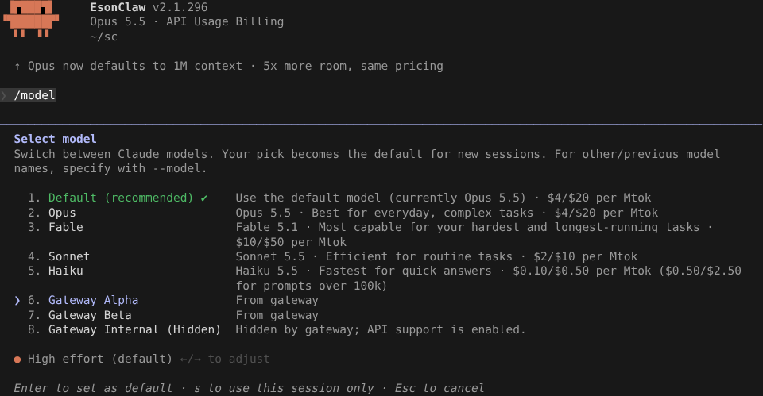
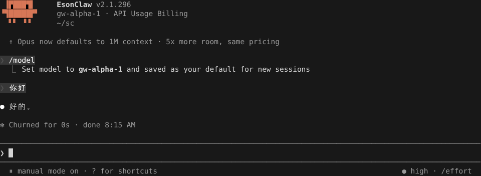

# 模型自动发现与 Gateway

<!-- lang: zh-Hans -->

> 英文名：`model-discovery` · 领域：模型与 Provider · [返回功能索引](README.md)

## 这是什么

很多团队通过一个**API 网关**（代理、LiteLLM、公司内部网关等）使用模型。网关上可能有自己命名的模型，比如 `gw-alpha-1`。默认 `/model` 只列内置的 Claude 模型，要用网关的模型只能靠 `--model` 手打。

开启模型发现后，Claude Code 启动时会去问网关「你有哪些模型」（请求 `/v1/models`），把结果加进 `/model` 列表，标注 `From gateway`。

- **Anthropic 网关**：设置了非官方 `ANTHROPIC_BASE_URL` 就默认开启，`CLAUDE_CODE_ENABLE_GATEWAY_MODEL_DISCOVERY=0` 关闭；
- **OpenAI provider**：自动发现，见 [openai-provider.md](openai-provider.md)。

<details lang="en"><summary>English</summary>

> Name: `model-discovery` · Area: Models and providers · [Back to index](README.md)

## What it is

Many teams reach models through an **API gateway** (a proxy, LiteLLM, a company gateway and so on). The gateway may have models with its own names, such as `gw-alpha-1`. By default `/model` lists only the built-in Claude models, so using a gateway model means typing it with `--model`.

With model discovery on, Claude Code asks the gateway which models it has at startup (a request to `/v1/models`) and adds them to the `/model` list, marked `From gateway`.

- **Anthropic gateways**: on by default whenever `ANTHROPIC_BASE_URL` points somewhere unofficial; `CLAUDE_CODE_ENABLE_GATEWAY_MODEL_DISCOVERY=0` turns it off.
- **OpenAI provider**: discovered automatically, see [openai-provider.md](openai-provider.md).

</details>
<details lang="zh-Hant"><summary>繁體中文</summary>

> 英文名：`model-discovery` · 領域：模型與 Provider · [返回功能索引](README.md)

## 這是什麼

很多團隊通過一個**API 閘道**（代理、LiteLLM、公司內部閘道等）使用模型。閘道上可能有自己命名的模型，比如 `gw-alpha-1`。預設 `/model` 只列內建的 Claude 模型，要用閘道的模型只能靠 `--model` 手打。

開啟模型發現後，Claude Code 啟動時會去問閘道「你有哪些模型」（請求 `/v1/models`），把結果加進 `/model` 列表，標註 `From gateway`。

- **Anthropic 閘道**：設定了非官方 `ANTHROPIC_BASE_URL` 就預設開啟，`CLAUDE_CODE_ENABLE_GATEWAY_MODEL_DISCOVERY=0` 關閉；
- **OpenAI provider**：自動發現，見 [openai-provider.md](openai-provider.md)。

</details>

## 快速上手：Anthropic 网关

**1. 指向网关启动：**

```bash
ANTHROPIC_BASE_URL=https://gateway.example \
ANTHROPIC_AUTH_TOKEN=<bearer-token> \
claude
```

两个缺一不可：网关地址、认证（`ANTHROPIC_AUTH_TOKEN` 走 `Authorization: Bearer`，或 `ANTHROPIC_API_KEY` 走 `x-api-key`，两者都有时用前者）。

**2. 打开 `/model`。** 网关的模型排在内置模型后面，标 `From gateway`；网关标记为 hidden 的模型会显示 `(Hidden)`：



**3. 选中后回车**，之后的请求就发给这个模型，并保存为新会话的默认值：



## OpenAI 兼容网关

```bash
CLAUDE_CODE_USE_OPENAI=1 \
OPENAI_BASE_URL=https://gateway.example/api \
OPENAI_API_KEY=<gateway-api-key> \
claude
```

- `OPENAI_BASE_URL` 末尾有没有 `/v1` 都行，最终只请求一次 `/v1/models`；
- 官方 OpenAI API 只显示 `gpt-`、`o`、`codex` 开头的模型；自定义地址会显示网关返回的所有模型（标记为不支持 API 的除外）；
- ChatGPT 登录时从 ChatGPT Codex 的模型接口获取。

OpenRouter 等服务按普通 OpenAI 兼容地址使用即可，没有专门的配置。

## 缓存与安全

- 模型列表按「provider + 网关地址 + 账号 / 凭据」分别缓存，换网关、换账号不会串用别人的列表。
- 请求失败、超时时保留上次的列表，但只有身份完全一致才会显示；网关明确返回空列表时清空。
- `/login` 保存的官方 key 和 `CLAUDE_CODE_OAUTH_TOKEN` **不会**发给自定义网关；可信的 `apiKeyHelper` 可以提供网关凭据。
- 网关缓存独立存放，不会覆盖官方模型数据，失败时也不会回退去请求官方。

## 设置

| 配置项 | 写法 | 说明 |
| --- | --- | --- |
| `CLAUDE_CODE_ENABLE_GATEWAY_MODEL_DISCOVERY` | `0` | 关闭 Anthropic 网关模型发现（默认开启） |
| `ANTHROPIC_BASE_URL` | URL | 网关地址，请求 `${ANTHROPIC_BASE_URL}/v1/models` |
| `ANTHROPIC_AUTH_TOKEN` / `ANTHROPIC_API_KEY` | 字符串 | 认证；两者都有时优先前者 |
| `ANTHROPIC_CUSTOM_HEADERS` | header 列表 | 额外 header，大小写不敏感地覆盖默认值 |

## 说明

画面来自实际运行：测试用假 API 同时充当网关，返回 `gw-alpha-1`（Gateway Alpha）和 `gw-beta-2`（Gateway Beta）。
