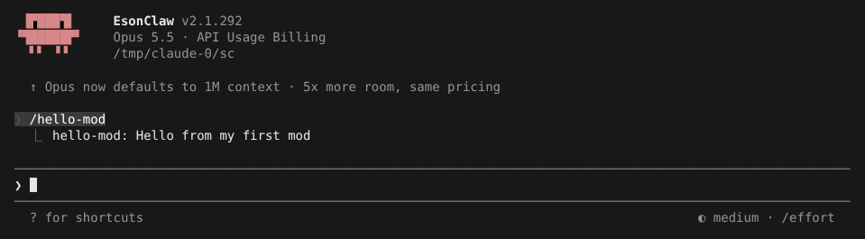
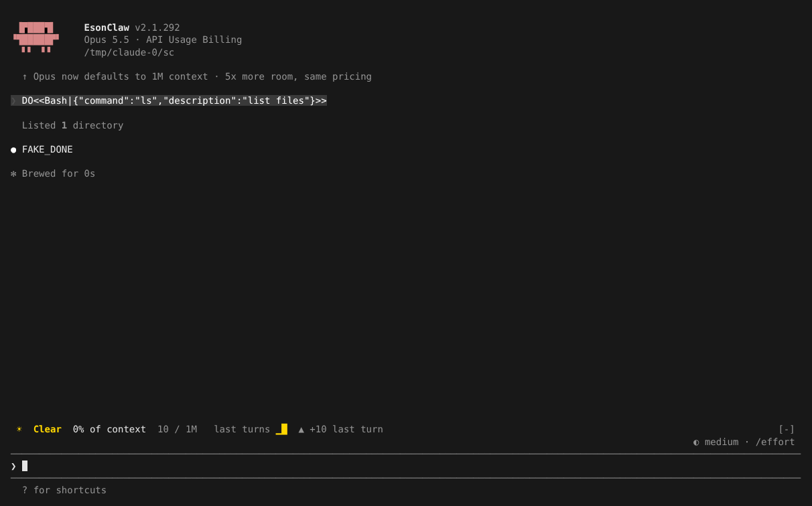
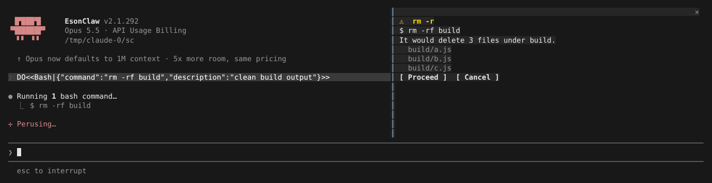
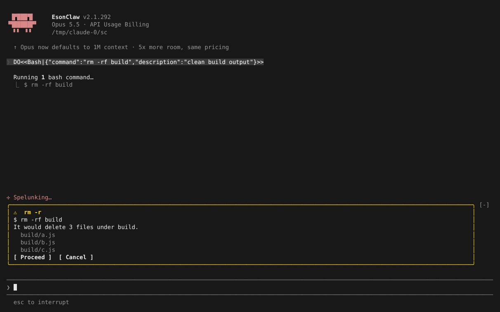

# Mods / Function Hooks

> 英文名：`mods` · 领域：插件与扩展 · [返回功能索引](README.md)

## 这是什么

Mod 是一种插件：你写一个 JavaScript / TypeScript 文件，**在 Claude 运行的各个环节插一手**。和 [Hooks](hooks.md)（跑外部脚本、看退出码）相比，Mod 直接运行在 Claude 里面，能做的多得多：

- **加命令**：注册 `/我的命令`；
- **拦截 / 改写工具调用**：Claude 要跑 `rm -rf` 时先停下来给你看会删什么；
- **改界面**：在输入框上方加一条状态栏，或在右侧开一个可点击的面板；
- **读写状态**：会话用量、工作目录、持久化的小数据；
- **调用模型、启动子代理、执行命令**。

写法是「中间件」：每个事件交给你的函数，你可以看一眼直接放行（`next(event)`），也可以改掉参数、拒绝，或者返回自己的结果。

> Mod 运行在本机、拥有较高权限，只加载你信任的插件。

## 快速上手：写第一个 Mod

**1. 建三个文件。**

```text
hello-mod/
├── .claude-plugin/plugin.json
└── hooks/
    ├── hooks.json
    └── register.ts
```

`.claude-plugin/plugin.json`：

```json
{ "name": "hello-mod", "version": "0.1.0", "description": "A first mod: one command and one tool note" }
```

`hooks/hooks.json`（路径相对这个文件）：

```json
{ "modules": ["./register.ts"] }
```

`hooks/register.ts`：

```ts
import type { Register } from 'claude-code'

export const register: Register = on => {
  // Add a /hello-mod command when the session starts.
  on('session.start', async ($, event, next) => {
    await $.command.register({ name: 'hello-mod', description: 'Show a greeting', immediate: true })
    return next(event)
  })
  on('command.run', { command: 'hello-mod' }, () => ({ text: 'Hello from my first mod' }))

  // Refuse to let Claude read .env files.
  on('tool.call', { tool: 'Read' }, async ($, e, next) => {
    if (String(e.file_path).endsWith('.env')) return { deny: 'hello-mod: .env files are off limits' }
    return next(e)
  })
}
```

- `on(事件, [匹配条件], 处理函数)` 注册一个 hook；
- `$` 是能力对象（`$.command`、`$.state`、`$.ui`…）；
- 调用 `next(e)` 表示「交给下一个处理者 / 照常执行」，不调用就是你接管了。

**2. 检查。** `claude plugin validate` 静态扫描（不执行代码），列出你挂了哪些 hook、用了哪些能力：

```text
$ claude plugin validate ./hello-mod
Validating hooks: /tmp/claude-0/hello-mod/hooks/hooks.json

  ❯ ./register.ts hooks: session.start, command.run{command=hello-mod}, tool.call{tool=Read}
  ❯ ./register.ts calls: $.command.register

✔ Validation passed with warnings
```

**3. 加载运行。** `claude --plugin-dir ./hello-mod`。输入 `/hello` 就能补全出新命令：



Claude 再想读 `.env` 时，会收到 `hello-mod: .env files are off limits` 的错误，转而换别的做法。

首次加载时会在插件里生成 `.claude-plugin/types/`（类型声明）和根目录 `tsconfig.json`，编辑器里就有补全和类型检查。改了代码用 `/reload-plugins` 热重载。

## 看看能做到什么：仓库自带的示例

`examples/mods/` 下有几个完整示例，可以直接 `--plugin-dir` 加载试用。

### Token Weather：输入框上方的状态条

把上下文用量画成「天气预报」，每轮更新：



核心只有两步：在 `turn.complete` 时用 `$.session.usage()` 记一笔、存进 `$.state`；在 `ui.render`（`component: "AbovePrompt"`）时用 `$.ui.resolve(e)` 拿到 `Box`、`Text` 组件画出来。

### Blast Radius：危险命令先给你看后果

Claude 要跑 `rm -r`、`git reset --hard`、`git clean`、`git push --force` 时，Mod 先把调用**挂起**，算出会影响哪些文件，让你选 Proceed 或 Cancel。

终端够宽（≥ 144 列，全屏渲染）时开在右侧面板，`1` / `2` 或鼠标点击选择：



终端较窄时退回到输入框上方显示：



选 Proceed 后命令照常进入权限确认；选 Cancel 则 Claude 收到「Blast Radius held this command: the user pressed Cancel. It would have: delete 3 files under build.」。

### 其他

- `replay-theater`：回放会话；
- `mods-test-lab`：覆盖各种能力的测试用 Mod。

## 常用事件与能力

| 事件 | 什么时候触发 | 常见用途 |
| --- | --- | --- |
| `session.start` | 会话开始 | 注册命令、初始化状态 |
| `prompt.submit` | 你按下回车 | 改写或拦截提示词 |
| `tool.call` | Claude 调用工具前（可按 `tool` 匹配） | 放行、拒绝（`{ deny }`）、改参数、挂起等确认 |
| `turn.complete` | 一轮回答结束 | 记录、统计、通知 |
| `command.run` | 你执行 Mod 注册的命令 | 返回 `{ text }` 显示结果 |
| `ui.render` | 界面绘制（按 `component` 匹配，如 `AbovePrompt`） | 画状态条、面板内容 |

| 能力 | 作用 |
| --- | --- |
| `$.command.register` | 注册斜杠命令 |
| `$.state.get` / `set` | 存取持久小数据（热重载后保留） |
| `$.ui.resolve` / `open` / `invalidate` | 拿界面组件、打开面板、请求重绘 |
| `$.session.usage` / `cwd` | 会话用量、工作目录 |
| `$.process.run` | 执行本地命令 |
| `$.agent.spawn` | 启动子代理（受并发上限约束，额度不足返回 `{ deny }`） |
| `$.tool.call` | 主动调用工具 |

完整接口见官方 [Mods reference](https://code.claude.com/docs/en/plugins/mods/reference)；生成的 `.claude-plugin/types/` 是本构建实际支持的声明。

## 给 Mod 写测试

`tests/*.test.ts` 用 `claude-code/testing`，可以模拟会话事件并挂载界面组件检查输出，`claude plugin test <目录>` 运行：

```ts
import { describe, expect, test } from "claude-code/testing";

describe("token-weather", () => {
  test("the band follows the context window", async ($, on) => {
    on("session.usage", () => ({ value: { startedAt: 0, rateLimits: [], context: { tokens: 36_100, window: 200_000, percent: 18 } } }));
    await $.session.start({ surface: "terminal", isInteractive: true, cwd: "/work" } as any);
    const ui = await $.ui.mount({ plugin: "token-weather", surface: "terminal", component: "AbovePrompt",
      props: { hasSurvey: false, isWorking: false, maxRows: 10, bodyColumns: 120 } } as any);
    expect(await ui.find({ type: "Text", text: /Clear/ })).toBeDefined();
  });
});
```

```text
$ claude plugin test examples/mods/token-weather
(pass) token-weather > the band follows the context window [119.85ms]

 1 pass
 0 fail
```

## 设置

| 配置项 | 写法 | 说明 |
| --- | --- | --- |
| `--plugin-dir <目录>` | 可重复 | 加载本地插件（含 Mod） |
| `CLAUDE_CODE_MAX_CONCURRENT_SUBAGENTS` | 正整数，默认 20 | `$.agent.spawn` 的每插件并发上限 |
| `strictPluginOnlyCustomization`（托管设置） | `true` | 插件 Mod 照常运行 |
| `CLAUDE_CODE_NO_FLICKER` | `1` | 全屏渲染；右侧面板只在全屏下出现 |

外部程序通过 stream-json 连接 Mod 的方式见 [mods-sdk-client.md](mods-sdk-client.md)。

## 本构建尚不支持的调用

声明里有、但本构建没实现的调用会抛出点名错误（如 `$.audio.play is not available in this build`），不会静默成功：`$.ui.view`、`$.prompt.media`、`$.audio.play`、`$.audio.speak`、`$.session.compact`、`prompt.change` 事件、prompt 装饰的 `virtualText`。完整兼容清单见 [mods-parity.md](../research/mods-parity.md)。

## 说明

画面来自实际运行（全屏渲染，110 / 140 / 160 列），模型回复由测试用假 API 生成（`FAKE_DONE`；提示词里的 `DO<<…>>` 是让假 API 调用工具的指令）。下方「详细说明」保留了逐项实现与验收记录，供 Mod 作者和维护者查阅。

## 详细说明

以下内容自原 README 迁入，保持原文。

### Mods / Function Hooks

Mods 是通过 Function Hooks 扩展运行时的可信 Plugin。以下说明针对当前源码构建，不代表已发布的 `@esonhugh/claude-code` launcher 已包含这些能力。

对齐目标包括官方 Mods 的函数、参数和回执、上下文传递、加载生命周期、作者测试及 UI 行为。除用户明确指定的 Privacy Mode 等差异外，现有本地行为不能自动视为例外。下文的未实现项是待完成工作；当前结果与分批修复顺序见 [兼容性清单](../../docs/research/mods-parity.md)，实际验收记录见 [mods-test.md](../../mods-test.md)。

当前 Mods/API 支持基线为官方 **2.1.303**：作者声明直接采用 2.1.303 原生制品内的完整声明体，不再叠加 2.1.295 Button children 投影；已提交的 Button、Pane 和内置 diff 专项保留其固定 **2.1.295** 来源，终端 OSC 7501 专项使用 **2.1.296**。这些专项不表示全部 UI 已完成迁移。声明列出但本构建未实现的调用会以点名该调用的运行时错误拒绝，不会静默成功：

- `$.ui.view`、`$.prompt.media`、`$.audio.play`、`$.audio.speak`：拒绝为 `$.<call> is not available in this build`（本构建没有音频输出路径）。
- `prompt.change` 事件：注册时加载失败并报告 `unsupported core event prompt.change`；prompt 装饰的 `virtualText` 拒绝为 `Prompt decoration virtualText is not available in this build`。
- `$.session.compact`：依次报告 `DISABLE_COMPACT`、正在运行的 turn；headless（`-p`/SDK）再报告不可用，交互式 REPL 最后拒绝为 `$.session.compact is not available in this build`。
- `prompt.submit` 的 `command` 字段：斜杠命令不经过 `prompt.submit`，该字段不会出现。
- `$.session.identity()` 只回答 managed settings 启用并原地加载的 Mod；本构建不保存服务器校验过的账号资料，`isVerified` 恒为 `false`。

兼容目标包含官方 diff Mod 原样实现的 diff viewer：注册和打开、文件/base/turn选择、ask上下文、刷新、滚动与显示效果都需一致；当前原生 `/diff` 不能代替这项验收。关键调试信息应准确记录状态和来源，日志文字无需与官方逐字相同。官方接口说明见 [Mods reference](https://code.claude.com/docs/en/plugins/mods/reference)。

本轮完成了终端选区读取与跟随、持有中的 VM 回调、作者声明覆盖和测试 runner 的临时文件清理。Client 故障次数与焦点恢复、session transcript 的公开接线、caller chain 的完整传播、Worker reload，以及 teammate 身份和恢复流程仍有未提交部分。官方 diff Mod 的完整终端效果和浏览器 Client 生命周期尚未验收通过。

`Button` 可以持有字符串和嵌套 `Text` children，整段仍是一个可点击控件和一个焦点位置。例如在 `ui.render` 中使用 `const {Button, Text} = $.ui.resolve(event)`，返回 `Button({key:'save', label:'Save', children:['Save ', Text({dimColor:true, children:'2m'})], onPress:() => {}})`。`label` 是无 children 显示能力的 surface 使用的名称；仅单字符串 child 的旧写法继续默认以 label 为 key。其他元素会被拒绝；复合 children 应给出稳定 key。终端鼠标沿用官方的挂载后 300ms 点击稳定期和窗口激活处理，Enter/Space 不等待此稳定期。已接受的 press 绑定原 guest handle，重绘期间只要仍有 drawing 持有它就可继续；新 Button 即使复用 key 或函数也不能接管旧 guest。

按钮移动或终端 resize 时，静止指针下的 hover 会在绘制后重新命中；为防止 hover 样式反复改变自身布局，连续四次变化后暂停跟随 1000ms，新的鼠标移动立即恢复。同一 Text 内两侧均有字符的空格仍属于该文本，跨 Text 或外侧的空白按空白处理。上述策略来自固定官方 2.1.295 的 Ink 实现，不新增 Mods 作者参数。专项脚本同时检查按钮在静止指针下移出/移回、两次额外 resize 的实际反色样式和关闭重开；可见 absolute 子树可以在父框之外命中，hidden/scroll 按对应轴裁剪；真实布局、重挂载与 hover 回归入口为 `bun test ./src/ink/hoverFollowsPaint295.test.tsx ./src/ink/hit-testAbsolute295.test.tsx`。

本批可重复终端脚本为 `bun scripts/validate-mods-button295.mjs --binary /absolute/built-claude --binary-sha256 SHA256 --evidence-root /private/tmp/claude-test/new-button-run`。先运行 `make build`，传入该新产物的 SHA-256；证据目录必须不存在。脚本使用隔离配置、dummy credential、关闭的 loopback provider 和私有 tmux，验证子文本绘制、重绘中的 press、重复 Enter、单次发送 Tab+Enter、两次实际 resize、子文本鼠标点击、Tab 到关闭位置及 Shift+Tab 返回，再完成关闭/重开。七次观察同时核对焦点与 hover 样式。Pane 的 Tab/Shift+Tab 依次访问作者控件、其他 Pane 标签及关闭位置；Enter 激活关闭或切换，保留 Pane 持键。无溢出时上下键循环作者控件，有溢出时优先滚动，Input/Select 先处理自己的编辑键。鼠标按 RenderElement Button 只激活按钮，保留原 custom keyboard focus；标签样式同时响应显示状态、键盘持有和 hover。类型、回归与验收边界见 [Pane 焦点记录](../../docs/research/mods-pane-focus295-20261009.md)。两种模式都核对实际 child 的零退出码、reap、EOF、无清理信号/错误及原关闭身份。默认 local 模式还要求原生逐帧与 resize 证据通过，不能只靠 pane 文本；官方对照加 `--mode official`，只报告行为验收。两种模式均不宣称完整 input owner、调度时序或 Mods 发布通过。覆盖边界和回归入口见 [Button 与鼠标验收](../../docs/research/mods-button-295-validity-20261009.md)。

最小目录为 `.claude-plugin/plugin.json`、`hooks/hooks.json` 和 `hooks/register.ts`。Manifest 使用普通 Plugin 的 `name`、`version`、`description`；在 `hooks/hooks.json` 声明入口（路径相对此文件）：

```json
{
  "modules": ["./register.ts"]
}
```

入口也可写为 `{"modules":["register.ts"]}`、`{"modules":["nested/register.ts"]}` 或 `{"modules":["../register.ts"]}`，路径均从 `hooks.json` 所在目录拼接。与固定官方 2.1.292 一致，前导 `/` 保留该目录锚点：`/register.ts` 指向 `hooks/register.ts`。解析后的路径和符号链接真实位置必须在插件目录内；这些字符串不提供 Node/npm 模块导入。

十组真实 CLI 场景已核对上述模块准入、hook 回执及越界/符号链接拒绝；完整 `hooks.json`、Mods 和 UI 兼容仍待验收。回归入口为 `bun test ./src/utils/plugins/pluginModules.test.ts`、`bun test ./src/utils/plugins/validatePlugin.test.ts` 和 `bun test ./src/services/mods/plugins.test.ts`，分别运行。

`register.ts` 导出 `register` 函数，可使用 `import type { Register } from 'claude-code'` 配合本次构建自动生成的类型。模块支持受限的静态相对导入；使用单入口，不假设支持动态导入、任意 npm/native 模块或 Node 全局对象。完整布局和示例见[研究报告](../../docs/research/claude-mods.md#73-最小示例)。例如在会话开始时注册一条本地命令：

```ts
import type { Register } from 'claude-code'

export const register: Register = on => {
  on('session.start', async ($, event, next) => {
    await $.command.register({ name: 'hello-mod', description: 'Show a greeting', immediate: true })
    return next(event)
  })
  on('command.run', { command: 'hello-mod' }, () => ({ text: 'Hello from my-mod' }))
}
```

从源码构建后加载可信插件；非 builtin Mod 首次加载及声明变化时会自动维护 `.claude-plugin/types/` 下的 `claude-code`、tool、MCP 与测试类型声明：

```bash
./built-claude --plugin-dir /absolute/path/to/my-mod
./built-claude plugin validate /absolute/path/to/my-mod
./built-claude plugin test /absolute/path/to/my-mod
```

`plugin validate` 静态扫描 hook 模块，不执行模块的顶层代码。`hooks:` 按注册顺序列出每个事件及 matcher，重复事件的不同 matcher 分别保留；`calls:` 列出能力调用，仅在该能力没有直接调用时补充已排序的 helper 来源，例如 `$.fs.read (via alpha, zebra)`。matcher 中的正则、列表和嵌套字段保留结构；无法静态确定的值显示 `?`，诊断字符串进行转义并限制长度。这些输出已与固定官方 2.1.292 的七个真实 CLI 场景对照；gating-hook 警告及其他诊断尚未纳入本项兼容结论。回归入口为 `bun test ./src/services/mods/validateDescriptions.test.ts ./src/cli/handlers/plugins.validate.test.ts`。插件目录与 manifest 字段参考 [Anthropic plugin manifest reference](https://code.claude.com/docs/en/plugins-reference)。

作者主声明采用官方 2.1.303 原生制品内的完整声明体作为基线：585 个主模块导出、52 个 testing 导出，以及完整事件、操作和全局定义，Button children 已由该声明体原生提供；资产摘要在生成前校验。生成文件头仍记录本地引擎版本，不把声明来源版本当作引擎版本。加载会生成三个基础类型根，并加入启用的直接和间接依赖插件在 manifest `types` 中声明的契约；依赖可不含 hooks。没有 `jsconfig.json` 或自定义根 `tsconfig.json` 时，还会创建插件根目录的 `tsconfig.json`，指向 `.claude-plugin/types/tsconfig.json`。已有根配置保持原样。

新增的 `PromptAutocompleteInput/Result/Suggestion`、`ModelTextBlock/ModelCompleteInput` 和 `AgentSpawnInput.workflow` 定义均来自官方原文；2.1.301 起 `HookFailure` 只有 `throw`/`timeout`，`.catch` 只在 hook 自身抛错或超时时运行，hook 自身调用之下触发的事件跳过该 hook 且不询问其 `.catch`。它们的运行时生产、分发和上下文仍须按功能验收；声明增量的历史差异见[声明专项](../../docs/research/mods-declarations-292-20261007.md)，本批 prompt.autocomplete 的实际实现与有限验收见[编辑和焦点专项](../../docs/research/mods-remote-composer-292-20261008.md)，不能仅凭类型检查通过推断其他功能支持。

依赖插件在自己的 `.claude-plugin/plugin.json` 中设置 `"types": "./types/index.d.ts"`，使用方在 `"dependencies": ["shared-state"]` 中声明它；普通来源的裸名称继承 marketplace，inline 等会话来源按名称查找。同名 inline 插件也可满足带 marketplace 的依赖。生成目录内优先链接依赖的真实契约文件；链接失败时只复制不超过 256 KiB 的普通文件，并去掉 BOM。契约必须留在依赖插件的真实目录内。

`.claude-plugin/types/` 由引擎管理，主声明、内部配置和 ignore 文件在加载或 `/reload-plugins` 时刷新，截断或改写后也会恢复。手写声明请放插件自身的 `types/`，自定义编译选项放根 `tsconfig.json`。移除依赖会删除生成的 `index.d.ts`，保留同目录的作者文件。旧生成 `results.d.ts` 仅在内容校验仍匹配时移除，作者改写和符号链接保留。

在本仓库已安装开发依赖的环境中，加载后可严格检查插件项目：

```bash
bun ./node_modules/typescript/bin/tsc -p /absolute/path/to/my-mod/tsconfig.json --skipLibCheck false --incremental false
```

目录外入口也会参与同一作者项目的类型检查。例如在 `hooks/hooks.json` 使用 `{"modules":["../code/register.ts"]}` 时，生成项目只追加 `code/register.ts`，不会包含整个 `code/` 目录。更改入口后执行 `/reload-plugins` 会更新 include；移回 `hooks/` 后移除旧的目录外入口，已有根配置保持原样。此流程已与官方 `2.1.291` 对照，其完整声明体与 `2.1.290` 相同。

旧本地别名 `CAS`、`HookEvent`、`EventPattern`、`Surface` 分别改用官方的 `StateSetOptions`、`EventName`、`Pattern`、`RenderSurface`；`!*` 不属于官方 pattern。testing 挂载使用对象参数，显式给出 `plugin`、`surface`、`component` 和该组件的完整 `props`。

完整声明与可加载能力不等于全部运行时行为已兼容。声明中的官方方法不再仅因缺少本地实现而阻止整个 Mod 加载；尚不可用的方法会返回可捕获的 `$.noun.method is not available in this build` 错误，这类回执仍属于待实现项。

| 能力 | 已提交行为与验收边界 |
| --- | --- |
| `ui.notice` / `ui.ask` | 已有生产入口；notice 放在 AskUserQuestion 对话框底部。单选、多选、自由输入、取消及多插件归属仍须分别验收。 |
| `command.run` | 已修复 headless `turn.complete` 中等待命令队列造成的死锁及未结算回执；交互式和嵌套命令流程仍待完整对照。 |
| `telemetry.log` / `telemetry.mark` | 公开调用经过 hook 链，内置插件执行发送门控；Privacy Mode 保留。剩余 matcher 与多插件归属继续验收。 |
| `mcp.connect` / `session.send` | 已有宿主入口；完整连接和跨会话生命周期不能由类型检查或入口存在推断。 |
| `session.append` | 已接入交互 REPL、headless 与工具结果路径：插件只能追加 text 块；system 行只能有一个 text 块；user 行作为 meta 行写入。完整 door 矩阵仍待逐项验收。 |
| `audio.play` / `audio.speak` / 交互式 `session.compact` | 本构建未实现，调用时以 `$.<call> is not available in this build` 拒绝（见上文）。 |

`prompt.mention` 已在 `@` 路径读取前触发：hook 可返回 `{ type: 'file' | 'already_read_file' | 'pdf_reference' | null, context? }` 或 `{ deny }`；`tool.check` 的 `ceiling` 由引擎设置，hook 返回的 `ceiling` 会被丢弃。server-tool 记录的宿主流程仍需继续对齐。依赖契约的直接和间接类型根已接入，详见上文的作者项目生成规则。[Anthropic Mods reference](https://code.claude.com/docs/en/plugins/mods/reference) 说明接口与事件；版本冲突时以固定版本实际生成的声明及实测行为为准。历史生命周期审查见[实现审查](../../docs/research/mods-implementation-audit-20261007.md)。

`$.process.spawn(request)` 已接通真实子进程与流式 middleware。它同步返回 `HookStream`，不是 Promise；request 仅有 argv/cwd/env/input。公开结果是 `{code,signal}`，hook 的 `next(e).result` 是 `{value:{code,signal}}` 或 `{deny}`：

```ts
export function register(on) {
  on('session.start', async ($, event, next) => {
    await $.command.register({name:'inspect',description:'Inspect git status',immediate:true})
    return next(event)
  })
  on('command.run', {command:'inspect'}, async ($) => {
    const child = $.process.spawn({argv:['git','status','--short']})
    let text = ''
    for await (const chunk of child) text += chunk.text
    const {code, signal} = await child.result
    return {text:`${text}\ncode=${code}, signal=${signal}`}
  })
}
```

块使用 `{stream:'stdout'|'stderr',text}`，以 UTF-8 解码，不承诺两根管道的相互顺序。spawn 没有输出截断或 timeoutMs；积压超过 1 MiB 字符时暂停读取。结束消费、真实取消、钩子超时及模块卸载会停止归属该操作的孩子，正常 hook 返回可继续保有已启动流。process.spawn 普通 hook 的自身预算按块重置，catch 共用一段 1000ms 恢复预算。首次拉取前 return 不启动孩子、result pending；结束已读块的流会拒绝未完成结果；关闭仍在等待的拉取按官方语义完成该拉取与结果。复现见[流与验收专项](../../docs/research/mods-process-spawn-validity-293-20261008.md)。

插件测试工具同样同步返回流，但测试主体读取 wrapped receipt，插件和测试 hook 的公开方法读取 raw receipt。测试底层需由 `on('process.spawn', async function* ...)` 应答，无 stub 时明确拒绝，不启动真实孩子。完整 gate 根据源码强制加入 mods-process-spawn，用新 binary 的真实作者命令检查八个 CLI 契约，重核关闭收据、原始日志、孩子副作用与 binary 身份；完整 Mods/UI 与发布仍需独立验收。

Native36 完整门禁正常结束：30项 / 24通过 / 6失败，overall failed。新增 mods-process-spawn 通过实际八项作者 CLI 契约和最终关闭原件重查；其余失败为 builtin-mods、code-review、terminal-canonical-diff、terminal-interaction、workflow、workflow-retry-partial-failure。 本批14文件回归746通过、7项原有skip、0失败；私有合并快照另有44项通过。构建、release-check及默认验收回归均通过，仍不代表完整Mods/UI或发布通过。完整源码身份与原件摘要见[流与验收专项](../../docs/research/mods-process-spawn-validity-293-20261008.md)。

`plugin validate` 校验 manifest、hook module、依赖、类型契约和 state 读写；`plugin test` 运行 `tests/` 中导入 `claude-code/testing` 的隔离作者测试。会话内可用 `/plugin-authoring` 请求当前 session 的作者目录并打开内置指南，也可显式刷新或启停（`my-mod` 为 manifest 名称）：

```text
/reload-plugins
/plugin disable my-mod
/plugin enable my-mod
```

`plugin test ./my-mod` 支持相对路径，子进程使用解析后的插件根目录。每个测试文件使用插件目录之外的独立临时 HOME；inline 测试插件保留在该次运行的独立目录内。正常结束、失败或超时后，runner 等待子进程退出，再清理自己创建的目录，保留其他并发运行的文件。临时声明文件仍可能生成在作者项目中。

例如把以下测试保存为 `tests/hello.test.ts`。作者 runner 会在首次调用时自动启动测试 session；底层宿主调用需要由测试 hook 应答，不能直接调用真实 UI、进程或模型：

```ts
import { test, expect } from 'claude-code/testing'

test('registers and runs the greeting', async ($, on) => {
  const registered: string[] = []
  on('session.start', ($, event) => ({ cwd: event.cwd }))
  on('command.register', ($, event) => {
    registered.push(String(event.name))
    return { value: { command: event.name } }
  })
  expect(await $.command.run({ command: 'hello-mod', args: '' }))
    .toEqual({ text: 'Hello from my-mod' })
  expect(registered).toEqual(['hello-mod'])
})
```

作者测试 body 中的 `$` 是事件驱动器：参数为事件输入对象，返回未解包的事件回执。例如先用 `on('session.start', (_, event) => ({ cwd: event.cwd }))` 提供桩，`await $.session.start({ cwd: '/fixture', surface: null, isInteractive: false })` 得到 `{ cwd: '/fixture' }`。生产 `register` 的 `$` 则按公开方法签名调用并解包 `{ value }`，例如 `$.http.fetch(url, init)`。测试 hook 内的 `$` 也使用生产接口签名。

`testing` 按官方 2.1.303 `EventCalls` 为 tool、command、config、prompt、skill、attribution、agent、session、telemetry、turn 和 UI 的 37 个事件入口提供显式输入及原回执类型，包括 session.start/receive/append/send/compact/attach/detach/measure/end、prompt.mention 与 turn.start。例如 `$.tool.check({ tool, input, tool_use_id })` 返回 `ToolCheckResult`；`$.prompt.submit` 接受完整 `PromptSubmitInput`，`$.session.compact` 接受带 trigger 和 messages 的完整 `SessionCompactInput`。`Args<'prompt.fill'>`、`EventOf`、`ResultOf` 与 testing 的 `EngineCall` 保留事件签名；生产便利调用的默认参数和回执解包不适用于测试驱动器。builtin 工具输出按生成的 `outputSchema` 推导，MCP 输出保持 `unknown`。testing `Engine` 只从 `EventCalls` 的事件调用构造，不继承生产操作方法或任意 namespace；`$.ui.resolve`、`$.prompt.edit`、`$.ui.invalidate`、`$.ui.selection`、`$.ui.panes`、HTTP 和 session 元数据读取不是它的方便方法。生产 `$` 与 `On` 继续按各自声明使用。`ui.invalidate` 的 `Args` 为 `{ event: InvalidatableEventName }`，`ResultOf` / `OpEventResult` 是 `{ value: void }` 或 `{ deny: string }`，generic `EngineCall` 保留这份回执；生产 sugar 同步返回 `void`。当前声明保留官方完整 `OpEventOf/OpValueOf`，包括 `ui.invalidate` 和 `ui.panes`；`ui.panes` 的空输入、readonly `UiPane[]` 值和包装回执进入 generic `EngineCall`，testing `Engine` 不新增 `panes` 方便方法。其余缺失生产方法的运行时实现仍在补齐。

`Frozen<T>` 按官方定义递归固定对象字段，并保留数组原声明的可变类型；这不允许修改运行时已冻结的 hook 输入。作者需要修改装饰等数组时，应创建新的数组与对象后传给 `next`。

`prompt.edit` 是 composer 事件，没有公开的 `$.prompt.edit()` 方法。普通输入及 Vim Insert 的实际编辑进入 hook；输入包含编辑前的 `text/cursor`、UTF-16 `start/end`、`inputText`、可选 `key` 和固定的 `{ kind: 'composer' }` 来源。`next(event)` 返回编辑后的 `{ text, cursor }`，hook 可附加装饰，例如：

```ts
import type { Register } from 'claude-code'

export const register: Register = on => {
  on('prompt.edit', async ($, event, next) => {
    const box = await next(event)
    return {
      ...box,
      decorations: box.text ? [{ start: 0, end: box.text.length, color: 'green' }] : [],
    }
  })
}
```

装饰支持 `color/backgroundColor/dimColor/bold/italic/underline/strikethrough`，范围相对返回文本。编辑链使用官方 50ms 自身预算；调用 hook 前准备 UI 访问权限的宿主等待不计入其中，完成后恢复计时。同批编辑合并首个编辑前状态与最后编辑后状态，多项合并时省略 `key`。异步回复按期间输入重新计算，失效草稿和已卸载编辑器不接受旧绘制。插件 `prompt.fill` 不冒充人工编辑事件。这些路径已有真实 Worker 和挂载输入组件的源码测试；普通/Vim 的 fill、编辑回执、50ms 默认预算与整条 composer ANSI 已与固定官方 2.1.292 实测一致，完整主题及 terminal/diff/browser Client 生命周期仍待验收。

会话 hook 返回对应事件的回执，例如 session.start 返回 `{ cwd }`、session.end 返回 `{ sessionId }`；忽略 `register` 自身的返回值不等于可以从这些 hook 返回 `undefined`。`SessionContextBreakdown` 保留官方原始数组类型，传给 hook 的输入再应用 `Frozen`；旧 `UsageBreakdown` 接口仍保留现有定义。

同一注册环境对每个原始事件 pattern 只允许一个不带 matcher 的注册；`*`、`namespace.*` 或 `!event` 等模式即使带 matcher，也不能重复注册。精确事件可以有多个带 matcher 的 hook，包括 `{}`，并可以与一个不带 matcher 的 hook 共存；不同 pattern 独立计数。第二个精确事件 hook 可写为 `on('tool.call', {}, async ($, e, next) => next(e))`。

`plugin validate` 不执行模块，检查可静态识别的注册；Worker 在实际注册时检查完整调用。同一个 helper 被调用两次时，固定官方 2.1.292 和本地静态校验都可能接受，但 Worker 会报告 `registered twice`。静态校验通过仍需运行插件测试。空模式 `!*` 不匹配任何事件；导入的合法 bare `on` helper 可以被识别。

`toolAdapter.test.ts` 和 `runtimePromptCompose.test.ts` 中的下游 context/嵌套 compose 夹具也采用上述合法写法，原上下文及调用帧断言保留。两份原件由官方289逐一拒绝，加空 matcher 后逐一接受；两文件在用户仓库路径、调用方无凭据时分别50/0和5/0，无skip。可分别运行 `env -u ANTHROPIC_API_KEY -u CLAUDE_CODE_OAUTH_TOKEN bun test ./src/services/mods/toolAdapter.test.ts` 和 `env -u ANTHROPIC_API_KEY -u CLAUDE_CODE_OAUTH_TOKEN bun test ./src/services/mods/runtimePromptCompose.test.ts`；测试内部隔离HOME/config/XDG并恢复环境。该55项上下文回归与前批六文件289项分别记录，不拼成完整门禁结果。

输入编辑测试已提交，可运行 `bun test ./src/components/TextInput.modsEdit.test.tsx ./src/components/VimTextInput.modsFlow.test.tsx ./src/services/mods/promptEditRuntime.test.ts`。`openai-compat.test.ts` 是含 `node:assert` 的模块级脚本，应检查其 `openai-compat.test.ts passed` 输出与退出码。它在 `bun test` 中注册0个case，不能将该统计解释为断言未执行或虚报为新增pass；也可用 `env -u ANTHROPIC_API_KEY -u CLAUDE_CODE_OAUTH_TOKEN bun ./src/services/api/openai-compat.test.ts` 直接执行。

同批 Worker 按键夹具也应自行隔离 HOME/config/XDG、恢复环境，并使用测试内部占位认证；无需调用方提供真实 key。当前原4案已在实际工作区通过，尚未提交该新UI文件。

`src/utils/swarm/teammateResume.test.ts` 使用独立 HOME/config/XDG/TMP 和测试占位认证，可直接运行 `bun test ./src/utils/swarm/teammateResume.test.ts`。

`SendMessageTool.test.ts` 同样自行隔离子进程配置并提供测试占位认证，可直接运行 `bun test ./src/tools/SendMessageTool/SendMessageTool.test.ts`。构建路径检查可用 `bun ./scripts/build-isolated.test.mjs`；它使用调用者的 `TMPDIR` 保留证据，拒绝覆盖仓库根或祖先目录，不执行真实二进制构建。

逐文件验证还需独立设置系统 `TMPDIR` 与 `CLAUDE_CODE_TMPDIR`，后者用于真实任务输出；冻结副本需有自己的 Git 仓库，才能验证依赖 Git 的 `/diff`。大型文件的整文件进程上限应覆盖全部用例的正常耗时，保持每案原预算不变。2026-10-06 对报告原155文件的完整独立进程复验均exit0；完整官方API/UI/diff交互验收仍待完成。

测试卫生已分批签名提交：`eb5e545` 处理两份上下文夹具，`265c3db` 处理 OpenAI 测试环境，`4e28238` 处理 compact 注册与请求准入夹具，`734480c` 处理 SendMessage 隔离，`d9cdbbe` 处理构建路径检查。每份实际暂存版本均在对应 HEAD 上独立检查后提交；其余功能与完整兼容门禁继续验证。 主请求测试应显式传入 `publicTurn`；复用冻结请求的内部 fork 应移除该准入，避免测试设置赋予额外 turn 所有权。

当前已提交的测试 runner 要求在测试 body 的第一个 `await` 前完成 `on` 注册。测试 registrar 的 `.catch` 句柄、普通 `await` 后继续注册，以及惰性流的注册时序仍待合入。生产 Mod 的 `register` 与测试 body 使用不同的注册环境，不应把生产接口的支持情况直接套用到测试 runner。

```ts
import { test, expect } from 'claude-code/testing'

test('mocks an engine tool call', async ($, on) => {
  on('tool.call', () => ({ result: 'fixture' }))
  expect(await $.tool.call({ tool: 'Bash', command: 'printf fixture' }))
    .toEqual({ result: 'fixture' })
})
```

测试 body 的 `$` 只提供声明中 `EventCalls` 的事件入口，例如 `$.tool.call`；生产接口的 `$.env.get` 不能直接用于官方 2.1.292 的测试 body。上例由 hook 返回结果，不会执行 Bash 命令。

Hook 的宿主预算可以结束调用等待，不能立即抢占模块的同步 CPU 循环。取消后 5 秒仍未结算时，仅拒绝该请求；共享 Worker 的独立心跳负责识别无响应和退役。已归因的故障模块不会在自动恢复中重新加载，其他已准入模块按已固定的声明重建；旧 catch、句柄及在途调用不会迁移。连续第三次未归因 Worker 崩溃停用其 JS Mods，显式 reload 重置累计计数。卸载先撤销本地能力，不等待 guest 确认。debug log 记录故障原因、Worker 年龄、等待请求数量及可确认的模块和执行来源；已结算请求使用独立 ID，真实 callback 单独标记，未知来源保持未知。同样错误文字的不同崩溃分别记录，输入、选项和私密字段不序列化。custom 方法和 UI constructor 的调用者由宿主验证后传递，保留最先七项并在同步返回或抛错后恢复；无法确认祖先对应请求时不打印叶请求 ID。公开 Worker custom 方法 10 秒未回答时拒绝宿主 Promise，guest 的迟到结果被忽略；普通 hook 和 engine.create 不套用这一期限。严格 dispatch fallback、独立 nativeHost、全部等待类别及原生故障恢复仍在对齐中。

当前测试 runner 会将引擎诊断计入测试失败；与官方“已完成测试仅附带诊断”的行为仍有差异。测试 body 抛错、未处理的拒绝、超时和卸载失败均保留非零退出码及错误信息。

`register` 的返回值会被忽略，异步函数会等待完成；因此可以使用返回注册句柄的简写，例如 `export const register: Register = on => on('session.start', ($, event, next) => next(event))`。生成声明与实际 Worker 保持一致，返回句柄不会代替模块的 hooks 注册结果。

作者项目使用完整的主声明、tool 和 MCP 辅助声明及依赖类型根；对生成项目执行严格检查：

```bash
bunx tsc -p /absolute/path/to/my-mod/.claude-plugin/types/tsconfig.json --skipLibCheck false
```

`$.tool.call` 根据实际 builtin `outputSchema` 推导输出，工具名保持字面量时，`next(event)` 和 `next.to(event, 'core')` 也保留对应结果类型；MCP、宽泛字符串或没有输出 schema 的工具按官方契约返回 `unknown`。先区分拒绝、错误与成功，再读取结果，例如：

```ts
import type { EngineInterface, ToolCallResult } from 'claude-code'
declare const $: EngineInterface

const receipt: ToolCallResult<'Read'> = await $.tool.call({
  tool: 'Read', file_path: '/workspace/README.md',
})
if (receipt.deny === undefined && receipt.isError !== true && receipt.result.type === 'text') {
  const content: string = receipt.result.file.content
}
```

`next.to` 的类型推导不授予跨 tier 权限：`prepend` 可继续到 `append/builtin/core`，`append` 可继续到 `core`；普通用户 Mod 使用 `next(event)`。

生成目录按官方规则刷新；内容校验仅用于清理旧本地生成的辅助模块。本批补齐 command/config/tool 列表、注册回执、`agent.spawn`、`mcp.call`、UI 返回，以及官方 289 的 `AgentSpec`、七态 `AgentStatus` 和精确 Agent/tool.check hook 定义；全部官方类型及真实生产路径仍在对齐中。

`$.agent.register` 接受具名 `AgentSpec`，保留 `permissionMode`、`hooks`、`mcpServers`、`omitClaudeMd` 等官方字段。公开 `$.agent.spawn` 接受 `prompt` 与可选 `description/subagentType/model/name/cwd`，默认描述取 prompt 的前五个空白分词；hook 输入另含宿主固定的父身份、provider、permission、fork 与 teammate 字段，不能改写这些身份。返回可带 `agentId` 和 `teammateId`；当前同进程 teammate 已生成独立的 logical ID，完整生命周期仍待对照。`tool.check` 返回 `{ decision: 'allow' | 'ask' | 'deny' }`，可选 `reason/rule/hook/setting` 及 `decider: 'host'`（仅在 headless 宿主权限回调会被询问的 ask 上出现）；`ceiling` 由引擎按工具设置，hook 自带的 `ceiling` 会被丢弃；来源字段来自实际权限决策。

同进程 teammate 停止或任务记录被回收后，`SendMessage` 可用其名称或 logical ID 恢复原对话。恢复会重新检查当前 agent 定义、允许类型、权限规则、`agent.offer` 和定义所在项目的信任；不恢复已保存的 `bypassPermissions`。可读历史保留消息 UUID 与父链，发送者身份进入新提示，并发消息只启动一个恢复任务，其余进入邮箱。当前读取器无法读取历史时会冷启动；官方完整历史清洗、hydration、延迟加载定义和所有原生生命周期仍待补齐。上述行为有源码验证，新制品同操作验证待完成。

公开 `$.config.list()` 的 `config.describe` 保留调用插件的来源，每次重新计算这份描述；引擎菜单使用独立的 `engine/core` 描述缓存。公开命令列表同样保留调用者，引擎命令投影使用自身来源。

文件读取按官方重载声明：`$.fs.read(path)` 返回文本，`$.fs.read(path, { as: 'bytes' })` 返回 `{ base64 }`；使用 `FsReadOptions` 的一般重载返回 `string | FsBytes`，需要判断结果类型。显式 options 必须包含 `as`。`$.fs.stat(path)` 使用默认选项，传 options 时必须包含 `resolve: boolean`，例如 `$.fs.stat(path, { resolve: true })`；`realPath` 仍为可选字段。空对象会被运行时拒绝，也应被作者类型检查拒绝。

`$.fs.stat` 遇到末端循环符号链接或超过系统链接跳转上限时，返回链接自身的 `kind/size/mtimeMs/isLink`，即使设置 `{ resolve: true }` 也省略 `realPath`。路径中间的目录经过循环链接时仍返回错误。此行为已与固定官方 2.1.292 在 macOS 的 13 组真实 CLI 回执逐字对照；完整文件 API、Mods 和 UI 兼容仍待验收。运行 `bun test ./src/services/mods/hostOperations.test.ts` 检查链接元数据、遍历错误和现有宿主操作。

- 生命周期：扫描并固定模块声明 → 准入 → 加载候选模块并执行 register → `engine.create` → `session.start` barrier；首次输入等待初始化完成。`/clear`、resume 更新会话绑定，不重复启动同一 activation。
- 作者模式：`/plugin-authoring` 的 Enable 只授权当前 session 的独立 `dev-mods` 目录；公开 turn 结束后才加载新模块，取消和迟到结果有 generation fencing。同一 session 的 resume 恢复该授权；`/clear` 和 fork 创建的新 session 不继承，需重新确认。
- 重载与卸载：模块依赖变化可触发热重载，显式 reload 使用同一生命周期；技术加载失败保留旧 activation，禁用、移除、拒绝准入或接口构建失败撤下对应能力。相同声明及加载集合下不重复执行失败的 engine.create；声明、动态导入或集合变化时重新尝试。已进入调用持有原 generation，结束后释放；Worker 故障不自动重放已发生的宿主副作用。
- Worker 故障恢复：识别到造成 CPU 阻塞的插件后，自动恢复其余插件，已挂载的 AbovePrompt 会使用恢复后的插件重新绘制，无需额外输入或调用 invalidate。正在执行的失败调用不会自动重放；显式 reload 会重新尝试崩溃插件，刷新等待恢复完成，有 transcript 日志的宿主会提示崩溃插件已卸载。恢复本身失败仍返回错误；完整终端呈现仍待对照。
- 环境目录：`CLAUDE_CODE_PLUGIN_DIRS` 加载绝对目录或以 `~` 开头的目录，macOS/Linux 用 `:` 分隔，Windows 用 `;`；与重复的 `--plugin-dir` 合并去重。相对路径和网络路径会被跳过并记录 debug 警告；sideload 策略拒绝这些目录时才输出错误并以非零状态退出。交互会话自动观察模块变化；长期非交互会话需设置 `CLAUDE_CODE_PLUGIN_DIR_WATCH=1` 才自动重载，未设置时仍可显式刷新。
- 缓存清理：按官方 289 的暂存目录命名和时间边界保留有效安装暂存区，孤立版本使用 14 天期限。清理先读取有效安装记录；缺失、损坏或没有安装记录时不继续删除。安装路径按真实文件系统位置比较，marker 和递归删除不跟随链接。运行中的 `.in_use` 生命周期、发布链及平台专属边界仍待补齐。 当前加载契约可运行 `bun test ./src/utils/plugins/pluginLoader.contract.test.ts`。GC 的 20 案子进程夹具已提交，可运行 `bun test ./src/utils/plugins/cacheUtils.gc.test.ts`。
- `strictPluginOnlyCustomization`：与官方一致，只锁定 settings/skills/agents 等非插件来源的 hooks；Mods 是插件 hook 模块，设置后照常加载。
- Managed 加载：组织 Mods 必须由 managed `enabledPlugins` 启用，并通过 managed `extraKnownMarketplaces` 中的绝对目录市场、相对插件路径原地加载。远程或复制到缓存的插件保留用户身份；设置 `allowManagedHooksOnly` 时不运行这些模块。`disableAllHooks` 在个人设置中保留组织 Mods，在 managed settings 中阻止全部安装插件的 Mods；宿主内置 Mods 和 guard 仍按自身开关与 seating 规则加载。
- 2.1.303 起另有：`$.ui.notify(text, { title? })` 异步返回 `{ isSent: true, channel }` 或 `{ isSent: false, reason: 'disabled' | 'no-channel' | 'no-surface' }`；`tool.describe` 回执可带布尔 `isDeferred`；`$.env.set` 返回 `{}` 或 `{ deny }`；`$.http.fetch` 请求与响应正文各限 4 MiB，重定向由宿主逐跳处理；`Text` 支持 `size/weight/mono/tabular/dir`，`Input` 支持 `rows`；headless 无 surface 时 `$.ui.open` 返回 `isPlaced: false`；`skill.prompt` 输入带 `frontmatter/source/pluginName/path`。
- 当前接线：tool 注册、列举、描述、调用与检查；prompt compose/edit/read/fill/suggest/submit/context/section/attachment；turn middleware 与流式 model step；agent offer/register/list/spawn；MCP 调用；动态 slash commands；session receive/measure/usage/compact/end/authorize；config/options、accepted settings、fs、受限 HTTP、argv process、env、版本化 state/JSON store，以及 terminal/remote UI 与 terminal media。state 写入支持 owner-only、JSON/大小限制和 `ifVersion` CAS；订阅失效只重绘读取对应 key 的 UI instance。命令、Pane 和 callback 跟随 activation/drawing 生命周期，禁用后释放所有权。
- 会话版本：`await $.session.version()` 返回 `{ version, base?, builtAt? }`，不接受参数，terminal、非交互和未绑定 session 时均可读取。`version` 与当前 binary 的 `--version` 一致；`base` 沿用引擎 analytics 的基础版本提取规则，`builtAt` 使用 binary 内嵌的构建时间戳，源码运行没有时间戳时省略。调用经过 `session.version` 中间件；作者测试需用 `on('session.version', () => ({ value: { version: 'test-engine' } }))` 提供桩。
- 时钟：`await $.clock.sleep(ms, { signal: next.signal })` 可在当前事件取消时提前结束等待。`$.clock.after(ms, callback)` 和 `$.clock.every(ms, callback)` 同步返回 `Timer` 句柄，调用 `timer.cancel()` 停止；模块卸载或重载也会停止旧计时器。回调发起的宿主调用使用实际存活的调度上下文：原 hook 仍在执行时保留 registration，并允许同插件其他 hook；原 hook 回执已结算后以插件作为独立来源，排除该插件自己的中间件。普通 hook 结束后，已经启动的异步宿主调用可以完成；真正取消、抛错、超时或卸载仍会阻止迟到的 UI 写入。
- 草稿：`await $.prompt.read()` 返回 `{ text, cursor }`，`cursor` 是 UTF-16 偏移。`prompt.fill({ text, mode, decorations? })` 返回 `{ isFilled, text, cursor, refusal? }`；缺少 composer 或被对话框阻挡时分别返回 `no_composer`、`dialog`。draft 仍受调用者的 `prompt.read` 准入控制，没有声明读取或读取被拒绝时字段为空。replace 将编辑器切回 prompt 模式，装饰相对填入文本的 UTF-16 范围计算；宿主以实际接受的文本判断能否绘制。Unicode 清理在 hook 改写之后按缓存功能开关执行，装饰范围同步换算。`prompt.suggest({ text })` 返回 `{ isShown }`，可据此判断是否显示建议。
- 插件提交：`await $.prompt.submit({ text: '检查当前变更', asUser: true })` 在当前 turn 完成后进入队列。省略 `asUser` 时模型文本带插件 sender 标记；`asUser: true` 省略该标记，但事件和 transcript 仍保留 `{ kind: 'plugin', name, asUser: true }` 来历。Promise 在 prompt 准入后返回原始或中间件改写的 `{ text, context?, origin }`，不会等待模型回答；被丢弃时返回 `{ drop }`。在 `prompt.submit`、tool/command 等可能持有 turn 的 hook 内等待它会被拒绝；应在独立 UI 回调等入口提交，prompt hook 中使用 `next`。
- 宿主回执：`await $.fs.list()` 的每项包含 `mtimeMs`，普通文件使用同次 stat 的修改时间与字节大小，目录、链接和其他项为0，列表不跟随链接。`await $.process.run(['git', 'status', '--short'])` 返回 `exitCode/stdout/stderr/isStdoutTruncated/isStderrTruncated`；stdout、stderr 各自限4MiB，恰好限值不算截断；发生溢出时丢弃被上限切断的UTF-8尾部，没有溢出则按完整Buffer解码。可分别检查两项截断标志后处理输出。取消或超时会尝试终止真实子进程；终止失败会拒绝调用，未收到实际close不视为清理完成。公开失败使用带插件/命令前缀的HooksError，超时消息包含实际预算。
- 原生验收：resize请求记录真实控制器Mach时钟，并与实际内核ACK及后续物理绘制帧关联；异步已发布文件尾仅说明可见prefix。使用方法、历史失败和剩余验收范围见[请求时钟有效性处置](../../docs/research/mods-native-driver-clock-validity-20261009.md)。完整输入owner与时序门禁仍未通过。
- 会话数据：`session.repo()` 返回只读 `SessionRepo` 或 `null`；无参数 `session.messages()` 返回最近 4096 条主会话的 `SessionMessage`，保留文本、tool use 与已有 tool result。在 Agent 或嵌套查询中调用也读取主会话，每次调用读取实时绑定。`{ as: 'api' }` 返回引擎规范化后的 `{ role, content }` 消息，content 始终为数组，保留图片、文档、thinking 和配对的工具块，省略每次发送的 cache control。`{ agentId }` 读取当前 session 中前台/后台 Agent、持久 fork 或同进程 teammate 的实时或已保存对话；不可读取的 ID 返回包含该 ID 的 `{ deny }`。Workflow 的内部 Agent、其他 session 和无法读取记录的其他进程不在此接口范围内。resume 重新绑定后不会读到旧 session 的记录。`session.usage()` 的 `startedAt` 始终为 epoch 毫秒数，已记录的启动时间在恢复时保留、`/clear` 时重置；缺少记录的历史会话使用官方活动时钟回退，详见下面的兼容边界。
- 中间件声明：已有 session 读取、授权和 HTTP hook 名称均可直接用于 `on`，支持 `!*`、命名空间 pattern 和否定 pattern；`next.trace` 提供只读 `received`、`returned`、`outcome` 及流事件的可选 `chunks`。`next.called/error` 只在 catch handler 提供，普通 handler 不应要求它们存在。
- Validate 输出：`claude plugin validate /absolute/path/to/my-mod` 按注册顺序显示 matcher，例如 `ui.render{component=Pane, requestId=review}`；同名事件的不同注册分别保留。仅经 helper 调用的方法显示 `$.fs.read (via loadFile)`，helper 名去重后排序；同一方法也直接调用时省略 `via`。诊断静态读取 AST，不执行模块代码；未知值显示 `?`。这批输出修复不扩大已有模块准入范围。
- 命令投影：宿主获取 command 描述时以 `engine/core` 发起独立 `command.describe`；公开 `$.command.list()` 的中间件仍保留实际调用插件的来源。
- 调用历史：嵌套宿主调用和插件提交队列保留内部 caller history，避免重新进入已经发起调用的 registration；独立插件来源排除该插件全部 hook。该历史由宿主固定，不进入公开参数或回执，也不能通过 `prompt.submit` 额外字段伪造。UI 重绘作为新的引擎事件进入渲染 hook，不沿用触发 invalidate 的插件排除项。
- Prompt 组装：每次真实模型请求及 fallback/retry 都按当次模型与工具目录执行 `prompt.compose`；返回 section 的 shared/session scope 控制缓存边界。嵌套作者调用保持当前 hook snapshot，避免重新进入发起调用的 registration。
- AbovePrompt 与通知：terminal `AbovePrompt` 支持宿主绘制、Client 交互和 engine continuation。无 dialog/其他键盘所有权时，显式 `Ctrl+X` 后按 `Tab` 可进入 Band，保留当前草稿与光标；草稿值随后实际改变时退焦。自动取得站点键盘仍要求空 composer；已经显式持键后的首控件协商允许保留非空草稿。`ui.toast` 校验文本与时长并按插件限流，通知通过宿主 UI 展示。
- 请求重绘：更新插件状态后调用 `$.ui.invalidate('ui.render')`。公开方法同步返回 `void`；即使写成 `await $.ui.invalidate(...)`，也不会等待新画面发布。`InvalidatableEventName` 限定为 `ui.render`、`prompt.section`、`prompt.context`、`prompt.attachment`、`tool.describe`、`command.describe` 或 `config.describe`。宿主排队刷新对应绘制或描述缓存，后台失败按发起插件与 `ui.invalidate` 记录诊断。正常 hook 结束后，已发起的有效调用可以继续；卸载后的旧调用不能发布新画面。此操作已有精确事件输入和包装回执声明；所有原生 surface 仍待完整验收。
- 重绘回归：宿主测试应在触发交互前登记绘制回调，或订阅画面发布并检查当前快照，等到目标状态出现后再断言；不要用固定 sleep。运行 `bun test ./src/services/mods/render.test.ts ./src/services/mods/testLab.test.ts` 检查示例交互和旧绘制回调失效；设置 `CLAUDE_CODE_OFFICIAL_MOD_TYPES` 为官方完整 `.d.ts` 文件的绝对路径，才能同时执行示例的官方类型检查。当前声明回归可运行 `bun test ./src/services/mods/declarations.test.ts`。历史工作区的三个事件声明夹具尚未交付，不作为当前提交的通过项。
- Client 与恢复回归：当前可运行 `bun test ./src/services/mods/client.test.ts ./src/services/mods/runtimeUi.test.ts`，检查 Client 异步消息、绘制替换，以及 Worker 的 Pane 生命周期和恢复后发布。terminal Client、CPU 故障 consumer、session 恢复专项夹具已提交，可运行 `bun test ./src/services/mods/terminalClientRuntime.test.ts ./src/services/mods/workerFaultSession.test.ts ./src/services/mods/sessionWorkerRecovery289.test.ts`；完整 CLI/物理画面仍需另行对照。
- Client 回调与重绘：已经接受的 Button/Input/Select 操作保留当时的回调，区域 resize 或新绘制不会静默丢掉排队输入。新画面替换后再次调用旧回调会拒绝；卸载会取消尚未执行的操作。当前回归可运行 `bun test ./src/services/mods/client.test.ts ./src/services/mods/clientRealm.test.ts`；held-callback 专项夹具已提交，可运行 `bun test ./src/services/mods/clientHeldCallbacks289.test.ts`。该回归与完整 Band UI 验收分别记录。
- Pane 输入：没有 dialog 或其他输入所有权时，`Ctrl+X` 后按 `Tab` 依次经过 Band 实际控件、各可见 Pane 正文，再回到 composer；鼠标可直接进入可见控件。显式进入 Pane 保留当前草稿与光标，实际草稿值改变后退焦并作废旧请求；未显式持键时自动入焦要求空 composer，已持键后的 autoFocus 首控件允许未变更的非空草稿。未持键 Pane 的裸 Tab / Shift+Tab 由 composer 处理。已持键 Pane 内的 Tab、方向键和热键按实际控件处理，Input/Select 优先消费自身按键，Escape 关闭或退焦。控件未消费的普通字符继续进入 composer 并释放 Pane 持键；例如点击 diff 的 ask 后，可以直接输入下一条 prompt 或 `/exit`。同一个键盘事件不会重复派发。鼠标滚轮按实际命中的 Pane body 交给插件处理，Pane 外保持 transcript 滚动。
- Band 使用：`Ctrl+X` 后按 `Tab`，把当前实际控件的 `component/requestId/plugin/element/origin` 交给 `ui.focus` 协商；合法改写按发布的真实控件落点，空格激活 Button。拒绝或不调用 next 时保留 Band body 持键，不虚构 Button 焦点。Band 未持键时，裸 Tab/Shift+Tab 留给 composer。点击 `[-]` 或 `Ctrl+X` 后按 `Ctrl+A` 折叠，按相同快捷键或点击提示展开；折叠值在同进程组件重挂和 runtime 替换后保留。快捷键可通过现有 keybindings 重绑或解绑。
- 同 key 控件：人工 Band 及已持键 Pane 导航按实际控件顺序访问，即使同一插件的两个控件使用相同 key，Tab、Shift+Tab、上下键及 Enter 仍作用于当前槽位。人工跨插件移动保留目标控件的 plugin 与 person 来源。自动或插件改写焦点按 plugin/element 查找首个匹配；插件不调用 `next()` 时保留原槽位。定向官方 2.1.293 证据、回归和完整验收边界见[焦点与有效性记录](../../docs/research/mods-focus-chord-validity-20261008.md)。
- Band 验证边界：固定官方2.1.289与本轮隔离Makefile新制品，均在160×40独立tmux中完成逐步Band→两Pane→composer以及六chord一次发送对照，作者focus DTO/原回执、按钮和Pane热键结果一致，双方正常 `/exit 0`。ROOT的 `built-claude` 未替换。完整公共scroll、动态上下文、modal、diff交互及所有logical/physical帧仍待验收，详见 `mods-test.md`。一次tmux发送不证明官方一次OS读取；源码测试另覆盖真正单次stdin读取。
- 初始焦点：已持有键盘的可见 Pane，会把首个实际可见、带 `autoFocus: true` 的非 Client Button/Input/Select 交给真实 `ui.focus` 中间件协商。事件保留绘制控件的插件来源，从新的引擎调用开始，允许自身 hook 观察；只按宿主发布的真实落点应用 DOM 焦点。拒绝、不调用下层或无效改写不会虚构焦点，普通重绘保留已持有的输入和文本，卸载后的旧回执不能抢回键盘。Client 与 AbovePrompt 的完整焦点行为仍待对齐。
- 焦点组合键回归：运行 `bun test --no-env-file ./src/components/ModsPane.chordNavigation.test.tsx ./src/components/ModsPane.test.tsx ./src/components/ModsAbovePrompt.test.tsx ./src/services/mods/ui.test.ts ./src/services/mods/diffTakeover.test.ts ./src/commands/diff/diff.test.tsx`。应在独立临时 HOME、CLAUDE_CONFIG_DIR、TMPDIR 和 XDG 目录内执行，并移除调用方认证环境变量。新增回归同时检查默认按键解析、`pendingChord` 清空、宿主快照、实际 DOM 焦点、`source`、空 `base` 控件及返回 composer 的完整循环。历史工作区的 Band/PromptInput 专项报告与当前提交可复现的回归分别记录；源码通过不能替代当前 binary 的逐帧和官方双端验收。
- 组合键验收边界：官方 2.1.293 的默认定义为 `Chat` 上下文的 `ctrl+x tab -> abovePrompt:focus` 和 `ctrl+x ctrl+a -> abovePrompt:toggle`。面板尚未持键时不提前消费裸 Tab；组合键的前缀、完成、取消和解绑由现有按键系统处理。官方 2.1.293 的跨插件同 key 自动首焦定向运行确认原作者控件持焦并收到唯一 Enter 回调，装饰插件不收到回调，正常退出；旧 2.1.292 的同场景落点预期单独保留。该定向结果不等于最新版本完整验收。完整原生矩阵必须记录当前构建、同次运行的输入、快照、DOM 焦点、原始 PTY 输出和清理结果；零输出帧跨 resize、同步帧 ACK 和异常退出均不能据最终截图判为通过。诊断与准确证据边界见[焦点组合键记录](../../docs/research/mods-focus-chord-validity-20261008.md)。
- 焦点回归：运行 `bun test --no-env-file ./src/components/ModsPane.automaticFocus.test.tsx ./src/components/ModsPane.pluginFocus.test.tsx ./src/services/mods/ui.focusOwnership.test.ts ./src/ink/components/App.keyboardDispatch.test.tsx`。已有 automaticFocus 夹具覆盖真实 Worker、宿主入口、拒绝和改写；新增回归分别检查跨插件同 key 的实际 DOM/按键 owner，以及草稿变更的异步 fencing 和显式非空草稿持键后的首控件。新增组件夹具不冒充 Worker/CLI。focusOwner/autofocusHost/registrationMultiplicity 专项已提交，可运行 `bun test --no-env-file ./src/components/ModsPane.focusOwner.test.tsx ./src/components/ModsPane.autofocusHost.test.tsx ./src/services/mods/registrationMultiplicity289.test.ts`。测试需按上述要求隔离 HOME/config/认证；源码测试不替代双端 CLI 的界面验收。
- 焦点与布局：有可见内容的 Button/Select/Input 用高亮提示实际焦点；列表分页按最终落点与已提交绘制顺序导航。Diff 按 Pane 与嵌套 Code 容器的可用宽度排版，终端 resize 后重新适配；dock 正文预算随实际可见高度和 composer 高度更新。内容可达性、长文本与窄屏降级仍受插件自身布局及 wrap 声明约束。
- Pane 入场与宽度：自动打开的未入场面板通常等待144列；保留人工打开资格的面板等待110列。已入场的面板缩窄后仍保留，低于110列切换 inline，实际关闭后重新打开才重新计算入场条件。默认 dock outer 宽度为 `min(floor(columns * 0.45), 90, columns - 70)`，正文减去一列 grip；插件的 `columns` 请求正文宽度，dock outer 在24列至终端宽度减24列之间限制。inline 按实际自然内容高度与官方预算取较小值，正文边框和 padding 占4列、2行；多 tab 另占1行，空正文可为0行。fullscreen 输入区保持全宽；按官方2.1.289，dock 顶部始终预留1行，正文预算为输入区上方实际空间减1行。右上角 ✕ 与正文独立绘制，为人工关闭，不受 `closeOnEscape` 限制。用户手动尺寸持久化、grip拖拽和完整 resize 交互仍待对齐。
- Button：`onPress(press)` 收到中间件处理后的 `UiPressArgument`，包含 `plugin/element/component/requestId/surface`；可用 `press.surface` 判断点击来自哪里。`variant: 'primary'` 在终端使用 `suggestion` 主题色，`secondary` 或省略时保留普通样式；`plain: true` 优先，hover 样式最后覆盖。`role: 'dismiss'` 只是绘制提示，关闭仍由回调调用 `$.ui.close({ id })` 完成。生成声明导出 `ButtonProps`、`UiPressArgument`、`RenderSurface`、`PressedLink` 和 `TextHoverProps`。
- Diff action：插件声明相应 Button `action` 时，默认 Ctrl/Opt+Up/Down 切换文件，Ctrl+x 后按 b 切换 diff base；沿用现有 keybindings 配置，可重绑或解绑。显示用 `hotkey` 文本本身不会注册动作。
- Pane 关闭：面板实际持有键盘焦点时，按 `Ctrl+X` 后按 `x` 请求人工关闭；Input/Select 字段持焦时也可使用。关闭先释放字段与宿主焦点，再执行 `ui.close`；插件保持面板打开或抛错时，旧的挂起焦点请求不能恢复焦点，后续新的聚焦请求仍可进入。AbovePrompt Band 不注册这组关闭上下文。可在 `~/.claude/keybindings.json` 的 `Pane` / `PaneField` bindings 中把 `pane:close` 重绑或设为 `null`；两种上下文须分别配置。格式与上下文说明见 [Anthropic keybindings 文档](https://code.claude.com/docs/en/keybindings)，Mods API 见 [官方参考](https://code.claude.com/docs/en/plugins/mods/reference)。本批的测试与尚未完成的真实终端验收见[关闭与验收记录](../../docs/research/mods-pane-close-and-acceptance-20261008.md)。
- 官方 diff 使用：运行 `/diff` 打开面板。全屏中可用 `Ctrl+X` 后按 `b` 切换 base，`Ctrl/Opt+Up/Down` 翻动文件列表，点击文件定位正文；点击 `ask` 后选中 diff 随下一条被接受的 prompt 传入。再次点击 `asked ✓` 取消附加。按键仍遵循当前 keybindings 和插件实际声明的 action。已验证的接受路径与待验证的取消、内联及 resize 路径分别记录在 `mods-test.md`。
- 权限边界：模型工具仍经过原有 schema、managed hooks 与权限审批。**Worker/VM 不是 OS 安全沙箱**，Mod 的 fs/process 宿主能力不自动等同于模型 Read/Bash 权限；只运行经过审查的可信插件。
- 兼容性边界：已提供自动作者声明、`claude plugin validate`、`claude plugin test` 和 `/plugin-authoring`，但不宣称实现全部官方 API、模型流、桌面/远端 surface 或官方 binary 动态 parity。Node `dist/cli.js` 不是当前作者工具验收目标；跨平台、完整 release gate、逐帧 logical/physical 与未执行的官方 rollout 分支仍记为未覆盖。

插件缓存由启动流程自动清理：普通孤立版本的 `.orphaned_at` 标记超过 14 天后才删除，已安装版本会清除过时标记，新临时目录按其命名时间获得保留期保护。安装记录读取失败时保留缓存；版本和标记链接不作为普通文件递归处理。本批真实启动对照限 macOS 普通文件系统，Windows/WSL 及其他存储后端仍单独验收。

内置 guard 的运行时名称为 `cc-plugin-sec-default`，存储 ID 为 `cc-plugin-sec-default@builtin`。排序配置也接受官方保留的旧名称 `sec-default@builtin`，两种名称均按大小写归一化处理。排序只信任管理员策略及本次会话中服务器已验证的远程策略。未获验证的 `remote-settings.json` 磁盘缓存仍可提供普通 policy 值，但不能通过 `prependPlugins: []` 或省略 guard 的列表移除它。直接嵌入 Mods 宿主并自行提供策略的调用者保留原有排序契约。

官方用于“仅允许组织 Mods，同时保留个人 settings hooks”的 **managed settings** 配置如下。本地已按该选项在准入时拒绝非 managed 插件的 Mods（诊断为 `Hooks modules are restricted to managed plugins by allowManagedModsOnly`）；设置变更后的刷新行为仍待验收。官方若显式配置 managed `prependPlugins`，需包含 `cc-plugin-sec-default@builtin` 或 `sec-default@builtin`；组织仍有改名前的官方版本时，排序列表应使用旧别名：

```json
{
  "pluginConfigs": {
    "cc-plugin-sec-default@builtin": {
      "options": { "allowManagedModsOnly": true }
    }
  }
}
```

发布验收器的逻辑回归可在私有临时目录执行：

```sh
validation_tmp="$(mktemp -d /tmp/claude-release-tests.XXXXXX)"
TMPDIR="$validation_tmp" python3 .claude/skills/release-validation/scripts/test-release-driver.py
```

逐帧验证器回归可运行 `bun test ./scripts/verify-pty-terminal-evidence.test.mjs ./scripts/builtin-terminal-evidence.test.mjs ./scripts/terminal-input-evidence.test.mjs ./scripts/mods-test-lab.test.mjs`。测试需要私有短路径 TMPDIR、隔离机制（macOS 为 sandbox-exec，Linux 为 `scripts/linux-sandbox-exec.py`）及仅本机 loopback/Unix socket 权限；使用 dummy 凭据。帧比较、输入归属、收尾和 fresh replay 各自保留原始证据，保存的 passed 字段不能替代重算。

Linux 上运行完整 `run-binary-gate.py` 矩阵需要：内核允许非特权 user namespace（例如 Ubuntu 需放开 apparmor 的 `restrict_unprivileged_userns`）、Landlock ABI ≥ 3、允许 ptrace（原生终端采集用 seccomp `RET_TRACE` + ptrace），以及 `@xterm/headless` 文件不是硬链接（独立回放要求 nlink 为 1；Bun 在 Linux 默认以硬链接安装，请用 `bun install --frozen-lockfile --backend=copyfile`）。以 root 运行时启动器会为二进制注入 `IS_SANDBOX=1`。任一条件不满足时相关目标直接失败，不回退到不隔离运行；retained 模式（S7、readiness）仍只支持 macOS。

该入口执行所有已定义的 retained 回归。真实门禁仍须新构建、动态 baseline 和完整 `run-binary-gate.py` 矩阵；`--targets` 只追加目标，不能缩减必验范围。缺失、跨运行或仅空文件/目录的证据不能通过。code-review 的空变更 Scope 核对本案真实父子调用、请求及通知，最终汇总重验输入快照与证明 JSON 的哈希；其完整后续阶段仍需验收。该历史 Scope 轮矩阵为 28 项完成、26通过、2失败，整体未通过（不是最新门禁结果），见[Scope 与封存复核](../../docs/research/release-scope-identity-validity-20261008.md)；[上一批验收记录](../../docs/research/release-acceptance-validity-20261008.md)保留历史结果。

Darwin native journal 另记录实际 child 的 `read/readv` 与两种 `NOCANCEL` 入口：保存原返回值、errno 和成功读取的字节前缀，识别同一注册 PTY 的 fd 别名。它不把 broker 发出的 bytes 当作 child 已读取，也不把读取成功当作解析或输入消费证明。`records.bin` 的 kind 3 与 stdout 输出分开；实际 CLI 回归另生成 `child-input-read-proof.json`，Mach 时间按十进制字符串保存。运行方式与剩余输入链见[child 读入证据](../../docs/research/mods-native-child-input-read-validity-20261009.md)。

Native30 是历史记录；已封存的 Native35 完整矩阵仍为29项完成、23通过、6失败，准确范围见[Native35处置](../../docs/research/mods-native-payload-closure-validity-20261008.md#native35-最终处置)。零输出观察只有在实际raw区间为零且resize位于其start/end之间时，才与start的物理网格比较；仍回放全部resize并要求后续新尺寸帧。ACK在start前生效的旧快照继续失败，同步ACK的时序门禁也继续失败，详见[帧与验收记录](../../docs/research/mods-terminal-noack-validity-20261008.md)。

Anthropic 的 [Mods overview](https://code.claude.com/docs/en/plugins/mods/overview)、[API reference](https://code.claude.com/docs/en/plugins/mods/reference)、[organization policy](https://code.claude.com/docs/en/plugins/mods/admin) 和 [官方示例源码](https://github.com/anthropics/claude-code/tree/main/mods) 可用于了解官方设计（2026-10-04 核对）。作者应以目标 binary 生成的声明与 `plugin validate` 为可调用 API 的依据；`ui.notice`、公开 telemetry 和 headless `command.run` 已分别提交生产路径修复；`ui.ask`、音频、MCP 与 session 操作等仍需按实际宿主和完整生命周期逐项验收。已存在同名方法也仍需检查参数、返回值、生产入口和 UI，不能仅凭名称认定兼容。源码已支持已准入且存活的 builtin/inline 官方 diff Mod 接管 `/diff`，同步暂停原生 sidebar 的自动打开与轮询，在卸载或失效后释放接管。普通 Mod 无法通过名称、manifest 或公开字段取得该身份。生产启动已加载独立的官方 2.1.295 diff 归档，并接入官方交互 surface、可用性开关和首次偏好恢复；`agents-md` 仍保留 2.1.277。真实 startup、原样 Worker、接管及资源打包控制有源码验证。官方289和隔离新制品已在160×40全屏九文件 fixture 中完成 uncommitted 切换、列表翻页、选中文件、ask、直接输入及正常退出对照；两条真实 composer prompt 的准入结果一致，首条附加选中 diff，第二条不重复附加。只有本地64/93帧完成logical/physical核对；通知位置、辅助模型选择仍有差异，普通终端内联、resize、取消/丢弃、上下文预算和官方全帧仍待验收，详见 `mods-test.md`。

### 复制文本

`$.ui.copy` 异步返回复制回执，文本保持原样，不做字符串转换。省略 `surface` 时，宿主先选择当前绘制的 surface，再进入 `ui.copy` middleware；middleware 可以改写文本和目标，也可以拒绝操作。

```ts
const receipt = await $.ui.copy({ text: '待复制的文本' })
if (!receipt.isCopied) {
  $.ui.log(`复制未完成：${receipt.reason}`, { to: 'debug' })
}
```

导出 `UiCopyArgs` 和 `UiCopyResult`；失败原因是 `no-surface`、`no-clipboard` 或 middleware 返回的 `refused`。`{ deny }` 会使 Promise 拒绝。当前 terminal 接入既有剪贴板工具和 OSC 52，单次 OSC 写入最多 1 MiB；实际复制还取决于终端支持。远端应用的 clipboard responder、能力广告和超时协议仍待接通，当前没有对应设施时返回 `no-clipboard`。源码回归可运行 `bun test ./src/services/mods/uiCopy.test.ts ./src/services/mods/uiCopy.types.test.ts ./src/services/mods/uiCopyTerminal.test.ts`。


print 模式也提供 `$.ui.log`：两种目标都会写入启用的 debug 日志（如 `--debug-file /tmp/mods-debug.log`），保留插件名；日志最多 10000 个 UTF-16 单元并在截断时保护代理对。`--output-format stream-json --verbose` 还把默认 `transcript` 目标输出为 SDK 事件；`debug` 目标与被 hook 改写为 debug 的日志不产生该事件。text 和普通 JSON 输出保留模型结果，日志不进入模型请求或保存的会话历史。公开便利调用仍返回 `void`，不能用 `await $.ui.log(...)` 作为投递完成屏障。

```json
{"type":"system","subtype":"ui_log","plugin":"example","text":"diff 已加载","uuid":"...","session_id":"..."}
```

交互终端的 transcript 日志按官方 `notice` 级别显示为无圆点的暗色提示，默认模式可见；原有普通 `info` 仍按 verbose 设置显示。

SDK 导出 `SDKUILogMessage`，`SDKMessage` union 和运行时 schema 均接受此事件。聚焦回归：`bun test --no-env-file ./src/cli/print.modsLog.test.ts ./src/cli/print.modsLog.types.test.ts`；官方 2.1.292 实测与范围见 [print 日志专项](../../docs/research/mods-print-log-20261007.md)。

### 持久状态通知

Mod 可以设置一条属于自己的状态。状态显示在输入框下方，带有插件名和 `⚠` 标记；多个插件的状态可以同时存在，toast 超时不会清除它。同插件再次设置会替换原状态，清除时传入 `undefined`：

```ts
$.ui.status('正在读取 diff')
$.ui.status('diff 已就绪')
$.ui.status(undefined)
```

`$.ui.log`、`$.ui.status` 和 `$.ui.toast` 同步返回 `void`，与官方2.1.289的公开便利调用一致。`await` 这些方法不能用作通知完成的屏障，也不会捕获后台 dispatch 的拒绝；异步失败会在 debug 日志记录插件、操作名和原因。作者声明保留 `string` 参数；JavaScript 调用会先做 `String(text)`，status 的 `null`/`undefined` 则清除状态。作者类型要求清除时显式传入 `undefined`。

```ts
$.ui.log('diff 已加载')
$.ui.log('正在分析文件', { to: 'debug' })
$.ui.toast('检查完成', { timeoutMs: 4000 })
```

`UiLogSink`、`UiLogOptions` 和 `ToastOptions` 已导出；canonical `ui.log/status/toast` 的事件输入与 `ValueOrDeny<void>` 回执仍是异步事件调用。运行 `bun test ./src/services/mods/uiVoid289.test.ts ./src/services/mods/uiNotifications.types.test.ts ./src/services/mods/uiNotifications.lifetime.test.ts` 检查真实 Worker、参数转换、同步作者异常、后台拒绝和精确声明。后台失败后插件仍可继续执行。完整 UI 和跨 realm 错误原型仍有待对齐的项目，见 `mods-test.md`。

Mod 可用无参数的 `await $.ui.panes()` 查询自己的 Pane。返回类型为 `Promise<readonly UiPane[]>`，每项只含 `id`、`title`、`isShown`、`isFocused` 和 `isPlaced`；已放置的 Pane 在前，各组保持打开顺序。记录属于引擎，模块重载后仍能找到原 Pane；其他插件的 Pane 不会列出。修改返回副本不会修改引擎状态。可以在激活时避免重复打开：

```ts
on('session.start', async ($, event, next) => {
  if (!(await $.ui.panes()).some(pane => pane.id === 'clock')) {
    await $.ui.open({ id: 'clock', title: 'Clock' })
  }
  return next(event)
})
```

运行 `bun test ./src/services/mods/uiPanes.test.ts ./src/services/mods/uiPanes.types.test.ts` 检查真实 Worker、middleware、重载、回调回收及精确作者类型。官方289与本轮新制品已完成相同的查询、`/reload-plugins`、焦点 chord、按钮、持键重开和关闭流程；稳定返回值一致，双方正常退出。首次 open 后立即查询焦点的发布时间、传递依赖的作者项目与所有 UI 帧仍有差异或未覆盖，详见 `mods-test.md`。通过 composer 键入命令会先交出 Pane 持键；查询返回的是调用当时的状态。

终端 Mod 可调用 `const selection = await $.ui.selection()`，得到 `{ text, requestId? }` 或 `undefined`。读取不复制、不清除高亮；复制或按键清除高亮后，选区保留到随后一次 prompt/command 结束。选区落在同一已挂载 transcript 消息范围内时附带消息 UUID 或 `tool_use_id`；跨消息和侧边 Pane 选区只返回文字。当前没有选区支持的 host 返回 `undefined`。滚动按实际绘制距离移动选区，保留离屏文字与原列，反向滚动恢复端点；相邻 Pane、边框和 padding 限定选区范围。新版跨 scope 的 softWrap 编码、已卸载历史消息的身份和完整原生终端操作仍待验证；源码检查不能视为全部选区行为一致。

Client Mod 可注册 `ui.fault` 观察自己的 surface 故障：

```ts
on('ui.fault', async ($, e, next) => {
  await $.ui.status(`${e.module}: ${e.phase}: ${e.reason}`)
  return next(e)
})
```

`e` 包含宿主固定的 `surface/component/requestId/element/module/phase/reason`；`phase` 只有 `load/render/run`。该事件返回空对象，不提供 `$.ui.fault()` 调用，也不能用 `next` 改写地址或原因。自己的匹配 hook 结算后，仍存活的绘制可自动重试一次；连续失败不无限重绘。未返回的 Promise 被拒绝时记录错误并继续运行该 surface；回调返回的 Promise 或 thenable 被拒绝时，停止所属实例并发送 `run` 故障，其他实例和 hook 继续运行。成功返回值不替换画面，render 返回 Promise 仍会同步失败。已排队的旧实例拒绝可记录警告。终端 Pane 和 AbovePrompt 的真实 React 绘制异常限制在 Client 区域：相同传入 props 值及全局 columns/rows/conversationColumns 保持失败缓存；这些输入变化后，须有新的宿主绘制才重建实例，单独区域 resize 不重试。跨 owner 共享、异步绘制期间 resize、完整长链晚警告及各 surface 的原生流程仍待对照。

调试 Mods 时，可用 `claude --debug-file /tmp/claude-mods-debug.log`。`[ModsPrompt]` 用 UUID 关联入队与 admitted/dropped/aborted 回执，记录入口、asUser 与队列优先级；`[ModsUI]` 记录 open/close 来源、绘制 generation、发布 revision、可见性、焦点、实际正文/自然内容尺寸及滚动 offset；`[ModsSession]` 记录按 session 匹配的费用恢复时间。`[ModsUI]` 的 `ui.fault` 记录插件、七个故障字段及结算耗时；`reason` 来自模块错误，清理控制字符并限制为200个UTF-16代码单元。队列与布局记录不新增 prompt/context/provider 正文；模块错误原因与其他既有 debug 内容需按实际输出检查。日志有助于定位空白、旧绘制和布局问题，仍需结合真实终端帧验证。

#### 模型辅助调用

`model.complete` 返回 `ModelCompleteResult`，成功时为 `{ isAnswered: true, text, usage }`；请求失败、回复没有文本或被取消时返回 `isAnswered: false` 和 `reason`。每个已发起请求的分支都有四项实际 token 计数：`input_tokens`、`output_tokens`、`cache_read_input_tokens`、`cache_creation_input_tokens`；未报告的计数为零。`api-error` 另有 HTTP `status`（没有响应时为 `null`）与 `error` 分类，不公开错误正文或 headers。非法参数、被限制的模型与 middleware 的 `{ deny }` 仍拒绝调用。

例如在 `hooks/register.ts` 注册一个摘要命令：

```ts
import type { Register } from 'claude-code'

export const register: Register = on => {
  on('session.start', async ($, event, next) => {
    await $.command.register({ name: 'model-note', description: 'Summarize the supplied text' })
    return next(event)
  })
  on('command.run', { command: 'model-note' }, async ($, event) => {
    const reply = await $.model.complete({
      model: 'haiku', prompt: `Summarize briefly: ${event.args}`, maxTokens: 1024,
      effort: 'medium', timeoutMs: 10_000,
    })
    if (reply.isAnswered) return { text: reply.text }
    return { text: reply.reason === 'api-error'
      ? `Request failed: ${reply.error} (${reply.status})`
      : `No reply: ${reply.reason}` }
  })
}
```

`model.fork({ prompt })` 使用主会话保存的缓存共享上下文，追加一个问题，禁止工具调用和 fork 自己尾部的缓存写入。完成主会话后再调用的上下文包含刚完成的助手回复；官方 2.1.287 的同操作二进制对照也观察到这一行为，详细请求与文档表述差异见 `mods-test.md`。它返回同样的结构化结果；主会话尚无可 fork 的响应时为 `{ isAnswered: false, reason: 'nothing-to-fork' }`，这个分支不带 usage。fork 汇总所有非错误回复的文本和各响应的用量，取消或失败保留已测得的用量。`model.classify` 仅在成功回复不属于给定标签时返回 `undefined`；请求失败、取消或空回复会拒绝并指出原因。

`turn.step` 和 `turn.complete` 由宿主登记的实际 turn 触发；真实 Agent 和 teammate 每轮都有自己的 `turnId`，内部 `model.fork` 查询不会因取得新 `agentId` 而成为新的 turn。`turn.complete` 在登记释放后获取当前 hooks 和查询服务；它不能再取消刚结束的主 turn，子代理的完成文本也不会追加到主会话。取消查询仍可完成当前逻辑会话内的收尾；会话结束、切换或 runtime 卸载后，旧 turn 不会向新会话发送完成事件。这些边界已通过真实 QueryLoop、runAgent、teammate 和有界 fork 的源码验证；完整 compact/settings producer、普通父 step 中的 fork 以及原生制品对照仍待验收，详见 `mods-test.md`。

`complete` 的 `effort` 可选 `low`、`medium`、`high`、`xhigh` 或 `max`；仅对支持 effort 的模型发送，未指定时不添加新的请求默认值。`timeoutMs` 必须是正整数，实际计时最大为 2147483647 毫秒，从核心请求开始计时，超时返回 `aborted`。第二个参数可传 `{ signal: controller.signal }`，其中 `controller` 是插件内的 `AbortController`；信号对象和取消原因不进入 hook 输入，只传递所属调用的取消事件。已取消的信号不会发起请求，完成后的监听器会释放。父 turn 取消时，complete/fork 的调用结果为 `aborted`，fork 保留已测用量；外层 turn 仍按取消结束，classify 拒绝并指出 `aborted`。参数错误与中间件拒绝仍抛出异常。

当前源码和生成声明已覆盖这些选项；实际 SDK effort 请求、Worker 取消及超时回归已通过，新的 compiled 验收结果见 `mods-test.md`。官方 API 的其他缺口仍按上面的兼容性边界列出。

#### 读取主会话和 Agent 对话

在模块的 `register` 中注册命令，再在命令 hook 里调用读取接口。命令参数留空时读取主会话，指定 Agent ID 时必须检查拒绝结果：

```ts
import type { Register } from 'claude-code'

export const register: Register = on => {
  on('session.start', async ($, event, next) => {
    await $.command.register({ name: 'conversation', description: 'Inspect main or agent messages' })
    return next(event)
  })
  on('command.run', { command: 'conversation' }, async ($, event) => {
    const agentId = String(event.args ?? '').trim()
    const messages = agentId
      ? await $.session.messages({ agentId, as: 'api' })
      : await $.session.messages({ as: 'api' })
    if ('deny' in messages) return { text: messages.deny }
    return { text: JSON.stringify(messages, null, 2) }
  })
}
```

加载插件后执行 `/conversation` 或 `/conversation <agentId>`。ID 可来自 `agent.list()` 或 Agent tool use 的 `toolUses[].agentId`；仅在实际启动 Agent 后提供，已完成结果有测得的时长时还包含 `durationMs`。无参数读取和 `{ as: 'api' }` 主会话读取总是返回数组；带 ID 的读取检查 `deny` 区分消息与拒绝，拒绝时不替换为主会话。生成声明将消息表示为只读数组，使用 `'deny' in messages` 可完成 TypeScript 的拒绝分支收窄。

API 消息最多 4096 条，从 user 开始，反映最近一次 compaction 后引擎将用于下一次请求的内容。可同时使用 `{ agentId, as: 'api' }`；文本行用法为 `await $.session.messages({ agentId })`。这些格式与 Anthropic 的 [Messages API](https://platform.claude.com/docs/en/api/messages/create) 对应；每次发送的缓存标记仍由宿主根据 [prompt caching](https://platform.claude.com/docs/en/build-with-claude/prompt-caching) 规则处理，读取不会改动原始对话。源码、声明与真实制品的验收范围分别记录在 `mods-test.md`。

#### 查询会话用量与首次启动时间

`await $.session.usage()` 返回 `context`、`rateLimits`、可用的 `cost` 和 `startedAt`。`startedAt` 始终返回 number，使用 epoch 毫秒；有启动记录的 resume/continue 保留原值，离开会话期间的文件修改也可据此判断归属。`/clear`、新会话和 `/branch` 使用各自的新时间。它与 `/cost` 累积活动时长的内部时钟分开，计费恢复不会改写首次启动时间；带 breakdown 的异步读取也保留调用时的快照。

```ts
import type { Register } from 'claude-code'

export const register: Register = on => {
  on('session.start', async ($, e, next) => {
    await $.command.register({
      name: 'session-age',
      description: 'Show the first launch time of this session',
    })
    return next(e)
  })
  on('command.run', { command: 'session-age' }, async $ => {
    const { startedAt } = await $.session.usage()
    return { text: new Date(startedAt).toISOString() }
  })
}
```

开启 transcript 持久化时，新会话将启动时间按 session ID 写入 `session-started-at` 元数据，压缩和恢复保留它；读取官方 transcript 时也接受同 session 的 `cost-state.startTime`，项目费用恢复接入 `lastStartTime`。分支使用自己的新时间。缺少启动记录的历史会话遵循官方 2.1.287 的活动时钟回退规则，返回恢复时刻减去已保存的活动时长（没有活动时长时使用当前会话时钟）；这个回退值不是可证明的历史首次启动时间，不应用它断言精确的历史编辑归属。首次 prompt 时间和文件创建时间不参与这个回退。公共声明保持官方的 `startedAt: number`。参考 [官方 Mods reference](https://code.claude.com/docs/en/plugins/mods/reference)，实际可调用 API 仍以目标制品生成的声明为准。

#### 向其他 Mod 暴露函数

在 manifest 中增加 `"types": "./types/index.d.ts"`，以声明合并公开命名空间；调用方通过普通 plugin dependencies 引用提供方。`types/index.d.ts` 只包含自包含类型，例如：

```ts
export type Greeting = { read(input: { text: string }): Promise<string> }
declare module 'claude-code' {
  interface EngineInterface { greeting: Greeting }
}
```

对应 `hooks/register.ts` 可以构建接口，并在同一模块注册中间件和命令：

```ts
import type { Register } from 'claude-code'

export const register: Register = on => {
  on('engine.create', async (_, event, next) => {
    const built = await next(event)
    return { ...built, greeting: { read: async (input: { text: string }) => input.text } }
  })
  on('greeting.read', async (_, event, next) => {
    const result = await next(event)
    return 'deny' in result ? result : { value: result.value + '!' }
  })
  on('session.start', async ($, event, next) => {
    await $.command.register({ name: 'greet-mod', description: 'Run the greeting' })
    return next(event)
  })
  on('command.run', { command: 'greet-mod' }, async ($, event) => ({
    text: await $.greeting.read({ text: String(event.args || 'Hello') }),
  }))
}
```

自定义方法接收一个对象或不接收参数；可调用成员自动成为有类型的 `noun.method` hook，hook 返回 `{ value }` 或 `{ deny }`，而调用方读取解包后的方法返回值。`engine.create` 的第一参数尚未构建，读取接口应使用 `await next(event)`；生成类型保留这一阶段差别。接口只能在该 hook 的直接返回对象中公开，如示例的 `return { ...beneath, greeting: ... }`；不能枚举 `$` 或 `beneath`，也不能把包含它们的接口对象存入普通变量再返回。原样转发已有命名空间，不覆盖其他 Mod 或 engine 持有的命名空间。非函数字段不成为 hook，也不能作为运行时自定义命名空间成员发布。

#### 可复用测试 Mod

仓库自带 [`examples/mods/mods-test-lab`](../../examples/mods/mods-test-lab)，用于观察真实插件生命周期、命令、prompt/工具/turn 事件和 Pane 交互。构建后可在独立配置、私有 Git fixture 和 tmux 中启动，不读取个人认证或调用真实模型。`check/run` 在 macOS 需要 `sandbox-exec`，在 Linux 需要 `/usr/bin/python3` 运行 `scripts/linux-sandbox-exec.py`（user/mount/net 命名空间 + Landlock，网络只有沙箱内 loopback；`accept-builtin` 的 provider 经 `provider.sock` 转发进沙箱，`run`/`run-builtin` 的 `--api-url` 在 Linux 上不可达），`run` 另需已安装的 tmux；没有不隔离的 fallback：

```bash
make build
bun scripts/mods-test-lab.mjs check sample
bun scripts/mods-test-lab.mjs run sample
```

其他 Claude 正在使用仓库的制品时，使用独立构建目录；`output` 交给构建脚本创建，不要预先创建。后续运行、validate、test 必须使用同一个 `MODS_CLI`：

```bash
MODS_BUILD_ROOT=$(mktemp -d /private/tmp/mods-build.XXXXXX)  # Linux: mktemp -d /tmp/mods-build.XXXXXX
make build CLAUDE_CODE_BUILD_DIR="$MODS_BUILD_ROOT/output"
MODS_CLI="$MODS_BUILD_ROOT/output/built-claude"
"$MODS_CLI" plugin validate /absolute/path/to/my-mod
"$MODS_CLI" plugin test /absolute/path/to/my-mod
bun scripts/mods-test-lab.mjs run sample --binary "$MODS_CLI" --cache "$MODS_BUILD_ROOT/lab"
```

`run` 输出 session/socket、调试日志和连接命令；可用 `--binary /absolute/path/to/built-claude` 指定制品。默认缓存在 macOS 为 `~/Library/Caches/mods-test-lab`、在 Linux 为 `/tmp/mods-test-lab`（须为当前用户所有），各命令支持 `--cache /private/tmp/mods-test-lab`（Linux 为 `/tmp/mods-test-lab`）；路径过长无法创建 Unix socket 时改用短缓存目录。进入会话后使用：

```text
/mods-test
/mods-test status
/mods-test context
/mods-test reset
/mods-test close
```

无参数打开包含 Button、Input、Select、长列表和中英文 diff 的面板；`status` 查看计数，`context` 仅为下一条真正的 prompt 附加固定测试标记，`reset` 清理本 Mod 的测试状态。默认只观察事件，不改变工具输入/结果，不记录 prompt、工具参数或回答正文。最近事件最多 20 条；持久计数与当前 activation 状态分别展示。UI-only 入口没有模型服务，prompt/tool 完整链需要另行配置本地 loopback fixture。

官方 `agents-md` 保留固定 provenance 的 2.1.277 内置归档；diff 使用独立的 `assets/builtin-diff-2.1.295.zip`，校验完整模块、原样注册闭包、扫描元数据和归档来源后加载。归档缺失或校验失败会打印错误并恢复原生 diff。归档里的 `telemetry` Mod（向 Anthropic 发送插件分析数据）不注册、不加载，`/plugin` 中也不出现；设置 `CLAUDE_CODE_ENABLE_ANTHROPIC_TELEMETRY=1` 也不会启用它。生产 Mods 不会获得当前会话的 Anthropic credential，`session.authorize` 恒返回空授权；只有隔离的 builtin acceptance fixture 会注入固定 dummy credential 并限定到 loopback transport。`sec-default` 的宿主实现保护当前已接线的 managed 事件；下载的官方原件用于作者兼容检查，不因其名称或 manifest 获得宿主身份。可用以下入口区分静态检查、手工启动和 compiled 行为验收：

```bash
bun scripts/mods-test-lab.mjs fetch-official
bun scripts/mods-test-lab.mjs check diff
bun scripts/mods-test-lab.mjs check agents-md
bun scripts/mods-test-lab.mjs check sec-default
bun scripts/mods-test-lab.mjs check telemetry
bun scripts/mods-test-lab.mjs run diff
bun scripts/mods-test-lab.mjs run-builtin --binary ./built-claude
bun scripts/mods-test-lab.mjs accept-builtin --binary ./built-claude
```

下载固定官方提交到仓库外缓存，输出来源、内容摘要及实际路径；不全局安装、不修改用户 settings、不运行上游安装脚本。`run-builtin` 使用 binary 内嵌 archive 启动隔离会话，但单纯创建 session 不代表 readiness、activation 或 trigger。`accept-builtin` 使用私有 HOME/config、固定 dummy credential、loopback provider 和 sandbox，差分验证 `agents-md`、builtin/native `diff`、`sec-default` 拒绝、ModsPane 打开/resize/关闭/重开、ToolSearch 调用 Mod 注册工具、建议重载以及 telemetry 隔离授权，并检查逐帧证据、制品一致性与清理；它不读取个人认证或访问真实 provider。

最新 diff 归档可用 `bun scripts/package-official-diff.mjs VERIFIED_DECODED_MODULE_DIR NEW_ARCHIVE_PATH` 离线重现；输入必须是已核实的官方 2.1.295 完整模块，输出路径必须尚不存在。`[ModsBuiltin]` 调试记录包含版本、插件、storageId、归档及模块 SHA，加载失败另记录 phase 和 error。此操作仅生成归档，不替代构建及真实界面验收。

停止手工会话后可用 `bun scripts/mods-test-lab.mjs clean <run目录>` 回收工具自己的运行目录，活跃或封存的验收记录不会自动删除。`check` 只检查 discovery/preparation/scan；builtin acceptance 通过也只证明当前制品的上述场景，不等于全部官方 Mods、远端 surface、官方 binary parity 或完整 release gate 通过。

[`examples/mods`](../../examples/mods) 另保留 Token Weather、Blast Radius 和 Replay Theater 三个官方 2.1.287 作者示例的原样文件，可在官方与本地 CLI 间互换，用于 `plugin validate`、`plugin test` 和声明检查；示例通过不代表全部 Mods API 或终端场景通过。

测试方案、实际结果和未覆盖项见根目录 [`mods-test.md`](../../mods-test.md)；生命周期与契约依据见 [`docs/research/claude-mods.md`](../../docs/research/claude-mods.md)。

### Mods 的原生错误信息

使用 `--debug --debug-file /tmp/claude-debug.log` 查看 Mods 错误。跨 Worker 的 capability 失败保留普通 Error 及原生 DOMException 的消息；不会为读取消息而执行错误对象自定义的 getter 或 Proxy trap。

运行 `bun test ./src/services/mods/environmentNativeError.test.ts` 检查原生消息、原错误对象传播和不可执行的访问器。退出时出现 `The operation was aborted.` 说明等待被取消；本次只修复消息丢失，取消的诊断时机与官方兼容性仍需单独验证，不能据此认为生命周期已完全对齐。

### Dock 尾部与全宽输入框

全屏输入框保持终端全宽。dock 延伸到位于输入区起点的实际 prompt margin；前面有 spinner 或其他内容时不覆盖它们。通知使用 dock 左侧的列宽，缩放或 margin 收缩会清理旧边框。

运行 `bun test ./src/components/FullscreenLayout.dockTail.test.tsx` 检查物理单元格与输入框边界。官方2.1.291的小文件 diff 样例已在打开、160→140→160列缩放和关闭重开后取得右侧36行字符/样式一致；AbovePrompt、grip/focus、inline 和完整交互仍按 `mods-test.md` 的边界记录。

### 内置 Mods 缓存

CLI 启动时校验并自动恢复损坏的内置 Mods 缓存。多个 CLI 同时启动时，损坏缓存的替换串行执行；已完成的缓存会直接复用。macOS 默认路径为 `~/Library/Caches/claude-cli-nodejs/builtin-mods`。

运行 `bun test ./src/plugins/builtinMods.test.ts` 检查缓存复用、持锁等待、多进程修复、来源校验及路径边界。真实新制品的并发启动、草稿输入、正常退出和缓存复用证据见 `mods-test.md`。

### 作者测试的错误诊断

使用 `./built-claude plugin test /absolute/path/to/my-mod` 运行作者测试。失败结果保留 VM 原生 Error 的具体消息和调用栈；调用栈没有消息时补充错误名称和消息。测试失败仍返回非零退出码。

运行 `bun test ./src/services/mods/testing/runner.diagnostics.test.ts` 检查消息与原始 frame 的保留。

### 作者测试的插件路径

可从当前目录运行 `./built-claude plugin test ./my-mod`，也可传入绝对路径或符号链接。带空格的路径使用引号，例如 `./built-claude plugin test "./my mod"`。子进程在真实插件根目录中运行，不会重复拼接相对路径。

运行 `bun test ./src/services/mods/testing/runner.childRoot.test.ts` 检查三种路径及真实作者子进程加载。

### Mod 工具权限查询的原因

公开 `$.tool.check({tool, input})` 返回权限决定；`reason` 只在底层决定提供实际原因时出现。bypass 模式的允许结果是 `{decision:"allow"}`；匹配规则通过 `rule` 提供，不重复生成原因文字。核心回执省略空原因；插件显式返回的空 `reason` 则保留。ask／deny 保留实际审批或拒绝原因，权限查询不会执行工具或弹出审批。

`tool.check` hook 的 `next(e)` 还会返回权限来源：`rule` 保留设置中的规则原文，嵌套子命令按最终裁决寻找首条匹配规则；allow／ask 可回退到实际命中的 ask 规则，deny 不借用该规则。真实工具调用经过经典 Hook 时，`hook` 为 `PreToolUse`、`PermissionRequest` 等事件名；在经典 PreToolUse 的 ask 限制下产生的裁决也保留该来源。公开 `$.tool.check` 查询本身不运行经典 Hook，因此 core 的查询回执不带 `hook`。经典命令 Hook 的阻止消息使用 `PreToolUse:<工具名> hook error: <原因>` 格式，格式化后仍保留实际策略来源。

`tool.check` hook 调用 `next(e)` 后保持相同 decision 时，真实工具权限保留原裁决来源和已批准的输入；非空 `reason` 可以替换 ask／deny 的显示消息，空字符串不会清除原拒绝原因。未调用 `next(e)` 时，不采用核心尚未返回给插件的输入改写。hook 改变裁决时，拒绝显示 `Permission to use <工具名> denied by plugin <插件名>: <原因>`，审批显示 `<工具名> needs approval (asked by plugin <插件名>: <原因>)`。多个匹配插件使用 `plugins A, B`，包括因短路未执行的匹配 hook；同一插件只列一次，不匹配的 hook 和被排除的调用者不列入。省略 `reason` 不添加冒号，显式空字符串仍保留 `: `。

真实调用的 `tool.check` 带本次 `tool_use_id`，子 Agent 循环中还带与 `tool.call` 相同的 `agentId`；主循环、插件主动工具调用和公开权限查询不携带 Agent 身份。调用 `next(e)` 时，省略 `tool_use_id`、`agentId` 或 `ceiling` 会恢复收到的值；显式改成不同值（包括把已有值设为 `undefined`）则拒绝。`tool` 和 `input` 同样固定，输入按内容比较，可以传入等值副本。拒绝抛出带实际 hook 插件名及被改字段名的 `HooksError`；插件不能借权限查询替换被检查的调用。

作者 `$.tool.call({tool, ...args})` 返回最终工具消息的 `{result, text}`；普通工具执行失败带 `isError: true`，权限或插件拒绝返回 `{deny}`。错误文字即使包含“Permission denied”，也不会被误当成拒绝。合成结果同样通过工具 mapper 生成 `text`。`ref`、`isReadOnly` 和 model-only `context` 保留在 middleware 的 `next(e)` 回执中，作者公开调用不返回这些内部字段。 当前 session 不提供的工具会抛出 `HooksError`，消息为 `<插件名>: $.tool.call: no tool named "<工具名>" in this session`；`$.tool.check` 使用对应的方法名。错误中的插件名由宿主传入，不能通过工具参数改写。

运行 `bun test ./src/services/mods/dispatch.test.ts`、`bun test ./src/services/mods/toolHost.test.ts`、`bun test ./src/services/mods/runtimeTools.test.ts`、`bun test ./src/services/mods/toolCheckReason.test.ts` 和 `bun test ./src/services/tools/toolHooks.test.ts`，检查匹配插件名单、真实 Worker 身份边界、作者入口、经典 Hook 生产路径及权限来源。`--debug-file /absolute/path/mods-debug.log` 中的 `[ModsToolCheck]` 记录工具、tool use ID、Agent ID、检查阶段、核心是否被调用、hook 裁决及匹配插件名，不打印参数或原因正文。固定官方 2.1.292 的十一组真实 CLI 场景中，权限查询、作者调用和插件事件记录逐项一致，覆盖多插件短路、重复注册、matcher、同裁决改写及空原因；不可用工具的三项错误对照也一致。另外四个真实 CLI 场景按调用 ID 核对了子 Agent 身份、公开查询、缺省元信息恢复及完整拒绝错误，均与官方一致；原始请求交错仍有差异；控制子任务返回时机后，官方和本地均会产生额外完成请求，因此不以请求次数单独判定流程失败。connector ceiling 的策略数据源、取消和完整 Agent／工具生命周期继续独立验收。

### Mod 子任务的完成通知

`$.agent.spawn({prompt, ...})` 在任务启动时返回身份回执。宿主从根任务表认领该本地子任务的完成通知，结果通过 `turn.complete` 提供；完成后不会再把同一结果入队为主会话通知并自动发起额外查询。作者可以按返回的 `agentId` 筛选完成事件，并使用 `e.answer` 展示或处理结果。

此认领只用于公开 Mod spawn 对应的本地任务。普通 Agent 工具的后台完成通知继续送达；teammate 和 remote task 使用各自的生命周期。子任务上下文优先使用 `setAppStateForTasks` 写入根任务表，不改变当前权限视图。

使用 `--debug --debug-file /absolute/path/debug.log` 查看 `[ModsAgent] claimed completion notification`，日志包含 task ID、agent ID 和插件名，不包含任务正文。运行 `bun test ./src/services/mods/toolHost.spawnNotifications.test.ts ./src/tasks/LocalAgentTask/LocalAgentTask.progress.test.ts` 检查通知归属、三种终态和普通通知控制组。完整错误／取消／嵌套及 Workflow 矩阵继续按 `mods-test.md` 验收。

### Mod 主动工具调用的入口

作者使用 `$.tool.call({tool, ...args})` 时，Agent、AskUserQuestion、Workflow 会被 host check 拒绝。使用 `$.agent.spawn({prompt, ...})` 启动子任务，用 `$.ui.ask(...)` 提问；本地 `WorkflowTool` 同样受此限制。Agent 的旧名称 Task 在解析到 Agent 时也会被拒绝。错误包含插件名、工具名称和专用入口，便于定位调用位置。

这个限制作用于作者主动调用。模型正常执行工具产生的 `tool.call` 事件仍可由 Mods 观察及改写，`$.tool.check({tool, input})` 仍可查询权限，不启动工具。普通工具继续经现有权限、hooks 和执行链运行。运行 `bun test ./src/services/mods/toolHost.authorGate.test.ts` 验证这组边界；真实 CLI 对照及未完成项见 `mods-test.md`。


### REPL 提交测试的封闭环境

运行 `env -u ANTHROPIC_API_KEY -u CLAUDE_CODE_OAUTH_TOKEN bun test --no-env-file ./src/screens/REPL.submit.test.ts`。测试自行创建真实路径的临时 HOME／配置／XDG 目录，使用占位认证，并在结束后恢复环境，不需要调用者的 API key。恢复夹具覆盖所选会话记录传入成本恢复器，以及同 ID 恢复时 diff 和原始上下文的重置。

完整逐文件复验表见 [2026-10-07 验证记录](../../docs/research/mods-validation-20261007.md)。逐文件通过与同进程全量 suite、官方二进制交互门禁分别验收。


### Mod spawn 的并发上限

`$.agent.spawn` 默认允许同一插件同时保有 20 个启动中的或运行中的子任务。通过 `CLAUDE_CODE_MAX_CONCURRENT_SUBAGENTS=2 ./built-claude --dangerously-skip-permissions` 可改为两个；变量接受去除首尾空白后的带可选正负号十进制正整数，缺失、非整数、非正数或非有限数回退为 20。

收到启动回执不会释放名额；宿主依据根任务表中的 `agentId` 观察任务，`completed/failed/killed` 或已观察记录被移除后释放。失败、拒绝、前台完成、remote 或 teammate 等没有返回 `async_launched` 的执行不会占用后台名额。任务已启动后，调用者退出及插件重载不会重置其计数。达到上限时抛出 `<plugin>: $.agent.spawn refused: <limit> spawns are running at once`，作者可捕获错误并等待已有任务结束后再尝试。

`--debug --debug-file /absolute/path/debug.log` 输出 `[ModsAgent] spawn reserved/settled/released`，包含插件、agent/task ID、状态及计数，不打印任务正文。运行 `bun test --no-env-file ./src/services/mods/spawnConcurrency.test.ts ./src/services/mods/toolHost.spawnLifetime.test.ts` 验证插件计数与实际 Agent 返回状态。普通 Agent 入口还有独立的全局并发检查；两类拒绝的处理方法见下节，完整原生入口矩阵继续验收。

### Mods 工具执行的只读标记

`tool.call` hook 的 `await next(e)` 回执可能含 `isReadOnly: true`：工具已对本次实际执行参数判定只读。缺省表示不能据此认定只读，参数改写也参与判定。标记只描述当前调用；Agent 的子工具各自触发事件。

```js
on('tool.call', async ($, e, next) => {
  const output = await next(e)
  if (output.deny === undefined && output.isReadOnly !== true) {
    // 本次执行可能改动文件，可刷新插件维护的 diff。
    await $.ui.invalidate()
  }
  return output
})
```

同一插件内的 hook 可看到本插件其他 hook 的未处理回执；离开插件后才核对标记来源。保留 `next(e)` 的原回执，或保留同一个 `ref` 和未改写的 `result`，才能保留标记；自行设置它不能证明只读。按官方 2.1.292 的运行实现，插件主动调用 `$.tool.call()` 的最终回执会移除该标记，观察该执行的其他 hook 仍可读取它。在启用官方 diff mod 的终端会话中，用 `/diff` 切换视图；文件写入后可查看实际变更。事件和方法索引见 [Anthropic Mods reference](https://code.claude.com/docs/en/plugins/mods/reference)，精确类型以安装版本写出的声明为准。证据与未覆盖项见 [只读标记专项](../../docs/research/mods-tool-readonly-20261007.md)。

### Mods 面板的键盘处理顺序

持有焦点的 Mods 面板先处理 Enter、方向键和 Esc；面板未处理的按键仍交给输入框。在面板持有键盘焦点时，可用 Esc 返回输入框，再输入 `/diff` 关闭或重开面板。快捷键和 chord 保留原有拦截流程，同一按键不会重复派发 DOM 事件。

运行 `bun test ./src/components/ModsPane.keyboardCapture.test.tsx` 验证这一处理顺序。此修复只覆盖键盘派发，其他面板布局与完整官方 UI 对齐的验收边界见 `mods-test.md`。


### Mods 面板的尺寸与关闭

全屏模式下，默认 dock 宽度为终端列数的 45%，最多 90 列，并为对话预留 70 列；面板 body 再扣除 1 列 grip。`$.ui.open({id, columns})` 的 columns 是 body 宽度请求，实际 outer 宽度会夹在最少 24 列与剩余至少 24 列对话区之间。小于 110 列的全屏终端使用 inline 布局。官方 diff 模块在该宽度下保留面板，并显示扩大终端到至少 110 列的提示。

dock 的 grip 列在面板持有焦点或鼠标直接悬停时高亮；仅悬停在 body 不会点亮 grip。

inline 面板绘制圆角边框和关闭标记，内容按自然高度显示。默认总高度预算为终端行数的三分之一；显式 rows 请求还需预留边框和多面板 tab 行。面板 body 可以是零行。点击右上角关闭标记会产生 `ui.close` 的 person 来源；Esc 是否关闭由 closeOnEscape 决定。

`--debug --debug-file /tmp/claude-pane-debug.log` 中的 `[ModsUI]` metrics 可核对 bodyRows、contentRows、placement、drawing 和 scrollOffset。运行 `bun test ./src/components/ModsPane.hostGeometry.test.tsx` 检查尺寸；实际官方对照与完整验收边界见 `mods-test.md`。


### Mods 面板自动聚焦

面板用 `$.ui.open({ id, focus: true })` 取得键盘后，可在 Button、Input 或 Select 上设置 `autoFocus: true`。多个控件声明时，按注册顺序选择第一个，并通过 `ui.focus` 协商；事件的 `origin` 是控件所属插件，`next.origin` 是 `engine/core`。hook 返回拒绝或不调用 `next` 时不会授予该控件焦点；改写 `element` 则采用已确认的实际落点。

```ts
const { Box, Button } = $.ui.resolve(e)
return Box({ children: [Button({
  key: 'save', label: 'Save', autoFocus: true,
  onPress: press => $.ui.log(`${press.plugin}:${press.element}:${press.surface}`),
})] })
```

`onPress` 收到 `ui.press` 参数，含插件、控件键、surface、component 和 requestId。焦点参数携带插件与控件键。历史官方 2.1.292 对照中，不同插件复用同一键时焦点事件与 Enter actor 曾不一致。官方 2.1.293 的定向原生对照改为按 plugin 与 key 落到作者控件；本地采用该已核实行为。插件应使用不同控件键来避免这种歧义。官方 2.1.292 的 `display: 'none'` 保留控件注册，隐藏控件也可能获焦点及接收 Enter；不希望它参与焦点时，应从绘制树中省略它。

运行 `bun test --no-env-file ./src/components/ModsPane.automaticFocus.test.tsx ./src/services/mods/uiRealm.test.ts` 检查真实 Worker 和输入。官方源码及终端对照、候选与工作区结果见 [自动聚焦验收](../../docs/research/mods-automatic-focus-20261007.md)。本批只验证 Pane；Band、Client 和完整 UI 对齐继续单独验收。

当前对照的 35 个完整面板矩形中有 31 个字符、样式及位置相同；Input/Select 的四个状态帧仍有差异，展开列表、光标及重绘状态需继续对齐。焦点与回调行为通过不代表所有控件 UI 已匹配。


### Mods Input 的光标与提交

Input 取得焦点后显示加粗 label、实际字符簇光标与 `⏎ submit` 提示；`submitLabel` 可改提示文字。光标、占位及终端焦点沿用主输入组件的绘制规则。

```ts
const { Input } = $.ui.resolve(e)
return Input({
  key: 'reply', label: 'Reply', placeholder: 'Type a reply', autoFocus: true,
  onInput: (value, input) => $.ui.log(`change: ${input.element} (${value.length})`),
  onSubmit: async (value, input) => {
    $.ui.log(`submit: ${input.plugin}:${input.element}:${input.surface}`)
    // 在这里处理 value；不要将实际输入内容写入 debug 日志。
  },
})
```

成功提交后，host 在没有后续编辑时清空该输入，清空不会再发 `onInput`。回执等待期间重复 Enter 不会重复提交；拒绝或未送达保留文本。显式 value 的新值覆盖缓存，值相同的重绘保留当前编辑。

运行 `bun test --no-env-file ./src/components/ModsPane.inputPresentation.test.tsx` 检查这些状态。官方源码、三侧终端对照与精确验收边界见 [Input 专项](../../docs/research/mods-input-presentation-20261007.md)；Select 展开列表和完整 UI 仍须继续验收。

本轮最终制品的两个 Input 状态帧与官方 2.1.292 完全相同；整体 35 帧中 **33 帧相同**，其余两个 Select 帧共 50 个差异单元格。完整画面对照仍未通过，详细结果以上述 Input 专项为准。


### Mods Select 的展开与选择

```ts
const { Select } = $.ui.resolve(e)
return Select({
  key: 'base', label: 'Base', value: 'main', autoFocus: true,
  options: [{ value: 'main', label: 'Main' }, { value: 'dev', label: 'Develop' }],
  onSelect: (value, input) => $.ui.log(`picked: ${value} (${input.element})`),
})
```

获得焦点会展开列表；方向键改变高亮，Enter 确认并收起。收起时 Enter 或方向键只展开，不发 onSelect；输入字符循环寻找标签前缀，Space 不会提交。最多展示八项，超出的数量另行显示。空闲时 Ctrl+C 先收起，再释放控件焦点；任务运行时 Ctrl+C 交给取消流程。

回执等待期间显示乐观选择；hook 改写结果的 value 会更新已选值，较晚结果不会覆盖后续选择。相同 value 的重绘保留当前选择，新 value 才覆盖。省略或不匹配选项的 value 显示 none；options 非空且 value 唯一。

运行 `bun test --no-env-file ./src/components/ModsPane.selectPresentation.test.tsx`。官方源码、三侧新制品对照、失败记录和验收范围见 [Select 专项](../../docs/research/mods-select-state-20261007.md)。

最终官方/候选/工作区对照各 **51/51 个完整面板矩形相同，0 个差异单元格**，含原 35 帧和新增 16 帧 Select 状态。完整作者类型、Band/Client、任务取消、多主题与全终端帧仍需单独验收，不能据此宣称全部 Mods 已对齐。


### Mods 剪贴板操作

使用 `await $.ui.copy({text: '需要复制的文本'})` 复制原文；省略 `surface` 时选择首个附着界面，也可指定 `terminal`、`desktop`、`mobile` 或 `vscode`。`ui.copy` hook 通过 `next({...e,text})` 改写复制内容，或返回 `{value:{isCopied:false,reason:'refused'}}`；`{deny:'原因'}` 会拒绝调用。

成功回执为 `{isCopied:true}`；失败原因包括 `no-surface`、`no-clipboard` 和 `refused`。终端复用既有剪贴板路径；OSC 52 输出上限为 1 MiB，远程目标文本上限为一百万个 UTF-16 code units。远程界面还需要自己的 responder。本轮原生流程和精确范围见 [剪贴板专项](../../docs/research/mods-ui-copy-20261007.md)。


### Mod 模型文本块与完成回执

在命令或其他可调用 Hook 中使用 `$.model.complete`：

```ts
const reply = await $.model.complete({
  model: 'sonnet',
  system: [{ text: 'Summarize the supplied data briefly.', cache: true }],
  prompt: [{ text: 'Shared context\n', cache: true }, { text: event.args }],
  maxTokens: 1024,
  effort: 'low',
  timeoutMs: 10_000,
})
if (reply.isAnswered) $.ui.log(reply.text)
else $.ui.log(reply.reason)
```

成功回执为 `{ isAnswered: true, text, usage }`；核心失败以 `isAnswered: false` 返回 `empty-reply`、`aborted` 或 `api-error`。四项 usage 保留实际计数，未提供的计数为零；API 错误只提供 `status` 和分类，不返回错误正文或 headers。非法参数、模型准入拒绝和 Hook 的 `{deny}` 仍拒绝调用。JavaScript Hook 可覆盖 `{value}`，作者不能假设它一定来自核心；生成 TypeScript 声明仍使用精确的官方结果类型。

作者的 prompt/system 接受字符串或 `{text, cache?: true}[]`。Hook 收到合并的字符串及对应的 promptBlocks/systemBlocks，可以改写字符串；请求只为仍匹配的新文本前缀保留原缓存标记，剩余文本不加标记。空列表合并为空字符串，未配对 UTF-16 在发送前修复。`DISABLE_PROMPT_CACHING=1` 或现有模型缓存开关生效时，请求中的缓存标记会被移除；这不改变 Hook 看到的块。JavaScript 的 cache:false 也作为无标记处理，公开声明的 cache 仍只允许 true。

`timeoutMs` 接受正整数，实际计时最大为 2147483647 毫秒；从核心请求开始计时，Hook 执行使用自己的预算。超时返回 aborted。effort 使用官方五个名称，按现有模型能力选择是否发送。已取消的作者 signal 可以在调用前阻止请求；完整在途取消、其他 provider 能力和 fork/classify 最新行为仍按专项验收范围检查。

使用 `--debug --debug-file /absolute/path/debug.log` 查看 `[Mods] model.complete`：包含模型、字符长度、块数、结果、HTTP 分类和用量。运行 `bun test --no-env-file ./src/services/mods/modelTextBlocks.test.ts ./src/services/mods/modelResults.test.ts ./src/services/mods/modelOptions.test.ts` 检查相关契约；[专项对照](../../docs/research/mods-model-complete-292-20261007.md) 列出实际覆盖与剩余差异。接口背景见 [Anthropic Mods reference](https://code.claude.com/docs/en/plugins/mods/reference)。


### Mod 分类器与分类 Hook

```js
on('prompt.submit', async ($, e, next) => {
  const kind = await $.model.classify(e.text, ['bug', 'feature'])
  if (kind === undefined) return next(e)
  $.ui.log(`分类：${kind}`)
  return next(e)
})
```

`classify(text, labels, { model })` 要求至少两个非空字符串标签，默认使用引擎的小型快速模型，也可指定别名或模型 ID。公开 `model.classify` Hook 可以改写文本、标签和模型，或返回 `{value}` / `{deny}`；底层分类推理直接调用核心服务，每次分类不会再派发公开 `model.complete` 事件。直接调用 `$.model.complete` 仍走它自己的 Hook。

按官方 2.1.292，分类提示词把每一行文本标成数据，使用 20 个基础输出 token。回复去掉首尾空白、引号和尾部句点，先进行大小写无关的完整匹配，再按标签长度选择有边界的命中，返回标签原来的拼写；重复标签允许，长度相同时保持输入顺序。未命中返回 `undefined`；空回复、请求错误、取消和策略拒绝抛出 `HooksError` 并指出原因。初始文本与标签列表形状在 Hook 前检查，标签内容在核心检查，Hook 可以修复标签。最终交给核心的数据仍检查文本和标签列表的形状；JavaScript Hook 的 `{value}` 保持不透明，公开 TypeScript 类型仍限定分类结果为标签或 `undefined`。

`--debug --debug-file /absolute/path/debug.log` 中的 `[Mods] model.classify` 记录插件、模型、文本长度、标签数量、命中索引或失败原因，不新增正文日志。运行 `bun test --no-env-file ./src/services/mods/modelClassify.test.ts ./src/services/mods/modelRuntime.test.ts` 检查分类和真实 Worker 路径。原生对照范围与剩余限制见 [分类器专项](../../docs/research/mods-classify-292-20261007.md)；公开类型以本版本生成的声明为准，参考 [Anthropic Mods reference](https://code.claude.com/docs/en/plugins/mods/reference)。


### Mod 模型完成参数与错误

`$.model.complete` 的 `maxTokens`、`timeoutMs` 必须为正整数；`effort` 支持 `low | medium | high | xhigh | max`。输出上限取解析后模型的单次回复限制与 64000 中较小者。超长 deadline 的实际 timer 钳制到 2147483647 毫秒，完成后清理。Hook 可以先改写参数，最终请求仍按输入形状、输出整数、deadline、effort、允许列表、输出上限的顺序检查。

```ts
on('command.run', { command: 'summarize' }, async ($, event) => {
  const answer = await $.model.complete({
    model: 'sonnet', prompt: event.args, maxTokens: 128,
    effort: 'low', timeoutMs: 2000,
  })
  if (answer.isAnswered) $.ui.log(answer.text, { to: 'debug' })
  return {}
})
```

参数错误和策略 `deny` 抛出 `HooksError`，包含调用插件名；API、空回复和请求取消继续使用此前定义的结构化回执。模型允许列表忽略解析名称中的 `[1m]` 上下文标记。JavaScript 的非有限数值可以进入 Hook 修复；最终模型参数仍按正整数规则拒绝。模型字符串交给已有解析器，包括空字符串；这表示 Mods 不提前拒绝，不保证真实服务会接受空模型名。未知第一方模型在完成请求中留出 2048 个 thinking token；`CLAUDE_CODE_MODEL_CAPABILITIES` 的 `rejects_disabled_thinking` / `-rejects_disabled_thinking` 控制该决定，已知允许关闭 thinking 的旧模型保留官方优先规则。

调试日志记录模型、请求输出、实际 cap、thinking 余量和钳制后的 deadline。运行 `bun test --no-env-file ./src/services/mods/modelValidation.test.ts ./src/services/mods/modelOptions.test.ts ./src/services/mods/modelRuntime.test.ts` 检查参数和 Worker 路径。精确原生验收与限制见 [模型参数专项](../../docs/research/mods-model-params-292-20261007.md)，作者类型参考 [Anthropic Mods reference](https://code.claude.com/docs/en/plugins/mods/reference) 及安装版本生成的声明。


### 模型完成的独立取消信号

把插件自己的 `AbortController` 留在后续处理函数可访问的位置，用 `{ signal: stop.signal }` 取消该次完成：

```ts
const stop = new AbortController();
const pending = $.model.complete({ model: "haiku", prompt: "Summarize this text" }, {
  signal: stop.signal,
});
// 在后续 Cancel 处理函数中调用；其他完成调用继续运行。
stop.abort(new Error("Cancelled by the plugin"));
const reply = await pending;
if (!reply.isAnswered && reply.reason === "aborted") {
  // 当前调用已取消。
}
```

信号属于 options，模型 Hook 的 `e` 中没有 `signal`。已取消的信号优先于请求检查，不派发模型 Hook、不发送请求；普通完成或核心超时/取消的回执和用量可修改，作者端提前取消或 Hook 取消返回共享冻结回执。信号 getter 只读取一次，结算后移除监听器。JavaScript 会忽略未使用的 options 与额外参数，但公开 TypeScript 仍要求 `ModelCompleteOptions` 的 `signal?: AbortSignal`；非法信号报带插件名的 `HooksError`。模型 Hook 在处理取消时仍可用 `$.ui.log(..., { to: "debug" })` 输出最终诊断。

本批次验证命令：`bun test --no-env-file ./src/services/mods/modelSignals.test.ts ./src/services/mods/modelLocalCancellation.test.ts ./src/services/mods/modelAbort.test.ts`。精确原生对照和未覆盖范围见 [取消专项](../../docs/research/mods-model-signals-292-20261007.md)，作者契约参见 [Anthropic Mods reference](https://code.claude.com/docs/en/plugins/mods/reference) 和插件生成的声明。

### Mods 模型 fork 与父轮次取消

`$.model.fork({prompt})` 在已有主会话响应后使用保存的会话快照。不要将结果当作 `null | {text, usage}`；按 `isAnswered` 和 `reason` 分支：

```ts
const answer = await $.model.fork({prompt: '检查当前讨论中的遗漏'})
if (answer.isAnswered) {
  $.ui.log(answer.text)
} else if (answer.reason === 'nothing-to-fork') {
  $.ui.log('主会话还没有可复用的响应')
} else if (answer.reason === 'api-error') {
  $.ui.log(`模型请求失败：${answer.status ?? 'unknown'} / ${answer.error}`)
} else {
  $.ui.log(`模型未回答：${answer.reason}`) // empty-reply 或 aborted
}
```

fork 沿用快照模型和工具定义；工具调用由权限回调拒绝，最多运行两轮，不写侧链 transcript 或新 prompt cache。`nothing-to-fork` 不含 usage；其他结果含四个 token 字段。回复按 assistant 消息顺序连接，每条消息的文本块用换行连接并 trim，已有有效文本优先于后续 API 错误。

在 `turn.step` hook 中调用模型时，父轮次取消会传入 `next.signal`：模型核心中的 complete/fork 返回普通可修改的 `aborted` 回执；classify 抛出 `${plugin}: $.model.classify: the request was aborted`。若取消发生在模型 Mods hook 内，则调用拒绝为 `HooksError: user-cancel`，finally 可读取相同的 `next.signal.reason` 并写日志。调用者自己的 complete `options.signal` 仍使用共享冻结取消回执，详见上一节。

对照来源为官方 2.1.292 原生制品和生成的作者声明；[验收边界与证据](../../docs/research/mods-model-parent-fork-292-20261007.md)。SSE 部分 usage 字段的协议见 [Anthropic Streaming 文档](https://platform.claude.com/docs/en/build-with-claude/streaming)。完整请求上下文和所有 UI/diff 行为仍在逐项验证。

### Mods 宿主取消原因

嵌入方调用 `runtime.dispatch(..., {signal})` 或 `runtime.stream(..., {signal})` 时，取消会保留原始 `signal.reason`；trusted host callback 发起的嵌套操作继承该原因，局部 `$.clock.sleep(ms, {signal})` 也保留其取消原因。跨 Worker 的错误仍按公开协议传递，不能依赖跨 realm 的对象身份。回调结束后能力失效，取消继续回收所属进程，并有界等待 stream 收尾。源码回归、真实 CLI 相邻验证和未完成兼容范围见[取消与缺口复核](../../docs/research/mods-cancellation-audit-292-20261008.md)。

### Mods 测试环境隔离

`prompt.compose` 与 `model.fork` 的以下回归自行设置占位凭据及独立临时 HOME/config/XDG 目录，运行结束恢复原环境并清理自有目录。可以直接在没有 API key 的环境运行，不需要修改用户认证配置：

```bash
bun test --no-env-file ./src/query.promptCompose.test.ts
bun test --no-env-file ./src/services/mods/modelFork292.test.ts
```

这些是模型替身驱动的源码回归；完整运行时、UI、官方 diff 和 G5 验收仍需对应的真实入口证据。详见 [测试隔离记录](../../docs/research/mods-test-isolation-20261007.md)。

### Mods 轮次完成 checkpoint

官方 2.1.292 的普通主轮次完成后，即使耗时不足 30 秒，也在原始历史中记录 `turn_duration`。本地已移除旧门槛：未取消的普通轮次都会记录；swarm 仍在运行时继续等待。本地非查询命令、查询前拒绝、取消与自动循环轮次不记录模型完成 checkpoint。调试模式可查找 `[turn-duration] completed elapsedMs=`，日志不包含输入或回复正文。

`showTurnDuration` 控制现有完成时间行的显示，隐藏该行也保留历史 checkpoint。它可增加下一轮 `turn.step.messageCount`，但不成为 API 请求或 `$.session.messages` 的聊天条目。不要把该计数与公共聊天条目数量等同。

```bash
bun test --no-env-file ./src/screens/REPL.turnCheckpoint292.test.ts
```

[本批验证与已知差异](../../docs/research/mods-turn-checkpoint-292-20261007.md)区分准确提交候选、工作区与官方。完整附件、官方 `· done` 时间显示和其他原生 `ui.render` 站点继续对齐；当前结果不代表完整上下文或 UI 已一致。

### Mods 原生完成行的绘制

`ui.render` 现在可以拦截真实的 `TurnDuration` 消息行。`e.requestId` 是该消息的 UUID；`e.props.word` 是按 UUID 稳定选择的完成动词，`e.props.durationMs` 是原始耗时。可取得时还传递实际终端的 `viewport`。全屏 transcript 可见性已知时，`e.props.onScreen` 包含从 0 开始的 `first`、包含末行的 `last` 和绘制总行数 `of`；完全离开视口时为 `null`，未知时不添加字段。它描述实际绘制；`next(e)` 添加、删去或改写该字段会被拒绝，插件应保留收到的只读上下文。

在插件 `hooks/register.ts` 中注册：

```ts
export function register(on) {
  on('ui.render', { component: 'TurnDuration' }, async ($, e, next) => {
    const { Box, Text } = $.ui.resolve(e)
    return Box({
      flexDirection: 'column',
      children: [
        Text({ children: '本轮已完成' }),
        await next({ ...e, props: { ...e.props, word: 'Completed' } }),
      ],
    })
  })
}
```

`next(e)` 保留原生行，也可在一个自定义树中使用多次；改写 `word` 或 `durationMs` 只影响这次绘制，不修改历史 checkpoint。返回 `Text` 可替换整行，返回空 `Box` 可隐藏。即使配置 `showTurnDuration=false`，插件仍能替换完成行。按作者声明构建 Client、按钮等组件时，宿主保留其绘制和回调的生命周期；卸载、重载或失效的旧绘制不能继续操作新行。


异步绘制应使用 `next.signal` 取消等待，例如 `await $.clock.sleep(500, { signal: next.signal })`。原生站点的新输入、`$.ui.invalidate('ui.render')` 或组件卸载会中止旧绘制；Worker 内的原因是 `HooksError: ui.render: superseded`。已有画面在新绘制等待时继续显示，新画面提交后才释放旧回调；相同输入不重新调用钩子。不要把被取消的绘制作为成功结果，也不要在旧绘制中继续更新状态。源码、实际终端 resize、重复失效和 `/clear` 的对照见[绘制生命周期验收](../../docs/research/mods-render-lifetime-292-20261007.md)；作者参数和类型以[官方 Mods reference](https://code.claude.com/docs/en/plugins/mods/reference)及生成声明为准。

没有匹配当前输入的 `ui.render` 钩子时，完成行直接走原生绘制。实际终端和源码对照范围见[本批验收](../../docs/research/mods-native-duration-292-20261007.md)。其他原生组件和官方完成时间/后台等待格式仍需后续对齐；本节不宣称所有 UI 或 diff viewer 已匹配。


### Mods 助手文本行

真实助手回复现在触发 `ui.render` 的 `AssistantMessage`。`e.requestId` 是会话中该消息的 UUID；`e.props.text` 是移除隐藏分析块和 cc-memory 标签外壳后的显示正文，`e.props.isFirstOfReply` 控制首行标记。实际可用的终端 `viewport` 和全屏 `onScreen` 仍由宿主传递。

```js
on('ui.render', { component: 'AssistantMessage' }, async ($, e, next) => {
  const { Box, Text } = $.ui.resolve(e)
  return Box({ flexDirection: 'column', children: [
    Text({ children: '插件提示' }),
    await next({ ...e, props: { ...e.props, text: '**重新绘制的回复**' } }),
  ] })
})
```

`next(e)` 保留原生 Markdown 和错误消息处理；可多次调用以绘制不同文本，也可直接返回自己的树。这些改写只影响显示，原始会话正文仍保存。`isSummary`、`onScreen` 和消息身份由宿主确定；不得在普通行中添加 `isSummary: true`。非法续绘或自定义树失败时回退原生回复。

[本批验收](../../docs/research/mods-assistant-text-292-20261007.md)记录准确提交候选、工作区和官方制品的独立证据。narration 摘要见下节；其他原生消息站点、完整模型显示适配及 diff viewer 继续对齐。


### Mods narration 摘要

非空 narration thinking 块在普通及展开视图中均触发 `AssistantMessage`，并带宿主确定的 `e.props.isSummary === true`。签名分类只用于显示；插件收到清理后的正文，不修改原始 thinking 或 signature。普通私有 thinking 保持其展开规则。

```js
on('ui.render', { component: 'AssistantMessage' }, async ($, e, next) => {
  if (!e.props.isSummary) return next(e)
  return next({ ...e, props: { ...e.props, text: '**摘要显示正文**' } })
})
```

`isSummary` 保留为只读字段，不能删除、设置 false 或加入普通行。`next(e)` 使用原生摘要 Markdown 和模型相关的 “· summary” 标记；直接返回插件树时，其内容由插件绘制。`isFirstOfReply` 可改写以控制首行标记，空显示文本可隐藏该次原生续绘。

已签名的非空 narration 消息完成时，宿主清空其短时 thinking 预览，再交给原生消息行和 Mods 绘制，避免摘要在普通视图或 transcript 中出现两份。普通私有 thinking 的预览保留规则沿用现有路径；本批完成交接与剩余流式差异见[验收记录](../../docs/research/mods-summary-handoff-292-20261007.md)。

`maxProseWidth` 是可选的终端列数设置，整数且至少 40。摘要 prose 按该宽度换行，顶层代码和表格保留终端宽度；不在保存正文中增加换行。当前已接线的消费者与尚未验证的复杂 Markdown、模型缓存和动态桌面路径见[本批验收](../../docs/research/mods-assistant-summary-292-20261007.md)。


### Mods 执行型工具测试

在仓库内编写会经过真实 executor 的 Mods 测试时，用 `buildTool` 创建 Tool，补齐 schema、描述、prompt、调用、结果映射和渲染方法。不要用 `as unknown as Tool` 把不完整对象送入执行器；只读分类、权限和取消等默认方法由生产构造函数补齐。

```ts
import { buildTool } from './src/Tool.js'
import { z } from 'zod/v4'

const fixtureTool = buildTool({
  name: 'FixtureTool',
  inputSchema: z.object({ value: z.string() }),
  maxResultSizeChars: Infinity,
  description: async () => '测试工具',
  prompt: async () => '测试工具',
  renderToolUseMessage: () => null,
  call: async (input: { value: string }) => ({ data: input }),
  mapToolResultToToolResultBlockParam: (data: { value: string }, id: string) => ({
    type: 'tool_result', tool_use_id: id, content: data.value,
  }),
})
```

需要在测试中替换 `call` 以观察取消或进度时，显式标注 `Tool<typeof inputSchema, Output>`，保留 executor 的完整回调签名。这是仓库测试的内部构造方式；插件作者的公开工具接口仍见前面的 Mods API 用法。当前 query/tool 测试定义修正、保留的主动 abort 失败和官方真实终端差异见[验收记录](../../docs/research/mods-query-tool-fixtures-20261007.md)。


### turn.step 主动取消与收尾

`$.turn.abort({turnId:e.turnId})` 取消当前 turn 的模型和工具，不添加用户中断提示。调用成功后 hook 仍应处理 `next.signal` 并返回合法结果；取消期间输出的 text chunk 可以进入显示、历史和 `turn.complete.answer`，返回结果的 `answer` 不会替代实际输出。

```js
on('turn.step', async function* ($, e, next) {
  yield {kind: 'text', index: 0, text: '本轮已停止。'}
  await $.turn.abort({turnId: e.turnId})
  // next.signal.aborted 为 true；reason.message 为 turn-abort。
  return {
    turnId: e.turnId, index: e.index, answer: '',
    toolUses: [], stopReason: 'end_turn', usage: null,
  }
})
```

公开 stream 有有限的取消收尾时间，应及时结束并清理资源；显式 iterator `return()` 和 runtime disposal 会立即开始取消并等待清理。没有完整消费 `next(e)` 的 hook 必须返回合法 `TurnStepResult`，省略返回会诊断并回退，取消后不会因此再发主模型请求。真实 hook/模型错误仍保留错误信息，不因为 signal 已取消就全部吞掉。

合法返回、协作取消、缺少返回、真实异常与模型清理的测试、官方源码依据和终端对照见[主动取消专项](../../docs/research/mods-stream-abort-parity-292-20261007.md)。前一批记录的 self-abort 缺口由此专项继续验收；远程 attach/detach、完整 UI/diff/G5 和全量 WIP 的结果另行记录。
