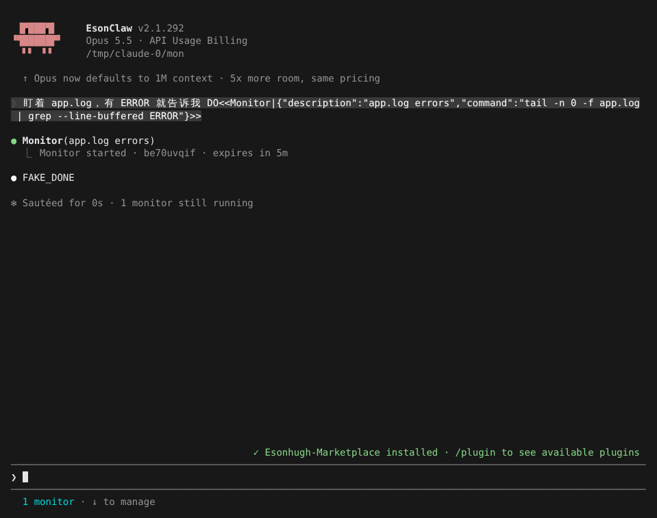
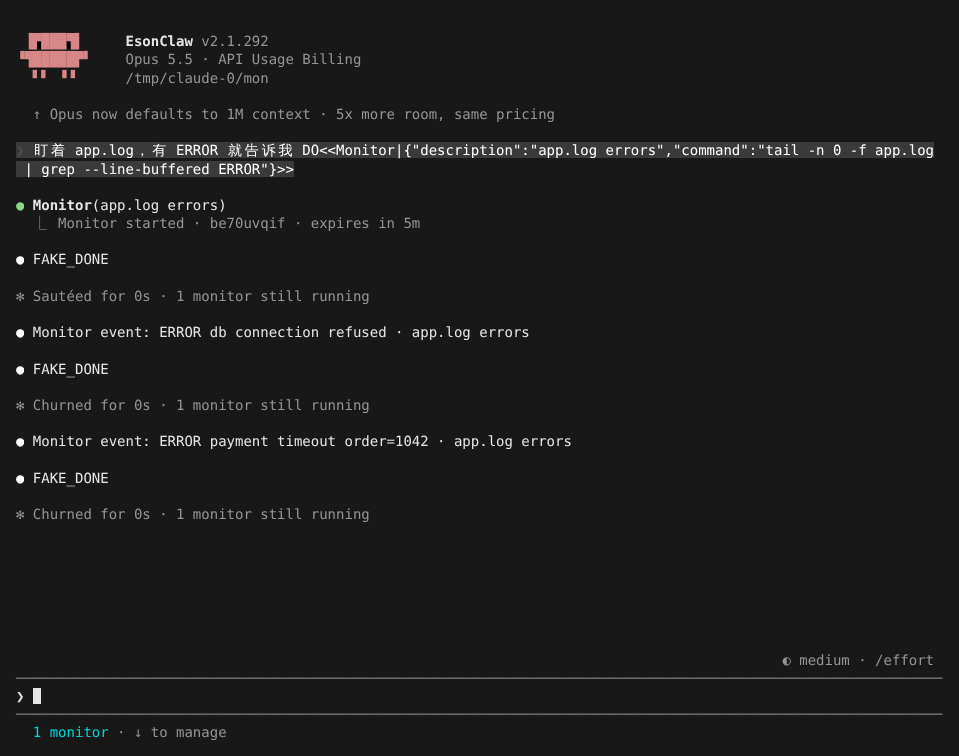
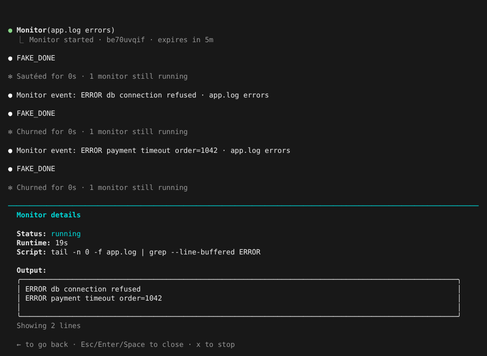

# Monitor 工具

> 英文名：`monitor-tool` · 领域：工具 · [返回功能索引](README.md)

## 这是什么

「部署完告诉我」「日志里出现 ERROR 就处理」这类等待型任务，以前 Claude 只能 `sleep 30` 再看一眼，既浪费时间又会错过东西。

Monitor 工具让 Claude 在后台跑一条命令（例如 `tail -f app.log | grep ERROR`），**命令每输出一行，Claude 就被叫醒一次**，看到内容后决定怎么处理。你可以照常和 Claude 说话，两边互不耽误。

## 快速上手：盯一个日志文件

**1. 让 Claude 开始盯。** 比如说「盯着 app.log，有 ERROR 就告诉我」。Claude 启动 Monitor，回执显示任务 ID 和到期时间（默认 5 分钟），底部出现 `1 monitor · ↓ to manage`：

命令和 Bash 一样走权限检查；这里的 `tail` 和 `grep` 是只读命令，所以直接放行。

**2. 有新内容时 Claude 被叫醒。** 日志里写入两条 ERROR，对话里各出现一条 `Monitor event: <这一行内容> · <监视描述>`，Claude 接着处理（200 毫秒内的多行会合并成一次）：

**3. 查看和停止。** 按 `↓` 选中任务栏，`Enter` 打开 Monitor details，能看到命令、已运行时间和最近的输出；按 `x` 停止监视，`Esc` 关闭：

命令自己结束（例如进程退出）时，对话里会出现一次 `Monitor "…" stream ended`。

## 什么时候会自动停

| 情况 | 结果 |
| --- | --- |
| 到期（默认 5 分钟） | 通知一次「已到期」，Claude 需要的话可以重新开始 |
| 命令结束 | 通知 `stream ended` |
| 输出太多太快 | 超出速率的事件被合并成「N events suppressed」提示；持续刷屏 30 秒后自动停掉，提醒 Claude 换个更精确的过滤条件 |
| 你按 `x` 或 Claude 调 `TaskStop` | 立即停止 |

到期时间由 Claude 通过 `timeout_ms` 指定：最短 1 秒，交互模式最长 30 分钟，`-p` 非交互模式最长 10 分钟。

## 和 Bash 的分工

开启 Monitor 后，Bash（以及 PowerShell）会拒绝以 `sleep N`（N ≥ 25，与官方 2.1.311 一致）开头的前台命令，并提示 Claude：等条件用 Monitor 加 until 循环，等自己启动的命令用后台运行，不要拆成多个短 sleep 绕过。这个拒绝只发给模型，界面上看到的是一行折叠的 `Ran 1 bash command`，和官方一致。

## 权限

- 命令按 Bash 规则检查：`Bash(...)` 的 allow / ask / deny 同样适用；也可以写 `"Monitor"` 整体放行。
- [自动模式](auto-mode.md) 下 `Monitor` 的 allow 规则会被暂时搁置，交给分类器判断。

## 操作按键

| 按键 | 位置 | 作用 |
| --- | --- | --- |
| `↓` | 输入框为空时 | 进入底部任务栏 |
| `Enter` | 任务栏 | 打开 Monitor details |
| `x` | Monitor details | 停止监视 |
| `←` / `Esc` | Monitor details | 返回 / 关闭 |

## 说明

画面来自实际运行（全屏渲染，110×40），模型回复由测试用假 API 生成（`FAKE_DONE`；提示词里的 `DO<<…>>` 是让假 API 调用工具的指令）。
