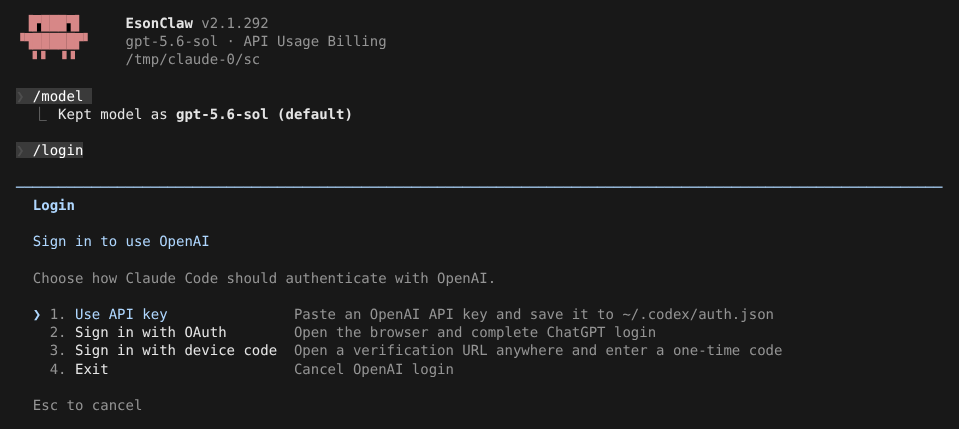
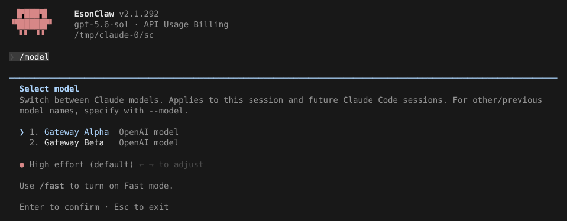

# OpenAI / Codex provider

> 英文名：`openai-provider` · 领域：模型与 Provider · [返回功能索引](README.md)

## 这是什么

Claude Code 默认调用 Anthropic 的 Claude 模型。打开 OpenAI provider 后，同一套界面、工具、权限、命令不变，只是**背后的模型换成 OpenAI 的**（通过 Responses API）。可以用：

- **ChatGPT 账号登录**（OAuth 或设备码），用订阅里的 Codex 额度；
- **OpenAI API key**，按量计费；
- **OpenAI 兼容网关**（公司网关、OpenRouter 等）。

## 快速上手

**1. 开启：**

```bash
CLAUDE_CODE_USE_OPENAI=1 claude
```

**2. 登录：** 输入 `/login`，选一种方式：



| 选项 | 适合 |
| --- | --- |
| Use API key | 已有 OpenAI API key，粘贴后保存到 `~/.codex/auth.json` |
| Sign in with OAuth | 本机有浏览器，用 ChatGPT 账号登录 |
| Sign in with device code | SSH / 无界面机器：在任何设备打开链接、输入一次性码 |

也可以不登录，直接用环境变量：

```bash
CLAUDE_CODE_USE_OPENAI=1 OPENAI_API_KEY=<your-api-key> claude
```

**3. 选模型：** 默认 `gpt-5.6-sol`，欢迎画面会显示。`/model` 列出当前账号或网关可用的模型（下图是一个返回两个模型的兼容网关）：



面板标题是 `Switch between OpenAI models…`。默认模型不在网关返回的列表里时，列表顶部会多一行 `Default (<模型名>)`，标为当前模型。

## 用兼容网关

```bash
CLAUDE_CODE_USE_OPENAI=1 OPENAI_BASE_URL=https://gateway.example/api OPENAI_API_KEY=<key> claude
```

地址末尾有没有 `/v1` 都可以。模型列表的获取规则见 [model-discovery.md](model-discovery.md)。

## 模型名怎么对应

| 你写的 | 实际发送 | 可用环境变量覆盖 |
| --- | --- | --- |
| 不指定 / `opus` | `gpt-5.6-sol` | `ANTHROPIC_DEFAULT_OPUS_MODEL` |
| `sonnet` | `gpt-5.6-terra` | `ANTHROPIC_DEFAULT_SONNET_MODEL` |
| `haiku` | `gpt-5.6-luna` | `ANTHROPIC_DEFAULT_HAIKU_MODEL` |
| 其他名字（包括完整的 Claude 模型 ID） | 原样发送 | — |

## 凭据从哪里来

按顺序取第一个有的：

1. `OPENAI_AUTH_TOKEN`
2. `OPENAI_API_KEY`
3. `~/.codex/auth.json` 里的 API key
4. `~/.codex/auth.json` 里的 ChatGPT 登录凭据

`~/.codex/auth.json` 权限为 `0600`，**不要提交或分享**。和 Codex CLI 共用这个文件。

## 用 ChatGPT 账号时多出来的

- 启动画面和 `/status` 显示套餐、Codex 用量上限和速率限制重置额度（重置需二次确认）；API key 时只显示 `API Usage Billing`。
- `/stats` 多一个 OpenAI activity 分页：累计、峰值、连续天数，以及日 / 周 / 累计图表（`v` 切换视图，方向键选日期）。
- 可以使用 [Codex Apps](codex-apps.md)。
- 请求 `chatgpt.com/backend-api/codex` 时以 Codex CLI 的身份发送版本号（`client_version` 参数和 `version` header，目前为 `0.164.0`，与 Codex CLI 0.164.0 一致），不发送 Claude Code 自己的版本号。跟进新版 Codex 只需改 `src/services/openai-oauth/client.ts` 的 `OPENAI_CODEX_CLIENT_VERSION`。

## 命令在 OpenAI 下的行为

| 命令 / 工具 | 行为 |
| --- | --- |
| `/fast` | 开启优先处理，发送 `service_tier: "priority"`；网关不支持时直接显示服务端错误，再执行一次关闭 |
| `/compact` | 走 OpenAI 远端压缩，并保留之前的压缩历史，多次压缩不丢上下文 |
| `WebSearch` | 使用 OpenAI 服务端搜索，结果和引用转换成和 Claude 一致的格式 |

## 网络安全访问档位（Daybreak）

OpenAI 给网络安全类工作提供了单独的访问档位（Daybreak）。本 fork 在 OpenAI provider 下多了一个 `/daybreak` 命令来切换档位，每次请求 Responses API 时在请求体里带上 `access_programs.cyber`。

**什么时候用：** 账号已经由 OpenAI 开通 Daybreak，要在 Claude Code 里做安全测试、漏洞分析等工作时。没开通就保持默认（`off`）。

**怎么切：**

| 输入 | 效果 | 请求里发送的 `access_programs` |
| --- | --- | --- |
| `/daybreak` | 显示当前档位 | — |
| `/daybreak blue` | 切到 blue 档 | `{"cyber": "daybreak_blue"}` |
| `/daybreak red` | 切到 red 档 | `{"cyber": "daybreak_red"}` |
| `/daybreak off` | 关闭，回到标准档 | `{"cyber": "standard"}` |

参数不区分大小写。切换后从下一次请求开始生效，不用重启。选择写进用户设置 `~/.claude/settings.json` 的 `daybreak` 字段，下次启动沿用。也可以直接写设置：

```json
{
  "daybreak": "blue"
}
```

只接受 `blue`、`red`、`off` 三个值，写错时设置文件校验不通过。没有设置时等同于 `off`。

**实际效果**（tmux 里对着测试用假服务运行）：

```text
❯ /daybreak
  ⎿  Daybreak is off; standard access program selected. Usage: /daybreak [blue|red|off]
❯ /daybreak blue
  ⎿  Daybreak set to blue
❯ /daybreak red
  ⎿  Daybreak set to red
❯ /daybreak
  ⎿  Current Daybreak program: red. Usage: /daybreak [blue|red|off]
❯ /daybreak purple
  ⎿  Invalid argument: purple. Usage: /daybreak [blue|red|off]
```

假服务记录到的请求（每轮对话有一个 `gpt-5.6-luna` 的辅助请求和一个主请求）：

```text
{"model":"gpt-5.6-sol","access_programs":{"cyber":"standard"}}        # 默认
{"model":"gpt-5.6-sol","access_programs":{"cyber":"daybreak_blue"}}   # /daybreak blue 之后
{"model":"gpt-5.6-sol","access_programs":{"cyber":"daybreak_red"}}    # /daybreak red 之后
```

**注意：**

- 只在 OpenAI provider（`CLAUDE_CODE_USE_OPENAI=1`）下可用，用 Claude 模型时 `/daybreak` 不出现。
- 账号没有开通对应档位时，服务端会拒绝请求（例如 `OpenAI API 403: ...`），界面直接显示这个错误；执行 `/daybreak off` 即可恢复。
- `/compact` 的远端压缩请求不带 `access_programs`。
- 走兼容网关时同样会发送这个字段；网关不认识它时如何处理取决于网关。

## 设置

| 配置项 | 写法 | 说明 |
| --- | --- | --- |
| `CLAUDE_CODE_USE_OPENAI` | `1` | 开启 OpenAI provider |
| `OPENAI_AUTH_TOKEN` / `OPENAI_API_KEY` | 字符串 | 凭据 |
| `OPENAI_BASE_URL` | URL | 兼容网关地址 |
| `ANTHROPIC_DEFAULT_OPUS_MODEL` / `_SONNET_MODEL` / `_HAIKU_MODEL` | 模型名 | 别名映射 |
| `daybreak`（settings.json） | `blue` / `red` / `off` | 网络安全访问档位，见上文；`/daybreak` 会写入用户设置 |

## 说明

画面来自实际运行：`OPENAI_BASE_URL` 指向测试用假服务，它返回两个模型（Gateway Alpha / Gateway Beta）。
