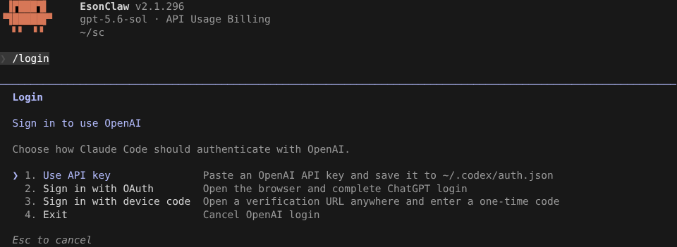
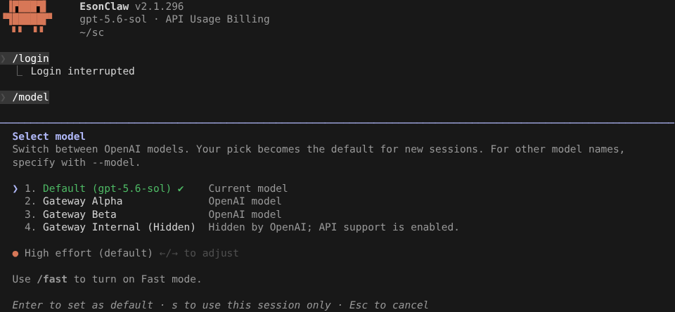

# OpenAI / Codex provider

<!-- lang: zh-Hans -->

> 英文名：`openai-provider` · 领域：模型与 Provider · [返回功能索引](README.md)

## 这是什么

Claude Code 默认调用 Anthropic 的 Claude 模型。打开 OpenAI provider 后，同一套界面、工具、权限、命令不变，只是**背后的模型换成 OpenAI 的**（通过 Responses API）。可以用：

- **ChatGPT 账号登录**（OAuth 或设备码），用订阅里的 Codex 额度；
- **OpenAI API key**，按量计费；
- **OpenAI 兼容网关**（公司网关、OpenRouter 等）。

<details lang="en"><summary>English</summary>

> Name: `openai-provider` · Area: Models and providers · [Back to index](README.md)

## What it is

Claude Code calls Anthropic's Claude models by default. With the OpenAI provider turned on, the UI, tools, permissions and commands stay the same; only **the model behind them becomes OpenAI's** (through the Responses API). You can use:

- **a ChatGPT account sign-in** (OAuth or device code), using the Codex allowance in your subscription;
- **an OpenAI API key**, billed by usage;
- **an OpenAI-compatible gateway** (a company gateway, OpenRouter and so on).

</details>
<details lang="zh-Hant"><summary>繁體中文</summary>

> 英文名：`openai-provider` · 領域：模型與 Provider · [返回功能索引](README.md)

## 這是什麼

Claude Code 預設呼叫 Anthropic 的 Claude 模型。開啟 OpenAI provider 後，同一套介面、工具、權限、命令不變，只是**背後的模型換成 OpenAI 的**（通過 Responses API）。可以用：

- **ChatGPT 帳號登入**（OAuth 或裝置碼），用訂閱裡的 Codex 額度；
- **OpenAI API key**，按量計費；
- **OpenAI 相容閘道**（公司閘道、OpenRouter 等）。

</details>

## 快速上手

**1. 开启：**

```bash
CLAUDE_CODE_USE_OPENAI=1 claude
```

**2. 登录：** 输入 `/login`，选一种方式：



| 选项 | 适合 |
| --- | --- |
| Use API key | 已有 OpenAI API key，粘贴后保存到 `~/.codex/auth.json` |
| Sign in with OAuth | 本机有浏览器，用 ChatGPT 账号登录 |
| Sign in with device code | SSH / 无界面机器：在任何设备打开链接、输入一次性码 |

也可以不登录，直接用环境变量：

```bash
CLAUDE_CODE_USE_OPENAI=1 OPENAI_API_KEY=<your-api-key> claude
```

**3. 选模型：** ChatGPT 账号登录时，默认模型跟随账号 `/codex/models` 列表里优先级最高的非隐藏模型（和 Codex CLI 一致），拿到列表之前、或者用 API key / 网关时，默认是 `gpt-5.6-sol`。欢迎画面会显示当前默认模型。`/model` 列出当前账号或网关可用的模型（下图是一个返回两个模型的兼容网关）：



面板标题是 `Switch between OpenAI models…`。默认模型不在网关返回的列表里时，列表顶部会多一行 `Default (<模型名>)`，标为当前模型。

## 用兼容网关

```bash
CLAUDE_CODE_USE_OPENAI=1 OPENAI_BASE_URL=https://gateway.example/api OPENAI_API_KEY=<key> claude
```

地址末尾有没有 `/v1` 都可以。模型列表的获取规则见 [model-discovery.md](model-discovery.md)。

## 模型名怎么对应

| 你写的 | 实际发送 | 可用环境变量覆盖 |
| --- | --- | --- |
| 不指定 / `opus` | ChatGPT 账号：列表里的第一个模型；否则 `gpt-5.6-sol` | `ANTHROPIC_DEFAULT_OPUS_MODEL` |
| `sonnet` | `gpt-5.6-terra` | `ANTHROPIC_DEFAULT_SONNET_MODEL` |
| `haiku` | `gpt-5.6-luna` | `ANTHROPIC_DEFAULT_HAIKU_MODEL` |
| 其他名字（包括完整的 Claude 模型 ID） | 原样发送 | — |

## 凭据从哪里来

按顺序取第一个有的：

1. `OPENAI_AUTH_TOKEN`
2. `OPENAI_API_KEY`
3. `~/.codex/auth.json` 里的 API key
4. `~/.codex/auth.json` 里的 ChatGPT 登录凭据

`~/.codex/auth.json` 权限为 `0600`，**不要提交或分享**。和 Codex CLI 共用这个文件。

## 用 ChatGPT 账号时多出来的

- 启动画面和 `/status` 显示套餐、Codex 用量上限和速率限制重置额度（重置需二次确认）；API key 时只显示 `API Usage Billing`。
- `/stats` 多一个 OpenAI activity 分页：累计、峰值、连续天数，以及日 / 周 / 累计图表（`v` 切换视图，方向键选日期）。
- 可以使用 [Codex Apps](codex-apps.md)。
- 上下文窗口按账号模型目录（`/codex/models`）里的 `context_window` 取，和 Codex 一致：例如 `gpt-6.1-sol` 500k、`gpt-6-luna` 与 `gpt-5.6-sol` 272k；模型名加 `[1m]` 时用目录的 `max_context_window`（目前 872k），且不会超过它。目录里没有的模型和 API key / 网关用户保持内置值。`/autocompact`（`/context-window`）的档位按这个上限截断，见 [自动压缩窗口](compaction.md)。
- `/model`、`/effort` 和网页的思考强度菜单只列目录给该模型的 effort 档位，并显示、发送目录默认值；`ultra` 发送为 `xhigh`。
- 状态栏与 `/usage` 的 5 小时、每周额度来自响应里的 `x-codex-*` 头；用完额度时显示 `You've hit your ChatGPT usage limit · resets <时间>`，而不是原始 429。
- `ToolSearch` 加载的延迟工具（MCP、Codex Apps 等）以 Responses 原生的 `tool_search_call` / `tool_search_output` 放在对话里找到它的位置（压缩后放在输入开头），顶层 `tools` 整个会话保持不变，加载工具后提示缓存不再整体失效。其他 Responses 端点（API key、兼容网关）仍把加载的工具加进 `tools`。缓存命中与官方 Codex、pi 的对比见 [缓存基准](cache-benchmark.md)。
- 请求 `chatgpt.com/backend-api/codex` 时以 Codex CLI 的身份发送版本号（`client_version` 参数和 `version` header，目前为 `0.166.0`，与 Codex CLI 0.166.0 一致），不发送 Claude Code 自己的版本号。跟进新版 Codex 只需改 `src/services/openai-oauth/client.ts` 的 `OPENAI_CODEX_CLIENT_VERSION`。

## 命令在 OpenAI 下的行为

| 命令 / 工具 | 行为 |
| --- | --- |
| `/fast` | 开启优先处理，发送 `service_tier: "priority"`；网关不支持时直接显示服务端错误，再执行一次关闭 |
| `/compact` | 默认和 Claude 一样由模型写摘要；设置 `compact.mode` 为 `codex` 后改走 OpenAI 服务端压缩，并保留之前的压缩历史，多次压缩不丢上下文，见 [Codex 式压缩](compaction.md#换一种压缩方式codex-式压缩) |
| `WebSearch` | 使用 OpenAI 服务端搜索，结果和引用转换成和 Claude 一致的格式 |
| `apply_patch` | 只在 OpenAI provider 下出现的编辑工具，见下文 |
| `Read` PDF、`@` 提到的 PDF | 以 `input_file` 发给模型；SDK 传入的 `content` 来源 document 与 `search_result` 转成文字 |

## `apply_patch` 工具

GPT 模型训练时用的是 Codex 的 `apply_patch`：一次调用可以改多个文件、多处位置。OpenAI provider 下 Claude Code 提供同名工具，默认取代 Edit / Write（参数 `input`，Codex 的补丁格式：`*** Add File` / `*** Update File`（可带 `*** Move to`）/ `*** Delete File`、`@@` 段、`*** End of File`，也接受 heredoc 写法），Claude 路径仍只用 Edit / Write。同一个编码任务，请求数从 13 次降到 7 次（Codex 0.167.0 为 5 次），总 token 从 156k 降到 85k。

- **按顺序套用**：和 Codex 一样逐个文件对照检查后写入（上下文行必须匹配，空白和弯引号的差异按 Codex 的规则容忍）。某个文件对不上时，前面已写入的文件保留，在这个文件停下，返回给模型的结果写明哪个文件失败及原因、哪些已套用、哪些没有尝试；第一个文件就对不上时一个文件都不改。格式错误、同一路径出现两次或命中 deny 规则时整个补丁不执行。hooks 只对会被写入的文件运行。
- **显示**：每个文件单独一行，和 Claude 并行编辑多个文件时一样：新增是 `Write(path)`，修改是 `Update(path)`，删除是 `Delete(path)`，移动的文件显示 `Update(旧路径 → 新路径)`，各自带 diff；失败的文件以红点显示错误，后面没有尝试的文件列在下方。
- **权限**：补丁涉及的每个路径（包括 Move 的目标）都按 Edit 的权限规则和权限模式检查；不带路径的整工具规则也生效：新增文件和 Move 目标看 `Write`，其余看 `Edit`，所以 `allow: ["Edit", "Write"]` 下补丁不再弹确认，`deny`/`ask` 同理。确认框显示整个补丁，选项 2 把本会话切到 accept edits。Explore、Plan 与 verification 这类只读 agent 不能用它。
- **hooks**：`PreToolUse`、`PostToolUse`、`PostToolUseFailure` 按文件拆成等价的 Edit / Write 事件各跑一次（修改 → Edit，新增 → Write，删除 → 把内容改成空的 Edit，移动 → 新路径的 Write 加旧路径的删除 Edit），所以已有的 `Edit|Write` hook 不用改。matcher 写 `apply_patch` 匹配不到这三个事件，`*` 或不写 matcher 的 hook 也按文件运行。按文件的 hook 可以阻止、拒绝或要求确认，阻止任何一个文件就整个补丁不执行；它返回的 allow、`updatedInput` 和输出改写会被忽略。`PermissionRequest` / `PermissionDenied` 对应唯一的确认框，整个补丁只触发一次，`tool_name` 是 `apply_patch`，写 `Edit` 或 `Write` 的 matcher 也会匹配；`tool_input.file_path` 是第一个文件，`tool_input.file_paths` 是全部文件的绝对路径。
- **SDK / `claude web` 的确认**：Agent SDK 的 `canUseTool`、`--permission-prompt-tool`（stdio 或 MCP 工具）和 `claude web` 收到的不是一个 `apply_patch` 请求，而是按文件拆开、和 hooks 相同形状的 Edit / Write 请求（修改的 `old_string` / `new_string` 是整个文件内容），按补丁顺序逐个询问；已被规则或模式允许的文件不再询问，这时 `PermissionRequest` 也按文件以 Edit / Write 触发。宿主拒绝某个文件时，前面的文件照常写入，在这个文件停下，模型收到已套用的结果和一段说明哪个文件被拒、哪些没有改；第一个文件就被拒时整个补丁不执行。宿主可以通过 `updatedInput` 改 `new_string` / `content`，改动会写进文件；改路径会被拒绝。被宿主拒绝的文件按它看到的 Edit / Write（含该文件的输入）列在 SDK 结果的 `permission_denials` 里，和 Claude 模式分开调用 Edit / Write 时一样。只为 `apply_patch` 写的 ask 规则仍然整个补丁询问一次。
- 文件历史、读取状态、LSP 与 VS Code 通知、设置文件校验和 Edit / Write 相同。
- **只给 apply_patch**：默认（`"openaiEditTools": "apply_patch"`）OpenAI provider 下不提供 Edit / Write，和 Codex 一样只用 apply_patch 编辑文件；设为 `"all"` 时三个都提供。2026-11-11 用 bench 对照（5 个编辑类任务各 3 次，gpt-6.1-sol）：两者通过率都是 100%；第一次测得只给 apply_patch 时每任务 token 少约 11%，用最终默认的 binary 重跑没有重现，token 与花费差异在噪声内。

## 网络安全访问档位（Daybreak）

OpenAI 给网络安全类工作提供了单独的访问档位（Daybreak）。本 fork 在 OpenAI provider 下多了一个 `/daybreak` 命令来切换档位，每次请求 Responses API 时在请求体里带上 `access_programs.cyber`。

**什么时候用：** 账号已经由 OpenAI 开通 Daybreak，要在 Claude Code 里做安全测试、漏洞分析等工作时。没开通就保持默认（`off`）。

**怎么切：**

| 输入 | 效果 | 请求里发送的 `access_programs` |
| --- | --- | --- |
| `/daybreak` | 显示当前档位 | — |
| `/daybreak blue` | 切到 blue 档 | `{"cyber": "daybreak_blue"}` |
| `/daybreak red` | 切到 red 档 | `{"cyber": "daybreak_red"}` |
| `/daybreak off` | 关闭，回到标准档 | `{"cyber": "standard"}` |

参数不区分大小写。切换后从下一次请求开始生效，不用重启。选择写进用户设置 `~/.claude/settings.json` 的 `daybreak` 字段，下次启动沿用。也可以直接写设置：

```json
{
  "daybreak": "blue"
}
```

只接受 `blue`、`red`、`off` 三个值，写错时设置文件校验不通过。没有设置时等同于 `off`。

**实际效果**（tmux 里对着测试用假服务运行）：

```text
❯ /daybreak
  ⎿  Daybreak is off; standard access program selected. Usage: /daybreak [blue|red|off]
❯ /daybreak blue
  ⎿  Daybreak set to blue
❯ /daybreak red
  ⎿  Daybreak set to red
❯ /daybreak
  ⎿  Current Daybreak program: red. Usage: /daybreak [blue|red|off]
❯ /daybreak purple
  ⎿  Invalid argument: purple. Usage: /daybreak [blue|red|off]
```

假服务记录到的请求（每轮对话有一个 `gpt-5.6-luna` 的辅助请求和一个主请求）：

```text
{"model":"gpt-5.6-sol","access_programs":{"cyber":"standard"}}        # 默认
{"model":"gpt-5.6-sol","access_programs":{"cyber":"daybreak_blue"}}   # /daybreak blue 之后
{"model":"gpt-5.6-sol","access_programs":{"cyber":"daybreak_red"}}    # /daybreak red 之后
```

**注意：**

- 只在 OpenAI provider（`CLAUDE_CODE_USE_OPENAI=1`）下可用，用 Claude 模型时 `/daybreak` 不出现。
- 账号没有开通对应档位时，服务端会拒绝请求（例如 `OpenAI API 403: ...`），界面直接显示这个错误；执行 `/daybreak off` 即可恢复。
- `/compact` 的远端压缩请求不带 `access_programs`。
- 走兼容网关时同样会发送这个字段；网关不认识它时如何处理取决于网关。

## 设置

| 配置项 | 写法 | 说明 |
| --- | --- | --- |
| `CLAUDE_CODE_USE_OPENAI` | `1` | 开启 OpenAI provider |
| `OPENAI_AUTH_TOKEN` / `OPENAI_API_KEY` | 字符串 | 凭据 |
| `OPENAI_BASE_URL` | URL | 兼容网关地址 |
| `ANTHROPIC_DEFAULT_OPUS_MODEL` / `_SONNET_MODEL` / `_HAIKU_MODEL` | 模型名 | 别名映射 |
| `daybreak`（settings.json） | `blue` / `red` / `off` | 网络安全访问档位，见上文；`/daybreak` 会写入用户设置 |
| `openaiModel`（settings.json） | 模型名 | OpenAI provider 下 `/model` 保存的默认模型。不写进 `model`，因为官方 Claude Code 也读 `model`，会把 gpt 模型名发给 Anthropic。没有 `openaiModel` 时仍读 `model`（`opus`、`sonnet` 等别名会映射到 OpenAI 模型）；旧版写在 `model` 里的 gpt 模型名启动时会移过来 |

## 说明

画面来自实际运行：`OPENAI_BASE_URL` 指向测试用假服务，它返回两个模型（Gateway Alpha / Gateway Beta）。
