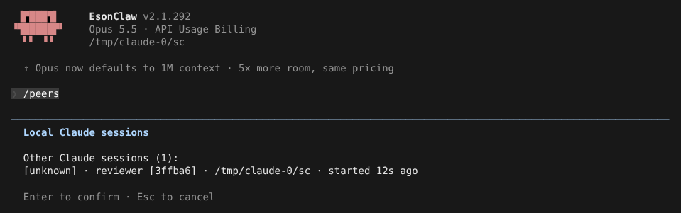
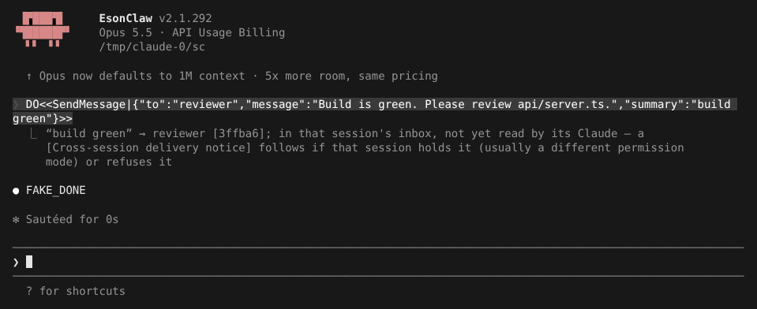
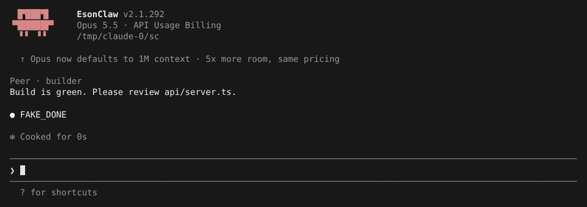

# 独立会话通信

> 英文名：`peer-messaging` · 领域：Agent 与编排 · [返回功能索引](README.md)

## 这是什么

你可能同时开着好几个 Claude 窗口：一个在改代码，一个在跑测试，一个在写文档。独立会话通信让它们**互相知道彼此存在，并能发纯文本消息**：

- `/peers` 列出同机其他会话；
- Claude 用 `SendMessage` 给另一个会话发消息；
- 对方收到后显示 `Peer · <发送者>`，像收到一条新输入一样处理。

只在同一台机器、同一个配置目录内有效（Unix socket / Windows named pipe），不跨机器。

## 快速上手

**1. 起两个有名字的会话**（名字方便辨认）：

```bash
claude --name reviewer     # 窗口 A
claude --name builder      # 窗口 B
```

**2. 在 builder 里 `/peers`**，能看到 reviewer：



**3. 让 builder 发消息。** 比如对 builder 说「测试通过后通知 reviewer 来看 api/server.ts」，它会调用 `SendMessage`。发送成功只代表**已放进对方收件箱**，不代表对方已处理：



**4. reviewer 收到**，显示发送者和内容，然后开始处理：



## 来信不等于你的指令

- 来信单独标记来源，**不算用户指令，也不算权限批准**——对方会话需要权限时照常问你。
- 只传纯文本：不会执行里面的斜杠命令，不带附件。
- Claude 的普通回复不会自动发给别人，只有显式 `SendMessage` 才会。

## 谁的消息会被接收：`crossSessionInbound`

| 值 | 效果 |
| --- | --- |
| `accept` | 直接进入对方的处理队列 |
| `hold` | 先暂存，等权限模式或设置变化后再判断 |
| `refuse` | 拒绝 |

不设置时按「权限级别」自动判断：双方权限模式相同就接收，不同就暂存（例如一个普通会话发给一个 bypass 会话）；对方被暂存或拒绝时，发送方会收到 `[Cross-session delivery notice]`。项目设置只能比用户设置更严格，仓库不能自己放宽。

```json
{ "crossSessionInbound": "accept" }
```

## 被暂存的消息由你决定

消息被暂存（`hold`）时，终端会话会弹出对话框 `Held message from another session`，显示发送者、暂存原因和消息原文：

| 选项 | 效果 |
| --- | --- |
| `Deny — drop it and tell the sender it was declined` | 丢弃，发送方收到「已拒绝」的通知（默认选中，按 `Esc` 也是拒绝） |
| `Deliver this message to Claude` | 交给 Claude 处理 |

桌面版和非交互会话不能弹框，暂存的消息会在一段时间后过期，不会送达。发送方在每次状态变化（暂存、放行、拒绝、过期）时都会收到 `[Cross-session delivery notice]`，用 `SendMessage` 返回的 `msg_id` 对应是哪条消息。

## 等对方忙完再通知我：`notify_when_idle`

想等另一个会话做完手上的事，不用反复问「好了没」：让 Claude 调用 `SendMessage` 时带 `notify_when_idle: true`。对方下次空闲或退出时，你这边会收到一条 `[Cross-session idle notice]`，只通知一次。不带 `message` 就只订阅不发消息；带上就同时发消息并订阅。只能在主对话里用，子代理不行；对方长时间没有空闲信号时订阅会过期，同样会收到通知。

## 设置

| 配置项 | 写法 | 说明 |
| --- | --- | --- |
| `--name` | 字符串 | 会话名，`/peers` 和 `SendMessage.to` 用 |
| `crossSessionInbound` | `accept` / `hold` / `refuse` | 入站策略 |
| `--messaging-socket-path` | 绝对 `.sock` 路径或 named pipe | 指定收件地址（高级集成用） |

`--bare` 和 SSH 本地界面默认不注册收件箱；不同 `CLAUDE_CONFIG_DIR` 的会话互相看不到。

## 说明

画面来自实际运行：两个会话共用一个配置目录，模型回复由测试用假 API 生成。下方「详细说明」保留地址格式和判断规则细节。

## 详细说明

以下内容自原 README 迁入，保持原文。

### 独立会话通信

CLI 启动时（包括 `-p` 非交互模式）会注册同机 inbox；`--bare` 和 SSH local UI 默认不注册。会话发现使用同一个 `${CLAUDE_CONFIG_DIR:-~/.claude}/sessions` registry，因此不同 `CLAUDE_CONFIG_DIR` 的 session 不会通过名称或 UUID 相互发现。可用 `--name` 设置易识别的 session 名称：

```bash
claude --name reviewer
```

默认 endpoint 无需配置。高级集成可使用 `--messaging-socket-path <endpoint>` 覆盖：Unix 使用绝对 `.sock` 路径，Windows 使用 local named pipe；显式指定后也可让 `--bare` 启动 inbox，但 SSH local UI 仍不启动。显式 endpoint 绑定失败会终止启动；自动 endpoint 不可用时只记录 debug log，CLI 继续运行。

查看当前可发现的其他 session（仅在 messaging inbox 成功启动时显示，结果不包含当前进程）：

```text
/list-agents
/peers
```

模型侧的 `ListAgents` 和 `SendMessage` 默认 deferred，由 `ToolSearch` 按需加载。`SendMessage.to` 可使用列表中的 name、名称冲突时的 `name [ref]`、session UUID，或回复来信时复制其精确 `from="uds:..."` 地址。跨独立 session 只发送纯文本，不传递 Team 的 shutdown/plan approval 等结构化控制消息。普通 assistant 文本不会自动发送给 peer；发送成功只确认 transport write，不代表接收方已经接受或处理消息。Peer 输入保留独立 provenance，不作为用户指令或权限批准，也不会解析 slash commands 或 attachments。

入站策略可在用户级或项目级 settings 中配置：

```json
{
  "crossSessionInbound": "accept"
}
```

可选值：

- `accept`：消息进入接收方队列；
- `hold`：暂存，等待 permission class 或 settings 变化后重新判断；
- `refuse`：拒绝消息。

未配置时不是固定值：接收方尚无 permission context 时为 `hold`；已知发送方 permission class 时，同 class 为 `accept`、不同 class 为 `hold`；来信未声明 class 时，普通 prompting session 为 `accept`，bypass session 为 `hold`。project/local policy 只能比 user/managed policy 更严格，不能在仓库配置中放宽上层限制。

该协议仅用于同机 session：macOS/Linux 使用 Unix domain socket，Windows 使用 local named pipe；Remote Control、Direct Connect 和 SSH Remote 是独立 transport。
