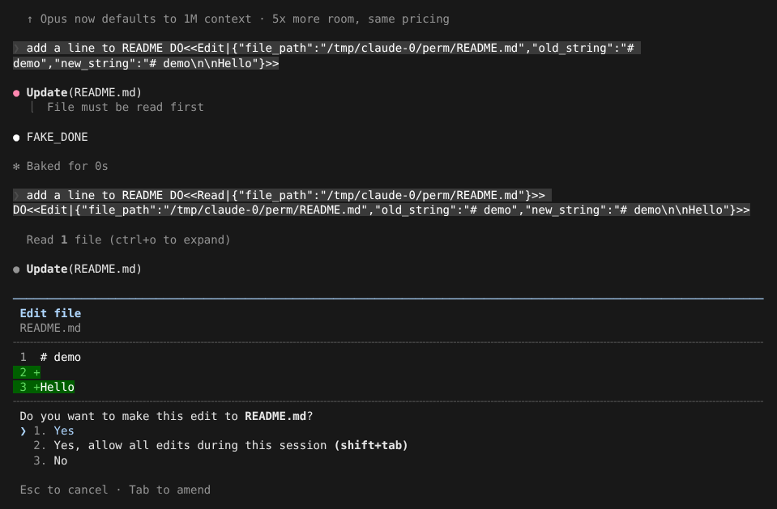
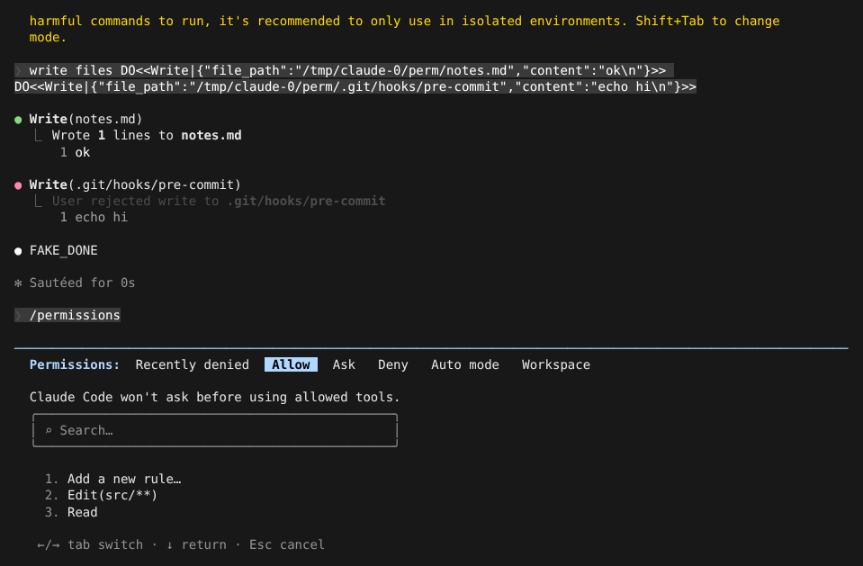
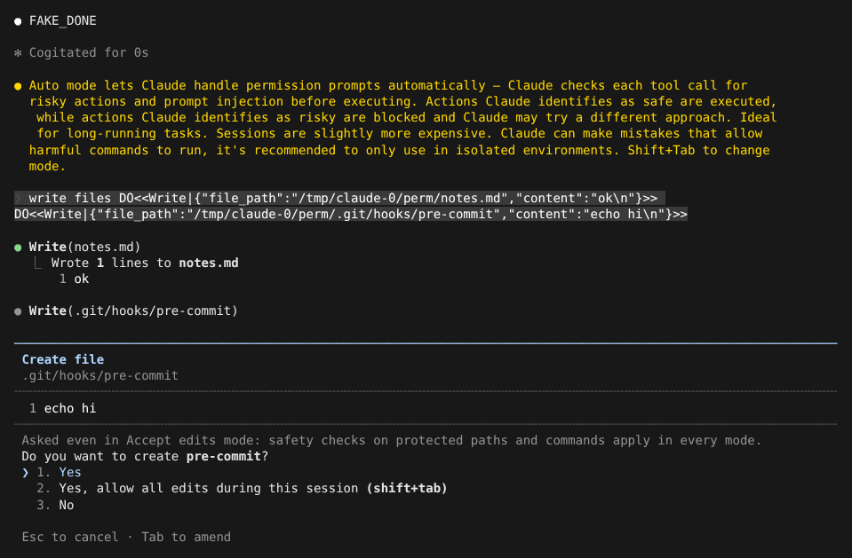

# 权限规则、权限模式与 Safe mode

> 英文名：`permissions` · 领域：权限与安全 · [返回功能索引](README.md)

## 这是什么

Claude 每次要改文件、跑命令、访问网络之前，都会判断要不要先问你。决定这件事的有三样东西：

1. **权限规则**：你提前写好的「这类操作直接允许 / 总是先问 / 一律禁止」。
2. **权限模式**：整体的松紧程度，例如「改文件不用问」或「先只做计划」。按 `Shift+Tab` 切换。
3. **安全底线**：改 `.git/`、`.claude/`、shell 配置这类敏感位置，不论规则和模式怎么设，都会先问（bypass 模式除外，见下文）。

自动模式（让分类器替你判断）见 [auto-mode.md](auto-mode.md)。

## 第一次遇到：权限确认框

没有规则覆盖的操作会弹出确认框，并显示要改的内容：



| 选项 | 效果 |
| --- | --- |
| 1. Yes | 只允许这一次 |
| 2. Yes, allow all edits during this session | 本次会话里改文件都不再问（等于切到 accept edits 模式，也可以按 `Shift+Tab`） |
| 3. No | 拒绝；Claude 会收到 `User rejected ...` 并换个做法 |

`Tab` 可以在拒绝时补一句说明（例如「别改这个文件，改 docs/ 下面的」），`Esc` 取消。

## 用规则提前决定

在 settings.json 里写 `permissions`。下面是本页演示用的配置：

```json
{
  "permissions": {
    "allow": ["Edit(src/**)", "Read"],
    "ask": ["Bash(git push:*)"],
    "deny": ["Bash(rm:*)"]
  }
}
```

效果：改 `src/` 下的文件直接执行；改 `README.md` 不在 allow 范围里，照常询问（上一张图）；`rm` 命令被直接拒绝，模型收到错误后自行处理：

```text
● Update(src/a.ts)
  ⎿  Added 1 line, removed 1 line
      1 -export const a = 1
      1 +export const a = 2

● Bash(rm -rf build)
  ⎿  Error: Permission to use Bash with command rm -rf build has been denied.
```

三种规则的优先级是 **deny > ask > allow**。

### 规则怎么写

| 写法 | 匹配 |
| --- | --- |
| `Read`、`WebFetch` | 整个工具 |
| `Bash(git push:*)` | 以 `git push` 开头的命令 |
| `Edit(src/**)` | 当前目录下 `src/` 里的任何文件 |
| `Agent(model:opus)` | 按工具参数匹配：用 opus 模型的子 Agent |
| `WebFetch(domain:*.example.com)` | 指定域名，支持 `*.example.com`、`api-*.example.com`、`domain:*` |
| `mcp__github` / `mcp__github__*` | 某个 MCP server 的全部工具（server 名里有 `__` 时用后一种） |
| `mcp__github__get_*` | MCP 工具名通配 |
| `Web*` | 工具名通配，**只能用在 deny / ask** |

几条容易踩的细节：

- Bash 的 deny / ask 规则会「看穿」包装：`sudo rm`、`env X=1 rm`、`nohup rm`、`exec rm` 都按 `rm` 匹配。
- `Bash(find:*)` 不会放行带 `-exec`、`-execdir`、`-ok`、`-delete` 的 find。
- 超过 10000 字符、或以悬空的 `&&` / `||` / `|` 结尾的命令一律询问。
- 工作目录外的写入、带 `cd` 的复合写入命令、带参数的 `cp` / `mv` 仍会询问。
- `WebFetch(domain:...)` 规则优先于内置的预批准域名。

### 在界面里管理规则：`/permissions`

不想手改 JSON 时用 `/permissions`。`←/→` 切换分页：最近被拒绝的、Allow、Ask、Deny、自动模式规则、工作区目录：



选 `Add a new rule…`，输入规则后选择保存位置：

```text
  Add deny permission rule

    WebFetch(domain:*.internal.example.com)

  Where should this rule be saved?
  ❯ 1. Project settings (local)  Saved in .claude/settings.local.json
    2. Project settings          Checked in at .claude/settings.json
    3. User settings             Saved in at ~/.claude/settings.json
```

## 权限模式

按 `Shift+Tab` 在模式之间切换，当前模式显示在提示框下方：

```text
  ⏵⏵ accept edits on (shift+tab to cycle)
```

```text
  ⏵⏵ auto mode on (shift+tab to cycle)
```

| 模式 | 启动参数 `--permission-mode` | 行为 |
| --- | --- | --- |
| Manual（默认） | `manual`（即 `default`） | 按规则来，没规则就问 |
| Accept edits | `acceptEdits` | 改文件不再问；命令照常问 |
| Plan | `plan` | 只读、只出计划，不动文件；需要先开启 `planModeAvailable` |
| Auto | `auto` | 由分类器判断是否需要问，见 [auto-mode.md](auto-mode.md) |
| Don't ask | `dontAsk` | 没有规则放行的操作直接拒绝，不弹框 |
| Bypass | `bypassPermissions` | 都不问（灾难性删除如 `rm -rf /`、删主目录仍会问）；只建议在隔离环境用 |

- 默认的 `Shift+Tab` 轮替是 Manual → Accept edits → Auto → Manual。Plan 默认不在轮替里，打开 `"planModeAvailable": true` 后才出现（`/plan`、`EnterPlanMode` 也受它控制）：

```text
  ⏸ plan mode on (shift+tab to cycle)
```

- Bypass 只有在你同意过警告、或用启动参数开启后才会出现在轮替里；`/yolo` 是切到 bypass 的快捷命令。被组织策略禁用时会提示 `Bypass permissions mode was not enabled` 并保持原模式。
- 模式会记在对话里，`--resume` / `--continue` 回来时恢复上次的模式（命令行显式指定的优先）。

## 安全底线：受保护的路径

写入下面这些位置时，即使在 Accept edits 模式、即使有 allow 规则，也会先问：

- `.git/`、`.claude/`
- shell 配置文件
- 构建工具配置：`.npmrc`、`bunfig.toml`、`.husky`、`.cargo` 等

确认框里会注明原因：



读取 UNC 网络路径（`//host/share`、`\\host\share`）也总是要人工确认。Bypass 模式下受保护路径不再询问，但灾难性删除仍要确认。

## 项目设置不能做的事

为了防止仓库里的配置「偷偷放权」，项目级 `.claude/settings.json` 和 `.claude/settings.local.json`：

- 把 `defaultMode` 设成 `bypassPermissions` 或 `auto` 会被忽略；
- `env` 里不能设置 `CLAUDE_CONFIG_DIR`、`HOME`、`TMPDIR`，不能打开 Anthropic 遥测或改写 OTel 导出目标；
- 被 git 跟踪的 `.claude/settings.local.json`，在你没有明确信任这个工作区之前，其中的 allow 规则不生效。

组织托管设置开启 `allowManagedPermissionRulesOnly` 后，skill 和命令里声明的 `allowed-tools` 不再自动放行。

## 排查坏配置：Safe mode

`claude --safe-mode`（或 `CLAUDE_CODE_SAFE_MODE=1`）启动一个「干净」的会话：不加载 CLAUDE.md、插件、MCP、非托管 hooks、自定义 agents / skills 等定制，组织托管的设置仍然生效。怀疑是某个配置把 Claude 搞坏了时，先用它确认问题是否消失。

## 非交互模式

`claude -p` 没有界面可以弹确认框。加 `--permission-prompts none` 时，所有需要确认的操作直接拒绝，模型收到：

```text
Permission to use Bash has been denied. ...
```

默认 `--permission-prompts host` 则交给 SDK 的宿主程序决定。

## 已知问题

- 旧文档写 Plan 模式下有 allow 规则时模型会直接收到 `Cannot call <tool> while in plan mode.`；实测交互模式是弹出确认框（写入都没有执行），官方 2.1.303 同样弹框。

## 说明

画面来自实际运行，模型回复由测试用假 API 生成（`FAKE_DONE`，提示词里的 `DO<<…>>` 是让假 API 调用工具的指令）。
