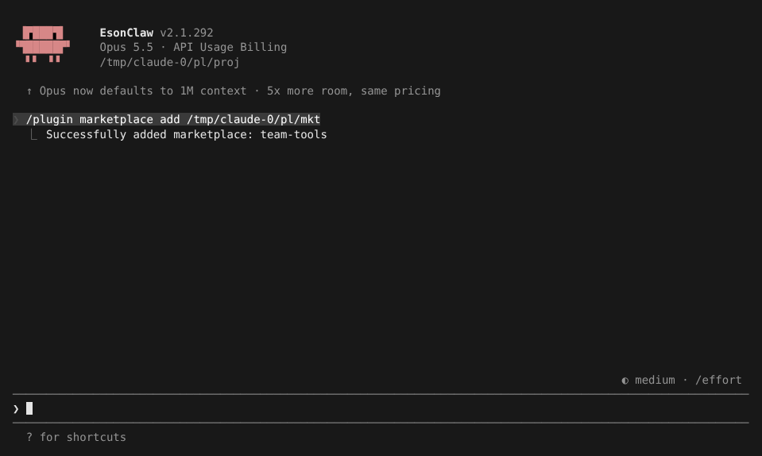
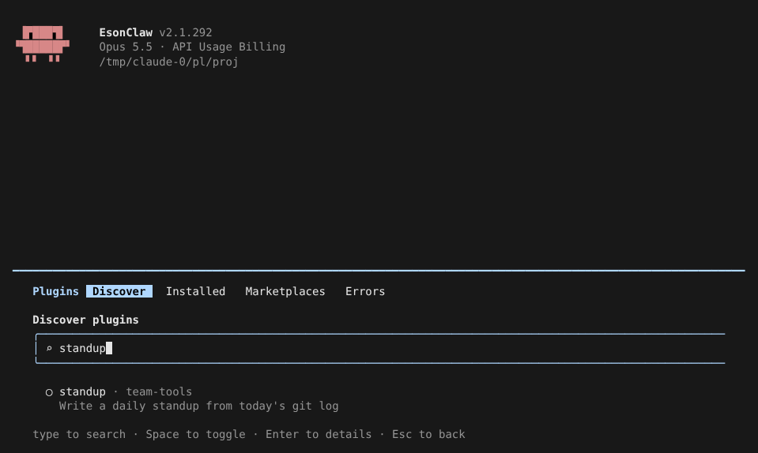
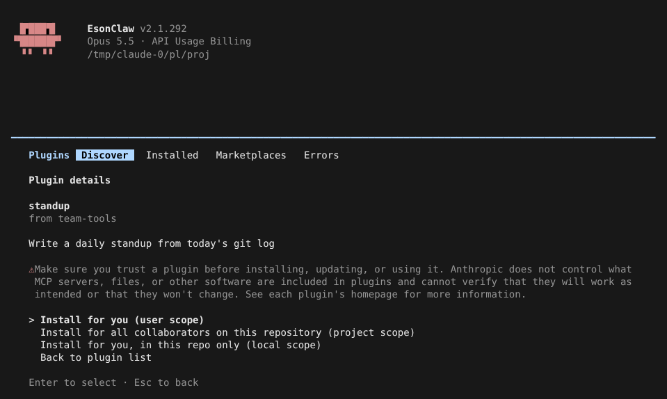
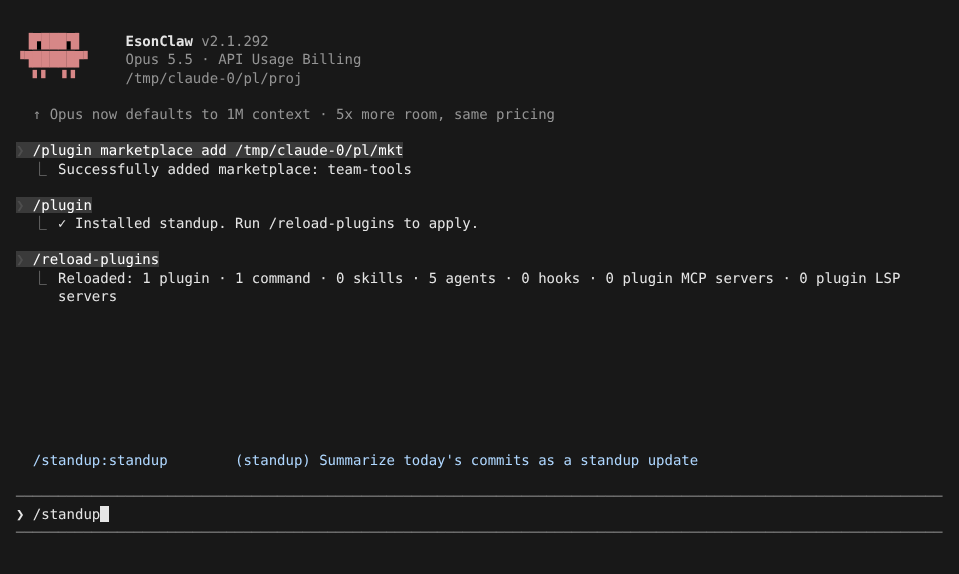
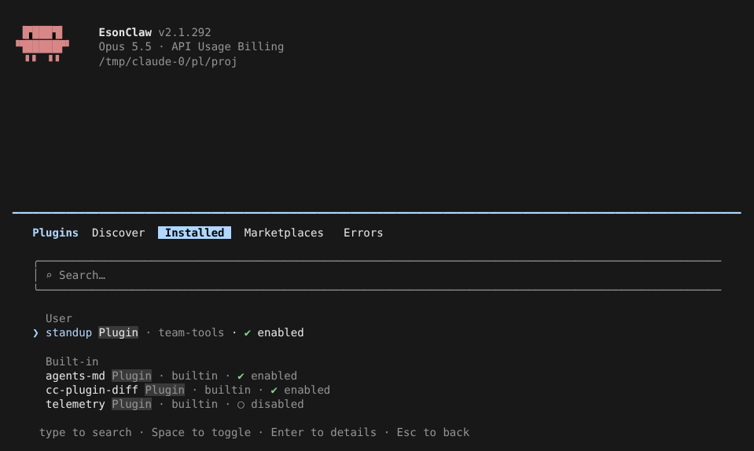
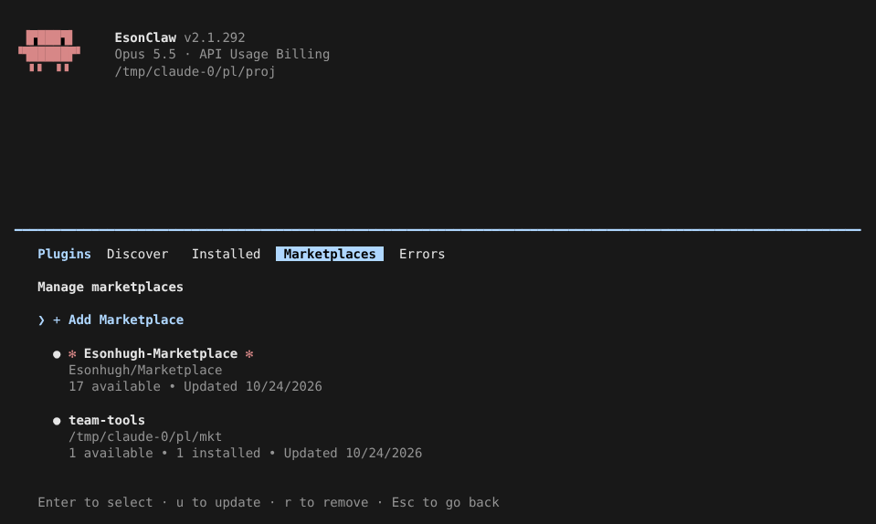

# 插件与 Marketplace

> 英文名：`plugins-marketplace` · 领域：插件与扩展 · [返回功能索引](README.md)

## 这是什么

**插件**是一个打包好的扩展：里面可以有斜杠命令、[skill](skills.md)、[子代理](agents.md)、[hook](hooks.md)、[MCP server](mcp.md)、LSP 等，装一个插件就一次性拿到一整套能力。

**Marketplace（插件市场）**是插件的目录。它可以是一个 GitHub 仓库，也可以是本地文件夹。团队把常用插件放进自己的 marketplace，成员加一次就能浏览和安装。

本 fork 启动时会自动登记 `Esonhugh-Marketplace`（底部提示 `✓ Esonhugh-Marketplace installed`），官方插件名称照常兼容。

## 快速上手：建一个团队 marketplace 并安装插件

**1. 准备 marketplace 目录。** 最小结构是一个清单加一个插件：

```text
team-tools/
├── .claude-plugin/marketplace.json
└── standup/
    ├── .claude-plugin/plugin.json
    └── commands/standup.md
```

```json
// team-tools/.claude-plugin/marketplace.json
{
  "name": "team-tools",
  "owner": { "name": "Platform Team" },
  "plugins": [
    { "name": "standup", "source": "./standup", "description": "Write a daily standup from today's git log" }
  ]
}
```

`commands/standup.md` 就是一个普通的斜杠命令文件（frontmatter 写 `description`，正文写提示词）。

**2. 添加 marketplace。** 本地路径或 `owner/repo` 都可以：

```text
/plugin marketplace add ./team-tools
```



**3. 浏览并搜索。** 输入 `/plugin`，在 Discover 分页直接打字搜索：



**4. 选中后按 `Enter` 看详情，选择安装范围：**



| 范围 | 写到哪里 | 适合 |
| --- | --- | --- |
| user | `~/.claude/settings.json` | 只有你自己、所有项目都用 |
| project | 项目 `.claude/settings.json`（提交进仓库） | 整个团队都用 |
| local | 项目 `.claude/settings.local.json` | 只有你、只在这个仓库用 |

**5. 立即生效。** 安装后运行 `/reload-plugins`，不用重启；它会报告重新加载了多少命令、skill、agent、hook 和 MCP / LSP，新命令马上能用：



## 管理已安装的插件

`/plugin` 里用 `←` `→` 切换分页：

- **Installed**：按 user / project / local / favorite / 内置分组，`Space` 启用或停用，`Enter` 看详情（可以「Add to favorites」收藏，收藏的插件单独置顶成一组）：



- **Marketplaces**：查看已添加的市场，`u` 立即更新，`r` 删除：



- **Errors**：加载失败的插件和原因。

`/reload-plugins` 加载失败时会回滚到上一次能用的状态，不会让已有插件全部失效。已安装的插件使用本地缓存，reload 不会重新下载。

## 临时试用，不安装

```bash
claude --plugin-dir ./my-plugin            # 用本地目录，只对本次会话生效
claude --plugin-url https://example.com/my-plugin.zip   # 下载 zip，只对本次会话生效
```

两个参数都可以重复写多次。`--plugin-url` 限时 30 秒、最大 256 MiB，下载到只有你能读的会话临时目录。公司可在托管设置里用 `disableSideloadFlags: true` 禁止这两个参数。

## 命令速查

| 命令 | 作用 |
| --- | --- |
| `/plugin` | 打开插件管理界面 |
| `/plugin marketplace add <路径或 owner/repo>` | 添加 marketplace |
| `/reload-plugins` | 不重启，应用安装 / 更新 / 启停 |
| `claude plugin install <名字>@<市场>` | 命令行安装（另有 `list` `enable` `disable` `update` `uninstall` `validate` `marketplace` 子命令） |
| `claude plugin validate <路径>` | 检查插件或 marketplace 清单写得对不对 |

## 设置

| 配置项 | 写法 | 说明 |
| --- | --- | --- |
| `enabledPlugins` | `{"standup@team-tools": true}` | 启用 / 停用 |
| `favoritePlugins`（用户设置） | 插件 ID 数组 | 收藏，由界面维护 |
| `defaultEnabled`（插件或 marketplace 清单） | `true` / `false` | 安装时默认是否启用 |
| `disableSideloadFlags`（托管设置） | `true` | 禁止 `--plugin-dir` / `--plugin-url` |

## 已知问题

全屏模式下 `/plugin` 的搜索框右边框会被截掉一格（官方完整），不影响使用。

## 说明

画面来自实际运行（全屏渲染，110×30），用的是上面这个本地 `team-tools` marketplace；列表中的其他插件来自自动登记的 Esonhugh-Marketplace。
