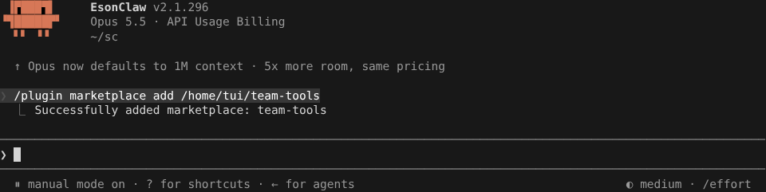
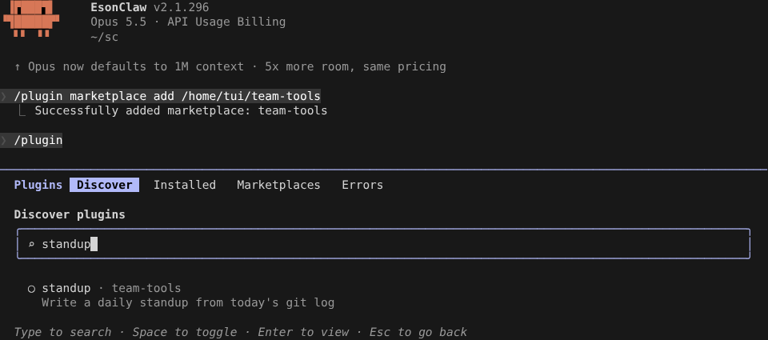
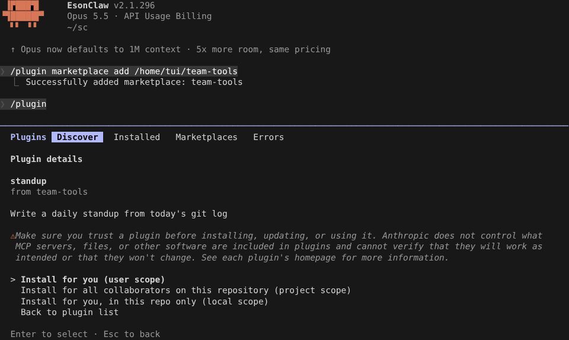
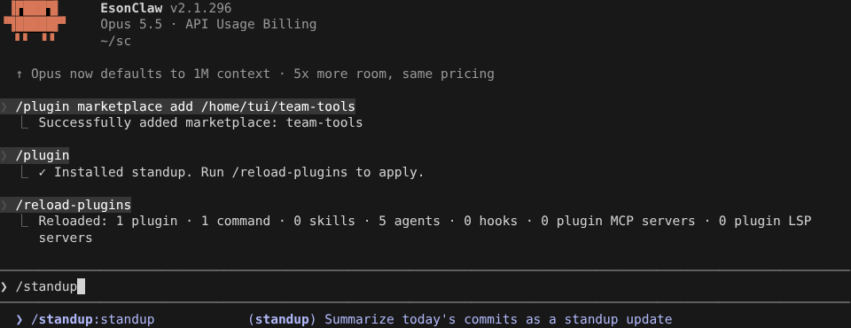
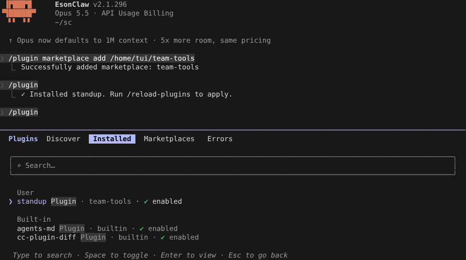
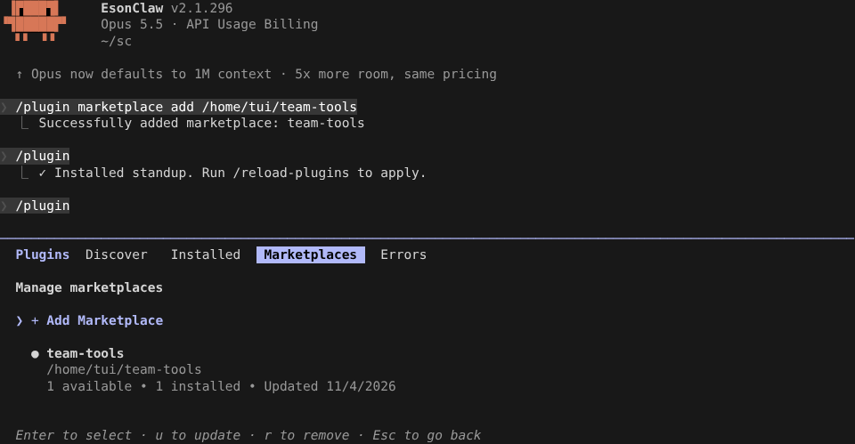

# 插件与 Marketplace

<!-- lang: zh-Hans -->

> 英文名：`plugins-marketplace` · 领域：插件与扩展 · [返回功能索引](README.md)

## 这是什么

**插件**是一个打包好的扩展：里面可以有斜杠命令、[skill](skills.md)、[子代理](agents.md)、[hook](hooks.md)、[MCP server](mcp.md)、LSP 等，装一个插件就一次性拿到一整套能力。

**Marketplace（插件市场）**是插件的目录。它可以是一个 GitHub 仓库，也可以是本地文件夹。团队把常用插件放进自己的 marketplace，成员加一次就能浏览和安装。

本 fork 启动时会自动登记 `Esonhugh-Marketplace`（底部提示 `✓ Esonhugh-Marketplace installed`），官方插件名称照常兼容。

<details lang="en"><summary>English</summary>

> Name: `plugins-marketplace` · Area: Plugins and extensions · [Back to index](README.md)

## What it is

A **plugin** is a packaged extension that can hold slash commands, [skills](skills.md), [subagents](agents.md), [hooks](hooks.md), [MCP servers](mcp.md), LSP servers and more, so installing one plugin gives you a whole set of capabilities at once.

A **marketplace** is a catalogue of plugins. It can be a GitHub repo or a local folder. A team puts the plugins it uses into its own marketplace, and members add it once to browse and install.

At startup this fork registers `Esonhugh-Marketplace` automatically (the footer shows `✓ Esonhugh-Marketplace installed`); official plugin names work as usual.

</details>
<details lang="zh-Hant"><summary>繁體中文</summary>

> 英文名：`plugins-marketplace` · 領域：插件與擴充 · [返回功能索引](README.md)

## 這是什麼

**插件**是一個打包好的擴充：裡面可以有斜槓命令、[skill](skills.md)、[子代理](agents.md)、[hook](hooks.md)、[MCP server](mcp.md)、LSP 等，裝一個插件就一次性拿到一整套能力。

**Marketplace（插件市場）**是插件的目錄。它可以是一個 GitHub 倉庫，也可以是本地資料夾。團隊把常用插件放進自己的 marketplace，成員加一次就能瀏覽和安裝。

本 fork 啟動時會自動登記 `Esonhugh-Marketplace`（底部提示 `✓ Esonhugh-Marketplace installed`），官方插件名稱照常相容。

</details>

## 快速上手：建一个团队 marketplace 并安装插件

**1. 准备 marketplace 目录。** 最小结构是一个清单加一个插件：

```text
team-tools/
├── .claude-plugin/marketplace.json
└── standup/
    ├── .claude-plugin/plugin.json
    └── commands/standup.md
```

```json
// team-tools/.claude-plugin/marketplace.json
{
  "name": "team-tools",
  "owner": { "name": "Platform Team" },
  "plugins": [
    { "name": "standup", "source": "./standup", "description": "Write a daily standup from today's git log" }
  ]
}
```

`commands/standup.md` 就是一个普通的斜杠命令文件（frontmatter 写 `description`，正文写提示词）。

**2. 添加 marketplace。** 本地路径或 `owner/repo` 都可以：

```text
/plugin marketplace add ./team-tools
```



**3. 浏览并搜索。** 输入 `/plugin`，在 Discover 分页直接打字搜索：



**4. 选中后按 `Enter` 看详情，选择安装范围：**



| 范围 | 写到哪里 | 适合 |
| --- | --- | --- |
| user | `~/.claude/settings.json` | 只有你自己、所有项目都用 |
| project | 项目 `.claude/settings.json`（提交进仓库） | 整个团队都用 |
| local | 项目 `.claude/settings.local.json` | 只有你、只在这个仓库用 |

**5. 立即生效。** 在 `/plugin` 里安装、启用 / 停用、卸载、改设置或增删 marketplace 之后，关闭菜单时会自动执行 `/reload-plugins`，不用重启；菜单里什么都没改就关闭则不 reload。Claude 正在回复时关闭菜单，`/reload-plugins` 会排队到这次回复结束再执行，并提示 `Plugin changes apply when the current response finishes (/reload-plugins is queued).`。用命令行 `claude plugin install` 装的插件，在已打开的会话里手动运行一次 `/reload-plugins`。它会报告重新加载了多少命令、skill、agent、hook 和 MCP / LSP，新命令马上能用：



## 管理已安装的插件

`/plugin` 里用 `←` `→` 切换分页：

- **Installed**：按 user / project / local / favorite / 内置分组，`Space` 启用或停用，`Enter` 看详情（可以「Add to favorites」收藏，收藏的插件单独置顶成一组）。切换不会马上生效，底部提示 `Changes apply when you close this menu`：



- **Marketplaces**：查看已添加的市场，`u` 立即更新，`r` 删除：



- **Errors**：加载失败的插件和原因。对某条插件错误按 `Enter` 会先问 `Uninstall <name>?`（`Uninstalling this plugin clears its error.`），选项是 `Yes, uninstall` 和 `No, cancel`，默认停在 No，按 `Esc` 也是取消。

`/reload-plugins` 加载失败时会回滚到上一次能用的状态，不会让已有插件全部失效。已安装的插件使用本地缓存，reload 不会重新下载。

## 插件依赖

插件可以在 `plugin.json` 里声明它依赖的其他插件。只写名字时按声明方自己的 marketplace 查找，也可以写成 `名字@marketplace`：

```json
// child/.claude-plugin/plugin.json
{ "name": "child", "version": "1.0.0", "dependencies": ["base"] }
```

- **安装**：`claude plugin install child@mk` 会沿 `dependencies` 逐层把依赖一起装上并启用，成功信息末尾列出依赖名（最多列 5 个），例如 `(+ 1 dependency: base)`。marketplace 条目里写的依赖和 `plugin.json` 里写的都会读。找不到的依赖不会让安装失败，只在成功信息后附一条警告；其他 marketplace 的插件要在根 marketplace 的 `allowCrossMarketplaceDependenciesOn` 里列出才会自动装。作为依赖装进来的插件在 `installed_plugins.json` 里记为 `auto: true`，之后再用名字单独安装它，就改回手动安装。
- **重复安装**：插件在该范围已启用、安装记录和文件都在时，`claude plugin install` 不重新安装，也不改写记录，输出 `Plugin "child@mk" is already installed (scope: user)`；原本作为依赖自动装上的，后面加 ` — marked as manually installed`。直接从本地目录 marketplace 读取的插件再附一句 ` — it loads in place from <目录>, so edits there take effect at the next session start or /reload-plugins`；目录里 `plugin.json` 的版本和记录不同时，还会给出更新记录版本的 `claude plugin update` 命令。缺少的依赖这时会补装，输出末尾同样列出 `(+ 1 dependency: base)`；补装不上的写成 ` — 1 dependency still unresolved: nope@mk.`，依赖所属的 marketplace 还没添加时再问 `Is the "<市场>" marketplace added?`。依赖已经安装但被停用时，按首次安装的流程重装一遍，依赖会重新启用。
- **停用**：还有已启用的插件依赖它时，`claude plugin disable base@mk` 会拒绝并退出码为 1，设置不变：`base is still required by child. Disable that plugin first, or disable everything together: claude plugin disable child@mk && claude plugin disable base@mk`。`/plugin` 的 Installed 页同样拒绝。`disable --all` 不受影响。
- **启用**：`claude plugin enable child@mk` 会连带启用已安装但被停用的依赖，输出 `(also enabled 1 dependency: base)`；依赖没有安装时启用失败。
- **卸载与清理**：卸载后如果有自动安装的依赖不再被需要，会提示 ``1 auto-installed dependency no longer needed: lone. Run `claude plugin prune` to remove.``。`claude plugin prune`（别名 `autoremove`）列出并移除这些插件；`claude plugin uninstall <插件> --prune` 在卸载时一起清理。
- **补装**：插件加载时发现依赖缺失（比如 base 被卸载而 child 仍启用），`/reload-plugins` 会把依赖装回声明方启用的那个范围，再重载一次，结果里显示 `(+ 1 dependency: base) resolved`。

`claude plugin prune` 需要确认：终端里会列出要删的插件并问 `Remove? [y/N]`；输入或输出被管道、重定向时不会询问，要加 `-y`。`--dry-run` 只列出不删除，`-s user|project|local` 选范围（默认 user）。`uninstall --prune` 在非交互环境下同样要加 `-y`。

## 命令行：查看、配置和发布插件

**看一个插件里有什么、占多少上下文：`claude plugin details <名字>`。** 名字写 `name` 或 `name@marketplace` 都行（不分大小写），已停用的插件也能查。输出插件的显示名、版本、描述、来源，列出 Skills、Agents、Hooks、MCP servers、LSP servers，再估算每次会话固定占用的 token（Always-on，即名字、描述和 `when_to_use`）和每次调用 skill 或 agent 时的 token（On-invoke，即正文）。有可用的登录或 API key 时用 `count_tokens` 计数，取不到时按字符数估算，数字前带 `~`。没有 `--json`。找不到插件时退出码为 1。

```text
Full Plugin (full) 1.2.3
  Description: first line
      second line
  Source: full@inline

Component inventory
  Skills (2)  alpha, run
  Agents (1)  helper
  Hooks (2)  PreToolUse, Stop  (harness-only — no model context cost)
  MCP servers (1)  srv  (tool schemas resolved at runtime; not counted)
  LSP servers (1)  ls  (no model context cost)

Projected token cost
  Always-on:   ~17 tok   added to every session

Per-component (rounded)
  component  always-on  on-invoke
  alpha           < 20       ~250
  helper          < 20       < 20
  run             < 20       < 20

  On-invoke cost is paid each time a skill or agent fires.
  Token counts are estimates and may differ from actual usage.
```

（这段来自 `pluginDetails.test.ts` 的估算模式。）

**查看和设置插件选项：`claude plugin configure <名字>@<市场>`。** 插件在 `plugin.json` 的 `userConfig` 里声明的选项，这里列出每一项是否必填（required / optional）、是否敏感（sensitive）、是否已设置（set / not set）。必须写完整 ID（`claude plugin list` 显示的那个），已停用的插件也能查。`--json` 输出 `pluginId`、`displayName`、`schema`、`inputs`、`choices`、`configured`、`unconfigured`，敏感选项的值不输出。

要在命令行里保存，用 `--values-stdin` 从标准输入传一个「值全是字符串」的 JSON 对象：

```bash
echo '{"region":"eu"}' | claude plugin configure demo@mk --values-stdin
# Configuration saved. Restart Claude Code to apply it.
```

- 没写到的选项保留原值；空字符串不会覆盖已保存的敏感值，也不会写进数字类型的选项。
- 字符串会按选项类型转成布尔值或数字，并检查 `min` / `max`、可选值和必填项。未声明的选项、超过 64 KB 的值、多行的值都会被拒绝；整个输入不能超过 256 KB。
- 敏感选项存进系统的安全存储（macOS 钥匙串等），其他选项写进用户设置的 `pluginConfigs`。报错信息里如果出现了你传入的敏感值，会换成 `…`。
- 带 `--json` 时，保存成功输出 `saved`，被拒绝时输出 `refused`（含选项名和原因）。

**发布插件时打 git tag：`claude plugin tag [路径]`。** 在插件目录（默认当前目录）运行，会创建一个带注释的 tag，名字是 `<插件名>--v<版本号>`，指向 `HEAD`：

```bash
claude plugin tag ./standup --dry-run   # 只打印要执行的 git 命令
claude plugin tag ./standup --push      # 创建后推到 origin
```

- 依次在 `<路径>/.claude-plugin/plugin.json`、`<路径>/plugin.json` 找清单，路径本身是文件时直接用它。还会从插件目录往上找到 git 仓库根，找列出这个插件的 `marketplace.json`。
- 先跑和 `claude plugin validate` 相同的检查，警告逐行列出，有错误就停止。版本号取 `plugin.json` 的 `version`，没有时取 marketplace 条目的 `version`；两边都写了但不一致、版本不是合法 semver、tag 名不是合法的 git 引用名、不在 git 仓库里，都会停止。
- 插件目录或 `marketplace.json` 有未提交的改动、或者 tag 已经存在时也会停止，`-f` / `--force` 跳过这两项检查（推送时也带 `--force`）。
- `-m <消息>` 设置 tag 注释，`%s` 替换成版本号，默认是 `<插件名> <版本号>`。`--push` 推到 `--remote <名字>`（默认 `origin`）；remote 名只能由字母、数字和 `._/-` 组成，且以字母或数字开头，否则不推送，已创建的本地 tag 保留。不加 `--push` 时最后一行给出推送命令。

**取回被搁置的插件选项和密钥：`claude plugin restore-set-aside <插件 ID>`。** 组织声明的 marketplace 替换了同名的另一个来源时，原来存给这些插件的选项和密钥会被搁置，存在用户设置 `pluginConfigs` 和安全存储里键名为 `.set-aside/<时间戳>/<插件 ID>` 的条目下。`claude plugin list` 发现有搁置项时，会在末尾提示可以用这个命令处理。

- 不加参数时把这个插件 ID 的搁置项合并回原来的位置，现有的值优先；`--discard` 直接删除搁置项。
- 不检查插件是否已安装。还原后，以后装在这个 ID 下的插件都能读到这些值；插件存在自己数据目录里的文件不会被移动。
- 没有搁置项时输出 `No options or secrets are set aside for <插件 ID>.`，退出码为 0，不改写设置文件。

**列出已安装的插件：`claude plugin list`。** 直接从本地目录 marketplace 读取的插件多一行 `Read from: <目录>`，版本取该目录 `plugin.json` 里的版本。user 设置里停用、但 project 或 local 设置又启用的插件仍会加载，多一行 `Note: Disabled in ~/.claude/settings.json but still loads — project settings enable it, which overrides your user setting`。`--json` 的每一项另有 `readFromFolder`、`folderVersion`、`notes`、`projectEnabled` 字段。

**找不到插件时：** `claude plugin install nope@mk` 在 `mk` 里找不到插件时提示 ``Plugin "nope" not found in marketplace "mk". Your local copy may be out of date — try `claude plugin marketplace update mk`.``。

**删除 marketplace：`claude plugin marketplace remove <名字>`。** 从这个 marketplace 装的插件会一起卸载，输出逐个列出：

```text
✔ Successfully removed marketplace: mk
Also uninstalled 2 plugins from this marketplace:
  base@mk
  child@mk
The removal also deletes their saved options, secrets and data where it can.
To use a plugin again, add the marketplace back and reinstall the plugin.
```

**校验 marketplace：`claude plugin validate <marketplace 目录>`。** 除了 `marketplace.json`，还会校验每个本地条目（`source` 以 `./` 开头）的 `plugin.json`，这些结果的路径前缀为 `plugins[i] plugin.json → `；任何一个条目的 `plugin.json` 有错误，整体校验就失败。缺少描述的警告路径写作 `description`。


## 临时试用，不安装

```bash
claude --plugin-dir ./my-plugin            # 用本地目录，只对本次会话生效
claude --plugin-url https://example.com/my-plugin.zip   # 下载 zip，只对本次会话生效
```

两个参数都可以重复写多次。`--plugin-url` 限时 30 秒、最大 256 MiB，下载到只有你能读的会话临时目录。公司可在托管设置里用 `disableSideloadFlags: true` 禁止这两个参数。

## 命令速查

| 命令 | 作用 |
| --- | --- |
| `/plugin` | 打开插件管理界面 |
| `/plugin marketplace add <路径或 owner/repo>` | 添加 marketplace |
| `/reload-plugins` | 不重启，应用安装 / 更新 / 启停（关闭 `/plugin` 菜单时有改动会自动执行） |
| `claude plugin install <名字>@<市场>` | 命令行安装，连同 `dependencies` 一起装（另有 `list` `enable` `disable` `update` `uninstall` `validate` `marketplace` 子命令） |
| `claude plugin validate <路径>` | 检查插件或 marketplace 清单写得对不对 |
| `claude plugin details <名字>` | 列出插件里的 skill、agent、hook、MCP / LSP server，估算 token 占用 |
| `claude plugin configure <名字>@<市场> [--json] [--values-stdin]` | 查看插件选项和设置状态；`--values-stdin` 从标准输入保存 |
| `claude plugin tag [路径] [--dry-run] [-f] [-m <消息>] [--push] [--remote <名字>]` | 校验清单后创建 `<名字>--v<版本>` git tag |
| `claude plugin prune [--dry-run] [-s <范围>] [-y]` | 移除不再被需要的自动安装依赖（别名 `autoremove`） |
| `claude plugin uninstall <插件> --prune [-y]` | 卸载并清理不再需要的自动安装依赖 |
| `claude plugin restore-set-aside <插件 ID> [--discard]` | 还原或删除被搁置的插件选项和密钥 |

## 设置

| 配置项 | 写法 | 说明 |
| --- | --- | --- |
| `enabledPlugins` | `{"standup@team-tools": true}` | 启用 / 停用 |
| `favoritePlugins`（用户设置） | 插件 ID 数组 | 收藏，由界面维护 |
| `defaultEnabled`（插件或 marketplace 清单） | `true` / `false` | 安装时默认是否启用 |
| `disableSideloadFlags`（托管设置） | `true` | 禁止 `--plugin-dir` / `--plugin-url` |

来源为 npm 包的插件安装时带 `--ignore-scripts`，不会运行包里的 `preinstall` / `postinstall` 等生命周期脚本。

## 已知问题

- `--plugin-url` 只接受 `http` / `https`；写成 `ftp://…` 等其他协议时这个插件不会加载，启动时也没有提示；官方 2.1.303 同样不提示。
- 在 `/plugin` 里安装插件后，要关闭菜单才生效，安装结果只显示 `✓ Installed <name>.`；官方 2.1.329 在菜单里就地启用并显示 `Plugin is now active.`。
- `claude plugin details` 显示的是插件加载器实际加载的内容。和官方 2.1.329 不同：manifest 写了 `skills` 时只加载写出的路径，不再加载默认的 `skills/` 目录；插件根目录下的 `SKILL.md` 不算作 skill。

## 说明

画面来自实际运行（全屏渲染，110×30），用的是上面这个本地 `team-tools` marketplace；列表中的其他插件来自自动登记的 Esonhugh-Marketplace。
