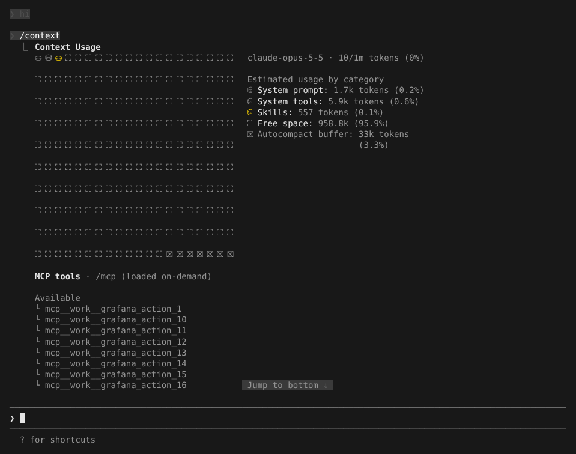

# Prompt context 与 Tool search

> 英文名：`prompt-context` · 领域：上下文与记忆 · [返回功能索引](README.md)

## 这是什么

每次 Claude 回答你，发给模型的不只是你那句话，还有一大段「背景」：系统提示词、所有工具的说明、可用的子代理和 skill 列表、MCP 工具列表、项目指令等。这些背景越大，**每次请求越贵、越慢**，长会话也越早触发压缩。

本 fork 在这几处做了优化，你不需要配置，开箱即生效：

1. **提示词分层**：把很少变化的部分（核心说明）放前面，经常变的部分（当前任务相关）放后面，这样前面那段能被模型的缓存（prompt cache）反复命中，只付一次全价。
2. **工具按需加载（tool search）**：MCP 工具不再一开始就把完整说明全部塞进请求，只告诉模型「有这些工具」，真要用时再通过 `ToolSearch` 加载说明。
3. **同类工具汇总**：同一个 MCP server 有 4 个以上待加载的工具时，只发一行汇总而不是逐个列名字。实测 26 个同前缀工具的列表从约 935 token 降到约 64 token。
4. **子代理列表增量发送**：可用 agent 的列表只在变化时补发差异，不每轮重发。

## 看看效果

接一个提供 40 个工具的 MCP server，然后运行 `/context`：MCP 工具一栏标着 `loaded on-demand`，它们**不占用上下文**（上方各类别里没有 MCP 这一项），只有用到时才计入：

`/context` 上半部分的方块图是当前上下文的占用情况，右侧按类别列出：系统提示词、系统工具、skill、剩余空间、为自动压缩预留的缓冲区。想知道「为什么这次请求这么多 token」时先看这里。

## 用自建网关时

`ANTHROPIC_BASE_URL` 指向非 Anthropic 地址（例如公司网关）时，tool search 和直连一样开启：发送 beta header 和 `defer_loading`，并且从第一个请求起附带一个隐藏的 `DeferredToolPlaceholder` 工具，加载新工具时不会让提示词缓存失效。

网关拒绝 tool search（返回 400/422）时，会自动去掉 deferred 工具重送一次，所有工具直接内联；重送成功或错误点名 tool search beta 后，本进程后续请求不再使用 tool search（与官方 2.1.311 一致）。想从一开始就避开这次被拒的请求，设置 `ENABLE_TOOL_SEARCH=false`。

## 设置

| 配置项 | 写法 | 说明 |
| --- | --- | --- |
| `ENABLE_TOOL_SEARCH` | `false` | 关闭 tool search，所有工具内联发送（网关不支持 `defer_loading` 时使用） |

## 说明

画面来自实际运行（全屏渲染，110×40），MCP server 是测试用的小脚本（`jira_action_1` … `grafana_action_20` 共 40 个工具）；`10/1m tokens` 这行的用量来自测试用假 API 的回报值，不代表真实计数。各项优化的 token 对比数据见 [`docs/research/prompt-context-optimization.md`](../research/prompt-context-optimization.md)。
