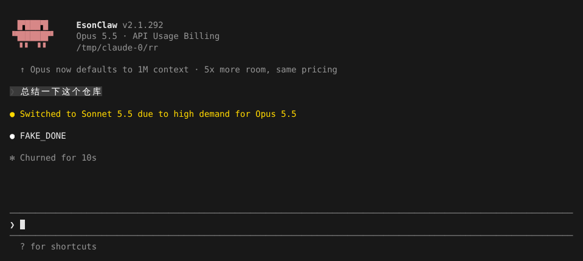

# 请求韧性：重试、回退模型与默认模型

> 英文名：`request-resilience` · 领域：模型与 Provider · [返回功能索引](README.md)

## 这是什么

调用模型的请求会因为各种原因失败：服务过载（529）、限流（429）、网络断开、响应流卡住。这一页讲 Claude Code 怎么自动处理这些情况，以及你能调哪些参数。行为对齐官方 2.1.303，Anthropic 和 [OpenAI provider](openai-provider.md) 都适用。

## 默认会做什么

- **自动重试**：可恢复的错误最多重试 10 次，间隔逐渐拉长；从第 1 次重试起，spinner 那一行就变成 `API error · Retrying in 4s · attempt 1/10` 倒计时，第 3 次起把 `API error` 换成具体错误（如 `529 Overloaded`），和官方一致。
- **响应卡住会重来**：响应流 5 分钟没有任何数据，就中止这次请求并重试。
- **不会无限挂着**：重试用完就报错。例如网关端口没开、`-p` 模式下设 `CLAUDE_CODE_MAX_RETRIES=1`，重试一次后直接退出：

```text
API Error: Unable to connect to API (ECONNREFUSED)
```

- **不可恢复的错误立即失败**：认证失败、组织额度上限、OpenAI 的 `usage_limit_reached` / `insufficient_quota` 等不会重试。

## 主模型过载时换备用模型

**1. 配置回退链。** 启动参数或设置二选一（参数优先），最多 3 个，按顺序尝试，`default` 表示默认模型：

```bash
claude --fallback-model sonnet,haiku
```

```json
{ "fallbackModel": ["sonnet", "haiku"] }
```

**2. 正常使用。** 当主模型**连续 3 次**返回 529（过载），Claude Code 自动换到链上的下一个模型，对话里会说明换了谁：



**3. 下一轮自动换回。** 你下一次输入时会重新从主模型开始尝试，不会一直停留在备用模型上。

## 无人值守：一直等到能用

跑夜间任务、CI 之类没人盯着的场景，可以让它遇到限流和过载时**一直等**而不是失败：

```bash
CLAUDE_CODE_RETRY_WATCHDOG=1 claude -p "..."
```

开启后：

- 429 / 529 不再受重试次数限制，普通退避每次最多等 5 分钟；
- 带「额度何时恢复」或 `Retry-After` 的 429 会等到恢复时间（单次最多 6 小时），等待期间每 30 秒输出一次 keep-alive；
- 其他临时错误最多重试 300 次；
- 组织额度上限这类不会自己恢复的 429 仍然立即失败。

可以用 `CLAUDE_CODE_RETRY_WATCHDOG_MAX_WAIT_MS` 限制一次请求累计等待多久，用 `CLAUDE_CODE_RETRY_WATCHDOG_MAX_USAGE_LIMIT_WAIT_MS` 设定「额度恢复时间太远就别等了」。

## 新会话默认用哪个模型

`ANTHROPIC_DEFAULT_MODEL` 设置新会话的默认模型。它的优先级最低：`--model`、`ANTHROPIC_MODEL`、设置里的 `model`（包括 `/model` 选过的）和组织默认模型都会覆盖它；写 `default` 或 `inherit` 等于没设。

## 设置

| 配置项 | 写法 | 默认 | 说明 |
| --- | --- | --- | --- |
| `--fallback-model` / `fallbackModel` | `a,b,c` / 数组 | — | 回退链，最多 3 个 |
| `CLAUDE_CODE_MAX_RETRIES` | 整数，最多 15 | `10` | 普通重试次数 |
| `CLAUDE_CODE_OVERLOADED_RETRY_BASE_DELAY_MS` / `_MAX_DELAY_MS` | 毫秒 | `500` / `32000` | 529 重试的起始 / 最大间隔 |
| `CLAUDE_ENABLE_STREAM_WATCHDOG` | `0` | 开启 | 关闭「响应卡住 5 分钟就重试」 |
| `CLAUDE_STREAM_IDLE_TIMEOUT_MS` | 毫秒，≥ `300000` | `300000` | 只能调长 |
| `CLAUDE_CODE_RETRY_WATCHDOG` | `1` | 关闭 | 无人值守持续重试 |
| `CLAUDE_CODE_RETRY_WATCHDOG_MAX_WAIT_MS` | 毫秒 | — | 429/529 累计等待上限 |
| `CLAUDE_CODE_RETRY_WATCHDOG_MAX_USAGE_LIMIT_WAIT_MS` | 毫秒 | — | 额度恢复时间超过它就不等 |
| `ANTHROPIC_DEFAULT_MODEL` | 模型名 | — | 新会话默认模型（优先级最低） |

## 说明

画面来自实际运行（全屏渲染，110×22）：在测试用假 API 前加了一个代理，让主模型 `claude-opus-5-5` 一律返回 529，其他模型正常回复 `FAKE_DONE`。
