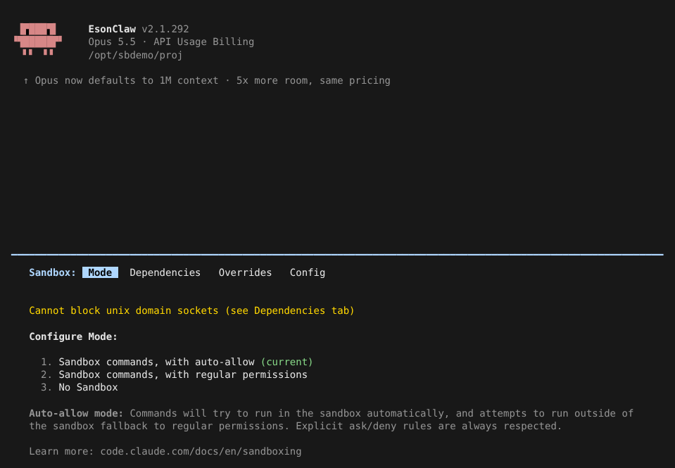
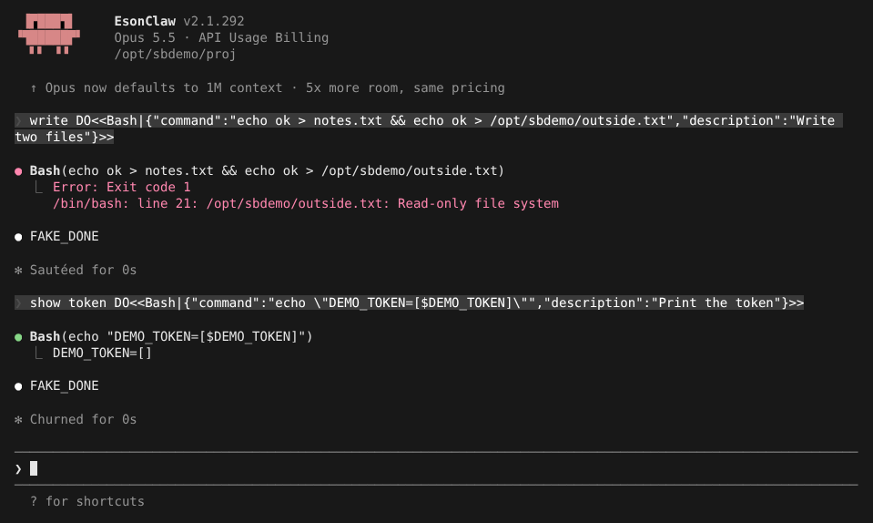
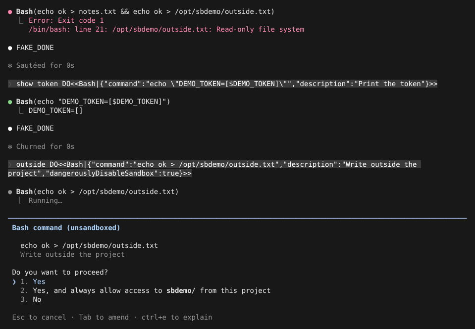
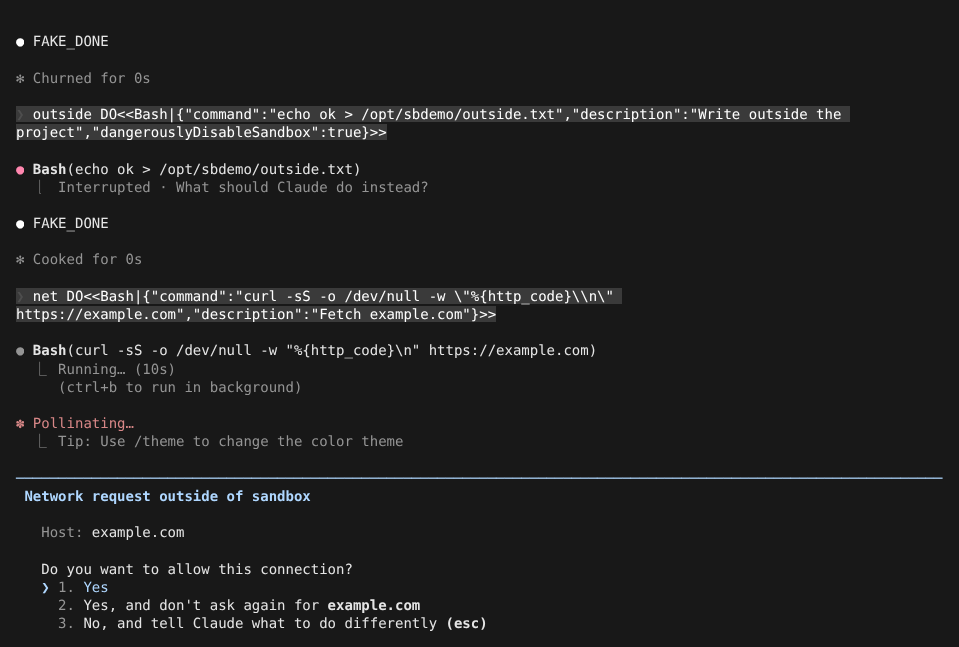

# Bash 沙箱

> 英文名：`sandbox` · 领域：权限与安全 · [返回功能索引](README.md)

## 这是什么

Claude 跑的每条 shell 命令，默认和你本人一样有完整权限：能改任何你能改的文件、能连任何网站、能读到你的环境变量。沙箱给这些命令套一层「隔离罩」（Linux 用 bubblewrap，macOS 用系统自带的 sandbox，Windows 用 binary 内置的 srt-win，第一次使用前运行 `claude sandbox install`）：

- **文件**：只能写当前项目目录和临时目录，写别处会得到 `Read-only file system`；
- **网络**：只能连你列出的域名，其他域名先弹窗问你；
- **凭据**：你指定的环境变量、文件在沙箱里读不到。

好处是可以放心让 Claude 自己跑命令：开启「auto-allow」后，沙箱里的命令不再一条条问你，因为它最多只能弄乱当前项目。

本 fork 的沙箱行为对齐官方 2.1.303（沙箱运行时同为 `@anthropic-ai/sandbox-runtime` 0.0.80）。

## 快速上手

**0. 装依赖（Linux）。** 需要 `bubblewrap` 和 `socat`：

```sh
sudo apt install bubblewrap socat
```

**1. 打开沙箱。** 输入 `/sandbox`，第一页选模式：



| 模式 | 效果 |
| --- | --- |
| Sandbox commands, with auto-allow | 命令在沙箱里跑，不再逐条确认；需要跳出沙箱的命令照常问你 |
| Sandbox commands, with regular permissions | 命令在沙箱里跑，但仍按平时的权限规则确认 |
| No Sandbox | 关闭 |

顶部的黄字是缺少的可选能力（这里是容器里没有 seccomp，无法拦截 unix socket），在 Dependencies 分页能看到详情。也可以直接写设置：

```json
{
  "sandbox": {
    "enabled": true,
    "autoAllowBashIfSandboxed": true,
    "network": { "allowedDomains": ["github.com"] },
    "credentials": { "envVars": [{ "name": "DEMO_TOKEN", "mode": "deny" }] }
  }
}
```

**2. 看它挡住了什么。** 下图用上面的设置：写项目里的 `notes.txt` 成功，写项目外的 `/opt/sbdemo/outside.txt` 被拒；外面设了 `DEMO_TOKEN=abc123`，沙箱里读到的是空值：



**3. Claude 想跳出沙箱时会问你。** Claude 可以在命令上标记「不用沙箱」（`dangerouslyDisableSandbox`），这时标题变成 `Bash command (unsandboxed)`，即使开了 auto-allow 也要你点头：



**4. 连没登记的域名也会问你。** `curl https://example.com` 时，example.com 不在 `allowedDomains` 里，弹出 `Network request outside of sandbox`：



选 2 会把这个域名记下来，以后不再问；选 3 拒绝，命令收到 `CONNECT tunnel failed, response 403`。

**5. 你自己打的 `!` 命令不进沙箱。** 在输入框用 `!` 开头执行的命令和你自己的终端一样，不受沙箱限制，也不受 `allowUnsandboxedCommands: false` 影响。

## 常用设置

都写在 `sandbox` 下：

| 配置项 | 写法 | 说明 |
| --- | --- | --- |
| `enabled` | `true` / `false` | 开关 |
| `autoAllowBashIfSandboxed` | `true` / `false` | 沙箱里的命令不再逐条确认（`/sandbox` 第 1 种模式） |
| `allowUnsandboxedCommands` | `true`（默认）/ `false` | `false` 时忽略「不用沙箱」标记，所有命令都必须在沙箱里跑 |
| `failIfUnavailable` | `true` / `false` | 开了沙箱但起不来（缺依赖、平台不支持）时直接报错退出；默认只警告并不用沙箱继续 |
| `excludedCommands` | 命令数组 | 这些命令不进沙箱（例如 `docker`） |
| `filesystem.allowWrite` / `denyWrite` | 路径数组 | 额外允许 / 禁止写的位置；也会合并 `Edit(...)` 权限规则 |
| `filesystem.denyRead` / `allowRead` | 路径数组 | 禁止读的位置，以及其中重新放开的子路径 |
| `filesystem.disabled` | `true` | 不做文件隔离，只保留网络和 seccomp 隔离；项目设置里写无效 |
| `network.allowedDomains` | 域名数组，支持 `*.example.com` | 允许直连的域名 |
| `network.deniedDomains` | 域名数组 | 永远拒绝，即使也写在 `allowedDomains` 里；所有来源的设置都会合并 |
| `network.strictAllowlist` | `true` | 不在允许列表的域名直接拒绝，不弹窗 |
| `credentials.envVars` | `[{ "name": "X", "mode": "deny" \| "mask" }]` | `deny`：沙箱里没有这个变量；`mask`：沙箱里是占位符，代理在发出请求时换回真值 |
| `credentials.files` | `[{ "path": "~/.aws", "mode": "deny" \| "mask" }]` | 同上，作用于文件或目录；macOS 上 `mask` 等同 `deny` |

`mask`、`network.tlsTerminate`、`credentials.awsPairs`、`sigv4` 属于实验功能，需要沙箱代理解开 HTTPS 才能替换请求里的值，一般用不到。

## 仓库里的设置不能放松沙箱

项目目录里的 `.claude/settings.json` 是仓库作者写的，可能不可信，所以有些「放松」只认用户设置、`--settings` 或托管设置（managed）：

- `credentials` 的 `mask` 项、`strictAllowlist`、`tlsTerminate`、`filesystem.disabled`、`ripgrep` 写在项目设置里无效；项目里的 `deny` 项照常生效。
- 项目里加的域名不会扩大 `strictAllowlist`。
- 托管设置或 `--settings` 写了 `allowUnsandboxedCommands: false` 时，项目的 `excludedCommands` 被忽略，项目的 `allowRead` 也不能重新放开受信设置里 `denyRead` 的路径。
- 托管设置开了 `allowManagedReadPathsOnly` / `allowManagedDomainsOnly` 后，其他来源的 `allowRead` / `allowedDomains` 不生效；`/status` 和 `/doctor` 会逐条列出被忽略的项，例如 `sandbox.network.allowedDomains is ignored — managed settings set allowManagedDomainsOnly ...`。
- `bwrapPath`、`socatPath`（自定义 bubblewrap / socat 路径）只能写在托管设置里。
- `--setting-sources` 排除的来源，其沙箱设置同样不生效。

## 沙箱里总是被保护的位置

不管怎么配置，下列位置在沙箱里都不能写：各级 `settings.json` / `settings.local.json`、托管设置、项目的 `.claude/skills`、`--plugin-dir` 指定的插件目录（这些内容会在沙箱外执行）。仓库的 `.git/hooks` 和 `.git/config` 只读；在 git worktree 里，只开放主仓库 `.git` 的写权限。

沙箱里的 `TMPDIR` 是 `/tmp/claude-<uid>`，每个用户各自一份。

## 和其他功能的关系

- [Terminal 工具](terminal-tool.md) 新开的终端也在沙箱里跑（规则同 Bash，包括 `excludedCommands` 与 `dangerouslyDisableSandbox`），但不享受 auto-allow，按平时的权限规则确认。
- [Monitor 工具](monitor-tool.md) 的命令在沙箱里跑，但不享受 auto-allow，按平时的 Bash 权限规则确认。
- [自动模式](auto-mode.md) 下，auto-allow 的命令仍然先经过 deny / ask 规则。
- 完整权限规则见 [permissions.md](permissions.md)。

## 已知差异

- 本容器里官方 2.1.303 的网络代理桥无法工作，网络部分只验证了本 fork 自身的行为。
- 官方在 auto-allow 下对 `python3 -c "..."` 仍会询问，本 fork 直接放行。

## 说明

画面来自实际运行（Linux，bubblewrap 0.9，110×36），模型回复由测试用假 API 生成（`FAKE_DONE`；提示词里的 `DO<<…>>` 是让假 API 调用工具的指令）。
