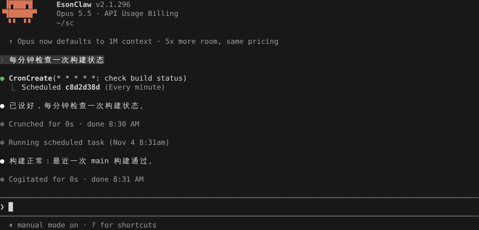
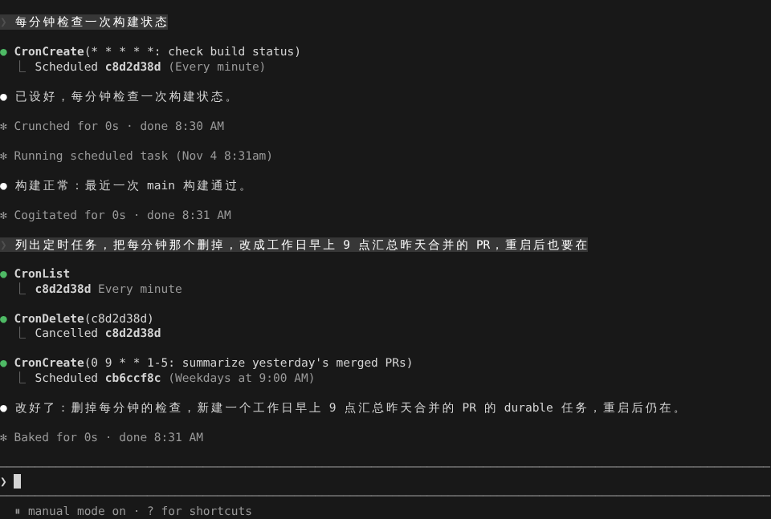

# 定时任务：Cron、/loop 与 ScheduleWakeup

<!-- lang: zh-Hans -->

> 英文名：`scheduled-tasks` · 领域：工具 · [返回功能索引](README.md)

## 这是什么

让 Claude 在会话里**到点自动执行**一段指令，不用你每次手动输入。常见用法：

- 盯一个慢任务：「每 5 分钟检查一次部署状态，好了告诉我」；
- 周期性汇报：「工作日早上 9 点汇总昨天合并的 PR」；
- 等外部结果：Claude 自己决定隔多久再看一次。

时间用标准 5 段 cron 表达式（分 时 日 月 周），按**本机时区**。

<details lang="en"><summary>English</summary>

> Name: `scheduled-tasks` · Area: Tools · [Back to index](README.md)

## What it is

Have Claude **run an instruction automatically at set times** within a session, without typing it each time. Common uses:

- watching a slow task: "check the deploy every 5 minutes and tell me when it is done";
- periodic reports: "on weekdays at 9 a.m., summarise the PRs merged yesterday";
- waiting on outside results: Claude decides how long to wait before looking again.

Times use standard 5-field cron expressions (minute hour day month weekday) in the **local time zone**.

</details>
<details lang="zh-Hant"><summary>繁體中文</summary>

> 英文名：`scheduled-tasks` · 領域：工具 · [返回功能索引](README.md)

## 這是什麼

讓 Claude 在會話裡**到點自動執行**一段指令，不用你每次手動輸入。常見用法：

- 盯一個慢任務：「每 5 分鐘檢查一次部署狀態，好了告訴我」；
- 週期性彙報：「工作日早上 9 點彙總昨天合併的 PR」；
- 等外部結果：Claude 自己決定隔多久再看一次。

時間用標準 5 段 cron 表示式（分 時 日 月 周），按**本機時區**。

</details>

## 快速上手：`/loop`

最简单的方式是 `/loop`，用自然语言说间隔和要做的事：

```text
/loop 5m check the deploy           # 每 5 分钟
/loop run tests every 2 hours       # 末尾写 every 也行
/loop check the deploy              # 不写间隔：Claude 自己决定下次什么时候看
```

- 间隔支持 `s`、`m`、`h`、`d`；秒会向上取整到分钟。除不尽的间隔（如 `7m`、`90m`）会取最接近的整齐值并告诉你。
- 不写间隔时是**自定节奏**：Claude 每做完一轮，用 `ScheduleWakeup` 定下一次唤醒（60 到 3600 秒），根据情况决定快慢；想停时说一声即可。

## 让 Claude 直接排程

你也可以直接说「每天早上 9 点帮我……」，Claude 会调用 `CronCreate`。下图是一个每分钟执行的任务：创建后显示任务 ID 和频率，之后每到点出现 `Running scheduled task (时间)`，Claude 执行那段指令：



Claude 用 `CronList` 列出、`CronDelete` 取消任务；你也可以直接让它「列出 / 取消定时任务」。

## 关掉会话后还要继续：`durable`

默认任务只活在当前会话里，退出就没了。加 `durable: true` 会保存到项目的 `.claude/scheduled_tasks.json`，下次在这个项目打开 Claude 时继续生效：



```json
{
  "tasks": [
    {
      "id": "cac97b38",
      "cron": "0 9 * * 1-5",
      "prompt": "summarize yesterday s merged PRs",
      "createdAt": 1792861589840,
      "recurring": true
    }
  ]
}
```

## 需要知道的规则

- **只在会话开着、且空闲时执行**：Claude 正在回答时，到点的任务会等这一轮结束。
- **重复任务 7 天后自动过期**，防止无人看管的会话无限跑下去。
- **会加少量随机延迟**：为避免大家都在整点同时请求，触发时间会有小幅抖动。
- `recurring: false` 是一次性任务，执行一次后删除。

## Cron 速查

| 表达式 | 含义 |
| --- | --- |
| `*/15 * * * *` | 每 15 分钟 |
| `0 * * * *` | 每小时整点 |
| `0 9 * * 1-5` | 工作日 9:00 |
| `30 18 * * 5` | 每周五 18:30 |

## 设置

| 配置项 | 写法 | 说明 |
| --- | --- | --- |
| `CLAUDE_CODE_DISABLE_CRON` | `1` | 关闭定时任务和 `/loop`（此时输入 `/loop` 会提示 `Unknown skill: loop`） |

`CronCreate` 的参数：

```json
{
  "prompt": "检查构建状态并报告失败项",
  "cron": "*/15 * * * *",
  "recurring": true,
  "durable": true
}
```

## 说明

画面来自实际运行，模型回复由测试用假 API 按脚本生成。
