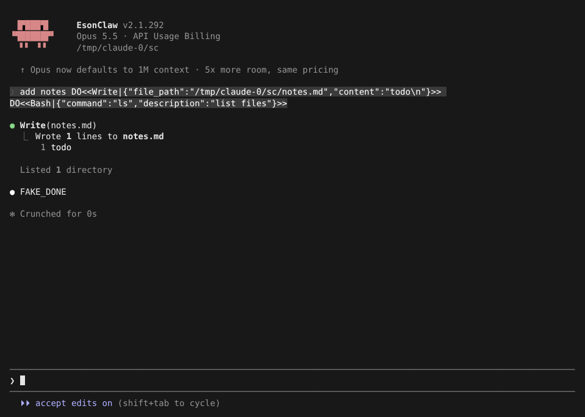
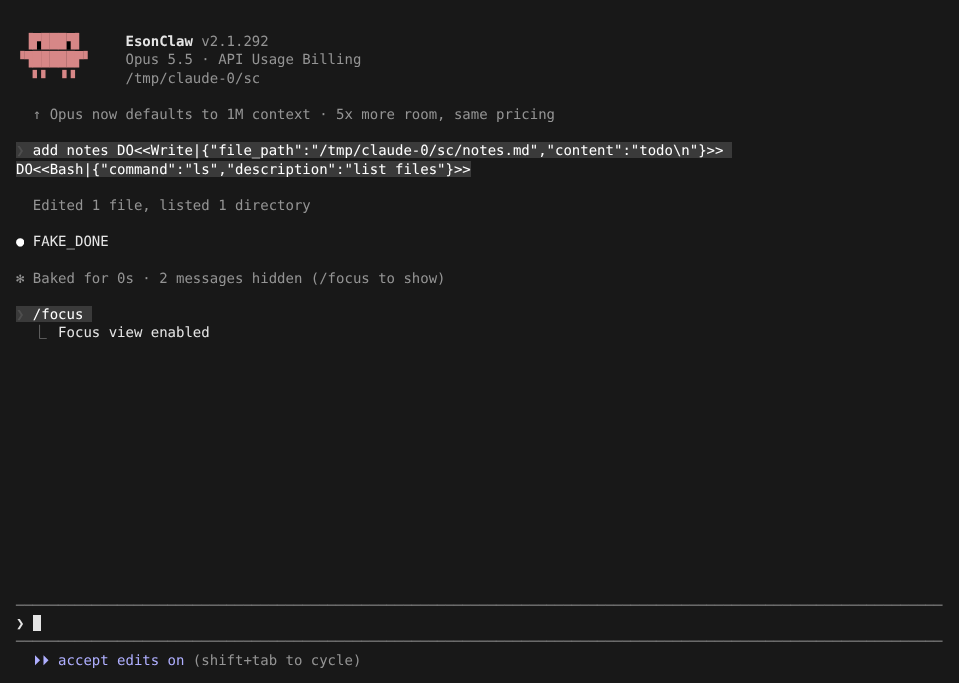
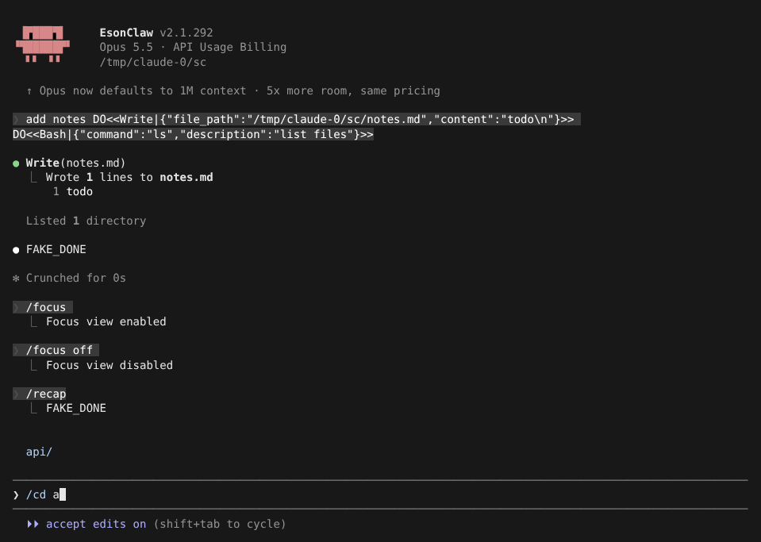
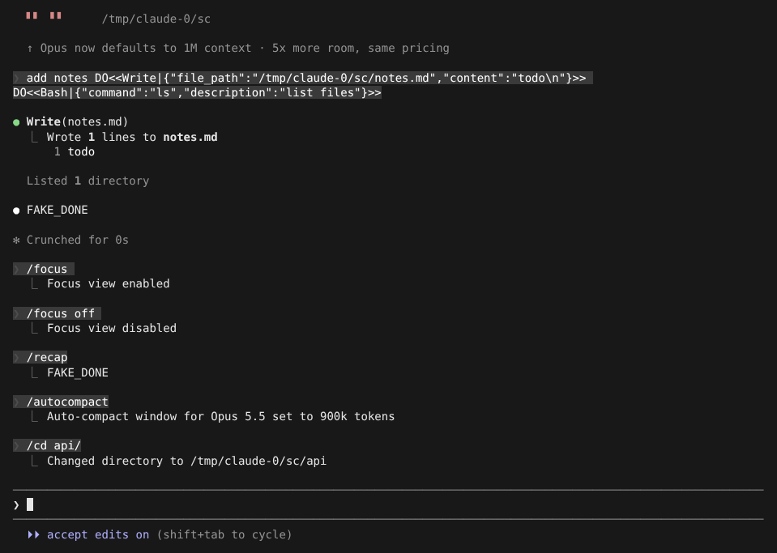
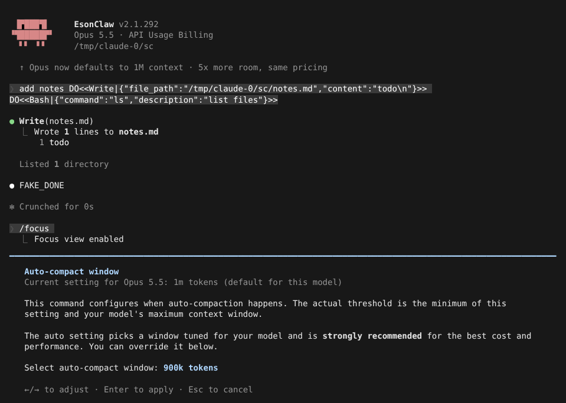

# 会话命令

> 英文名：`session-commands` · 领域：界面与交互 · [返回功能索引](README.md)

## 这是什么

在输入框打 `/` 会弹出命令列表。这一页汇总本 fork **新增或补齐**的会话命令，各自做什么、什么时候用。部分命令在 Claude 正在回答时也能立即打开（对齐官方 2.1.303）。

## 一览

| 命令 | 一句话 | 详见 |
| --- | --- | --- |
| `/recap` | 用一两句话总结「到目前为止做了什么」 | 本页 |
| `/cd <目录>` | 切换会话的工作目录 | 本页 |
| `/focus [on\|off]` | 精简显示：每轮只留你的问题、一行摘要和最终回复 | 本页 |
| `/autocompact [auto\|<tokens>]` | 调整对话多长时自动压缩 | 本页、[compaction.md](compaction.md) |
| `/usage` | 本次会话的花费、token、耗时（`/cost`、`/stats` 是别名） | [usage-and-cost.md](usage-and-cost.md) |
| `/skill-doctor` | 找出加载了却从没用过的 skill | [skills.md](skills.md) |
| `/reload-skills` / `/reload-plugins` | 不重启，重新读取 skill / 插件 | [skills.md](skills.md)、[plugins-marketplace.md](plugins-marketplace.md) |
| `/goal` | 给 Claude 设一个「做完才停」的目标 | [goal.md](goal.md) |
| `/diff` | 查看未提交的改动 | [diff-view.md](diff-view.md) |
| `/workflows` | 查看本会话跑过的 workflow | [workflows.md](workflows.md) |
| `/list-agents`（`/peers`） | 列出同一台机器上其他 Claude 会话 | [peer-messaging.md](peer-messaging.md) |
| `/background`、`/stop`、`/daemon` | 把会话放到后台继续跑 | [background-sessions.md](background-sessions.md) |
| `/fast` | 切换快速模式（OpenAI provider 下发送 `service_tier: "priority"`） | [openai-provider.md](openai-provider.md) |

## `/focus`：只看结果

Claude 每轮可能调用很多工具，画面很长。`/focus` 打开后，每轮只显示你的问题、一行工具摘要（例如 `Edited 1 file, listed 1 directory`）和最终回复，被省略的条数写在回合末尾。

需要**全屏渲染**（`CLAUDE_CODE_NO_FLICKER=1`）；非全屏下只打印提示。

关闭时（默认）：

`/focus` 打开后，同一轮变成一行摘要，末尾显示 `2 messages hidden (/focus to show)`：

`/focus off` 恢复。选择会保存，下次启动沿用；也可以在 settings 里用 `viewMode` 指定启动时的视图。

## `/cd`：换工作目录

在一个仓库里开着会话，想去隔壁目录干活，不用退出重开。输入 `/cd ` 后会列出子目录，打几个字母按 `Tab` 补全：

按 `Enter` 切换。新目录同时加入本会话允许访问的范围：

## `/autocompact`：什么时候自动压缩

对话越长越贵，到一定长度会自动压缩（把早期内容总结成摘要）。`/autocompact` 设置这个长度：

- 不带参数打开对话框：`←` `→` 调整，`Enter` 应用；
- 直接带值：`/autocompact 500k`、`/autocompact 200000`，或简写 `/autocompact 200`（范围 100k 到 1M）；
- `/autocompact auto`（或 `reset`）恢复为模型的推荐值。

设置**按模型分别保存**在用户设置 `modelSettings.<模型>.autoCompactWindow`，换模型后各自生效；OpenAI 等第三方模型同样适用。`-p` 模式下输出文本结果。更多见 [compaction.md](compaction.md)。

## `/recap`：我刚才做到哪了

立即生成一两句（最多 400 字）的会话回顾，用和主对话相同的模型。适合离开一会儿回来、或多个会话来回切时快速找回上下文。

终端失去焦点 5 分钟后也会自动生成一次。关闭自动回顾：设置 `awaySummaryEnabled: false` 或环境变量 `CLAUDE_CODE_ENABLE_AWAY_SUMMARY=0`（`=1` 强制开启）。`-p` 模式也可用。

## 其他命令的细节

- `/reload-plugins`：应用 `/plugin` 里的安装、更新、启停，重新加载插件的命令、skill、hook、MCP 和 LSP。已安装的插件用本地缓存，不会因为 reload 去下载。
- `/reload-skills`：只重读 user / project / plugin 的 skill，不动插件。
- `/diff`：如果有已加载并获准接管的官方 diff Mod，由它显示；否则用内置 Git diff。终端宽度 ≥ 110 列且没有 Mods 侧栏时显示在右侧，否则弹窗。
- `/workflows`：只查看，不启动 workflow；本会话没有时显示 `No dynamic workflows in this session.`。
- `/compact`：手动压缩；OpenAI provider 下走远端压缩并保留压缩历史。
- 切换到上下文更小的模型时，如果当前对话已经超过新模型上限，会先用上一个（窗口更大的）模型做摘要；那个模型不可用或失败时改用当前模型。

## 设置

| 配置项 | 写法 | 说明 |
| --- | --- | --- |
| `viewMode` | `default` / `verbose` / `focus` | 启动时的显示方式；`/focus` 的选择保存在全局配置 `briefTranscript` |
| `awaySummaryEnabled` | `true` / `false` | 自动回顾；环境变量 `CLAUDE_CODE_ENABLE_AWAY_SUMMARY=0/1` 同效 |
| `modelSettings.<模型>.autoCompactWindow` | token 数 | `/autocompact` 写入的值 |

## 输入框的小改进

输入框按 UTF-8 流处理普通文字、中文宽字符、Kitty 键盘协议和粘贴：同一次输入里的文字和 Enter、退格、方向键按顺序生效；没闭合的粘贴在短暂空闲后自动结束，后续按键不会被吞掉。

## 说明

画面来自实际运行（全屏渲染，110×36），模型回复由测试用假 API 生成（`FAKE_DONE`；提示词里的 `DO<<…>>` 是让假 API 调用工具的指令）。
