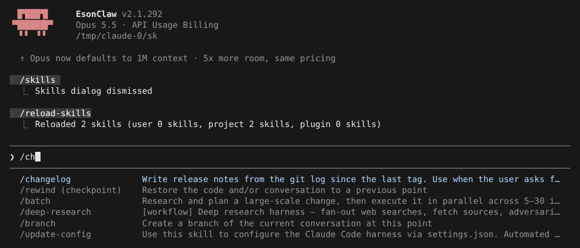
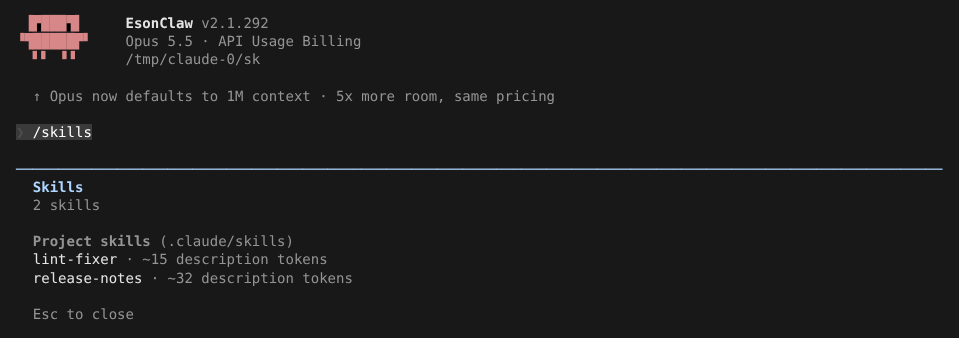
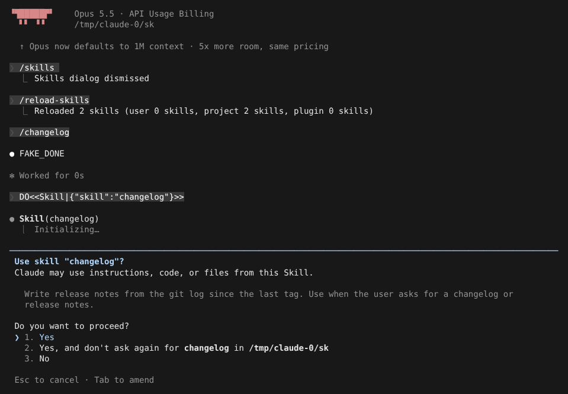
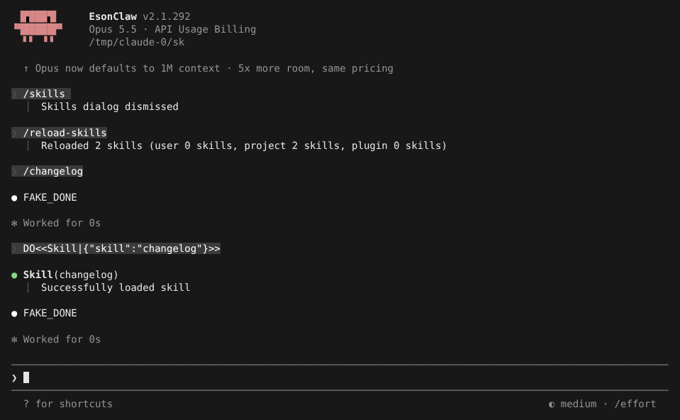
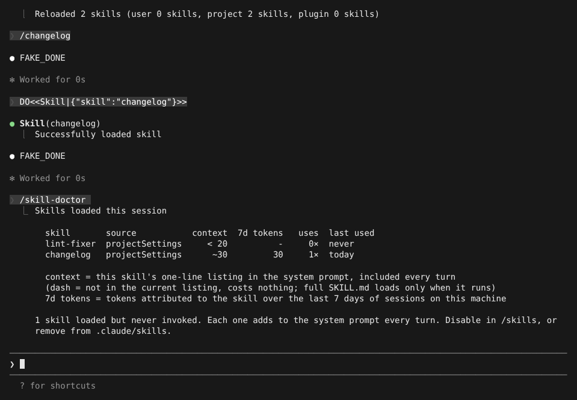

# Skills

> 英文名：`skills` · 领域：插件与扩展 · [返回功能索引](README.md)

## 这是什么

Skill 是一份写给 Claude 的「操作手册」：一个文件夹里放一个 `SKILL.md`，写清楚什么时候用、怎么做。之后：

- 你输入 `/名字` 就能直接调用；
- Claude 看到描述匹配的请求（例如你说「帮我写个 changelog」），也会自己调用。

平时每个 skill 只有**一行描述**放在系统提示里，完整内容只在用到时才加载，所以装多个也不会很占上下文。

## 快速上手：写一个 skill

**1. 建文件。** 在项目里建 `.claude/skills/changelog/SKILL.md`：

```markdown
---
name: changelog
description: Write release notes from the git log since the last tag. Use when the user asks for a changelog or release notes.
---
1. Run `git log --oneline $(git describe --tags --abbrev=0)..HEAD`.
2. Group commits into Features / Fixes / Other.
3. Write the result to CHANGELOG.md.
```

`description` 很关键：Claude 靠它判断什么时候该用这个 skill，写清楚「做什么 + 什么时候用」。

**2. 让会话看到它。** 新会话会自动加载；已经开着的会话输入 `/reload-skills` 重读。输入 `/` 加名字开头，补全列表里就能看到：



注意别和内置命令重名（例如 `/release-notes` 是内置命令）。

**3. 用 `/skills` 查看已加载的 skill**，按来源分组，并显示每个的描述占多少 token：



**4. 调用。** 你输入 `/changelog` 直接运行。Claude 自己调用项目里的 skill 时，第一次会问你是否允许；选第 2 项以后就不再问，规则 `Skill(changelog)` 写进 `.claude/settings.local.json`：





## 找出没用的 skill：`/skill-doctor`

装的 skill 越多，每轮系统提示越长。`/skill-doctor` 列出本会话加载的 skill、各自占多少上下文、过去 7 天用了多少 token、调用次数和最近一次使用：



从没用过的会被点名，可以考虑删掉（目前 `/skills` 只能查看，不能停用，见下方已知问题）。

## skill 放在哪里

| 位置 | 作用范围 |
| --- | --- |
| `~/.claude/skills/<名字>/SKILL.md` | 你自己的所有项目 |
| `.claude/skills/<名字>/SKILL.md` | 当前项目（可提交进仓库给团队用） |
| 插件的 `skills/<名字>/SKILL.md` | 装了该插件的地方，名字带插件前缀，如 `/my-plugin:review` |
| 内置 | 随程序提供，如 `/batch`、`/update-config` |

旧的 `.claude/commands/<名字>.md` 也按同样规则读取。

## SKILL.md 常用字段

| 字段 | 作用 |
| --- | --- |
| `name` / `description` | 名字和描述；描述决定 Claude 何时自动使用 |
| `when_to_use` | 补充说明使用时机 |
| `argument-hint` | 补全时提示参数，正文里用 `$ARGUMENTS` 取用户输入 |
| `allowed-tools` / `disallowed-tools` | 运行这个 skill 时额外放行 / 禁止的工具 |
| `model` / `effort` | 运行时使用的模型、推理强度 |
| `disable-model-invocation: true` | 只能你手动 `/名字` 调用，Claude 不会自己用 |
| `user-invocable: false` | 不出现在 `/` 菜单里，只给 Claude 用 |
| `paths` | 只在处理匹配路径的文件时才提供 |
| `context: fork` | 在独立的子代理里运行，不污染主对话（见下节） |

## 在子代理里运行：`context: fork`

复杂的 skill 可以交给子代理执行，主对话只收到结果：

```yaml
---
description: Run the review in a separate agent
context: fork
agent: reviewer
background: false
---
Review $ARGUMENTS.
```

- `agent`：用哪个子代理，名字对应 `.claude/agents/<名字>.md`；不写按默认规则选。值会转成字符串，`agent: 42` 选名为 `"42"` 的代理，建议直接写字符串。
- `background`：交互模式默认在后台运行；`false` 表示等它跑完再继续。

子代理的更多说明见 [agents.md](agents.md)。

## 已知问题

- `/skill-doctor` 提示「Disable in /skills」，但 `/skills` 目前只是只读列表，没有停用开关；要停用只能删除或移走 skill 文件夹。
- `-p` 非交互模式下，Claude 调用项目 skill 也会要求权限，官方此时直接放行（未修）。

## 开发者参考

- 回归测试：`bun test --no-env-file ./src/skills/loadSkillsDir.forkAgent.test.ts`；对照记录见 [fork agent 类型专项](../research/mods-fork-agent-types-20261007.md)。
- 仓库自带项目级 skill `.claude/skills/claude-code-feature-validation/`，用于功能验收，不随 binary 分发。
- 官方文档：[Anthropic skills](https://code.claude.com/docs/en/skills)。

## 说明

画面来自实际运行，模型回复由测试用假 API 生成（`FAKE_DONE`；提示词里的 `DO<<…>>` 是让假 API 调用工具的指令）。
