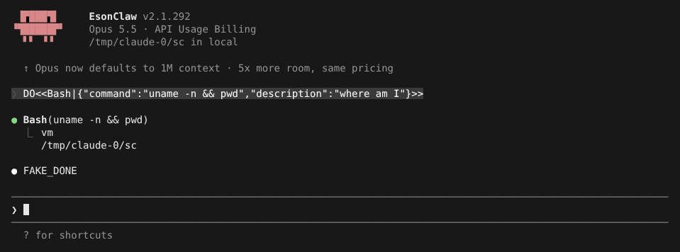

# SSH Remote

> 英文名：`ssh-remote` · 领域：远程执行 · [返回功能索引](README.md)

## 这是什么

代码在服务器上，但你想在本机终端里用 Claude？`claude ssh` 会：

1. 通过 SSH 连上远端，自动把匹配架构的 Claude Code 程序放上去（远端不用安装任何东西）；
2. 在远端运行 Claude 的「执行端」：读写文件、跑命令、加载远端的 skill / MCP / 设置；
3. 本机只负责显示界面、权限确认和中断；
4. 模型请求经 SSH 隧道回到本机，由本机加上认证再发出——**API key、登录凭据不会复制到远端**。

只支持交互式界面（不支持 `-p`）。

## 快速上手

```bash
claude ssh user@example.com              # 默认目录
claude ssh my-ssh-alias ~/project        # ~/.ssh/config 里的别名 + 远端目录
claude --model gateway-model ssh managed-config-id /srv/project
```

连上后欢迎画面的目录后面写着 `in <主机>`。之后就像本地一样使用，工具都在远端执行：



`@` 补全的是**远端**的文件：

```text
❯ @ap
  + api/
  + api/server.ts
```

退出时打印完整的续接命令，下次直接粘贴即可回到同一个远端会话：

```text
Resume this session with:
claude ssh localhost /tmp/claude-0/sc --resume ed884af4-0aaa-447c-bd54-88afacca8e09
```

## 常用的连接写进设置

```json
{
  "sshConfigs": [
    {
      "id": "managed-config-id",
      "name": "Managed Linux",
      "sshHost": "user@example.com",
      "sshPort": 2222,
      "sshIdentityFile": "/path/to/private-key",
      "startDirectory": "~/project"
    }
  ]
}
```

之后 `claude ssh managed-config-id` 即可。

## 哪些在本机、哪些在远端

| 本机 | 远端 |
| --- | --- |
| 界面、权限确认、Esc 中断 | 文件读写、Bash、`!命令` |
| 模型认证（API key、OAuth、自定义 header、代理） | tools、skills、plugins、hooks、MCP |
| `--settings`、`sshConfigs`、provider 选择 | 项目上下文、文件索引、会话记录 |

权限选择、`/yolo`、Shift+Tab 切模式、永久规则、额外工作目录都会同步到远端。

## 远端程序从哪来

启动时探测远端架构，部署 `linux-x64-baseline` 或 `linux-arm64`：

- 本机程序旁的 `dist/release/` 里有对应文件时直接用；
- 否则从 GitHub Release 下载，**必须**通过 `SHA256SUMS.txt` 校验，校验不过拒绝启动；
- 远端缓存在 `~/.cache/claude-ssh/<版本>/<架构>/claude`。

## 限制

- 只支持交互式界面；
- 断线不会自动重连，用退出时打印的 `--resume` 命令重新进入；
- 本机不保存第二份会话记录，记录以远端为准。

## 命令选项

```text
Usage: claude ssh [options] <host> [dir]
  --dangerously-skip-permissions  Skip all permission prompts on the remote (dangerous)
  --permission-mode <mode>        Permission mode for the remote session
  --local                         e2e test mode — spawn the child CLI locally (skip ssh/deploy)
```

## 说明

画面来自 `claude ssh --local`（跳过 SSH 和部署、在本机启动执行端，但走同一套认证代理和 socket 通道），所以主机名显示为 `local`；采集环境没有远端主机。模型回复由测试用假 API 生成。下方「详细说明」保留实现细节。

## 详细说明

以下内容自原 README 迁入，保持原文。

#### SSH Remote

`claude ssh` 在远端 Linux 主机执行 Claude child 与 tools，本地继续渲染 TUI、处理 permission prompt 和 interrupt：

```bash
claude ssh user@example.com
claude ssh my-ssh-alias ~/project
claude --model gateway-model ssh managed-config-id /srv/project
```

host 可以是 `user@host`、`~/.ssh/config` alias，或 settings 中的 `sshConfigs` ID：

```json
{
  "sshConfigs": [
    {
      "id": "managed-config-id",
      "name": "Managed Linux",
      "sshHost": "user@example.com",
      "sshPort": 2222,
      "sshIdentityFile": "/path/to/private-key",
      "startDirectory": "~/project"
    }
  ]
}
```

启动时会探测 Linux architecture，按当前版本选择并部署 `linux-x64-baseline` 或 `linux-arm64` binary。若当前可执行文件旁的 `dist/release/` 下存在对应的 `claude-code-v<version>-<target>` artifact，会直接使用（不做 checksum 校验）；不存在时才回退到 GitHub Release，且下载必须同时提供对应 asset 与 `SHA256SUMS.txt`，checksum 缺失或不匹配时拒绝启动。remote cache 位于 `~/.cache/claude-ssh/<version>/<target>/claude`。

模型 API/OAuth credential 不会复制到远端。远端 child 仅连接 reverse-forwarded Unix socket，由本地 proxy 按当前 provider 和本地 credential precedence 注入认证；OpenAI/Anthropic API key、OAuth token、account ID、cookie、client certificate/key/passphrase、`ANTHROPIC_CUSTOM_HEADERS` 和本地 base URL 不会通过 SSH child environment 继承。代理会在本地应用自定义 header 与网络代理设置，并在转发前替换认证 header。

`--settings` 与 `--setting-sources` 始终由本地 launcher 读取，用于解析 `sshConfigs`、provider、upstream 和认证；原始路径、inline JSON 与 secret 不会进入远端 argv。`--model` 或本地 settings 解析出的 model 会显式转发给 remote child。tools、skills、plugins、hooks、MCP、文件索引、项目上下文和 transcript 则由远端 child 及其远端 settings 管理。

连接或 resume 时，本地 UI 会先从远端 canonical transcript 完成 history bootstrap，再接受新输入；消息 UUID、hidden/meta 消息、compact boundary 和 live echo 会按远端 identity 合并去重。正常退出时显示包含原始 target、远端 cwd 和远端 session ID 的完整 `claude ssh ... --resume ...` 命令。本地不保存第二份可 resume transcript，当前也不自动重连断开的 SSH session。

SSH PromptInput 的 `@` fuzzy/path 候选来自远端文件索引和目录扫描，不会读取本机 workspace。目录选择可以继续补全下一级；cold index 完成后会对仍有效的 query 有界刷新。包含空格、引号、反斜杠、美元符号、反引号或 Unicode 的路径会使用可逆 quoted mention，例如：

```text
@"docs/path with spaces/file.md"
```

SSH Remote 当前只支持 interactive TUI。`!command` 在远端 cwd 直接执行并将转义后的结果写入远端 transcript；远端 Agent progress、Bash 和未知 MCP tool card 可在本地显示，但 display-only fallback 不能在本地执行。permission allow/deny/cancel、`/yolo`、Shift+Tab、永久规则、additional workspace directory、Esc interrupt、正常退出和断线均经 capability-protected control channel 同步；启用 `planModeAvailable: true` 时也同步 `/plan`。workspace directory 的存在性由远端验证。
