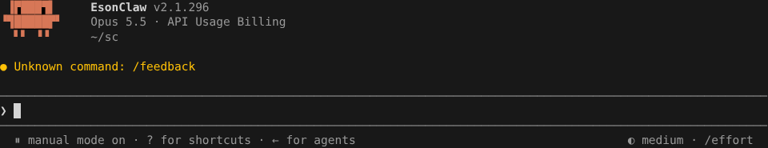
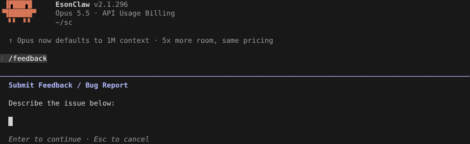

# 遥测与反馈

<!-- lang: zh-Hans -->

> 英文名：`telemetry` · 领域：界面与交互 · [返回功能索引](README.md)

## 这是什么

官方 Claude Code 默认会把使用统计、错误报告发给 Anthropic，`/feedback` 还会上传整段对话记录。本 fork 改成**默认全部关闭**，只有你明确打开才会发送。

另外有一套独立的 **OpenTelemetry（OTel）** 导出，用来把使用数据发到**你自己的**监控系统，与上面的开关无关。

<details lang="en"><summary>English</summary>

> Name: `telemetry` · Area: UI and interaction · [Back to index](README.md)

## What it is

The official Claude Code sends usage statistics and error reports to Anthropic by default, and `/feedback` uploads the whole transcript. This fork turns **all of it off by default**; nothing is sent unless you turn it on explicitly.

Separately there is an **OpenTelemetry (OTel)** export for sending usage data to **your own** monitoring system. It is independent of the switches above.

</details>
<details lang="zh-Hant"><summary>繁體中文</summary>

> 英文名：`telemetry` · 領域：介面與互動 · [返回功能索引](README.md)

## 這是什麼

官方 Claude Code 預設會把使用統計、錯誤報告發給 Anthropic，`/feedback` 還會上傳整段對話記錄。本 fork 改成**預設全部關閉**，只有你明確開啟才會傳送。

另外有一套獨立的 **OpenTelemetry（OTel）** 匯出，用來把使用資料發到**你自己的**監控系統，與上面的開關無關。

</details>

## 默认是什么样

不做任何设置时，`/feedback` 这个命令不存在，输入后显示 `Unknown command: /feedback`：



## 打开 Anthropic 遥测

```bash
CLAUDE_CODE_ENABLE_ANTHROPIC_TELEMETRY=1 claude
```

打开后 `/feedback` 才会出现，可以填写问题描述并上传：



但即使设了这个变量，遇到下面任一情况仍然**保持关闭**：

| 情况 | 原因 |
| --- | --- |
| 设置了 `DISABLE_TELEMETRY=1` | 你明确要求关闭 |
| 设置了 `DO_NOT_TRACK=1` | 通用的「不追踪」约定，效果同上 |
| 设置了 `CLAUDE_CODE_DISABLE_NONESSENTIAL_TRAFFIC=1` | 只允许必要流量 |
| 使用 Bedrock / Vertex / Foundry | 数据不该绕到 Anthropic |
| 使用 OpenAI 模式（ChatGPT 账号或 OpenAI API key） | 同上 |
| `ANTHROPIC_BASE_URL` 指向非官方网关 | 同上 |

打开后，事件只用这个会话自己的 Anthropic 凭据（OAuth token 或 API key）发往 `https://api.anthropic.com/api/event_logging/batch`，不再匿名发送。凭据暂时不能用时（还没信任工作目录、OAuth token 过期），这批事件先存到 `~/.claude/telemetry/`，按退避重试，凭据可用后补发；连续失败 8 次就丢弃。OAuth token 缺 `user:profile` scope 时（例如通过 `CLAUDE_CODE_OAUTH_TOKEN` 传入的 token 只有 `user:inference`），只有重新登录才会变，事件直接丢弃，不写盘也不重试。

反馈、记忆和压缩后的满意度问卷也跟随同一个开关（其中 Bedrock / Vertex / Foundry 不影响问卷，但这些会话不会上传对话记录）；`CLAUDE_FORCE_DISPLAY_SURVEY` 不能绕过它，问卷未启用时也不会上传对话记录。

内置 Mods 归档里的 `telemetry` Mod（向 Anthropic 发送插件分析数据）始终不加载，设了这个变量也一样。

**项目里的 `.claude/settings.json` 不能替你打开遥测**：写在项目设置 `env` 里的 `CLAUDE_CODE_ENABLE_ANTHROPIC_TELEMETRY` 和 OTel 导出配置会被忽略，防止克隆一个仓库就把你的数据发出去。

## 用网关或其他 provider 时

只有 provider 是 Anthropic、`ANTHROPIC_BASE_URL` 未设置或指向官方地址时，才算 first-party 会话。用网关、Bedrock / Vertex / Foundry 或 OpenAI 模式时，下面这些只对 Anthropic 账号有意义的请求都不发出，和遥测开关无关：

| 请求 | 不发出后的表现 |
| --- | --- |
| 用 API key 查 Anthropic 账号资料（`/api/oauth/profile`） | 网关的 API key 不会发到 `api.anthropic.com` |
| claude.ai MCP connectors | 不加载，用 claude.ai 账号登录、又通过代理设了 `ANTHROPIC_BASE_URL` 时也一样 |
| 补全 OAuth 账号信息、Grove 设置和通知、referral passes | 跳过 |
| fast mode 状态 | 只用本地缓存的状态 |
| 官方 MCP registry | 不拉取，只影响分析里“是否官方 MCP”的标记 |
| `/feedback` 和问卷的对话记录上传 | 直接失败，不上传 |

模型请求里的 `metadata.user_id` 也只保留 `session_id` 和 `CLAUDE_CODE_EXTRA_METADATA` 里的字段，不再带 device id 和 Anthropic 账号 id。网关如果靠 device id 区分用户，需要改用别的字段。

## 发到自己的监控系统（OTel）

按官方 [监控文档](https://code.claude.com/docs/en/monitoring-usage) 配置 OTel 导出（`CLAUDE_CODE_ENABLE_TELEMETRY=1` 加 `OTEL_*` 变量）即可，数据只发往你配置的地址。本 fork 在 `tool_decision` 事件上额外带两个字段，方便统计权限情况：

| 字段 | 取值 |
| --- | --- |
| `permission_mode` | 当时的权限模式，如 `default`、`auto` |
| `classifier_verdict` | [自动模式](auto-mode.md) 分类器的结论：`allow`、`block`、`unavailable`、`no_verdict` |

## 设置

| 配置项 | 写法 | 说明 |
| --- | --- | --- |
| `CLAUDE_CODE_ENABLE_ANTHROPIC_TELEMETRY` | `1` | 打开 Anthropic 遥测和 `/feedback`（默认关闭） |
| `DISABLE_TELEMETRY` | `1` | 强制关闭 |
| `CLAUDE_CODE_DISABLE_NONESSENTIAL_TRAFFIC` | `1` | 只保留必要流量，同样关闭遥测 |

## 说明

画面来自实际运行，模型请求发往本地测试用假 API。第二张图为了让本地地址被当作官方地址，额外设置了内部测试变量 `_CLAUDE_CODE_ASSUME_FIRST_PARTY_BASE_URL=1`；截图后直接按 `Esc` 取消，没有提交任何反馈。
