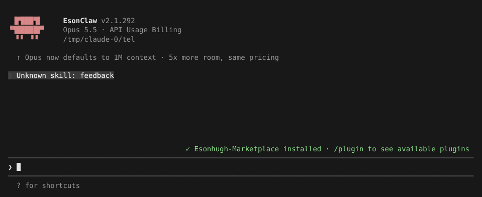
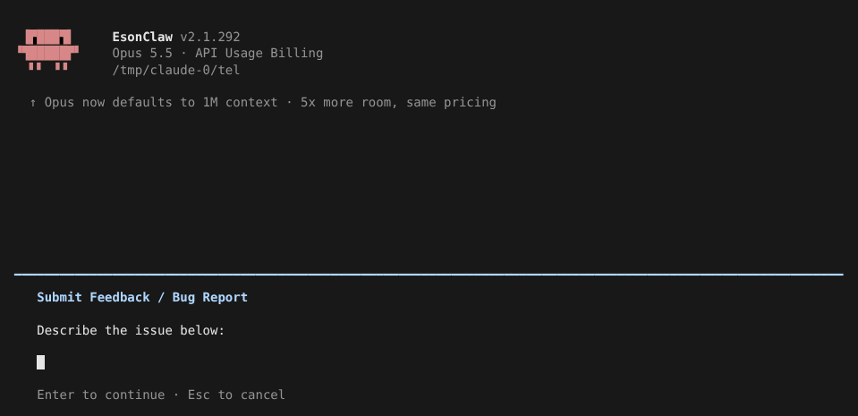

# 遥测与反馈

> 英文名：`telemetry` · 领域：界面与交互 · [返回功能索引](README.md)

## 这是什么

官方 Claude Code 默认会把使用统计、错误报告发给 Anthropic，`/feedback` 还会上传整段对话记录。本 fork 改成**默认全部关闭**，只有你明确打开才会发送。

另外有一套独立的 **OpenTelemetry（OTel）** 导出，用来把使用数据发到**你自己的**监控系统，与上面的开关无关。

## 默认是什么样

不做任何设置时，`/feedback` 这个命令不存在，输入后显示 `Unknown skill: feedback`：



## 打开 Anthropic 遥测

```bash
CLAUDE_CODE_ENABLE_ANTHROPIC_TELEMETRY=1 claude
```

打开后 `/feedback` 才会出现，可以填写问题描述并上传：



但即使设了这个变量，遇到下面任一情况仍然**保持关闭**：

| 情况 | 原因 |
| --- | --- |
| 设置了 `DISABLE_TELEMETRY=1` | 你明确要求关闭 |
| 设置了 `CLAUDE_CODE_DISABLE_NONESSENTIAL_TRAFFIC=1` | 只允许必要流量 |
| 使用 Bedrock / Vertex / Foundry | 数据不该绕到 Anthropic |
| `ANTHROPIC_BASE_URL` 指向非官方网关 | 同上 |

反馈、记忆和压缩后的满意度问卷也跟随同一个开关（其中 Bedrock / Vertex / Foundry 不影响问卷）。

内置 Mods 归档里的 `telemetry` Mod（向 Anthropic 发送插件分析数据）始终不加载，设了这个变量也一样。

**项目里的 `.claude/settings.json` 不能替你打开遥测**：写在项目设置 `env` 里的 `CLAUDE_CODE_ENABLE_ANTHROPIC_TELEMETRY` 和 OTel 导出配置会被忽略，防止克隆一个仓库就把你的数据发出去。

## 发到自己的监控系统（OTel）

按官方 [监控文档](https://code.claude.com/docs/en/monitoring-usage) 配置 OTel 导出（`CLAUDE_CODE_ENABLE_TELEMETRY=1` 加 `OTEL_*` 变量）即可，数据只发往你配置的地址。本 fork 在 `tool_decision` 事件上额外带两个字段，方便统计权限情况：

| 字段 | 取值 |
| --- | --- |
| `permission_mode` | 当时的权限模式，如 `default`、`auto` |
| `classifier_verdict` | [自动模式](auto-mode.md) 分类器的结论：`allow`、`block`、`unavailable`、`no_verdict` |

## 设置

| 配置项 | 写法 | 说明 |
| --- | --- | --- |
| `CLAUDE_CODE_ENABLE_ANTHROPIC_TELEMETRY` | `1` | 打开 Anthropic 遥测和 `/feedback`（默认关闭） |
| `DISABLE_TELEMETRY` | `1` | 强制关闭 |
| `CLAUDE_CODE_DISABLE_NONESSENTIAL_TRAFFIC` | `1` | 只保留必要流量，同样关闭遥测 |

## 说明

画面来自实际运行，模型请求发往本地测试用假 API。第二张图为了让本地地址被当作官方地址，额外设置了内部测试变量 `_CLAUDE_CODE_ASSUME_FIRST_PARTY_BASE_URL=1`；截图后直接按 `Esc` 取消，没有提交任何反馈。
