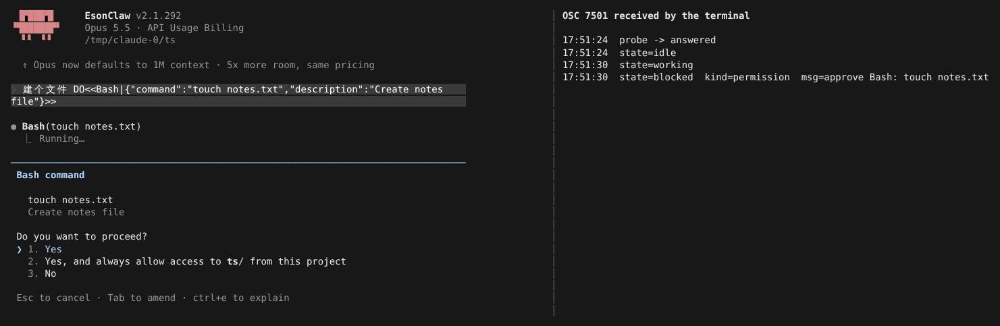
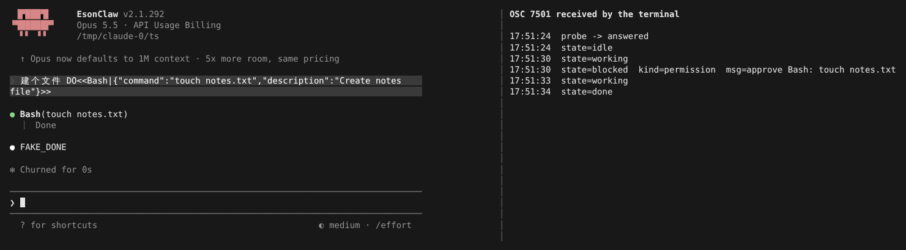

# 终端程序状态（OSC 7501）

> 英文名：`terminal-status` · 领域：工具 · [返回功能索引](README.md)

## 这是什么

同时开着好几个终端标签页时，你很难知道哪个 Claude 已经做完、哪个卡在等你点「Yes」。

OSC 7501 是一种终端协议：程序通过不可见的控制序列告诉终端「我现在是什么状态」，终端再把它显示在标签页、侧栏或通知里。Claude Code 会上报这些状态：

| 状态 | 含义 |
| --- | --- |
| `idle` | 空闲，等你输入 |
| `working` | 正在回答或跑工具 |
| `blocked` | 卡住等你：`kind=permission`（等批准）、`question`（等回答问题）、`auth`（等登录），`msg` 是一句说明 |
| `done` | 这一轮做完了 |
| `error` | 出错 |
| `clear` | 退出时清掉终端上的记录 |

后台任务（子代理、Monitor 等）会带 `id` 作为子记录单独上报，结束后移除。

## 怎么用

**不需要任何配置。** 启动时 Claude 会先问终端「你支持 OSC 7501 吗」，终端回应了才开始上报；不支持的终端（包括 tmux）不会收到任何状态序列。所以普通终端里看不到变化是正常的。

## 看看实际上报了什么

下面用一个模拟「支持 OSC 7501」的小终端包装器演示：左边是 Claude，右边是终端收到并解码后的状态记录。

**1. Claude 要跑 `touch notes.txt`，停下来等你批准。** 终端收到 `state=blocked kind=permission`，`msg` 里写着要批准什么，支持的终端可以据此在标签页上亮提示：

**2. 批准后继续执行，这一轮结束时上报 `done`。** 完成状态会一直保留，不会因为你切换窗口或按普通键就消失；退出 Claude 时再发 `state=clear` 清掉：

## 设置

| 配置项 | 写法 | 说明 |
| --- | --- | --- |
| `CLAUDE_CODE_DISABLE_TERMINAL_TITLE` | `1` | 关闭终端标题和状态上报 |
| `CLAUDE_CODE_SESSION_KIND` | `bg` | 后台会话使用，同样不探测、不上报 |

## 隐私提示

`msg` 会包含**完整的** Bash 命令、文件路径或 URL（和官方 2.1.296 一致）。内容只做了控制字符清理和长度限制，传输时的 Base64 只是编码，不是脱敏；如果你的终端会把状态同步到别处，请留意。

## 已知差异

- `done` 时官方会附一句回合摘要，`working` 时会附当前活动文字；本 fork 还没有对应数据源，这两种 `msg` 暂时为空。
- 后台子记录的增删已验收，但父子回合的完整时序还不能保证与官方完全一致。

## 说明

画面来自实际运行：左侧为本项目构建的 Claude Code，右侧是测试用包装器 `osc7501.py`（在 pty 里应答探测并把收到的 OSC 7501 解码打印出来，`title` / `msg` 已从 Base64 还原，省略了固定的 `app=claude-code` 字段）。模型回复由测试用假 API 生成（`FAKE_DONE`；`DO<<…>>` 是让假 API 调用工具的指令）。
