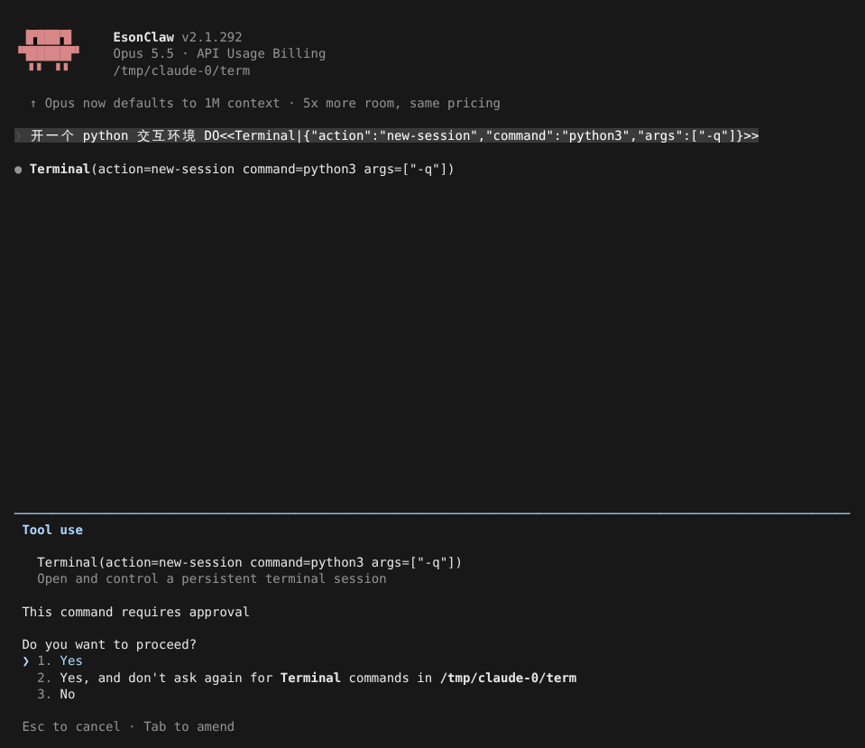
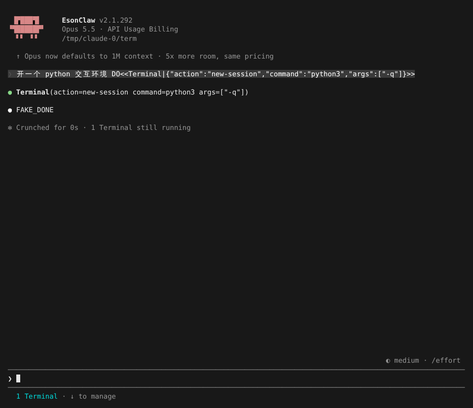
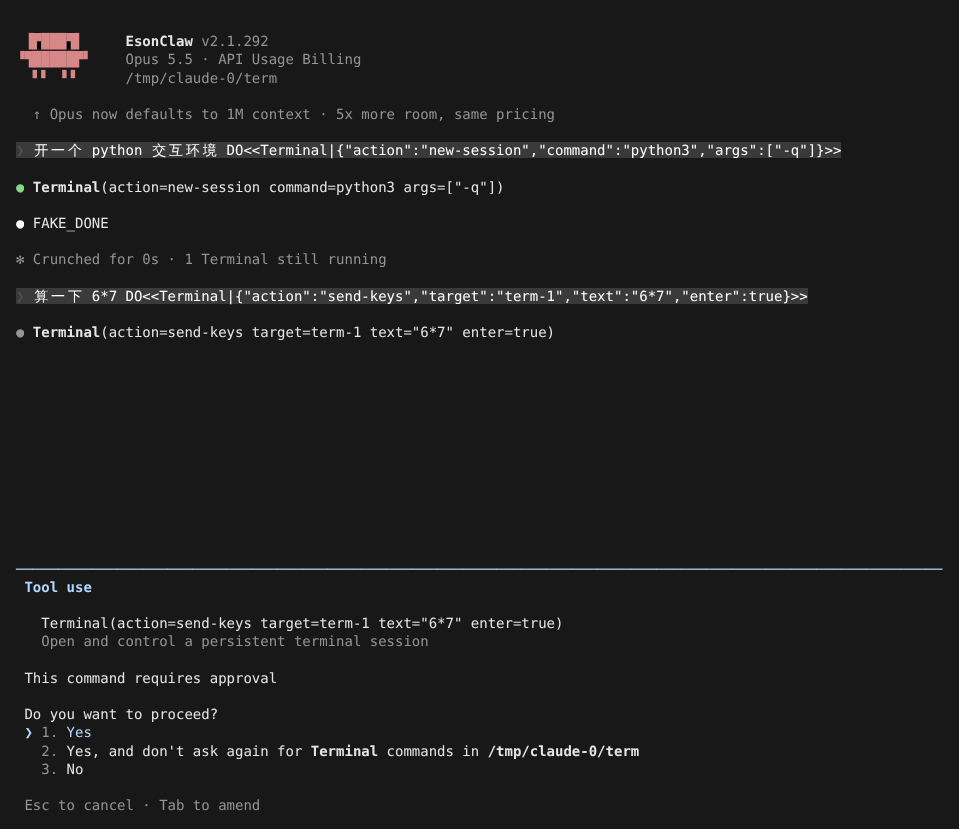
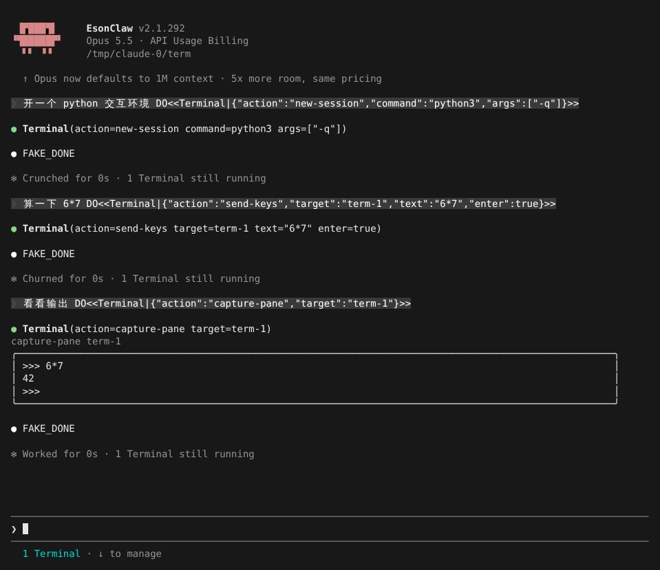
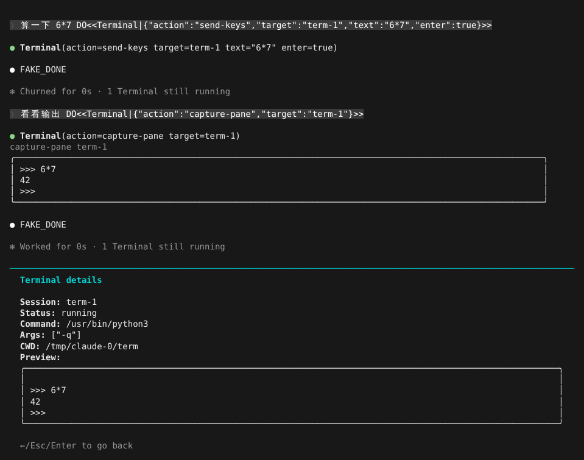
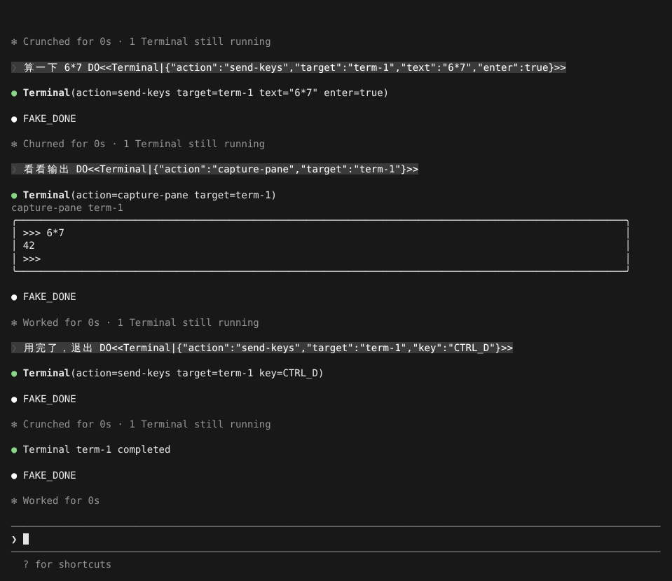

# Terminal 工具

> 英文名：`terminal-tool` · 领域：工具 · [返回功能索引](README.md)

## 这是什么

Bash 工具一次只跑一条命令、等它结束就拿结果，遇到需要**来回交互**的程序就没办法了，比如 Python / Node REPL、数据库命令行、`vim`、要你按 `y` 确认的安装脚本。

Terminal 工具给 Claude 一个**一直开着的终端**（PTY）：它可以先启动程序，再一句一句地输入、看屏幕、按特殊键、调整窗口大小，最后关掉。终端在后台运行，你在底部任务栏里随时能看到它的实时画面。

## 快速上手：让 Claude 用 Python 算个数

**1. Claude 打开一个终端。** 启动程序（这里是 `python3 -q`）和跑 Bash 命令一样要你批准：

**2. 终端在后台运行。** 回合结束时显示 `1 Terminal still running`，底部多出 `1 Terminal · ↓ to manage`：

**3. Claude 往终端里输入。** 每次按回车提交一行时，这一整行也会按 Bash 规则检查；不想每行都问，可选第 2 项，本项目内不再询问 Terminal：

**4. Claude 查看屏幕。** `capture-pane` 读取当前画面，结果以方框显示在对话里，只显示有内容的行：

**5. 你也可以看。** 按 `↓` 选中任务栏，`Enter` 打开 Terminal details：上面是命令、参数、工作目录，下面是最近的屏幕内容（窗口矮时只保留最新的几行）。`Esc` 返回：

**6. 用完退出。** Claude 发 `Ctrl+D`（或 `kill-pane`）后，进程结束，对话里出现一次 `Terminal term-1 completed`，最终输出会被保留：

## Claude 能做的操作

| 操作 | 作用 |
| --- | --- |
| `new-session` | 启动程序，可指定 `command`、`args`、`cwd`、`env`、`cols`、`rows`；不写 `command` 时用你的默认 shell |
| `send-keys` | 输入文字（`text`），可加回车（`enter`），或发特殊键 `ENTER` `TAB` `ESC` `BACKSPACE` `UP` `DOWN` `LEFT` `RIGHT` `CTRL_C` `CTRL_D` `CTRL_L` |
| `capture-pane` | 读取屏幕；`compact`（默认，精简）、`full`（完整）、`save_file`（写到文件，只回预览） |
| `resize-pane` | 改窗口大小，测试 TUI 布局时用 |
| `send-signal` | 发 `SIGINT` / `SIGTERM` 给进程（想模拟键盘 Ctrl+C 请用 `send-keys` 的 `CTRL_C`） |
| `display-message` / `list-panes` | 查看某个终端 / 列出还开着的终端 |
| `kill-pane` | 关闭终端，`force: true` 强制 |

## 权限怎么算

- `new-session` 把 `command + args` 当成一条 Bash 命令检查，`send-keys` 在回车提交时把这一整行当成命令检查，所以分几次输入也会命中你的 `Bash(...)` allow / ask / deny 规则；还没按回车的部分只检查 deny 规则。
- `capture-pane`、`display-message`、`list-panes` 是只读的，直接放行；`resize-pane`、`send-signal`、`kill-pane` 不走 Bash 规则。
- 选「don't ask again for Terminal commands」会在项目 `.claude/settings.local.json` 里写入 `"Terminal"` allow 规则。
- 终端**不在 sandbox 里运行**，sandbox 的自动放行对它无效；[自动模式](auto-mode.md) 下 `Terminal` 的 allow 规则会被暂时搁置，交给分类器判断。

## 操作按键

| 按键 | 位置 | 作用 |
| --- | --- | --- |
| `↓` | 输入框为空时 | 进入底部任务栏 |
| `Enter` | 任务栏 | 打开 Terminal details |
| `←` / `Esc` / `Enter` | Terminal details | 返回 |

## 设置

| 配置项 | 写法 | 说明 |
| --- | --- | --- |
| `permissions.allow` | `"Bash(python3:*)"`、`"Terminal"` | 按 Bash 规则放行特定程序，或整体放行 Terminal |
| `permissions.deny` | `"Bash(rm:*)"` 等 | 同样作用于终端里提交的每一行 |

## 进程结束后

后台轮询跟踪真实进程状态：自然退出时只通知一次，并按退出情况区分 `completed`、`failed`、`killed`，记录退出码和信号；退出前最后的输出也会被读完再保存。已结束的终端过一段时间自动回收。

## 说明

画面来自实际运行（全屏渲染，110×44），模型回复由测试用假 API 生成（`FAKE_DONE`；提示词里的 `DO<<…>>` 是让假 API 调用工具的指令）。
