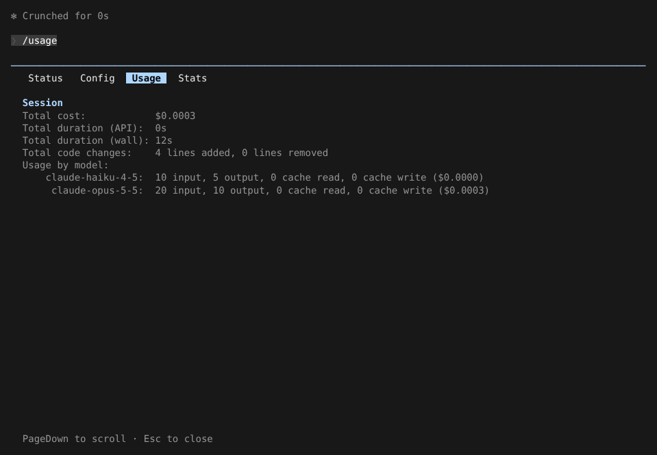
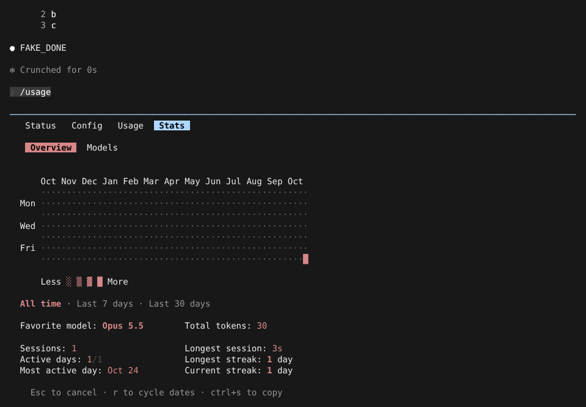

# 用量、成本与状态

> 英文名：`usage-and-cost` · 领域：上下文与记忆 · [返回功能索引](README.md)

## 这是什么

想知道「这次对话花了多少钱」「用了哪些模型」「最近用得多不多」，用这几个命令：

| 命令 | 看什么 |
| --- | --- |
| `/usage`（别名 `/cost`） | 本次会话：费用、耗时、改了多少行、每个模型的 token |
| `/stats` | 长期：每天的使用热力图、最常用模型、连续使用天数 |
| `/status` | 当前版本、会话 ID、工作目录、认证方式、模型、设置来源 |

它们在同一个面板的不同分页里（Status / Config / Usage / Stats），用 `←` `→` 切换。官方只给订阅用户开放 `/usage`；本 fork 对 API key、网关用户同样可用。

## 快速上手

**1. 看本次会话花了多少：** 输入 `/usage`。按模型列出输入、输出、缓存读写的 token 和对应费用（Claude 会在后台用小模型做标题、摘要等，所以常见两个模型）：



**2. 看长期使用：** 按 `→` 到 Stats 分页（或直接 `/stats`）。`r` 切换时间范围（全部 / 7 天 / 30 天），`ctrl+s` 复制：



**3. 在脚本里看：** `-p` 模式输出纯文本：

```sh
claude -p /usage
```

```text
Total cost:            $0.0000
Total duration (API):  0s
Total duration (wall): 0s
Total code changes:    0 lines added, 0 lines removed
Usage:                 0 input, 0 output, 0 cache read, 0 cache write
```

## 费用怎么算、能不能信

- 费用按模型公开价目估算，**不是账单**。未知模型按默认价估算，会标记为 `unknown`。
- 「思考」token 已包含在输出 token 里，单独记录一份方便查看，不重复计费。
- 子代理的费用计入它所属的主会话。

## 恢复会话后成本会继续累计

每个会话的累计成本（金额、耗时、改动行数、各模型 token）作为快照写进会话记录文件。

| 操作 | 成本账本 |
| --- | --- |
| `--continue`、`--resume <ID>`、`/resume` | 接着原来的继续累计 |
| `--fork-session` | 新会话 ID，继承源会话的累计值 |
| `/branch`、`/clear` | 从零开始 |
| 旧会话（没有快照） | 从零开始，无法还原原来的成本 |

用 `/exit` 正常退出时也会把本次成本存进项目记录，供查看最近会话。

## 订阅账号额外显示的内容

- **ChatGPT 登录**（OpenAI provider）：启动画面和 `/status` 显示套餐、Codex 用量上限和速率限制重置额度；重置需要二次确认。
- **API key / bearer token**：显示 `API Usage Billing`。
- Fable 模型显示每周额度。

## 开发者参考

- Mods：`$.session.usage({}).startedAt` 是会话启动时间（官方 diff 用它区分本会话的改动），`.cost.usd` 是根会话累计成本；恢复、fork、分支时的取值与上表一致。
- SDK：result 的 `modelUsage` 按原始模型名索引，附带可选的 `canonicalModel`、`provider`、`costBasis`（`list` / `unknown`），`usage.output_tokens_details.thinking_tokens` 为思考 token。
- 调试：`--debug --debug-file <path>` 里的 `[ModsSession]`、`restore-cost-state` 记录恢复来源和匹配结果，不含会话正文。
- 测试：`src/utils/sessionCostState.test.ts`、`src/utils/sessionStartedAt.restart.test.ts`、`src/costHook.test.ts`、`src/services/api/thinkingUsage.test.ts`、`src/services/api/modelUsageMetadata.test.ts`、`src/services/api/rootLedger.test.ts`；终端对照记录见仓库根目录 `mods-test.md`。
- 思考 token 计费口径见 [Anthropic: thinking pricing](https://platform.claude.com/docs/en/build-with-claude/thinking-steering-and-cost#pricing)。

## 说明

画面来自实际运行，使用测试用假 API（token 数是假 API 返回的固定值）。
