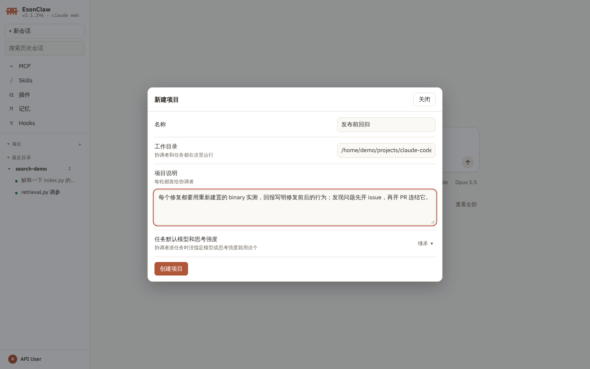
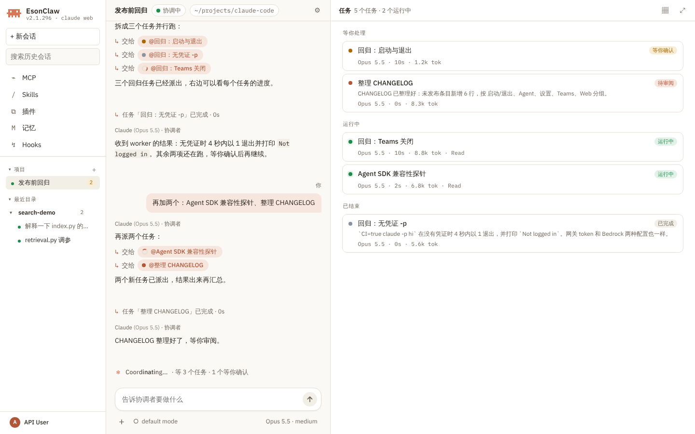
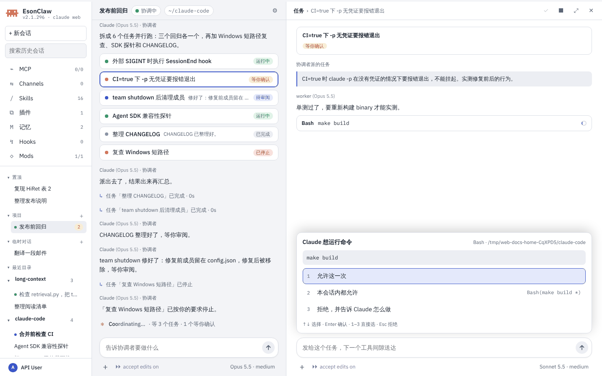
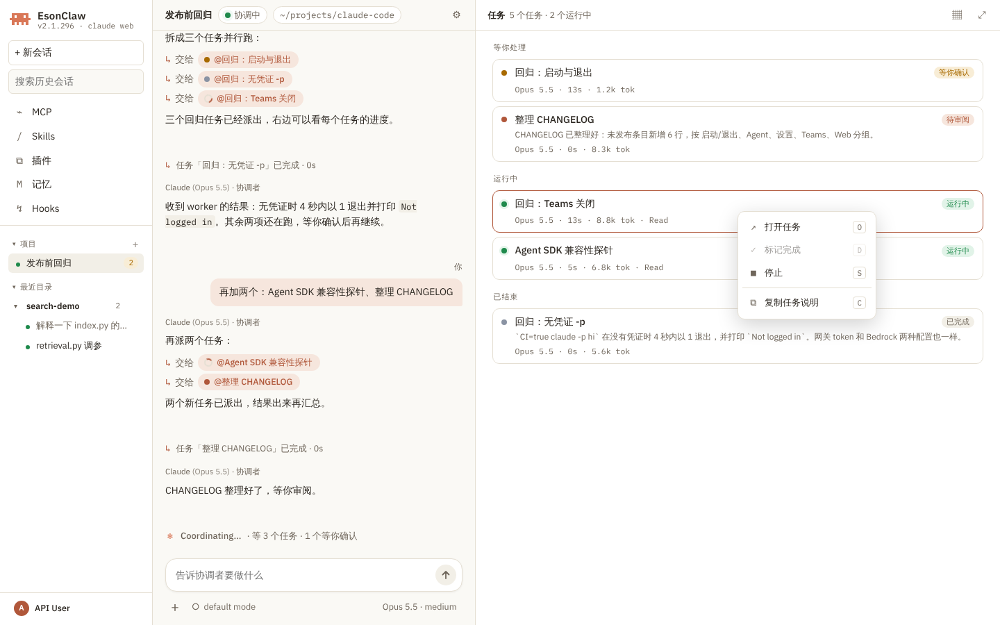
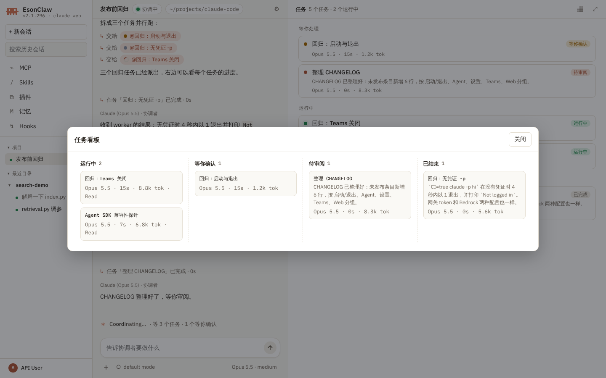
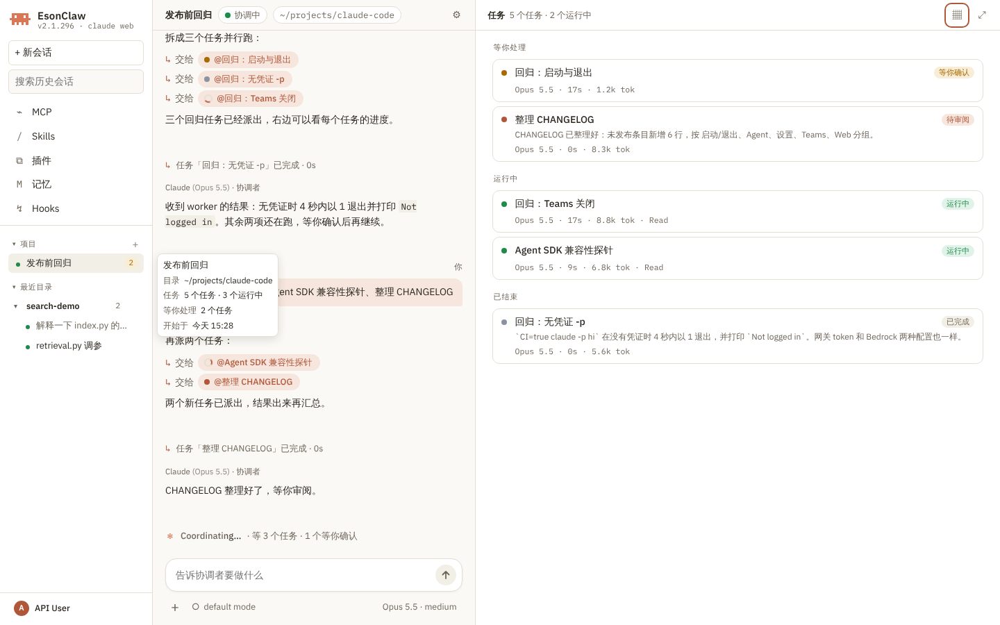

# Claude Web 项目：协调者与任务

> 英文名：`web-projects` · 领域：界面与交互 · [返回功能索引](README.md)

## 这是什么

[Claude Web](web-ui.md) 里的“项目”是一个目录加一个常驻的协调者会话。你只和协调者说要做什么，它把活拆成几个任务，派给 worker agent 并行做；右侧列出每个任务的状态，点开能看 worker 的完整过程、批准它的权限请求、直接给它发消息或停止它，做完了再审阅、标记完成。

项目和任务都记在本机的 `~/.claude/web/projects.sqlite`，关掉浏览器、重启 `claude web` 以后还在；已经结束的任务和协调者都能接着聊。对话内容仍然以 transcript 为准，库里只放列表和状态。

## 什么时候用

- 一件事能拆成几块互不依赖的工作：几个回归各查一遍、几篇文档各写一份、几个模块各改一处。
- 想让几个 worker 同时跑，自己只看结果、在需要时批准或补一句话。
- 同一个目录里反复做类似的事，想把要求写成项目说明，每轮自动带上。

## 分步上手

**第 1 步：新建项目。** 左侧栏“项目”标题旁点 `+`，填名称、工作目录、项目说明（每轮都发给协调者）和任务默认模型和思考强度（协调者派任务时没指定模型就用这个；“继承”表示和协调者一样，菜单里列出协调者当前的模型和它支持的思考强度档位；菜单和会话的模型菜单一致，网关发现的模型也在里面，用 ChatGPT 账号登录时还有 Daybreak 行）。目录第一次使用时会先问你是否信任它。

**第 2 步：告诉协调者要做什么。** 点左侧的项目进入项目视图：中间是协调者会话，右边是任务列表。在中间的输入框里说要做的事，协调者回复后，派出的每个任务显示成一行“↳ 交给 <任务>”（悬停看任务卡片，点开进入任务）；任务结束时中间插一行“任务「…」已完成 · 耗时”或“已停止”，协调者照常回复。顶栏显示项目名、协调中 / 空闲、目录和 ⚙ 项目设置。

右边的任务列表分三组：**等你处理**（等你确认、待审阅）、**运行中**、**已结束**。每张卡片是标题、一行摘要和“模型 · 耗时 · tokens · 最近的工具”（没有 tokens 时不显示；服务重启后恢复的任务，耗时接着之前的累加）。顶部是任务数和运行中的数量，右上角两个按钮打开看板和展开右栏。

**第 3 步：处理一个任务。** 点任务（右边或中间的卡片都行）换成这个任务的对话：顶部是“任务 › 标题”和操作按钮（✓ 标记完成、■ 停止、⤢ 展开、× 关闭），下面是协调者派的任务说明和 worker 的过程。worker 要运行命令时，审批卡片出现在这个任务的输入框上方，按键和普通会话一样（`1`–`3`、`↑` `↓` + `Enter`、`Esc` 拒绝）。

任务的输入框直接发给这个 worker：运行中的任务在下一个工具间隙收到；已结束的任务带着原有上下文恢复运行，服务重启以后也能恢复。发出的消息立即显示在任务对话里，协调者用 SendMessage 发给任务的消息也显示在这里（只显示一次）。协调者的输入框里输入 `@` 也能选一个任务直接发给它。worker 做完交回的结果按报告显示。输入框右下角的模型按钮是这个任务的：已结束的任务换了以后从下一条消息起生效；运行中的任务也可以先选好，下一次恢复时生效。左下角的权限模式是整个项目的，中间和右边同时变。

**第 4 步：审阅和收尾。** worker 做完后任务进入“待审阅”。看过结果后点 ✓ 或在右键菜单按 `D` 标记完成。右键一个任务卡片打开菜单：

| 菜单项 | 按键 | 作用 |
| --- | --- | --- |
| 打开任务 | `O` | 换成这个任务的对话 |
| 标记完成 | `D` | 只对“待审阅”的任务可用 |
| 停止 | `S` | 只对运行中、等你确认的任务可用；停止后显示“已停止” |
| 复制任务说明 | `C` | 把协调者给它的任务说明复制到剪贴板 |

`Esc` 关闭菜单。

**第 5 步：看板。** 任务列表右上角的看板按钮打开大弹窗，按 **运行中 / 等你确认 / 待审阅 / 已结束** 四列排卡片，点卡片回到右栏的任务对话，右键菜单同上。

## 左侧栏里的项目

项目行有任务在跑时前面是绿点，右边的数字是等你处理（等你确认 + 待审阅）的任务数，数字来自本地数据库，不用先打开项目。悬停看目录、任务数、等你处理和开始时间。

右键项目行：

| 菜单项 | 按键 | 作用 |
| --- | --- | --- |
| 重命名 | `R` | 行内编辑 |
| 项目设置 | `S` | 改名称、项目说明、任务默认模型；协调者空闲时立即带新说明重启（`--resume`，对话不丢），忙时等这一轮结束再重启 |
| 封存 | `A` | 从列表移走，并停止它的协调者 |
| 删除 | `D` | 菜单里再确认一次；删除项目记录，移进来的会话回到原来的目录分组 |

会话的右键菜单有“移至项目 ›”，见 [Claude Web](web-ui.md#左侧栏)。移进来的会话列在任务列表的“移入的会话”分组里，标“从会话移入”，点开就是原来的对话；侧栏搜索仍能找到它。

## 操作表

| 位置 | 操作 | 作用 |
| --- | --- | --- |
| 左中、中右两栏之间 | 拖动，或聚焦后按 `←` `→`；双击恢复默认 | 调整左栏 / 右栏宽度，刷新后保留 |
| 任务对话顶部 | ✓ / ■ / ⤢ / × | 标记完成 / 停止 / 右栏占满（中栏暂时收起） / 回到任务列表 |
| 任务卡片 | 左键 / 右键 | 打开任务 / 任务菜单（`O` `D` `S` `C`） |
| 任务输入框 | `Enter` | 发给这个任务 |
| 审批卡片 | `1`–`3`、`↑` `↓` + `Enter`、`Esc` | 和普通会话一样 |
| 窄屏（≤760px）顶栏 | 对话 / 任务 | 在协调者和任务列表之间切换 |
| `Esc` | | 关闭菜单或看板；没有弹窗时关闭打开的任务 |

## 实际输出

任务有五种状态：

| 状态 | 什么时候 |
| --- | --- |
| 运行中 | worker 在干活 |
| 等你确认 | worker 有一个没答的权限请求；刷新页面后审批卡片还在 |
| 待审阅 | worker 做完了，你还没标记完成 |
| 已完成 | 你点了标记完成 |
| 已停止 | 你或协调者（TaskStop）停止了它，或者它失败了（卡片上标出失败原因）；协调者退出或服务重启时还在跑的任务也会标成已停止，并提示“发消息可继续” |

运行中的卡片耗时从任务开始时计时；worker 还没上报用量时，tokens 取它 transcript 里最近一次请求的用量。

## 怎么运行的

- 协调者是一个 `claude -p` 子进程，带 `CLAUDE_CODE_COORDINATOR_MODE=1`、服务端生成的协调者提示词（`--system-prompt`）、项目说明（`--append-system-prompt`）、任务默认模型（`CLAUDE_CODE_SUBAGENT_MODEL`）和任务默认思考强度（`CLAUDE_CODE_SUBAGENT_EFFORT`）。worker 用 TodoWrite 维护自己的清单，作为任务进度。重开项目时用 `--resume` 恢复同一个协调者会话；协调者的模型和思考强度改过以后，重启、重开都保留。
- 一个任务就是协调者用 Agent 工具派出的一个 worker。服务端在转发协调者的 stream-json 时更新任务表：`task_started`、`task_progress`、`task_notification` 事件，以及带 `agent_id` 的 `can_use_tool` 请求。给任务发消息用 `send_task_message`（可带 `model` 和 `effort`），停止用 `stop_task`。
- 协调者的 transcript 不出现在左侧的会话列表里。

## 已知限制

- 协调者自己决定并行几个任务，没有上限设置。

截图来自 `make build` 产出的 `./built-claude`，在 1440×900 的 Chromium（Playwright）里实际操作得到，HOME 是临时目录，模型请求打到本地脚本化的假 Messages API（同 `src/web/web.binary.test.ts`），所以协调者和 worker 的回复是预设的。设计见 [项目设计文档](../design/claude-web-project.md)。按步骤截图的走查见 [Claude Web 界面导览](web-ui-tour.md#分步导览) 第 12 步。
