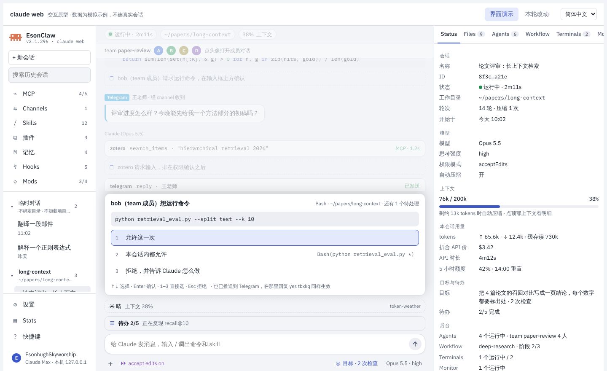
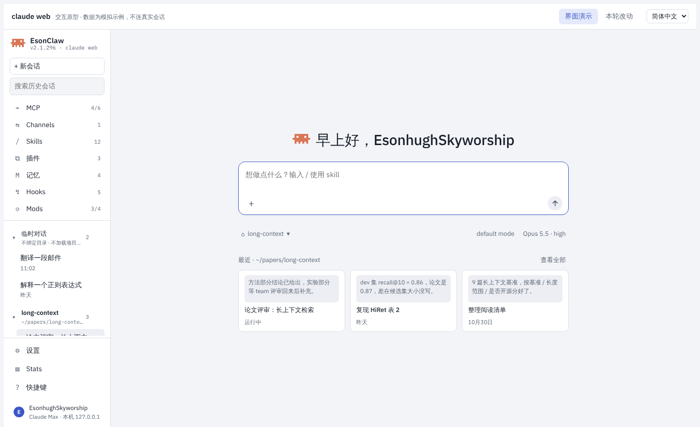
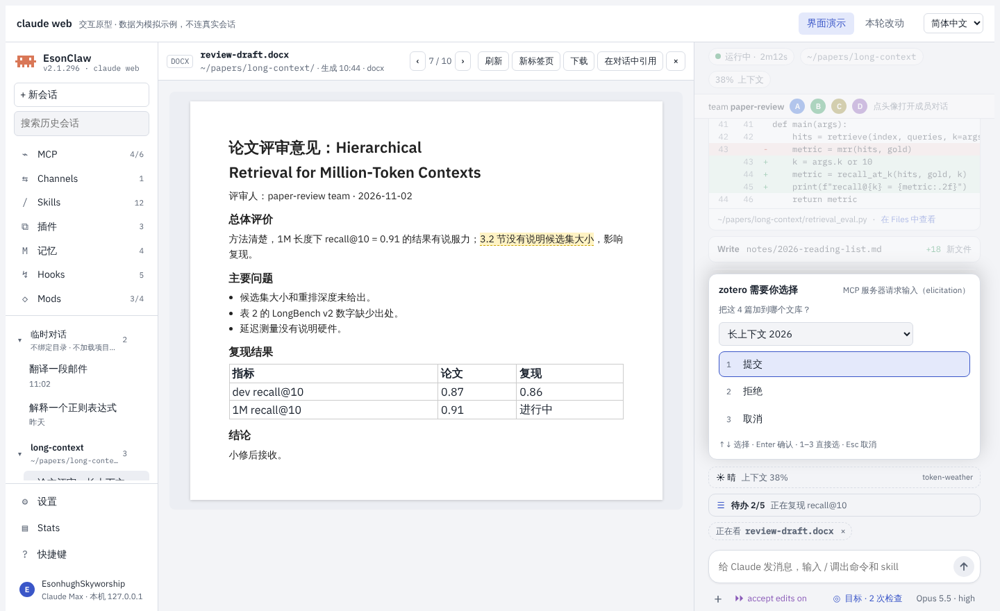
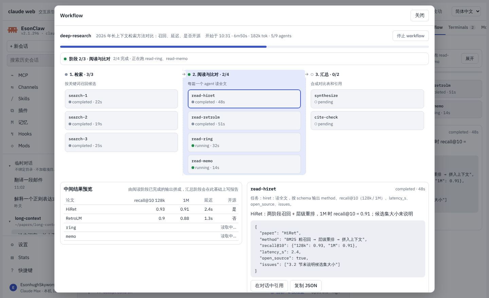
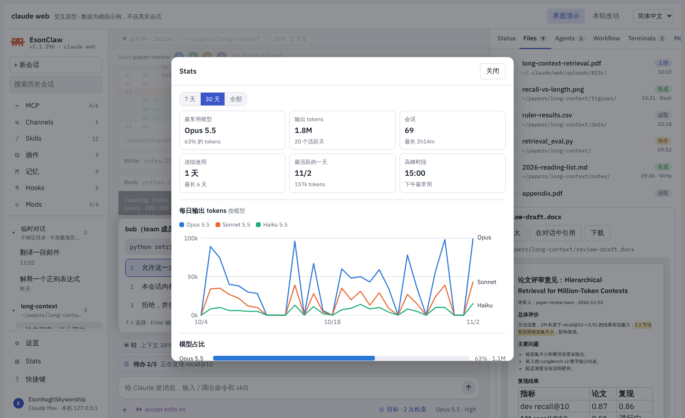
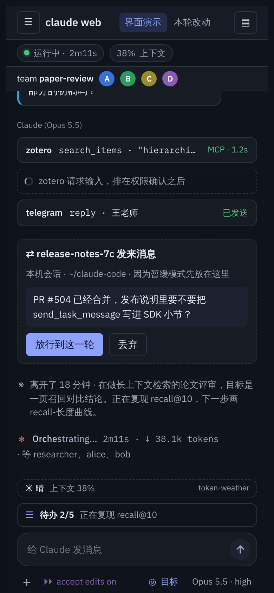

# Claude Web（本地网页界面，设计中）

> 英文名：`web-ui` · 领域：界面与交互 · [返回功能索引](README.md)

> 状态：**设计稿和交互原型，尚未实现**。现在的版本里还没有 `claude web` 命令，计划在 v2.1.296 发版后按 [设计文档](../design/claude-web.md) 第 8 节分阶段开发（Issue #502）。本页说明它要做成什么样，以及怎么打开原型看效果。

## 这是什么

`claude web` 会在本机起一个只监听 `127.0.0.1` 的网页服务并打开浏览器，提供一个类似 ChatGPT 的对话界面。它驱动的还是本机的 claude（复用 `claude server` 的会话管理和 stream-json 协议），工具、权限、MCP、skills、插件、hooks、mods 和终端里一致。

适合终端做不好的事：

- 读长回复：Markdown、表格、代码高亮、公式、Mermaid 图和图片按网页方式渲染。
- 处理文档：上传或拖入 PDF、Word、Excel、PowerPoint、图片，或者让 Claude 生成网页和报告，点开就在左边大面积预览，右边继续对话改它。
- 看后台在做什么：subagent、Agent Team、Workflow、终端、Monitor、后台任务都在右侧面板里，点开能直接和某个 agent 对话。
- 管理多个会话：按项目目录分组的历史，切过去先只读查看，开始输入才恢复。

fork 是通用个人 agent，所以网页界面默认面向对话和研究，不假设当前目录是代码仓库。

## 打开原型

原型是一个独立的 HTML 文件：[`docs/design/claude-web-demo.html`](../design/claude-web-demo.html)。下载后用浏览器打开即可，不需要服务，也不连真实会话；数据都是示例，按钮会模拟对应行为。右上角可以切换简体中文、繁体中文和英文，“本轮改动”列出最近一次设计调整。

## 主要界面

**1. 主界面**：左边是会话历史和 MCP、Skills、插件、记忆、Hooks、Mods 入口；中间是对话；右边是当前会话的 Status、Files、Agents、Workflow、Terminals、Monitor、Background Tasks 页签。需要你确认的工具调用和 MCP 提问会弹在输入框上方，背后的对话变灰。

**2. 新会话页**：点“+ 新会话”不弹菜单，而是换成一个起始页：问候、大输入框（支持 `/` 命令和 skill、`@` 文件、上传和粘贴），下方选目录（含临时对话）、权限模式和模型，再往下是这个目录最近的会话。第一条消息发出时才启动进程。起始页没有右侧面板。

**3. 成品视图**：Files 页签列出上传、生成、读取和修改过的文件。点任何一个文件，工作区变成两栏：左边大面积显示文件，右边继续对话。顶部可以在文件间切换、选历史版本（文本文件）、按类型操作（HTML 切桌面 / 平板 / 手机宽度，Markdown 切渲染 / 源码，PDF 和 PPTX 翻页，XLSX 切工作表），输入框上方会显示“正在看哪个文件、第几页”，发出的消息带上这一行。Esc 或 × 回到普通视图。

**4. Workflow**：右侧只显示当前阶段和这一阶段的 agents；点“展开”打开大窗口，上面是所有阶段的看板，下面左边是中间结果预览，右边是选中 agent 的详情。

**5. Stats**：左下角“Stats”打开和终端 `/stats` 同一份数据：最常用模型、按模型分色的每日曲线、模型占比、最近 25 周的活跃度格子、一天中各小时的分布，可以切 7 天、30 天和全部。

**6. 手机**：宽度 760px 以下，会话栏从左边滑出，右侧面板变成底部抽屉。

## 账号和模型

| 登录方式 | 显示 | 用量 | 说明 |
| --- | --- | --- | --- |
| Claude 账号 | 账号名和订阅 | 5 小时 / 每周额度 | 走已有的 OAuth 流程，局域网访问时可粘贴授权码 |
| ChatGPT 账号 | 账号名和套餐 | ChatGPT 额度 | 模型换成 OpenAI 模型；可用 Daybreak、`auto (Approve for me)` 和 Codex apps |
| Anthropic API key | “Anthropic API key” 和来源 | 按量费用 | `ANTHROPIC_API_KEY` 或 `apiKeyHelper`；网页不收集 key |
| OpenAI API key | “OpenAI API key” 和来源、base URL | 按量费用 | `CLAUDE_CODE_USE_OPENAI=1` 加 `OPENAI_API_KEY`，可选 `OPENAI_BASE_URL`；没有 auto 模式和 Codex apps |

## 外观

设置里可以选外观（跟随系统、浅色、深色）和配色（默认、陶土、黑白），每套配色都有浅色和深色两组颜色。这两项只存在浏览器里，不影响终端的 `/theme`。

## 安全

- 默认只监听 `127.0.0.1`，首次打开用一次性 token 换 HttpOnly cookie，校验 Host 和 Origin。
- 局域网访问必须启动时加 `--dangerously-allow-local-network`，网页里不能打开。
- 浏览器拿不到 API key 或 OAuth token；mod 界面只按元素树渲染，不接受原始 HTML。

完整的架构、协议、安全模型、分阶段计划和测试方案见 [设计文档](../design/claude-web.md)。
