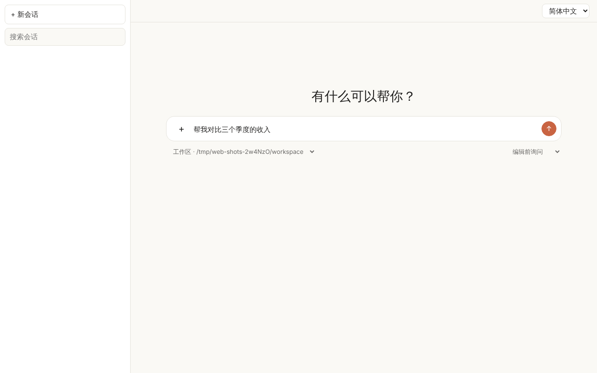
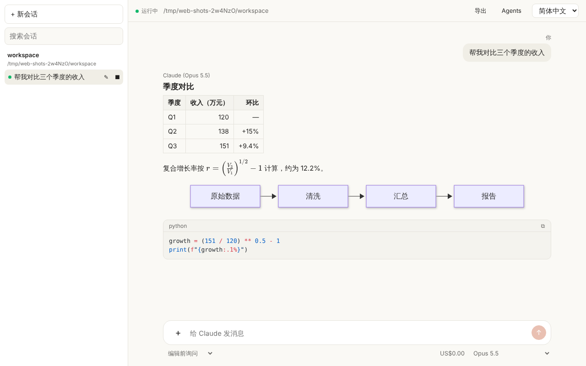
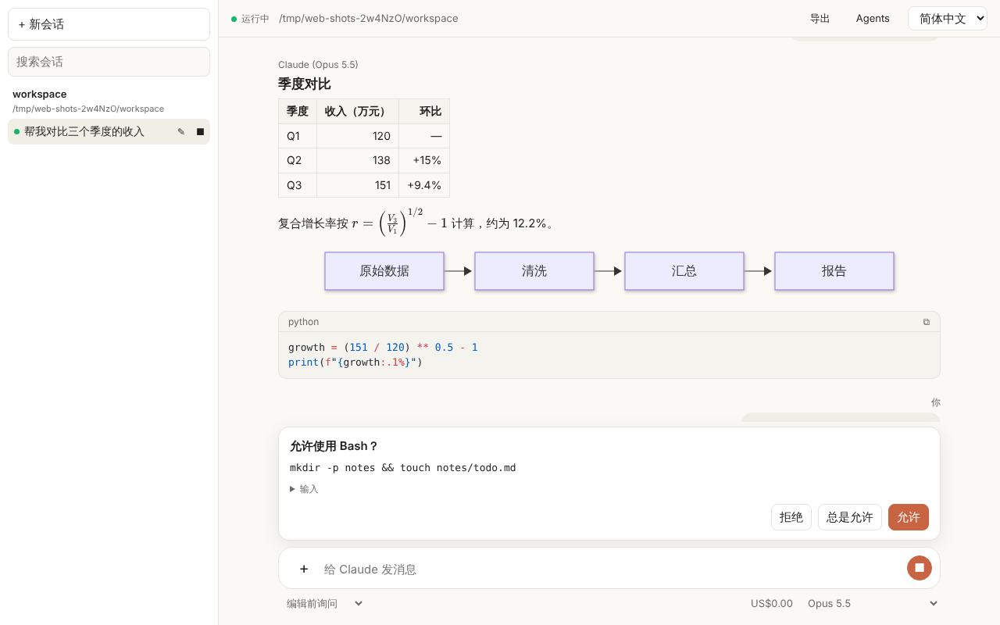
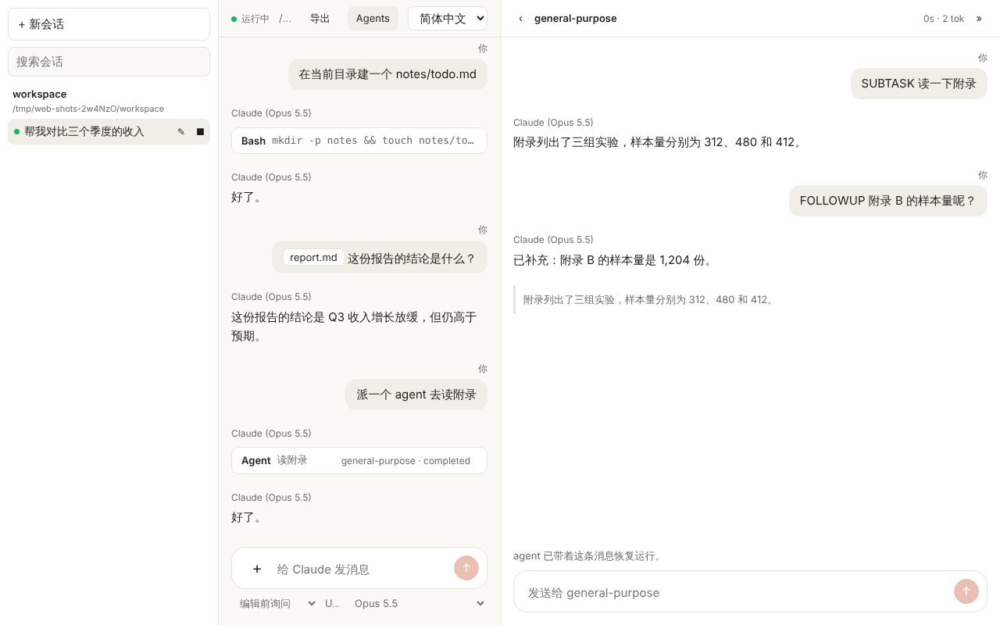

# Claude Web（本地网页界面）

> 英文名：`web-ui` · 领域：界面与交互 · [返回功能索引](README.md)

> 状态：**部分实现**（Issue #502）。对话、渲染、审批、会话历史、文件预览和上传、Agents 面板、来源与导出、`/` 命令面板、局域网访问和 TLS 已经可用；设计文档里的 Status / Files / Terminals / Monitor 等边栏页签、扩展管理、登录卡片等还没做，见文末“尚未实现”。完整设计见 [设计文档](../design/claude-web.md)。

## 这是什么

`claude web` 在本机起一个网页服务并打开浏览器，提供一个类似 ChatGPT 的对话界面。页面背后跑的还是本机的 claude：每个会话是一个 `claude -p` 子进程（复用 `claude server` 的会话管理和 stream-json 协议），工具、权限、MCP、skills、插件、hooks 和终端里一致，凭据只留在本机。

适合终端做不好的事：

- 读长回复：Markdown 表格、代码高亮、LaTeX 公式、Mermaid 图按网页方式渲染。
- 看文档：上传或在消息里 `@` 引用 PDF、Word、Excel、CSV、Markdown、HTML、图片，点开就在右侧预览。
- 看后台在做什么：subagent、workflow、team 成员列在 Agents 面板里，点开能看过程并直接给它发消息。
- 管多个会话：按工作目录分组的历史，点开先只读查看，开始输入才恢复。

## 快速上手

**第 1 步：启动。**

```text
$ claude web
Claude web UI: http://127.0.0.1:43117/?token=…
Sessions start in ~/.claude/web/workspace and run with your local credentials and full access to this machine. Press Ctrl+C to stop.
```

浏览器会自动打开这个地址（SSH 会话里或加 `--no-open` 时只打印）。地址里的 token 用一次就换成 cookie，地址栏随即去掉 token。已经有一个 `claude web` 在跑时，不会再起第二个，而是打印已有的地址并打开它。

**第 2 步：开始对话。** 起始页有大输入框，下方选工作目录（默认 `~/.claude/web/workspace`，也可以选历史里出现过的目录或手填绝对路径）和权限模式。第一条消息发出时才启动会话进程。



**第 3 步：看渲染结果。** 回复按 Markdown 增量渲染：表格、行内和块级公式（`$…$`、`$$…$$`、`\(…\)`、`\[…\]`，KaTeX）、Mermaid 图、按语言高亮的代码块（shiki，带复制按钮）。原始 HTML、`javascript:` 链接和图里的脚本都不会执行。输入框下方左边是权限模式，右边是本会话费用和模型，都可以直接切换；顶栏显示运行状态和工作目录。



**第 4 步：确认工具调用。** 需要你确认的工具调用从输入框上方弹出，显示工具名和命令，可以展开看完整输入；选“允许”“总是允许”或“拒绝”，结果回到子进程，和终端里的权限确认一致。回合进行中发送按钮变成停止按钮，点一下中断。



**第 5 步：预览文件。** 点“+”或把文件拖进页面上传（单个文件不超过 50 MB，每个会话共 500 MB），也可以在消息里写 `@/绝对/路径` 引用本机文件。消息里的文件标签、工具卡片里读写过的文件都可以点开，在右侧预览：

| 类型 | 预览方式 |
| --- | --- |
| 文本、代码、Markdown | 文本或渲染后的 Markdown；大文件只显示开头 |
| CSV、XLSX | 表格，XLSX 可以切工作表 |
| DOCX | 按页显示正文（mammoth） |
| PDF | 翻页（pdf.js） |
| HTML、SVG | 放在无权限的 sandbox iframe / 图片里，脚本不执行；HTML 可切桌面、平板、手机宽度 |
| 图片 | 原图 |
| PPT(X)、DOC、RTF、ODT、XLS、ODS | 本机装了 LibreOffice（`soffice`）时转成 PDF 再预览，否则提示下载 |

预览栏可以在新标签页打开或下载，按 Esc 关闭。


**第 6 步：看后台 agents。** 顶栏“Agents”打开右侧面板：根是主会话，下面按运行中、已结束分组列出 subagent、workflow 和 team 成员，每行显示类型、描述、耗时和 tokens；运行中的可以停止。对话里的 Agent 工具卡片也能点过来。


点一个 workflow 节点显示当前阶段和这一阶段的 agent 卡片，“展开”打开大窗口，按阶段分列画出所有 agent（多列关系图）。

**第 7 步：直接和 agent 对话。** 点树里的 agent，面板换成它的完整过程，底部输入框标着“发送给 …”。投递规则和终端 REPL 一致：运行中的 subagent 在下一个工具间隙收到消息；已结束的 subagent 带着原有上下文在后台恢复；运行中的 team 成员直接收到消息。workflow 里的 agent 只读。点“‹”回到树，“»”收起面板。



**第 8 步：命令面板。** 输入框里打 `/` 弹出命令列表，按名字和别名过滤，↑↓ 选择、Enter 或点击补全，Esc 关闭。列表来自会话自己报告的命令，只包含 `-p` 模式下能跑的（skills、提示词命令和支持非交互的本地命令，例如 `/usage`、`/context`）；`/color` 这类只对终端有意义的命令不列出。


## 会话历史

左侧按工作目录分组列出本机的历史会话（来自 transcript，和 `claude --resume` 看到的是同一份），可以按标题搜索、重命名、停止。点开一个会话先只读显示记录，长会话滚到顶部时“加载更早的消息”；在输入框里开始输入才在原目录恢复它，之前的上下文照常带上。正在运行的会话带绿点。同一个会话同一时间只能在一个标签页里打开，另一个标签页会提示“已在其他标签页打开”。没有标签页连着的会话空闲 `--idle-timeout` 后结束。

## 来源与导出

每轮回答下面列出这一轮读过的网页来源（WebSearch 结果、WebFetch 的地址、deep-research workflow 引用的链接），点开是原链接。顶栏“导出”把当前对话存成 Markdown（含工具调用摘要和来源列表），或者用浏览器打印成 PDF（打印样式会去掉侧栏和输入框）。

## 界面语言和布局

顶栏可以切换简体中文、繁體中文和 English，默认跟随浏览器语言，选择存在浏览器本地。浅色 / 深色跟随系统。窗口窄于 1100px 时左侧栏收起，760px 以下会话栏从左边滑出。

## 命令行参数

```text
claude web [--port <n>] [--host <ip>] [--workspace <dir>] [--no-open]
           [--idle-timeout <ms>] [--max-sessions <n>]
           [--dangerously-allow-local-network] [--trusted-host <host>]...
           [--tls-cert <file> --tls-key <file>]
```

| 参数 | 默认值 | 作用 |
| --- | --- | --- |
| `--port <n>` | `0`（随机） | 监听端口 |
| `--host <ip>` | `127.0.0.1` | 绑定地址；只接受 loopback 或局域网地址，局域网地址必须同时加 `--dangerously-allow-local-network` |
| `--workspace <dir>` | `~/.claude/web/workspace` | 新会话默认的工作目录 |
| `--no-open` | 打开浏览器 | 只打印地址，不打开浏览器（SSH 会话里自动不打开） |
| `--idle-timeout <ms>` | `600000`（10 分钟） | 没有标签页连着的会话多久后结束；`0` 表示不结束 |
| `--max-sessions <n>` | `8` | 同时运行的会话上限；`0` 表示不限 |
| `--dangerously-allow-local-network` | 关闭 | 绑定 `0.0.0.0`，接受局域网来源的连接，并额外打印每个局域网地址的登录链接和警告 |
| `--trusted-host <host>` | 无 | 额外接受的 Host 头（可重复），例如反向代理或自定义域名；不带端口时按监听端口补上 |
| `--tls-cert <file>` / `--tls-key <file>` | 无 | PEM 证书和私钥，必须同时给；给了以后只说 https / wss，cookie 加 `Secure` |

Ctrl+C 或 SIGTERM 会停止服务、结束所有会话并删除 `~/.claude/web.lock`。

## 安全模型

- **登录**：启动时生成一次性随机 token，`/?token=…` 校验通过后换成 HttpOnly、`SameSite=Strict` 的签名 cookie（7 天有效），再重定向去掉 token。签名密钥只在这个进程的内存里，重启 `claude web` 后浏览器需要用新地址重新登录。没有 cookie 的页面请求返回 401 和“请打开终端里打印的地址”。
- **Host 和 Origin**：只接受 `127.0.0.1`、`localhost`、`[::1]`（加上 `--trusted-host` 和局域网模式下本机的局域网地址、`<主机名>.local`）作为 Host，防 DNS rebinding；会改状态的请求和所有 WebSocket 握手必须带同源 Origin，`Sec-Fetch-Site: cross-site` 一律拒绝。
- **来源地址**：任何模式下都只服务 loopback 和局域网来源（RFC 1918、链路本地、CGNAT 100.64/10 例如 Tailscale、IPv6 ULA），其他地址直接 403。
- **局域网访问**：必须在启动时加 `--dangerously-allow-local-network`，网页里不能打开。局域网里拿到地址的人就能以你的身份在这台机器上跑命令；没有 TLS 时流量（包括 token）是明文，启动时会打印这两条警告。
- **CSP**：`script-src 'self'`，不允许内联脚本和外部来源；`frame-ancestors 'none'`，加上 `nosniff`、`no-referrer`、`no-store` 等响应头。
- **文件 API**：只给出本会话上传目录、会话工作目录里的文件和 transcript 里工具读写过的文件，符号链接解析后再判断；claude 配置目录（`~/.claude`，`claude web` 自己的目录除外）和 `.env`、`*.pem`、`*.key`、`.credentials.json` 等凭据文件永远不给。HTML、SVG、JS 一律按纯文本返回，不会作为本站页面执行。
- **会话权限**：网页里的会话和终端里一样走权限确认；以 root 运行时不提供“跳过权限”模式。浏览器拿不到 API key 或 OAuth token，打开浏览器的子进程也只继承必要的环境变量。

## 体积

页面在构建时打包进 CLI 和单文件二进制（`scripts/build-web.mjs` 生成 `web/dist/assets.json`），运行时不读磁盘。shiki 语法、KaTeX、Mermaid、pdf.js、mammoth、exceljs 都按需加载。`make release-check` 会运行 `scripts/check-web-size.mjs`，嵌入的资源超过预算时失败。

## 尚未实现

下面是 [设计文档](../design/claude-web.md) 第 5 节里有、但现在还没有的部分：

- 右侧边栏的 Status、Files、Terminals、Monitor、Background Tasks 页签（现在只有 Agents 面板和文件预览），以及断线后的后台任务快照重建。
- workflow 展开视图里的“中间结果预览”和 agent 结构化输出面板；team 的消息时间线。
- MCP、Skills、插件、Channels、记忆、Hooks、Mods 的管理弹窗，mod 远程界面，MCP elicitation 表单。
- 账号卡片和网页登录（Claude / ChatGPT OAuth），Daybreak 菜单；现在只能用启动环境里已有的登录或 API key。
- Stats、设置页（外观、配色、界面名称）、快捷键帮助，按消息回退，目标 / 待办 / recap 显示，压缩分隔线，记忆和会话内容全文搜索，本机其他会话（UDS）列表。
- 可交互的终端输入（设计上第一版就只读）。

原型可以在 [`docs/design/claude-web-demo.html`](../design/claude-web-demo.html) 里看（下载后用浏览器打开，数据都是示例）。

截图来自 `make build` 产出的 `./built-claude`，在 1280×800 的 Chromium（Playwright）里实际操作得到；模型请求打到本地脚本化的假 Messages API（同 `src/web/web.binary.test.ts`），所以画面里的回复不代表真实模型输出，临时目录路径保留原样。
