# Claude Web（本地网页界面）

<!-- lang: zh-Hans -->

> 英文名：`web-ui` · 领域：界面与交互 · [返回功能索引](README.md)

## 这是什么

`claude web` 在本机起一个网页服务并打开浏览器，在浏览器里用 Claude Code：左边是会话列表和扩展入口，中间是对话，右边是 Status、Files、Agents、Terminals 等面板。页面背后跑的还是本机的 claude：每个会话是一个 `claude -p` 子进程，工具、权限、MCP、skills、插件、hooks 和终端里一样，凭据只留在本机，浏览器拿不到。

和终端相比，网页适合这些事：

- 读长回复：Markdown 表格、代码高亮、LaTeX 公式、Mermaid 图按网页渲染，Edit / Write 直接显示 diff。
- 看文件：上传或引用 PDF、Word、Excel、CSV、Markdown、HTML、图片，点一下在右侧预览。
- 看后台：subagent、workflow、team 成员、终端、Monitor 和后台 shell 都在右侧面板里，可以直接给 agent 发消息、往终端里打字。
- 管多个会话：置顶、按目录分组、悬停看详情、右键重命名 / 封存 / 删除。
- 分派一批任务：建一个“项目”，让协调者把活拆给多个 worker 并行做，见 [Claude Web 项目](web-projects.md)。

想先看一遍实际界面，见按操作顺序截图的 [Claude Web 界面导览](web-ui-tour.md)。

<details lang="en"><summary>English</summary>

> Name: `web-ui` · Area: UI and interaction · [Back to index](README.md)

## What it is

`claude web` starts a web server on your machine and opens the browser, so you can use Claude Code there: the session list and extensions on the left, the conversation in the middle, and panels such as Status, Files, Agents and Terminals on the right. Behind the page it is still your local claude: each session is a `claude -p` child process with the same tools, permissions, MCP servers, skills, plugins and hooks as in the terminal, and credentials stay on your machine where the browser cannot reach them.

Compared with the terminal, the web UI is better for:

- Reading long replies: Markdown tables, highlighted code, LaTeX math and Mermaid diagrams render as web content, and Edit / Write show diffs directly.
- Looking at files: upload or reference PDF, Word, Excel, CSV, Markdown, HTML and images, and preview them on the right with one click.
- Watching background work: subagents, workflows, team members, terminals, Monitor and background shells are all in the right panel, where you can message an agent or type into a terminal.
- Managing many sessions: pin, group by directory, hover for details, right-click to rename, archive or delete.
- Handing out a batch of tasks: create a project and let the coordinator split the work across several workers, see [Claude Web projects](web-projects.md).

To see the real UI first, read the step-by-step [Claude Web tour](web-ui-tour.md).

</details>
<details lang="zh-Hant"><summary>繁體中文</summary>

> 英文名：`web-ui` · 領域：介面與互動 · [返回功能索引](README.md)

## 這是什麼

`claude web` 在本機起一個網頁服務並開啟瀏覽器，在瀏覽器裡用 Claude Code：左邊是會話列表和擴充入口，中間是對話，右邊是 Status、Files、Agents、Terminals 等面板。頁面背後跑的還是本機的 claude：每個會話是一個 `claude -p` 子程序，工具、權限、MCP、skills、插件、hooks 和終端裡一樣，憑據只留在本機，瀏覽器拿不到。

和終端相比，網頁適合這些事：

- 讀長回覆：Markdown 表格、程式碼高亮、LaTeX 公式、Mermaid 圖按網頁渲染，Edit / Write 直接顯示 diff。
- 看檔案：上傳或引用 PDF、Word、Excel、CSV、Markdown、HTML、圖片，點一下在右側預覽。
- 看後台：subagent、workflow、team 成員、終端、Monitor 和後台 shell 都在右側面板裡，可以直接給 agent 發訊息、往終端裡打字。
- 管多個會話：置頂、按目錄分組、懸停看詳情、右鍵重新命名 / 封存 / 刪除。
- 分派一批任務：建一個“專案”，讓協調者把活拆給多個 worker 並行做，見 [Claude Web 專案](web-projects.md)。

想先看一遍實際介面，見按操作順序截圖的 [Claude Web 介面導覽](web-ui-tour.md)。

</details>

## 什么时候用

- 回复里有表格、公式、图，或者要对照着看文档。
- 想同时盯着几个会话或后台 agent，不想在终端之间来回切。
- 在同一个局域网里的另一台设备（比如平板、手机）上看进度、批准工具调用（需要显式打开局域网访问，见“安全模型”）。

## 快速上手

**第 1 步：启动。**

```text
$ claude web
Claude web UI: http://127.0.0.1:33777/?token=…
Sessions start in ~/.claude/web/workspace and run with your local credentials and full access to this machine. Press Ctrl+C to stop.
```

浏览器会自动打开这个地址（SSH 会话里或加 `--no-open` 时只打印）。地址里的 token 用一次就换成 cookie，地址栏随即去掉 token。已经有一个 `claude web` 在跑时不会再起第二个，而是打印 `claude web is already running (pid …) at …` 并打开它。

**第 2 步：开始对话。** 起始页是一个大输入框，下面左边选工作目录（默认 `~/.claude/web/workspace`，也可以选临时目录（排在最前）、最近用过的目录或手填路径），右边选权限模式和模型。还没有会话时输入 `/` 也列出命令和已启用的 skill，`@` 搜索所选目录里的文件。下方列出这个目录最近的 3 个会话。第一条消息发出时才启动会话进程；在默认工作目录以外的目录第一次开会话时，页面会先问你是否信任这个目录。

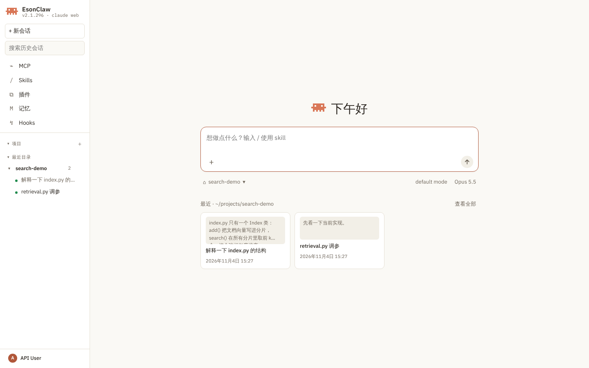

**第 3 步：确认工具调用。** 需要你确认的工具调用从输入框上方弹出，写明 Claude 想运行什么命令、在哪个目录。按 `1`–`3` 直接选，或者 `↑` `↓` 加 `Enter`；`Esc` 拒绝。选“拒绝，并告诉 Claude 怎么做”后光标回到输入框，下一句话就是给它的说明。确认结果会留在对话里（例如“已允许一次”）。

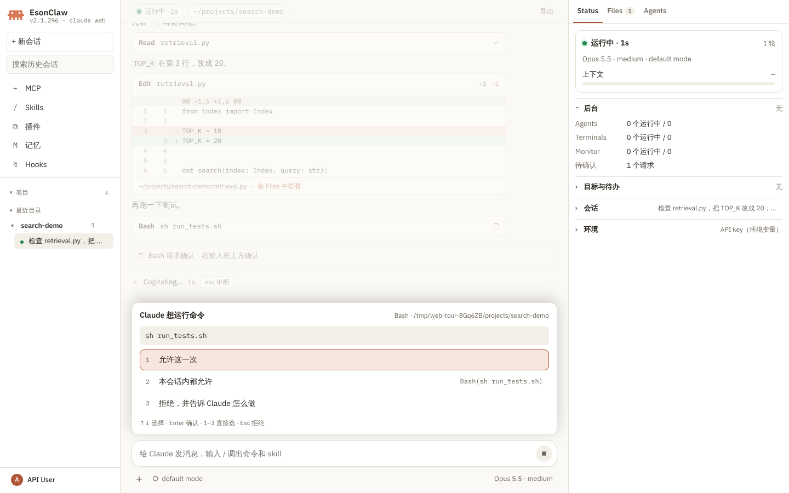

**第 4 步：看过程和结果。** 每次工具调用是一张卡片：Read、Bash 显示路径或命令，Edit / Write 显示 diff 和增删行数，点文件路径在右侧预览这个文件。MCP 工具如果带 `ui://` 界面（MCP Apps），卡片下方直接显示这个页面，见 [MCP Apps](mcp.md#mcp-apps工具自带界面)。回复按 Markdown 增量渲染，代码块带复制按钮。顶栏是运行状态、工作目录、上下文占用（点开看明细，可以立即 `/compact`）和“导出”。右侧 Status 页签汇总这个会话的模型、权限模式、上下文、用量、目标与待办和后台任务数。

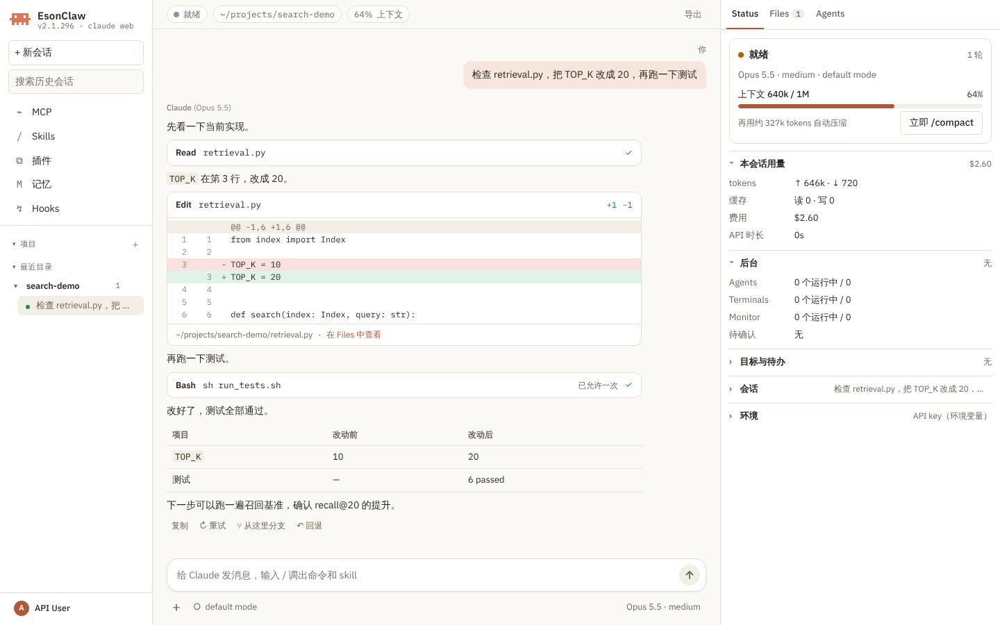

**第 5 步：预览文件。** 点“+”上传文件、添加图片，或者直接拖进页面、粘贴截图（单个文件不超过 50 MB，每个会话共 500 MB；5 MB 以内的图片直接作为图片发给模型）。输入 `@` 按路径搜索工作区文件并引用。消息里的文件、工具卡片里的路径都能点开预览：

| 类型 | 预览方式 |
| --- | --- |
| 文本、代码、Markdown | 高亮的代码或渲染后的 Markdown；大文件先显示开头 1 MB / 2000 行，末尾的“显示全部”原地加载整个文件 |
| CSV、XLSX | 表格，XLSX 可以切工作表；先显示前 500 行，“显示全部”加载其余行 |
| DOCX | 正文 |
| PDF | 所有页连续上下滚动 |
| HTML、SVG | HTML 在无权限的 sandbox iframe 里显示，可切桌面 / 平板 / 手机宽度；SVG 清理后按图片显示；脚本都不执行 |
| 图片 | 原图 |
| PPTX | 本机装了 LibreOffice（`soffice`）时转成 PDF 再预览；没有时在浏览器里直接画出每一页幻灯片（不加载外部媒体，只保留 http、https、mailto 链接） |
| PPT、DOC、RTF、ODT、XLS、ODS | 本机装了 LibreOffice（`soffice`）时转成 PDF 再预览，否则提示下载 |

预览栏顶部的 `‹` `›` 在这段对话里出现过的文件之间切换，也可以在新标签页打开或下载，`Esc` 关闭。

**评论文件。** 在图片、SVG、PDF、转换后的 Office 文件或浏览器画出的幻灯片上点一下，放下一个编号标记并写评论，`Enter` 发送；评论作为一条消息发给 Claude，写明文件、页码和标记位置（“pinned at 67% from the left, 55% from the top”）。文本和代码里选中几行后点“评论”，消息写明行号；渲染后的 Markdown、Word、PDF 和幻灯片引用选中的文字（PDF 与幻灯片同时写明页码）；表格可以评论单个单元格；HTML 预览多一个“源码”视图，同样能按行评论。对话里的图片点开后也能放标记。

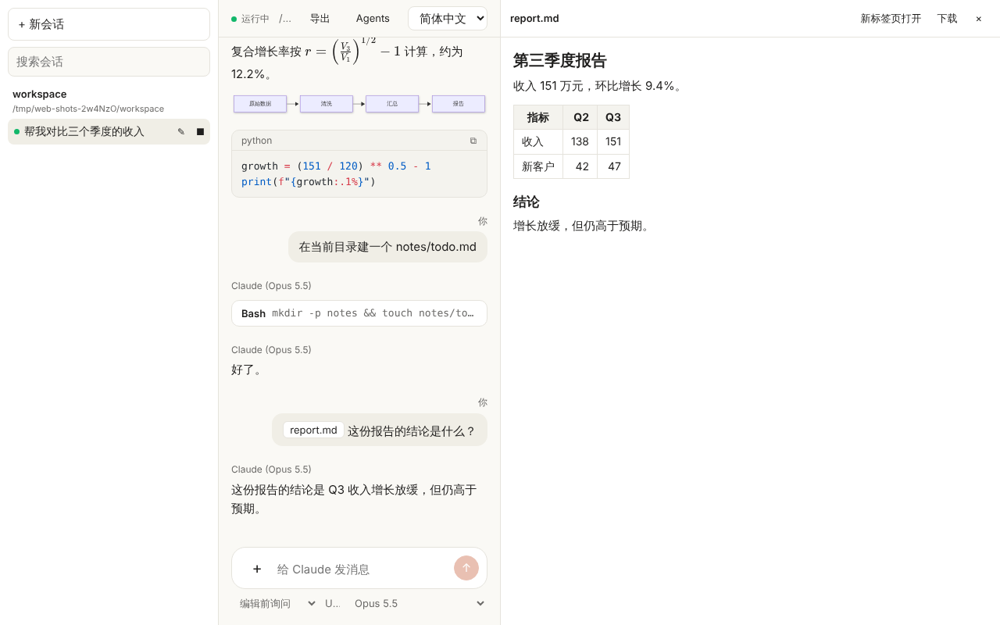

**第 6 步：命令和 skill。** 输入框里打 `/` 弹出命令和 skill 列表，按名字过滤，`↑` `↓` 选择、`Enter` 或 `Tab` 补全，`Esc` 关闭。列表来自会话自己报告的命令，只包含 `-p` 模式下能跑的；只对终端有意义的命令不列出。

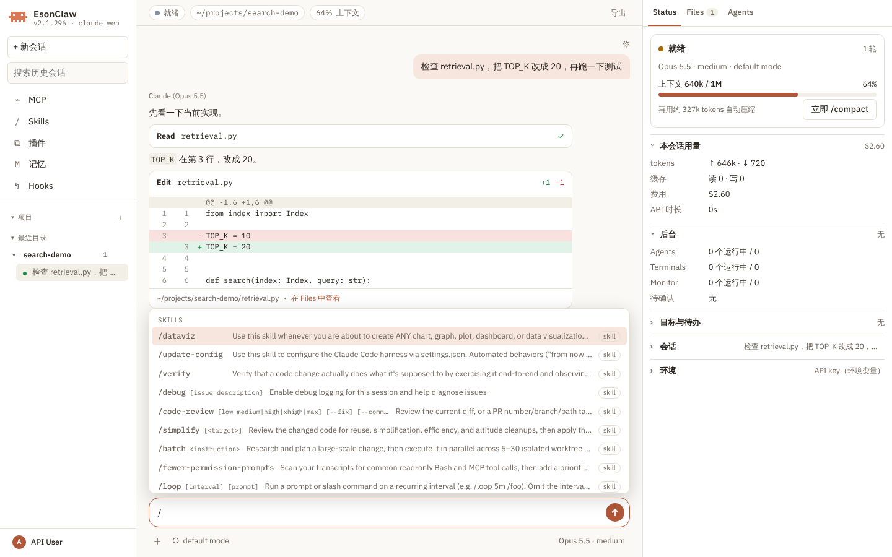

**第 7 步：看后台 agent。** 右侧 Agents 页签列出主会话和它派出的 subagent、workflow、team 成员，按运行中 / 已结束分组，每行有类型、描述、耗时和 tokens，运行中的可以停止。点一行看它的完整过程；底部输入框直接给它发消息：运行中的 subagent 在下一个工具间隙收到，已结束的带着原有上下文在后台恢复，运行中的 team 成员直接收到。对话里的 Agent 卡片也能点过来。

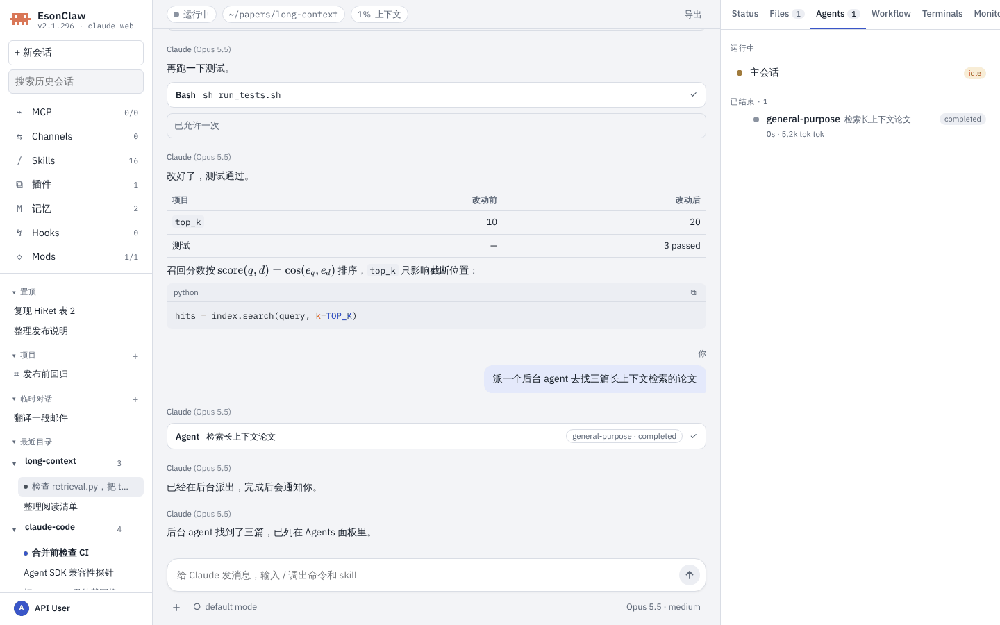

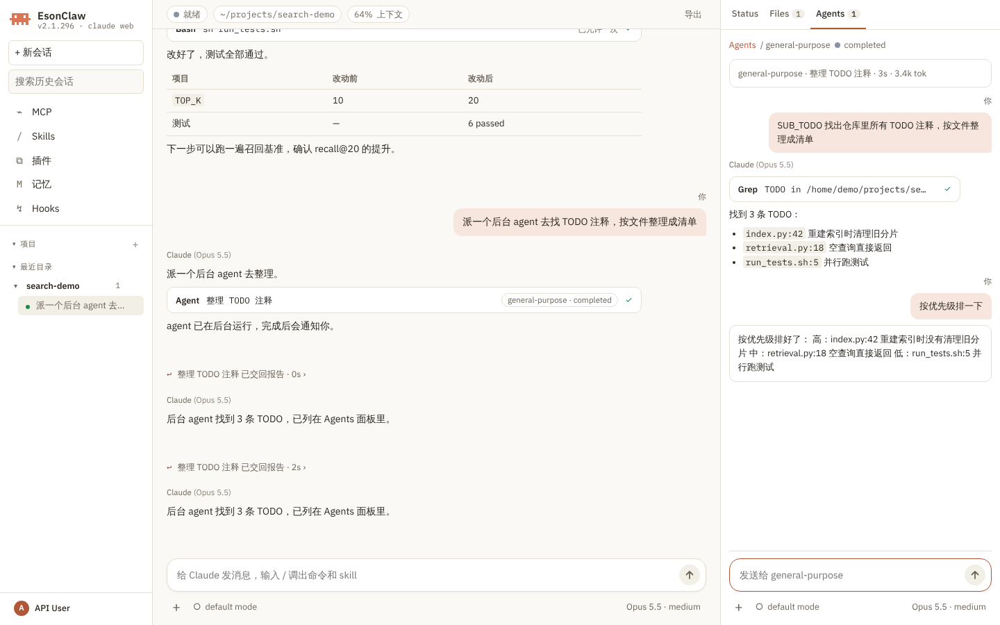

**第 8 步：账号和认证。** 左下角是账号卡片（订阅账号显示名字和套餐，API key 显示“API User”）。点开依次是 认证 ›、设置、统计、快捷键、退出登录。“认证”子菜单在 Anthropic OAuth（Claude 账号）、OpenAI OAuth（ChatGPT 账号）、Anthropic API key、OpenAI API key 之间切换，打勾的是当前使用的；API key 行点“编辑”打开对话框，填 key 和可选的 Base URL（只接受 http / https），按“保存并使用”。key 和 TUI `/login` 存在同一个地方，页面上只显示末 4 位和主机名。是否已登录和 `claude auth status` 的判断一致（宿主管理的 token、`ANTHROPIC_AUTH_TOKEN`、apiKeyHelper、Bedrock、Vertex、Foundry 都算）。没有登录时对话区显示登录卡片：点按钮在新标签页登录，打不开时复制链接登录，再把授权码粘贴回来。

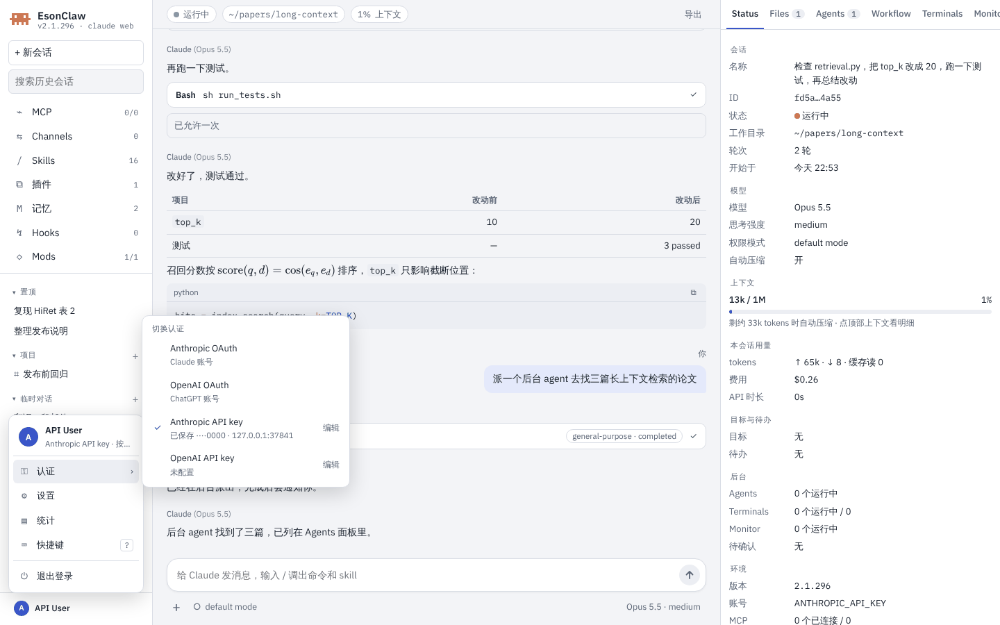

**第 9 步：设置和统计。** “设置”有三个页签：常规（界面语言、界面名称、外观、配色、工作目录、访问地址、局域网访问状态）、用量（本会话和订阅额度）、功能开关（自动压缩、Git 指引、记忆提取、agent 摘要、提示建议，写入用户设置）。界面语言、外观和配色只存在这个浏览器里，外观默认跟随系统的浅色 / 深色，配色默认 Clay。“统计”按 7 天 / 30 天 / 全部汇总最常用模型、输出 tokens、会话数、连续使用天数，下面是按模型的每日 tokens 曲线和活跃热力图（悬停看当天数字）。

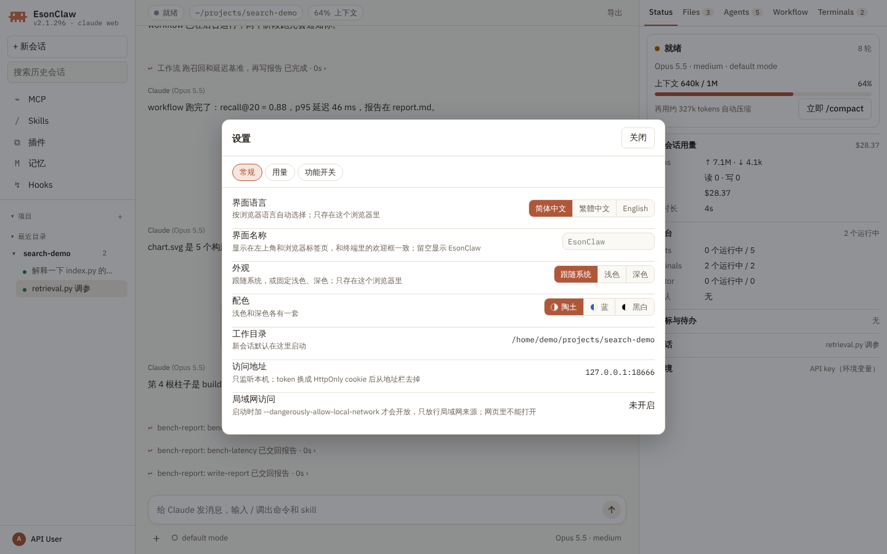

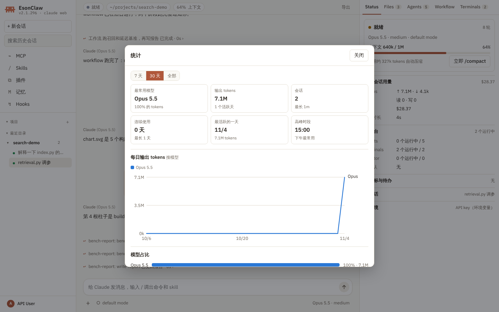

## 左侧栏

从上到下：品牌、`+ 新会话`、搜索，MCP / Skills / 插件 / 记忆 / Hooks 五个入口（点开是对应的管理弹窗，记忆弹窗可以搜索全部记忆文件；Channels 是 MCP 弹窗里的页签，Mods 是 Hooks 弹窗里的页签；Hooks 弹窗和终端 `/hooks` 一样只读，增改 hook 请编辑 settings.json 或让 Claude 改），然后是 **置顶**、**项目**、**临时对话**、**最近目录**（按目录分组，最近改过的目录在前）。插件弹窗的市场列表里 Esonhugh-Marketplace 排第一（`claude web` 首次启动时和终端一样自动安装它，`CLAUDE_CODE_DISABLE_OFFICIAL_MARKETPLACE_AUTOINSTALL=1` 关闭）；用 ChatGPT 账号登录（OpenAI 模式）时多一个“ChatGPT 应用”页签，可以逐个开关 Codex 应用。Channels 页签可以给当前会话开启开发频道（本地开发中的 channel 插件或 MCP server），会先显示一次本地开发警告，再点一次才开启。每段标题可以折叠。每行一行标题；没有标题的会话显示最后一条消息，再没有就显示 session id。正在运行的会话前面有绿点，未读的加粗并带蓝点。

鼠标停在一行上会出现提示卡片：标题、最近修改、目录、状态、改动的文件数、ID（拿不到的字段不显示）。鼠标可以移进卡片，选中里面的文字复制。行右侧的按钮置顶 / 取消置顶。

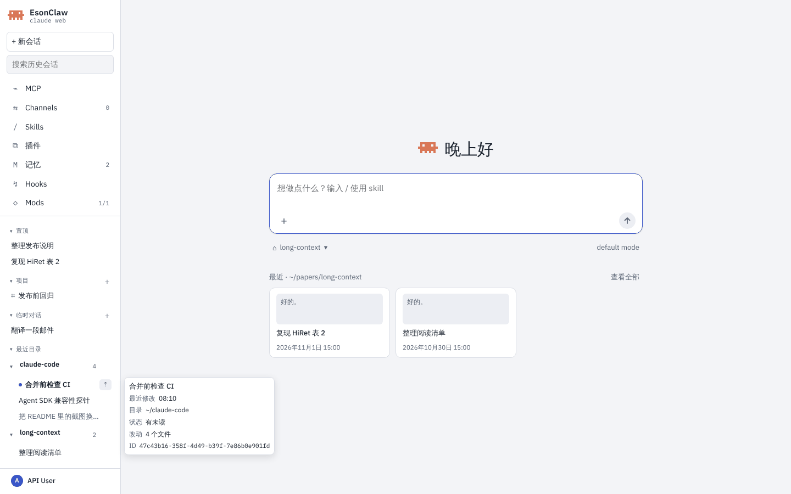

右键一行打开菜单，菜单打开时直接按字母执行：

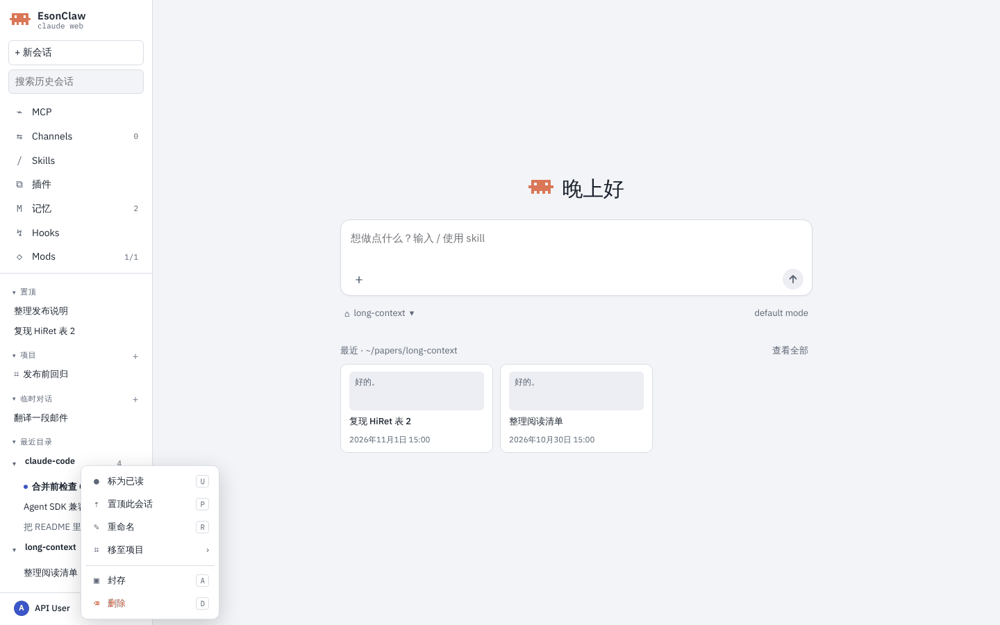

| 对象 | 菜单项 | 按键 | 作用 |
| --- | --- | --- | --- |
| 会话 | 标为未读 / 已读 | `U` | 未读的会话点开后自动变成已读 |
| 会话 | 置顶此会话 / 取消置顶 | `P` | 移到“置顶”段，刷新后保留 |
| 会话 | 重命名 | `R` | 行内编辑，`Enter` 保存，`Esc` 取消 |
| 会话 | 移至项目 › | | 子菜单里选一个项目；会话从“最近目录”移到项目的任务列表，搜索仍能找到 |
| 会话 | 封存 | `A` | 从列表移走，搜索仍能找到 |
| 会话 | 删除 | `D` | 菜单里再确认一次；先结束会话，再删除它的 transcript |
| 项目 | 重命名 / 项目设置 / 封存 / 删除 | `R` / `S` / `A` / `D` | 见 [Claude Web 项目](web-projects.md) |

`Esc` 关闭菜单。输入框和重命名框里右键仍是浏览器自带的菜单。

点一个历史会话先只读显示记录，长会话往上滚时加载更早的消息；在输入框里开始输入才在原目录恢复它，之前的上下文照常带上。同一个会话同一时间只能在一个标签页里打开。没有标签页连着的会话空闲 `--idle-timeout` 后结束。

会话选的模型、effort、上下文窗口和权限模式保存在服务端（`projects.sqlite`），刷新页面、新开标签页或会话进程空闲结束后再恢复，都按原来的选择继续；断线期间改的选择会在重新连上后补发。刷新时如果回合还在跑，页面显示到目前为止的输出并继续接收；占着会话的标签页关闭后，被锁住的标签页自动接管。会话进程异常退出时，错误框显示退出码和最后一行 stderr，而不是只写“The session ended.”。网络断开（切换 Wi-Fi、电脑休眠）时页面自动重连还在运行的会话进程，约三分钟内连不上或进程已经结束，就提示断开，发一条消息即可恢复。输入 `/clear`（或 `/reset`、`/new`）会在同一目录开一个新会话，沿用原来的模型、effort 和权限模式；项目协调者里不支持。地址里的会话即使不在侧栏最新 200 条里，刷新后也会重新打开。

## 右侧面板

Status、Files、Agents 一直在；Workflow、Terminals、Monitor、Background Tasks 在这个会话用过对应工具后才出现（重新打开的历史会话按记录里的工具调用判断）。

| 页签 | 内容 |
| --- | --- |
| Status | 顶部是状态、模型、思考强度、权限模式和上下文占用，用到 60% 时旁边直接给出“立即 /compact”；下面的分段可以折叠：本会话用量（tokens、缓存、费用）、后台（agent / 终端 / Monitor 数和待确认请求）、目标与待办、会话（名称、完整 ID 和 `uds:` 消息地址，都带复制按钮；工作目录、轮次）、环境（版本、账号、同一目录里正在运行的其他会话和它们的消息地址、API Base URL、代理、MCP、记忆、沙箱、Hooks）。ChatGPT 账号即使会话没在运行也显示 5 小时和每周额度 |
| Files | 这个会话读写和上传过的文件，点开预览 |
| Agents | subagent、workflow、team 成员的树，见第 7 步 |
| Workflow | 上方是所选 agent 的输出，下方每个阶段一个抽屉，列出这个阶段的 agent 卡片；结构化输出在弹窗里看；“展开”打开大弹窗，阶段排成看板列，点卡片在下方看它的输出；“停止 workflow”是红色按钮 |
| Terminals | Terminal 工具开的终端，每个终端是一个抽屉，可以同时展开几个；彩色屏幕每秒刷新，下面的输入框回车把一行发进终端，Ctrl+C 按钮发中断，行上的“停止”结束它 |
| Monitor | Monitor 任务和最近的事件 |
| Background Tasks | 后台 shell、终端、Monitor 等任务的命令、状态、时长和最后一行输出，可以停止 |
| Mods | 启用的 [Mod](mods.md) 写的状态条目和它们打开的每个面板；面板上的“Open on canvas”把它作为一个页签放进中间栏（和文件预览并列，切换页签时 Mod 保留自己的状态） |

Mod 画在终端里的东西在网页里也有对应位置：输入框上方的状态条（band）、输入框上方的 toast、对话里被 `ui.render` hook 改写的消息行、输入框的改写 / 补全 / 装饰，以及 Mod 自己的斜杠命令。Mod 的 Client 代码在独立来源的沙箱 iframe + Worker 里运行，不能联网，不能 `eval`，卡住 2 秒就被停止。

窗口窄于 1100px 时左侧栏收起成抽屉；760px 以下右侧面板也变成抽屉，从顶栏的按钮打开。

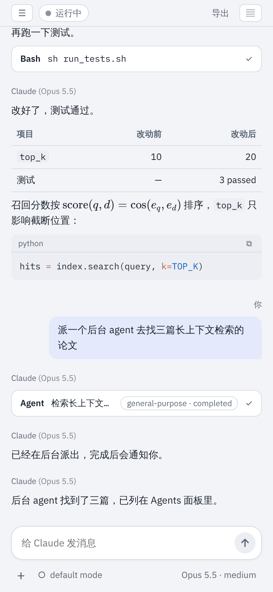

## 操作表

快捷键随时可以按 `?` 查看（macOS 上 Ctrl 换成 ⌘）：

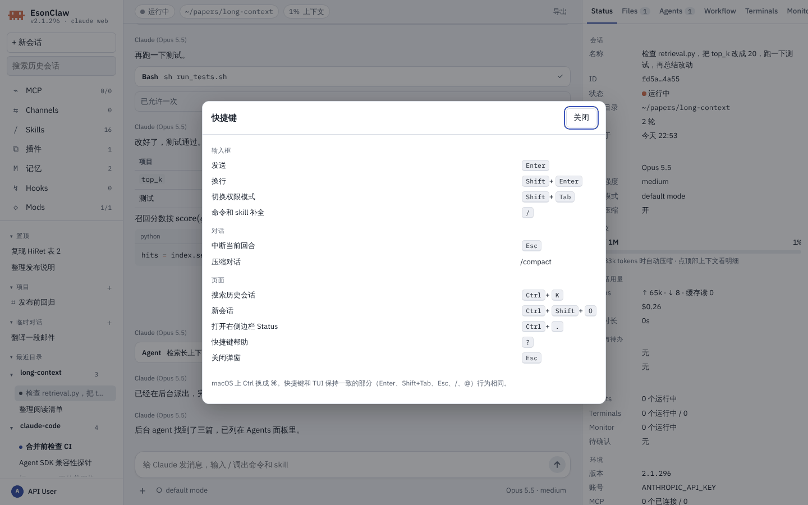

| 位置 | 按键 | 作用 |
| --- | --- | --- |
| 输入框 | `Enter` / `Shift+Enter` | 发送 / 换行；回合进行中按 `Enter` 也能发，消息先标“排队中”，模型在工具调用之间读到 |
| 输入框 | `Ctrl+Enter` | 回合进行中立即发送：中断当前回合（运行中的 shell 转到后台，不会被结束）并马上处理这条和已排队的消息，等同排队消息下方的“立刻发送” |
| 输入框 | `Shift+Tab` | 切换权限模式 |
| 输入框 | `/`、`@` | 命令和 skill 补全；`@` 列出可以直接发消息的任务和 agent、ChatGPT 登录时的 Codex 应用（`@codex-app:<name>`）和工作区文件；`↑` `↓` 选择，`Enter` 或 `Tab` 补全，`Esc` 关闭 |
| 输入框 | 空输入框里 `↑` / `↓` | 调出之前发过的消息，再往前是终端里在同一目录输入过的（与 CLI 共用 `~/.claude/history.jsonl`） |
| 对话 | `Esc` | 回合进行中时中断；排队中的消息连同图片放回输入框 |
| 审批 | `1`–`3`、`↑` `↓` + `Enter`、`Esc` | 直接选一项、移动后确认、拒绝 |
| 页面 | `Ctrl+K` | 搜索历史会话，每个匹配的会话列一行（窄屏时先打开左侧抽屉） |
| 页面 | `Ctrl+Shift+O` | 新会话 |
| 页面 | `Ctrl+.` | 打开右侧 Status |
| 页面 | `?` | 快捷键帮助 |
| 弹窗、菜单 | `Esc` | 关闭最上层的菜单或弹窗，焦点回到打开它的按钮；弹窗里 `Tab` 只在弹窗内循环 |
| 右键菜单 | 菜单上标的字母 | 见“左侧栏” |
| 文件预览 | `Esc`；PDF 里 `←` `→` | 关闭预览；翻页 |

其他鼠标操作：

| 操作 | 作用 |
| --- | --- |
| 用户消息上的“↶ 回退” | 回退到这条消息之前（只回退对话，或连文件改动一起还原，并显示还原了几个文件），原消息放回输入框；只出现在引擎能回退的消息上（本地命令、回合中途发的消息和压缩前的消息没有） |
| 回复下方的 复制 / 重试 / 从这里分支 / 回退 | 复制这条回复；重发上一条提示（带原来的图片）；从这里分出一个新会话；回退到这条回复对应的提示之前 |
| 顶栏“上下文” | 上下文分类明细和自动压缩阈值，可以立即 `/compact` |
| 顶栏“导出” | 把当前对话存成 Markdown，或用浏览器打印成 PDF |
| 输入框下方左边 / 右边 | 权限模式菜单 / 模型和思考强度菜单 |
| 左中、中右两栏之间 | 拖动，或聚焦后按 `←` `→`，调整左栏 / 右栏宽度，双击恢复默认；刷新后保留 |
| 输入 `/model` `/effort` `/stats` `/usage` `/cost` `/config` `/theme` `/mcp` `/hooks` `/plugins` `/memory` `/skills` `/keybindings` | 不发给模型，直接打开页面里对应的菜单或弹窗 |
| 输入框左边“+” | 上传文件、添加图片、使用 skill、引用工作区文件 |

## 实际输出

一轮里的思考和工具调用折叠成一行“步骤”（改文件的卡片不折叠，diff 照常显示），点开看每一步。对话里还会插入一行行事件：hook 拦截、其他会话发来的消息、Channel 消息（带来源标记）、定时任务触发、mod 日志、后台命令或 workflow 结束、API 重试状态、agent 交回结果或退出；Claude 用 SendMessage 发给任务时显示为“发送给 <任务>”。这些行刷新页面后都还在。

每轮回答下面列出这一轮读过的网页来源（WebSearch、WebFetch 和 deep-research workflow 引用的链接，只保留 http / https）。`/compact` 和 `/recap` 在对话里折叠成一行。TodoWrite 或 TaskCreate / TaskUpdate 建的待办固定在输入框上方，显示“待办 1/2”和正在做的那一项；两项之间显示“下一项：…”，全部做完才显示“全部完成”。

导出的 Markdown 带工具调用摘要和来源列表；打印成 PDF 时去掉侧栏和输入框。

`claude web --dangerously-allow-local-network` 启动时额外打印每个局域网地址的登录链接，并在 stderr 给出警告：

```text
Claude web UI: http://127.0.0.1:33777/?token=…
  on your network: http://192.168.1.20:33777/?token=…
Sessions start in ~/.claude/web/workspace and run with your local credentials and full access to this machine. Press Ctrl+C to stop.

WARNING: --dangerously-allow-local-network is on.
Anyone on your local network who gets the URL above can run commands on this machine as you.
Connections from loopback, private (RFC 1918), link-local, CGNAT and ULA addresses are accepted; others are refused.
Traffic is plaintext HTTP: others on the same network can read it, including the token. Use --tls-cert/--tls-key to encrypt it.
```

## 命令行参数

```text
claude web [--port <n>] [--host <ip>] [--workspace <dir>] [--no-open]
           [--idle-timeout <ms>] [--max-sessions <n>]
           [--dangerously-allow-local-network] [--trusted-host <host>...]
           [--tls-cert <file> --tls-key <file>] [--preview-origin <url>...]
```

| 参数 | 默认值 | 作用 |
| --- | --- | --- |
| `--port <n>` | 上次的端口（第一次随机） | 监听端口；不指定时沿用上次运行的端口，被占用时随机；`0` 表示随机 |
| `--host <ip>` | `127.0.0.1` | 绑定地址；loopback，或者同时加 `--dangerously-allow-local-network` 时的局域网地址 |
| `--workspace <dir>` | `~/.claude/web/workspace` | 新会话默认的工作目录 |
| `--no-open` | 打开浏览器 | 只打印地址（SSH 会话里自动不打开） |
| `--idle-timeout <ms>` | `600000`（10 分钟） | 没有标签页连着的会话多久后结束；`0` 表示不结束 |
| `--max-sessions <n>` | `8` | 同时运行的会话上限；`0` 表示不限 |
| `--dangerously-allow-local-network` | 关闭 | 监听所有网卡，接受局域网来源的连接；token 登录仍然需要 |
| `--trusted-host <host>` | 无 | 额外接受的 Host 头（可重复），例如反向代理或自定义域名 |
| `--tls-cert <file>` / `--tls-key <file>` | 无 | PEM 证书和私钥，必须同时给；给了以后只走 https / wss，cookie 加 `Secure` |
| `--preview-origin <url>` | 无 | 预览栏还可以在框架里显示的 http(s) 来源（本机 loopback 上的开发服务器默认就能预览） |

Ctrl+C 或 SIGTERM 会停止服务、结束所有会话并删除 `~/.claude/web.lock`。

## 安全模型

- **登录**：启动时生成一次性随机 token，`/?token=…` 校验通过后换成 HttpOnly、`SameSite=Strict` 的签名 cookie，再重定向去掉 token。签名密钥和上次的端口存在 `~/.claude/web/server.json`（权限 0600），所以重启 `claude web` 后已登录的标签页继续可用；两者和 cookie 一样 7 天后过期，届时重新生成，需要重新登录；删掉这个文件就让所有浏览器重新登录。token 每次启动重新生成。没有 cookie 的页面请求返回 401 和“请打开终端里打印的地址”。
- **Host 和 Origin**：只接受本机名字（加上 `--trusted-host`，局域网模式下再加本机的局域网地址）作为 Host，防 DNS rebinding；会改状态的请求和所有 WebSocket 握手必须带同源 Origin，`Sec-Fetch-Site: cross-site` 一律拒绝。
- **来源地址**：任何模式下都只服务 loopback 和局域网来源（RFC 1918、链路本地、CGNAT、IPv6 ULA），其他地址直接 403。
- **局域网访问**：必须在启动时加 `--dangerously-allow-local-network`，网页里不能打开。局域网里拿到地址的人就能以你的身份在这台机器上跑命令；没有 TLS 时流量（包括 token）是明文。
- **CSP**：`script-src 'self'`，不允许内联脚本和外部来源，`frame-ancestors 'none'`，并加 `nosniff`。服务端未捕获的错误只返回纯 JSON 500，不暴露源码和路径。
- **文件 API**：只给出本会话上传目录、会话工作目录里的文件和这个会话的工具读写过的文件，符号链接解析后再判断；claude 配置目录（`~/.claude/web` 除外）和 `.env`、`*.pem`、`*.key`、`.credentials.json` 等凭据文件永远不给。HTML、SVG、JS 一律按纯文本返回，不会作为本站页面执行。
- **账号接口**：`GET /api/account` 不返回 key，只返回末 4 位；Base URL 只接受不带账号、查询串和片段的 http / https 地址。
- **MCP Apps**：MCP 工具的 `ui://` 页面跑在沙箱 iframe 里（不透明 origin，读不到本站 cookie 和 API），未在资源里声明 CSP 时不能联网；页面只能调用同一个 server 的工具，只给页面用或只读的工具直接执行，其他先确认。
- **会话权限**：网页里的会话和终端里一样走权限确认；以 root 运行（没有 `IS_SANDBOX`）时不提供 bypass 模式。打开浏览器的子进程不继承 API key 等环境变量。

## 体积

页面在构建时打包进 CLI 和单文件二进制（`scripts/build-web.mjs` 生成 `web/dist/assets.json`），运行时不读磁盘。shiki 语法、KaTeX、Mermaid、pdf.js、mammoth、exceljs 都按需加载。`make release-check` 会运行 `scripts/check-web-size.mjs`，嵌入的资源超过预算时失败。

## 已知限制

- 工具卡片不显示耗时（stream-json 里没有这个字段）。
- Terminals 不列 Cron 任务；主会话开的终端显示“主会话”。
- 设置的用量页没有首 token 延迟和重试次数。
- macOS 上 API key 存进登录钥匙串，所以 e2e 在 macOS 上跳过账号用例。

完整设计见 [设计文档](../design/claude-web.md)，交互原型在 [`docs/design/claude-web-demo.html`](../design/claude-web-demo.html)（下载后用浏览器打开，数据都是示例）。

截图来自 `make build` 产出的 `./built-claude`，在 1440×900（手机图为 390×844）的 Chromium（Playwright）里实际操作得到，HOME 是临时目录；模型请求打到本地脚本化的假 Messages API（同 `src/web/web.binary.test.ts`），所以画面里的回复不代表真实模型输出，临时目录路径保留原样。
