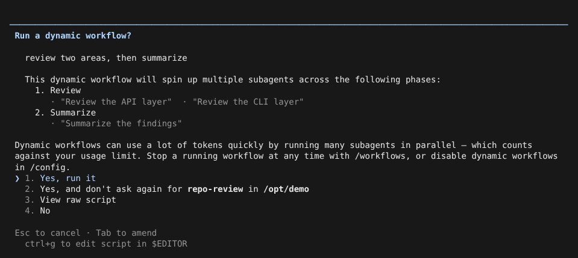
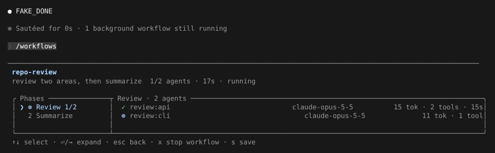
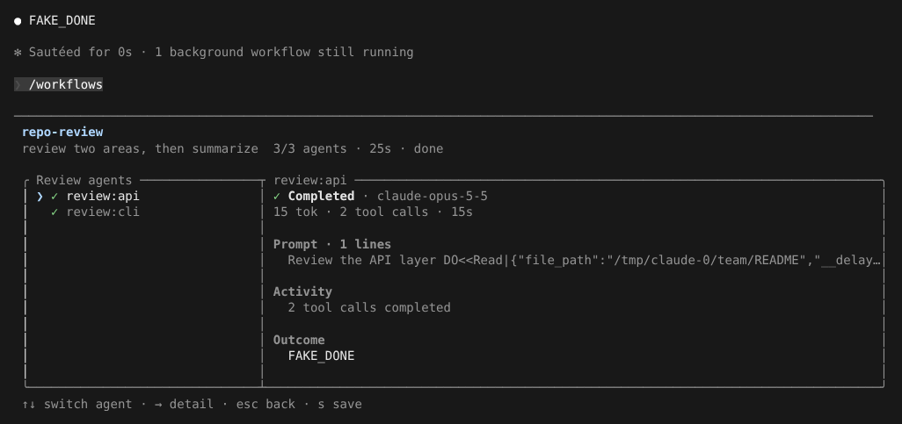

# Dynamic Workflow

> 英文名：`workflows` · 领域：Agent 与编排 · [返回功能索引](README.md)

## 这是什么

遇到「要很多个 Agent 一起做」的大任务（例如把仓库按模块分给 10 个 Agent 审查，再汇总），一个个手动派 Agent 很麻烦。Workflow 让 Claude 先写一小段 JavaScript 编排脚本，说明分几个阶段、每个阶段并行派哪些 Agent、结果怎么汇总，然后由运行时按脚本执行：

- 运行前会让你确认，看清楚要派多少 Agent；
- 在后台运行，不占住对话；`/workflows` 里能看到每个阶段、每个 Agent 的进度；
- 结束（完成、失败或被你停止）时，主对话会收到一条通知和结果；
- 跑得好的脚本可以保存成命名 workflow，下次按名字直接用。

脚本格式和官方 Workflow 兼容（不是 Anthropic 的官方实现）。

## 什么时候用

- 一个任务可以拆成很多份相同的工作，适合并行（批量审查、批量迁移、多角度调研）。
- 有明确的先后阶段：先并行收集，再汇总；或者流水线式逐步加工。
- 同一套流程以后还会反复跑。

只需要一两个 Agent 时直接用 [Agent](agents.md) 更省事。注意：Workflow 会同时跑很多 Agent，token 消耗增长很快。

## 用起来是什么样

你不用自己写脚本，告诉 Claude 你想怎么分工即可（也可以在提示里带上关键词 `ultracode` 让它优先考虑用 Workflow）。下面演示一个两阶段的流程：先并行审查 API 层和 CLI 层，再汇总。

**1. 运行前确认。** Claude 写好脚本后会弹出确认框，列出流程名、说明和阶段：



| 选项 | 作用 |
| --- | --- |
| Yes, run it | 运行 |
| Yes, and don't ask again for `<名字>` in `<目录>` | 运行，并且在这个目录里以后同名 workflow 不再询问 |
| View raw script | 查看完整脚本 |
| No | 不运行 |

确认框里还可以按 `Tab` 补充修改意见，`Ctrl+G` 用 `$EDITOR` 直接改脚本。

**2. 在后台运行。** 确认后对话立刻空出来，提示框下方多一行运行状态：

```text
✻ Sautéed for 0s · 1 background workflow still running

────────────────────────────────────────────────────────────────────────────────────────────────────────────────────────
❯ 
────────────────────────────────────────────────────────────────────────────────────────────────────────────────────────
  2 local agents · ctrl+x ctrl+k to stop agents · ↓ to manage
    ◯ repo-review  review two areas, then summarize                               running  0/2 agents  3s · ↓ 0 tokens
```

**3. 用 `/workflows` 看进度。** 左边是阶段，右边是当前阶段的 Agent，带模型、token、工具调用次数和耗时：



选中一个阶段按 `→`（或 Enter）进入，再选一个 Agent，能看到它收到的提示、做了什么、最后的结果：



**4. 结束时收到通知。** 主对话里出现一条完成通知，Claude 会根据结果继续回复；状态行变成 `done`：

```text
● Dynamic workflow "review two areas, then summarize" completed

● FAKE_DONE

  ? for shortcuts · ↓ to manage
    ◯ repo-review  review two areas, then summarize                                done  3/3 agents  25s · ↓ 45 tokens
```

**5. 保存成命名 workflow。** 在 `/workflows` 面板里按 `s`，确认名字后保存。`Tab` 在两个位置之间切换：

```text
  Save dynamic workflow
  Project scope · .claude/workflows/repo-review.js

  Save as:

  > repo-review

  enter to save · tab to toggle scope · escape to cancel
```

| 范围 | 保存位置 | 谁能用 |
| --- | --- | --- |
| Project scope | `<项目>/.claude/workflows/<名字>.js` | 这个项目 |
| User scope | `~/.claude/workflows/<名字>.js` | 你的所有项目 |

之后让 Claude 按名字运行（工具调用是 `Workflow({ name: "repo-review" })`），同样会先弹确认框。仓库里的 `docs/workflows/` 也会被当作 workflow 来源。

## /workflows 面板按键

| 按键 | 作用 |
| --- | --- |
| `↑` / `↓` | 选择阶段或 Agent |
| `→` / Enter | 展开 |
| `Esc` | 返回上一层 |
| `x` | 停止正在运行的 workflow |
| `s` | 保存为命名 workflow |

提示框下方状态行按 `↓` 可以打开后台任务列表，单独查看或停止某个 Agent；`Ctrl+X Ctrl+K` 停止所有 Agent。

## 开关与设置

默认开启（Pro 计划默认关闭）。在 `/config` 的 “Dynamic workflows” 里切换，或者：

| 设置 | 位置 | 值 | 说明 |
| --- | --- | --- | --- |
| `enableWorkflows` | settings.json | `false` | 关闭；关闭后模型拿不到 Workflow 工具（`Error: No such tool available: Workflow`） |
| `disableWorkflows` | settings.json | `true` | 同上 |
| `CLAUDE_CODE_DISABLE_WORKFLOWS` | 环境变量 | `1` | 同上 |
| `CLAUDE_CODE_WORKFLOWS` | 环境变量 | `0` 关闭 / `1` 开启 | `1` 让 Pro 计划也默认开启；显式关闭的设置仍然优先 |
| `workflowSizeGuideline` | settings.json 或 `/config` 的 “Dynamic workflow size” | `small` / `medium`（默认，Pro 为 `small`）/ `large` / `unrestricted` | 告诉 Claude 每次大概派多少 Agent（`medium` 约 10 个以内）。只是建议；硬上限是每次运行最多 1000 次 `agent()` |
| `ultracodeKeywordTrigger` | settings.json | `true`（默认）/ `false` | 提示里出现 `ultracode` 时是否触发 |
| `workflowKeywordTriggerEnabled` | settings.json | `true` / `false` | 同上，优先级更高 |
| `skipWorkflowUsageWarning` | settings.json | `true` | 不再显示用量提醒 |
| `autoContinueAtUsageLimit` | settings.json | `true`（默认）/ `false` | claude.ai 订阅用户的 Agent 撞到用量上限时，工作流暂停到额度重置后自动重跑这些 Agent；`false` 时这些 Agent 直接失败 |

## 脚本长什么样（给想自己写的人）

```js
export const meta = {
  name: 'repo-review',
  description: 'review two areas, then summarize',
  phases: [{ title: 'Review' }, { title: 'Summarize' }],
}

phase('Review')
const notes = await parallel([
  () => agent('Review the API layer', { label: 'review:api' }),
  () => agent('Review the CLI layer', { label: 'review:cli' }),
])

phase('Summarize')
return await agent('Summarize the findings', { label: 'summary' })
```

- 第一条语句必须是 `export const meta = { ... }`，而且是纯字面量（不能有变量、计算、展开、模板插值）；`meta.name` 就是运行名和保存时的文件名。
- 可用的全局函数：`agent`（派一个 Agent 并等它结束）、`parallel`（并行跑一组）、`pipeline`（流水线）、`phase`（标记阶段）、`workflow`（调用另一个 workflow，只能嵌套一层）、`log`、`args`、`budget`。
- 只写纯 JavaScript（不支持 TypeScript 语法）。脚本只负责编排；读写文件、执行命令交给 Agent。不要用 Node 的文件 / shell API、动态 import、`Date.now()`、`Math.random()`、`eval`、`Function`、WebAssembly，否则无法可靠地恢复运行。
- 除了脚本，也可以传 `{ scriptPath }`（脚本文件）、`{ name }`（已保存的 workflow）或 `{ plan }`（声明式计划）；同时给出时优先级是 `scriptPath > name > script > plan`。

## 暂停、恢复与失败

- 运行过程会记日志（journal）。用 `resumeFromRunId` 重新运行时，已经完成的 Agent 直接复用结果，只重跑改动过或没跑完的部分。
- 支持暂停 / 恢复，以及对失败的步骤跳过或重试；暂停时不会发终态通知。
- 完成、失败或被 `TaskStop` 停止时，主对话收到一条通知，带 token / 工具用量、耗时和输出文件；已经完成的分支结果会保留。对已经结束的运行再次执行不会重复启动。
- `agent()` 会一直等到那个 Agent 真正结束，即使它被路由到后台或被你切到后台。

## 已知问题

- 确认框里按阶段列出的 Agent 提示会归错阶段，并且多包了一层引号（上图中 `'Summarize the findings'` 出现在第 1 阶段 Review 下）。
- 实现的完整验收记录见 [生命周期验收](../../docs/research/workflow-agent-lifecycle-validity-20261009.md)。

## 说明

画面来自实际运行，模型回复由测试用假 API 生成（`FAKE_DONE`；脚本里 Agent 提示中的 `DO<<…>>` 是让假 API 调用工具、制造耗时的指令）。
