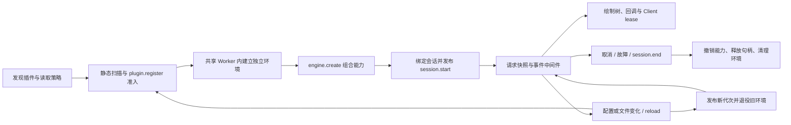

# Mods 实现、提交、文档与生命周期复核

日期：2026-10-07。结论：已形成可运行的 Mods 宿主，所选核心生命周期和已接通远程路径表现稳定，但尚未达到完整官方兼容；当前不能认定整体与官方一样顺畅。提交附带文档较及时，汇总文档存在滞后和重复。

当前状态（2026-10-08）：[取消与缺口复核](mods-cancellation-audit-292-20261008.md) 重新区分固定构建与当前结果。`6b13695` 已接通四类 Pane 控制，`cd276f7` 已接通滚动；余下三类仍缺。该报告里的八类 Unsupported、274/282 和 host callback 25/1 是 `005fae9` 当时的证据，保留原结果，不作为后续版本的结论。取消修复及全量 UI/diff 的验收边界见新报告。

## 范围与版本

- 基线 HEAD：`005fae9c507b5e3c511cea65ded62daaef20beda`。检查分别标记干净 HEAD、当前工作区和历史专项，不把工作区的大量未提交改动算入 HEAD。
- 本地版本：`2.1.280`；官方 registry latest 本次核实为 `2.1.292`。在线 reference 仍标注 as of `2.1.290`，实际安装版本的生成声明优先。[官方包元数据](https://registry.npmjs.org/@anthropic-ai/claude-code/latest)、[官方接口参考](https://code.claude.com/docs/en/plugins/mods/reference)。
- 使用仓库的 claude-source-binary-analysis 与 claude-runtime-debug 工作流，未修改产品代码。文档整理归入同一个未发布版本。
- 证据根：`/private/tmp/mods-review-20261007-QQGSW6`。官方固定制品 SHA-256：`97a01e5bc74a199e67189435d0331ea3a24eac2e07db4b76d9148c5b0386138f`；本次测试制品 SHA-256：`c20485034c67e9c73ffce301e248325b1ac959687a53c6ca78a47df0eff2b16d`。
- 本次 `make build CLAUDE_CODE_BUILD_DIR=.../build` 使用私有输出目录。上述 hash 对应添加最终复核说明之前的测试制品，不能当作随后文档更新后的新制品身份。

## 原理与生命周期

Mods 是 Plugin 中的函数中间件：manifest 负责身份/配置，`hooks/hooks.json` 指向导出 `register(on, options)` 的模块；事件运行时才提供 `$`、`e`、`next`。Hook 可以观察、改写或回答，`next(e)` 会实际执行后续链与核心行为。链由 prepend、user、append、builtin 到 core，结果反向返回；普通 hook 在 next 前失败时跳过，next 完成后的失败不应重复执行副作用，`.catch` 提供单独恢复逻辑。[官方事件与失败规则](https://code.claude.com/docs/en/plugins/mods/events)。

本地直接调用链与状态检查：

| 阶段 | 实现与观察 | 本次结论 |
| --- | --- | --- |
| 发现、信任与来源筛选 | `session.ts` 的 bind/reconcile → `plugins.ts` → `loader.ts`，区别 inline/managed/builtin，宿主服务在 bind 后可用 | 已接线，session/runtime 回归覆盖 |
| 扫描与能力构造 | `runtime.ts` admit/reconcile/publish；`environment.ts` 与 `worker.ts` 建环境和桥；engine.create 组合 `$` | 已接线；静态声明仍宽于当前生产能力 |
| 调用与快照 | `dispatch.ts` 固定 tier 顺序；`runtime.ts` capture 引用计数保留进入时的 activation 与能力表 | provider 热更期间的旧请求/新请求边界回归通过 |
| 热更 | session watcher 150ms 合并；作者修改有轮次边界；新候选准入/发布后退役旧版，加载失败可保留旧版，策略拒绝撤销旧版 | 所选 reload/拒绝/计时器/恢复回归通过；没有本轮全终端热更帧验收 |
| 绘制 | 原生 render site 与远程 renderer 保留 lease；新树发布后失效旧句柄，替代绘制与卸载取消旧请求 | 远程同输入实测通过；完整终端交互仍需独立验收 |
| 取消 | 父 turn、调用局部信号、activation 生命周期分别传递；stream 有界收尾与结果结算 | 仍有一项 host callback 取消回归失败 |
| 故障 | 独立 Worker 心跳与归因、撤销故障代能力、重建幸存模块、未知崩溃阈值；Client fault 按 owner 观察并最多失效一次 | Client 远程故障/串行/取消/失效同输入实测通过；未重新覆盖全部 CPU/故障组合 |
| 结束 | session.end/roster 移除 → disposer → watcher/订阅/环境清理；EOF 等待在途控制 | 两侧正常 EOF 退出，自有 pane/server/HTTP 清理通过 |

热更会再次执行 register，普通闭包状态不能当作持久化；需要跨重载状态时使用 state/store。作者模式的 Enable/Not now 和轮次结束加载有独立生命周期，不能用普通文件 watcher 代替。[官方创建与重载说明](https://code.claude.com/docs/en/plugins/mods/create)。

## 基线已确认问题与优先顺序

1. **优先接通剩余 SDK 控制。** `src/services/mods/remoteUiControl.ts:17` 的路由表只有十类控制，其他合法 subtype 落入 `src/cli/print.ts` 的 Unsupported 分支。此次官方与新构建同输入验证八个缺口，影响远程 prompt 编辑/补全、Pane 管理、滚动和焦点；具体回执见下一节。这是运行时差异，不只是类型缺失。
2. **取消回归仍红。** `src/services/mods/runtimeHostHooks.test.ts` 的 `trusted stream callback nested work pauses budget and inherits abort` 期望 `cancel stream callback`，实际为 `The operation was aborted.`。干净 HEAD 与工作区都复现 25 pass / 1 fail。待定位 `dispatchModStream`、hostCallbackFacade 和共享 AbortSignal 的竞态/原因传递；本轮没有将其直接推断为所有外部 hook 的取消失败。
3. **作者声明覆盖仍大于生产能力。** `runtime.ts` 的 coreHost 和 `loader.ts` 的 supportedCalls 仍缺 ui.notice/ask、audio.play/speak、mcp.connect、session.compact/send/append、command.run、process.spawn、telemetry.log/mark 共十二项公共方法。已有 session.compact/command.run 事件或 testing 驱动不能代替作者 `$` 方法；Privacy Mode 禁止外送的要求继续保留。
4. **提交与工作区的 UI 结论不能混用。** [diff 292 专项](mods-shipped-diff-292-20261007.md) 明确记录独立归档候选在 160/140 列的边框位置与官方不同，完整工作区的四阶段一致依赖未提交 UI。当前新构建的 SDK 局部通过没有关闭真实 diff 全帧、全部键鼠和浏览器 Client 执行生命周期。
5. **汇总文档有陈旧状态。** 复核前 mods-parity 仍以 287/289/290 为主，未出现 292；README 同时说明间接依赖类型根已生成，又写“仍待实现”。历史 claude-mods 明确冻结在 272，其旧结论应保留为历史，不能作为当前能力判断。

## 当前新制品与官方的实际控制对照

使用上一次 Client 故障专项的自包含 driver，新增八项合法控制请求；两侧使用相同 driver、fixture 和输入，并保留原始回包，不把整体 stdout 泛化为相同。只有生成 ID、隔离 cwd 和按 owner/element 对应的不透明句柄做限定规范化。

| 控制 | 官方 2.1.292 的 response | 本地新构建 |
| --- | --- | --- |
| ui_prompt_edit | `{"text":"draft","cursor":5}` | Unsupported |
| ui_prompt_autocomplete | `{"suggestions":[],"start":0}` | Unsupported |
| ui_panes | 空 panes，shown/focused/requested 为 null | Unsupported |
| ui_pane_show | `{"shown_id":null}` | Unsupported |
| ui_pane_focus | `{"focused_id":null}` | Unsupported |
| ui_close | `{"closed":true}` | Unsupported |
| ui_scroll | moved=false，offset=0，deny="no such site" | Unsupported |
| ui_focus | moved=false，element=null，deny="no such site" | Unsupported |

两侧各 111 条控制回执、91 条插件事件；282 项比较中 274 通过、8 项差异，全部差异就是上述八类。原有 render、句柄替换、过时 Client、消息串行、取消、故障观察与单次 ui_invalidate 的比较未新增失败。两侧 EOF 正常退出0，模型 POST 数为0，自有 pane/server/HTTP/request threads 均清理，制品和夹具校验保持不变。

原始记录：`native-official-review2/evidence/result.json`、`native-candidate-review1/evidence/result.json`；比较为 `native-comparison-pair.json`。默认工具沙箱禁止 localhost bind，首次驱动在开始前失败；授权的扩展执行仍用子进程沙箱禁止外网、真实 ~/.claude、Keychain 和临时范围外写入。失败启动日志保留，未算作产品回归。

## 提交与文档及时性

检查截至该 HEAD 的最近60个提交，以是否改动 `src/services/mods/` 作为筛选条件，得到35个提交：35个同步 CHANGELOG，34个同步 README，27个同步专项研究文档，没有完全缺文档的 Mods 提交。唯一没有 README 的 `add6514` 属于测试 mock 启动时间修正；这组计数只评估样本，不覆盖完整仓库历史，也不能证明文档内容全部正确。逐提交文件表为证据根的 `mods-commit-docs.json`。

最新 `005fae9`、`d3b3131`、`2cd6cb4`、`4c40736`、`6c5e93e` 均有针对相应控制路径的说明和专项。它们明确披露剩余控制、已有失败及 full-suite/UI/G5 边界，及时性较好。主要维护问题是逐批记录堆叠，而当前总表缺少统一更新。

本次文档处理：

- CHANGELOG 原77个十月栏目与九月三十日 v2.1.280 汇总合并为一个未发布条目；1567行原始条目完整存入[历史详细记录](../archive/implementation-records/changelogs/2026-10-07-v2.1.280-details.md)。九月十九日及更早部分逐字不变。
- 根条目保持四个标准章节，按能力归纳最终行为、准确提交边界与未完成验收，不把已被后续修复替代的旧状态写成当前状态。
- README 纠正间接依赖类型根的矛盾说明；mods-parity 增加本次292复核，旧矩阵明确保留为历史。

## 本次检查与限制

| 检查 | 结果 |
| --- | --- |
| session/runtime/remote fault/client/render/control/SDK schemas 七文件 | 232 pass / 1 skip / 0 fail，1317 expect |
| 工作区 host hooks | 25 pass / 1 fail，165 expect |
| 干净 HEAD host hooks（git archive 005fae9） | 25 pass / 1 fail，164 expect |
| 本次 make build，私有输出目录 | exit0 |
| 官方/新构建原生 stream-json 对照 | 两侧 exit0；274/282 比较通过，八类缺失控制差异保留 |
| 整理后的 CHANGELOG 格式与解析测试 | 格式通过；5 pass / 0 fail |
| 整理后的 make release-check | exit0，含 TypeScript、严格 Mods 控制类型、lint、missing audit 与 diff 检查；不包含全部 Mods 功能回归 |
| 整理后的最终 make build 与 --version | exit0，版本 2.1.280；制品 SHA-256 `fcfbc8a9b69561ec932f60fde554050c55a4d555e968c6374a065532c9e391ba`，独立于前述 SDK 测试制品 |

唯一 skip 是可选官方 agents-md/telemetry fixture。测试日志分别为 `lifecycle-ui.log`、`host-hooks.log`、`head-host-hooks.log`、`build.log`。没有重跑全量 WIP、完整 G5、全终端 logical/physical frames、浏览器 Client 或所有跨平台/模型/Agent 故障组合；本次结论是有限范围审查，不是完整发布放行。后续优先补八类远程控制及 responder/system 生命周期，解决取消回归，再用已提交候选验证完整 diff/终端手感。
